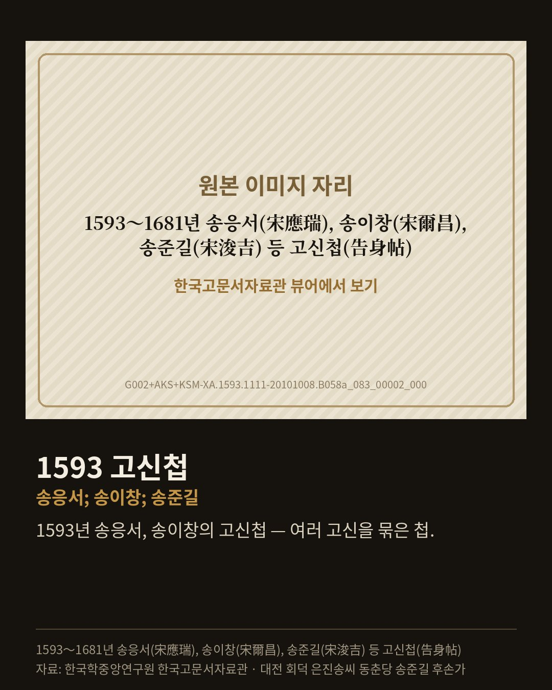
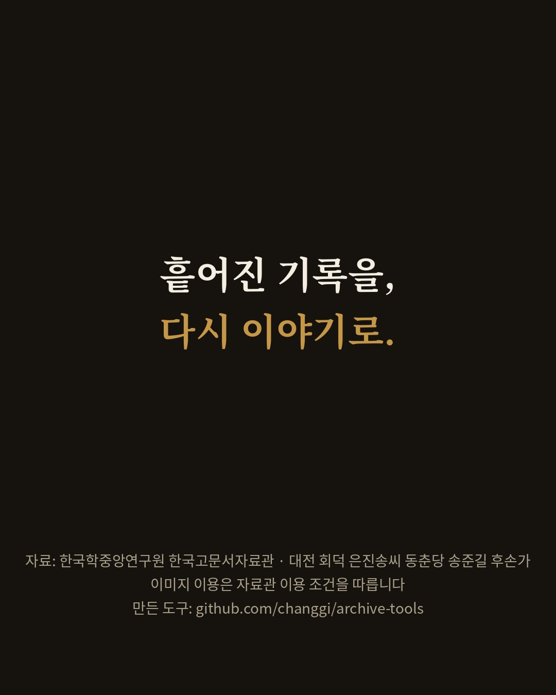

# 송준길의 기록으로 본 생애

대전 회덕 은진송씨 동춘당 송준길 후손가 · ③ 에디팅 전 — 자동 캡션 초안 그대로. 첩(帖)에 든 낱장 문서는 서버가 첩 전체 이미지를 똑같이 주므로 첩당 하나만 선별

- 🌐 [전시 웹페이지](https://changgi.github.io/archive-tools/examples/dongchundang-songjungil/exhibit.html) · [수업 활동지](https://changgi.github.io/archive-tools/examples/dongchundang-songjungil/handout.html)
- 카드뉴스: [`cards/`](cards/) · SNS 글: [`sns.txt`](sns.txt) · 에디팅 결과: [`selection.csv`](selection.csv)

| 표지 | 1번 카드 | 마무리 |
|---|---|---|
|  |  |  |

<!-- CURATOR -->
## 비하인드 — 큐레이터 노트

- **왜 이 문서들인가** — 같은 소장처에서 한 인물(송준길)의 생애를 문서로 따라갈 수 있는지 시험하려고 골랐습니다.
- **전하고 싶은 것** — 한 사람의 일생은 남긴 문서의 순서로도 그려진다는 것.
- **이렇게 보이길 바랐다** — 가문의 기록에서 시작해 혼사·위로 편지까지, 공적인 얼굴과 사적인 얼굴을 함께 보여 주었습니다.
- **이렇게 써 주세요** — 인물사 탐구, '문서로 쓴 전기' 만들기 활동에 쓰세요.
- **만들며 있었던 일** — 같은 소장처로 '테마'와 '인물' 두 방식의 큐레이션을 비교해 보려는 실험이었습니다. 처음에는 문서명으로 캡션 초안만 만들었고, 뒤에 원문 전문 판독(v0.3.6)과 원문 해석(v0.4.0)을 더해 지금 모습이 되었습니다.
- **남겨 둔 질문** — 문서에 남지 않은 송준길의 모습은 무엇일까요?
- **제작 기록** — 문서 6건 · 1593–1671년 · 원본 사진 146면(문서 전체) · 원문 판독 6건 · 번역 6건 · 못 읽은 글자 □ 0 · 불확실 (?) 3

전문: [`curator.md`](curator.md)
<!-- /CURATOR -->

## 선별 문서 (6점)

| # | 연도 | 유형 | 문서명 | 원본 |
|---|---|---|---|---|
| 1 | 1593 | 고신첩 | 1593〜1681년 송응서(宋應瑞), 송이창(宋爾昌), 송준길(宋浚吉) 등 고신첩(告身帖) | [원본 보기](https://archive.aks.ac.kr/viewer/viewer.do#imgnode.do?itemId=book&gubun=booktree&depth=6&upPath=01%5E0130%5EL013001%5EL013001F02%5EL013001F0201&dataId=G002%2BAKS%2BKSM-XA.1593.1111-20101008.B058a_083_00002_000&itemType=) |
| 2 | 1657 | 교지첩 | 1657〜1662년 송준길(宋浚吉) 교지첩(敎旨帖)－1 | [원본 보기](https://archive.aks.ac.kr/viewer/viewer.do#imgnode.do?itemId=book&gubun=booktree&depth=6&upPath=01%5E0130%5EL013001%5EL013001F02%5EL013001F0201&dataId=G002%2BAKS%2BKSM-XA.1657.1111-20101008.B058a_083_00001_000&itemType=) |
| 3 | 1660 | 비답첩 | 1660〜1670년대 송준길(宋浚吉) 비답첩(批答帖) | [원본 보기](https://archive.aks.ac.kr/viewer/viewer.do#imgnode.do?itemId=book&gubun=booktree&depth=6&upPath=01%5E0130%5EL013001%5EL013001F02%5EL013001F0201&dataId=G002%2BAKS%2BKSM-XA.0000.1111-20101008.B058a_083_00004_000&itemType=) |
| 4 | 1660 | 납폐서 | 1660년 송준길(宋浚吉) 납폐서(納幣書) | [원본 보기](https://archive.aks.ac.kr/viewer/viewer.do#imgnode.do?itemId=book&gubun=booktree&depth=6&upPath=01%5E0130%5EL013001%5EL013001F02%5EL013001F0206&dataId=G002%2BAKS%2BKSM-XF.1660.3023-20101008.B058a_083_00322_XXX&itemType=) |
| 5 | 1670 | 유서첩 | 1670〜1671년 송준길(宋浚吉) 유서첩(諭書帖) | [원본 보기](https://archive.aks.ac.kr/viewer/viewer.do#imgnode.do?itemId=book&gubun=booktree&depth=6&upPath=01%5E0130%5EL013001%5EL013001F02%5EL013001F0201&dataId=G002%2BAKS%2BKSM-XA.1670.1111-20101008.B058a_083_00003_000&itemType=) |
| 6 | 1671 | 위장 | 1671년 송준길(宋浚吉) 위장(慰狀) | [원본 보기](https://archive.aks.ac.kr/viewer/viewer.do#imgnode.do?itemId=book&gubun=booktree&depth=6&upPath=01%5E0130%5EL013001%5EL013001F02%5EL013001F0206&dataId=G002%2BAKS%2BKSM-XF.1671.3023-20101008.B058a_083_00321_XXX&itemType=) |

이미지: 한국학중앙연구원 한국고문서자료관 소장·제공. "원본" 링크를 누르면 자료관 뷰어에서 그 문서가 열립니다. 이미지를 다시 쓰려면 자료관에 문의하세요(소장처 동의 필요).
