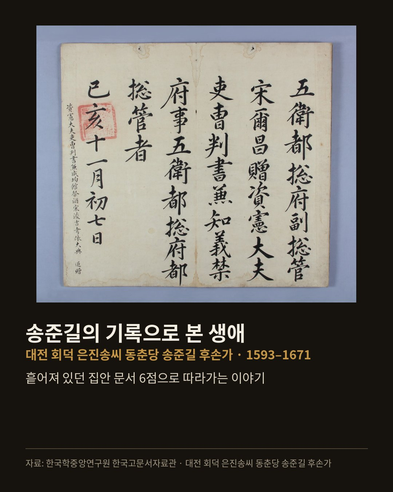

# 송준길의 기록으로 본 생애

대전 회덕 은진송씨 동춘당 송준길 후손가 · ③ 에디팅 전 — 자동 캡션 초안 그대로. 첩(帖)에 든 낱장 문서는 서버가 첩 전체 이미지를 똑같이 주므로 첩당 하나만 선별

- 🌐 [전시 웹페이지](https://changgi.github.io/archive-tools/examples/dongchundang-songjungil/exhibit.html) · [수업 활동지](https://changgi.github.io/archive-tools/examples/dongchundang-songjungil/handout.html)
- 카드뉴스: [`cards/`](cards/) · SNS 글: [`sns.txt`](sns.txt) · 에디팅 결과: [`selection.csv`](selection.csv)

| 표지 | 1번 카드 | 마무리 |
|---|---|---|
|  |  |  |

## 선별 문서 (6점)

| # | 연도 | 유형 | 문서명 | 원본 |
|---|---|---|---|---|
| 1 | 1593 | 고신첩 | 1593〜1681년 송응서(宋應瑞), 송이창(宋爾昌), 송준길(宋浚吉) 등 고신첩(告身帖) | [원본 보기](https://archive.aks.ac.kr/viewer/viewer.do#imgnode.do?itemId=book&gubun=booktree&depth=6&upPath=01%5E0130%5EL013001%5EL013001F02%5EL013001F0201&dataId=G002%2BAKS%2BKSM-XA.1593.1111-20101008.B058a_083_00002_000&itemType=) |
| 2 | 1657 | 교지첩 | 1657〜1662년 송준길(宋浚吉) 교지첩(敎旨帖)－1 | [원본 보기](https://archive.aks.ac.kr/viewer/viewer.do#imgnode.do?itemId=book&gubun=booktree&depth=6&upPath=01%5E0130%5EL013001%5EL013001F02%5EL013001F0201&dataId=G002%2BAKS%2BKSM-XA.1657.1111-20101008.B058a_083_00001_000&itemType=) |
| 3 | 1660 | 비답첩 | 1660〜1670년대 송준길(宋浚吉) 비답첩(批答帖) | [원본 보기](https://archive.aks.ac.kr/viewer/viewer.do#imgnode.do?itemId=book&gubun=booktree&depth=6&upPath=01%5E0130%5EL013001%5EL013001F02%5EL013001F0201&dataId=G002%2BAKS%2BKSM-XA.0000.1111-20101008.B058a_083_00004_000&itemType=) |
| 4 | 1660 | 납폐서 | 1660년 송준길(宋浚吉) 납폐서(納幣書) | [원본 보기](https://archive.aks.ac.kr/viewer/viewer.do#imgnode.do?itemId=book&gubun=booktree&depth=6&upPath=01%5E0130%5EL013001%5EL013001F02%5EL013001F0206&dataId=G002%2BAKS%2BKSM-XF.1660.3023-20101008.B058a_083_00322_XXX&itemType=) |
| 5 | 1670 | 유서첩 | 1670〜1671년 송준길(宋浚吉) 유서첩(諭書帖) | [원본 보기](https://archive.aks.ac.kr/viewer/viewer.do#imgnode.do?itemId=book&gubun=booktree&depth=6&upPath=01%5E0130%5EL013001%5EL013001F02%5EL013001F0201&dataId=G002%2BAKS%2BKSM-XA.1670.1111-20101008.B058a_083_00003_000&itemType=) |
| 6 | 1671 | 위장 | 1671년 송준길(宋浚吉) 위장(慰狀) | [원본 보기](https://archive.aks.ac.kr/viewer/viewer.do#imgnode.do?itemId=book&gubun=booktree&depth=6&upPath=01%5E0130%5EL013001%5EL013001F02%5EL013001F0206&dataId=G002%2BAKS%2BKSM-XF.1671.3023-20101008.B058a_083_00321_XXX&itemType=) |

이미지: 한국학중앙연구원 한국고문서자료관 소장·제공. "원본" 링크를 누르면 자료관 뷰어에서 그 문서가 열립니다. 이미지를 다시 쓰려면 자료관에 문의하세요(소장처 동의 필요).
