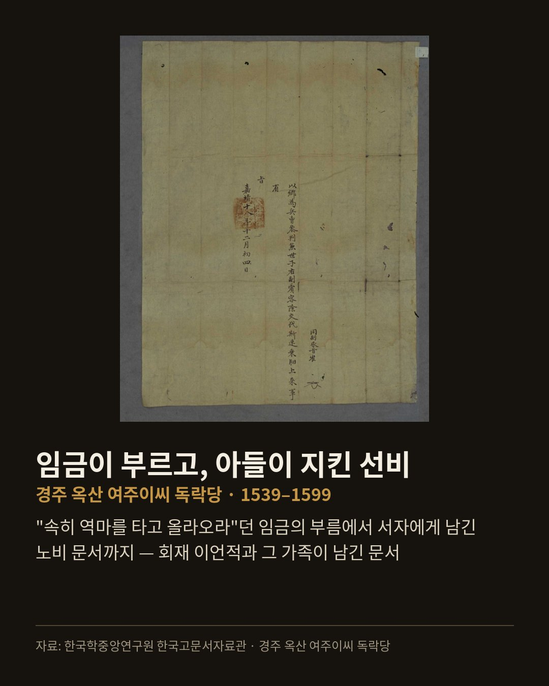
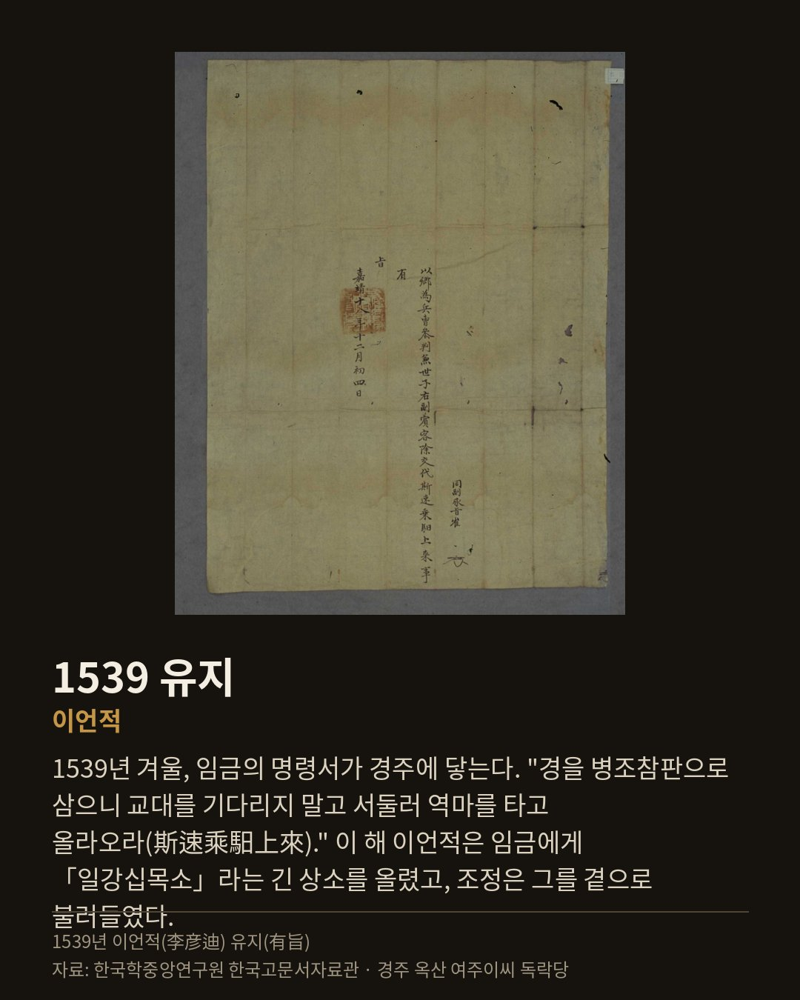
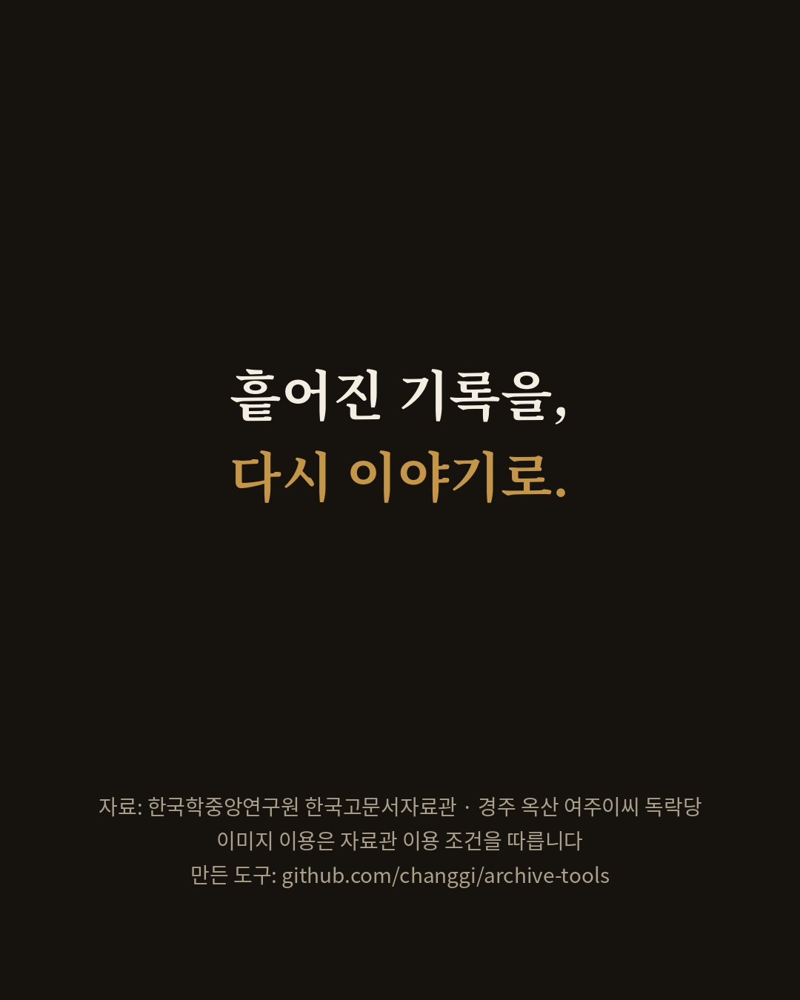

# EP.17 임금이 부르고, 아들이 지킨 선비

경주 옥산 여주이씨 독락당 (문중) · "속히 역마를 타고 올라오라"던 임금의 부름에서 서자에게 남긴 노비 문서까지 — 회재 이언적과 그 가족이 남긴 문서

- 🌐 [전시 웹페이지](https://changgi.github.io/archive-tools/examples/dongnakdang/exhibit.html) (한자 위 한글 독음 · 원문 해석) · [수업 활동지](https://changgi.github.io/archive-tools/examples/dongnakdang/handout.html)
- 🎬 영상: [릴스 9:16](https://changgi.github.io/archive-tools/examples/media/ep17-dongnakdang_reel.mp4) · [가로 16:9](https://changgi.github.io/archive-tools/examples/media/ep17-dongnakdang_wide.mp4) · 홍보 글: [`promo.md`](promo.md)
- 카드뉴스: [`cards/`](cards/) · SNS 글: [`sns.txt`](sns.txt) · 판독·해석 표: [`selection.csv`](selection.csv)

## 이야기 — 사료가 말하는 대로

임금이 "속히 올라오라"고 부른 선비는, 왜 유배지에서 생을 마쳤을까요?

> **1539 유지** — 1539년 겨울, 임금의 명령서가 경주에 닿는다. "경을 병조참판으로 삼으니 교대를 기다리지 말고 서둘러 역마를 타고 올라오라(斯速乘馹上來)." 이 해 이언적은 임금에게 「일강십목소」라는 긴 상소를 올렸고, 조정은 그를 곁으로 불러들였다.
> **1543 유서** — 4년 뒤, 임금은 그에게 고향 경상도를 통째로 맡긴다. 유서에는 이렇게 적었다. "농사와 누에치기를 권해 우리 백성을 입히고 먹이며(課農桑以衣食吾民), 억울한 일을 풀어 주라(伸理冤枉)." 임금이 본 이언적은 "덕이 안팎을 아우르고 학문이 정밀한(德涵內外 學造精微)" 신하였다.
> **1545 유지** — 1545년 정월, 새 임금 인종의 유지가 온다. 병을 핑계로 물러나려는 그에게 임금은 이렇게 썼다. "지난해 경이 올린 열 조목의 상소를 선왕께서 내게 보여 주셨고(往年卿上十條之疏 先王賜予觀焉), 서연에서 들은 경의 말이 간절하고 발라 늘 감탄했다." 그리고 내의원의 약을 함께 내려보냈다.
> **1556 소지** — 그러나 2년 뒤 그는 유배를 떠나 강계에서 숨을 거둔다. 1556년, 아내 박씨가 경주부에 소지를 올린다. "남편의 서자 이전인에게(家翁孽子李全仁亦中) 노비 두 사람을 따로 주었으니, 입안을 내어 달라." 유배지에서 아버지 곁을 지킨 서자에게, 본부인이 몫을 남긴 것이다.
> **1565 소지** — 9년 뒤, 동생 이응인이 형 이전인에게 문서를 써 준다. 자기 집 여종이 형의 첩이 되어 아들을 낳았기 때문이다. "형을 가엾게 여기고, 형제 사이에 차마 갈라놓지 못하는 마음으로(兄弟之間有所不忍之心)" 그 여종과 아이를 형의 몫으로 바꾸어 주었다.
> **1599 홍패** — 그리고 1599년, 이전인의 아들 이준이 무과에 급제한다. "전 현령 이준, 무과 병과 제89인(前縣令李浚武科丙科第八十九人)." 서자의 집안이 대를 이어 다시 나라의 문서에 이름을 올렸다.

| 표지 | 1번 카드 | 마무리 |
|---|---|---|
|  |  |  |

## 선별 문서 (6점)

| # | 연도 | 유형 | 문서명 | 원본 |
|---|---|---|---|---|
| 1 | 1539 | 유지 | 1539년 이언적(李彦迪) 유지(有旨) | [원본 보기](https://archive.aks.ac.kr/viewer/viewer.do#imgnode.do?itemId=book&gubun=booktree&depth=6&upPath=01%5E0167%5EL016712%5EL016712F02%5EL016712F0201&dataId=G002%2BAKS%2BKSM-XA.1539.1111-20101008.B043a_065_00004_XXX&itemType=) |
| 2 | 1543 | 유서 | 1543년 이언적(李彦迪) 유서(諭書) | [원본 보기](https://archive.aks.ac.kr/viewer/viewer.do#imgnode.do?itemId=book&gubun=booktree&depth=6&upPath=01%5E0167%5EL016712%5EL016712F02%5EL016712F0201&dataId=G002%2BAKS%2BKSM-XA.1543.1111-20101008.B043a_065_00011_XXX&itemType=) |
| 3 | 1545 | 유지 | 1545년 이언적 유지－1 | [원본 보기](https://archive.aks.ac.kr/viewer/viewer.do#imgnode.do?itemId=book&gubun=booktree&depth=6&upPath=01%5E0167%5EL016712%5EL016712F02%5EL016712F0201&dataId=G002%2BAKS%2BKSM-XA.1545.1111-20101008.B043a_065_00007_XXX&itemType=) |
| 4 | 1556 | 소지 | 1556년 이언적(李彦迪) 처(妻) 박씨(朴氏) 소지(所志) | [원본 보기](https://archive.aks.ac.kr/viewer/viewer.do#imgnode.do?itemId=book&gubun=booktree&depth=6&upPath=01%5E0167%5EL016712%5EL016712F02%5EL016712F0202&dataId=G002%2BAKS%2BKSM-XB.1556.4713-20101008.B043a_065_00301_001&itemType=) |
| 5 | 1565 | 소지 | 1565년 이전인(李全仁) 소지(所志) | [원본 보기](https://archive.aks.ac.kr/viewer/viewer.do#imgnode.do?itemId=book&gubun=booktree&depth=6&upPath=01%5E0167%5EL016712%5EL016712F02%5EL016712F0202&dataId=G002%2BAKS%2BKSM-XB.1565.4713-20101008.B043a_065_00304_001&itemType=) |
| 6 | 1599 | 홍패 | 1599년 이준(李浚) 무과 홍패(武科紅牌) | [원본 보기](https://archive.aks.ac.kr/viewer/viewer.do#imgnode.do?itemId=book&gubun=booktree&depth=6&upPath=01%5E0167%5EL016712%5EL016712F02%5EL016712F0201&dataId=G002%2BAKS%2BKSM-XA.1599.1111-20101008.B043a_065_00001_XXX&itemType=) |

## 원문 판독과 해석

### 1. 1539년 이언적(李彦迪) 유지(有旨)

**원문 판독**

```
以卿爲兵曹參判兼世子右副賓客除交代斯速乘馹上來事
有
旨
嘉靖十八年十二月初四日 (도장: 承政院印)
同副承旨崔 (수결)
```

**원문 해석** 경을 병조참판 겸 세자우부빈객으로 삼으니, (지금 자리의) 교대를 기다리지 말고 서둘러 역마를 타고 올라오라는 유지(有旨)이다. 가정 18년(1539) 12월 4일. 동부승지 최(崔) (서명)

**해제** 1539년(중종 34, 嘉靖 18) 12월 4일 승정원 동부승지 최○가 임금의 뜻을 받들어 이언적(1491~1553)에게 보낸 유지입니다. 유지는 승지가 왕명을 전하는 문서로, 끝에 날짜·승정원 도장·승지의 직함과 서명이 있습니다. '除交代'는 후임자와 업무를 넘기는 절차를 생략하라는 뜻입니다.

### 2. 1543년 이언적(李彦迪) 유서(諭書)

**원문 판독**

```
(앞부분은 이미지 밖·훼손)
薦臻專城或存於撫字赤子未蒙其實澤
䀏(?)有怨(?) 將何措置益軫予懷其惟重臣
惟卿德涵內外學造精微敦大而高明方嚴
而簡黙處論思之地嘉猷累陳作親民之官善
政素著允釐庶績方參廟謨今授卿以本道
觀察使兼兵馬水軍節度使卿其體予倚任
專推卿孝友之政課農桑以衣食吾民明敎
化以作新斯人秉大公而嚴黜陟揭至明而別
情僞剸裁盤錯伸理冤枉罷閑(?)大要錄狀啓
稟官 堂上斷以卿衷故玆敎示想宜知悉
嘉[靖二十二年] (훼손) 八月初十日 (도장)
```

**원문 해석** …(재앙이) 거듭 닥치는데 고을 수령들은 혹 백성 돌보기에 마음을 둔다 해도 백성은 실제 혜택을 입지 못하고, 원망이 있으니 장차 어떻게 조치할지 내 마음이 더욱 아프다. 이 일은 오직 중신(重臣)에게 달려 있다. 경은 덕이 안팎을 아우르고 학문이 정밀하며, 너그럽고 크면서도 밝고 바르며 엄하다. 말이 적고 침착하여 임금 곁에서 의논하는 자리에 있을 때 좋은 계책을 여러 번 올렸고, 백성을 다스리는 관원이 되어서는 선정이 본래 드러났으니 참으로 여러 일을 잘 처리하여 바야흐로 조정의 큰 계획에 참여하고 있다. 이제 경에게 본도(경상도) 관찰사 겸 병마·수군절도사를 맡기니, 경은 나의 믿고 맡기는 뜻을 헤아려 경의 효성과 우애로 다스리고, 농사와 누에치기를 권해 우리 백성을 입히고 먹이며, 교화를 밝혀 이 백성을 새롭게 하라. 크게 공평함을 지켜 관원의 승진과 파면을 엄히 하고, 지극히 밝게 하여 참과 거짓을 가리며, 얽힌 일을 잘라 처리하고 억울한 일을 풀어 주라. 큰 요점은 장계로 아뢰고 … 경의 충심으로 판단하라. 그러므로 이에 가르쳐 보이니 마땅히 다 알 것이다. 가정 (22)년 8월 10일

**해제** 1543년(중종 38) 8월 10일 중종이 이언적을 경상도 관찰사 겸 병마·수군절도사로 임명하며 내린 유서(諭書)입니다. 유서는 임금이 지방 장관에게 직접 내리는 당부의 글로, 임명 이유와 다스릴 방향을 적고 '故玆敎示 想宜知悉(그러므로 가르쳐 보이니 마땅히 알라)'로 맺습니다. 오른쪽 앞부분과 연도 일부는 훼손되었습니다.

### 3. 1545년 이언적 유지－1

**원문 판독**

```
頃因狀啓知卿病尙未差復方爲未安之際今
又見賫來(?)辭狀病勢亦猶未差尤爲馳慮
先朝知人之明至矣而以卿擢置宰相之列豈無所以
往年卿上十條之疏
先王賜予觀焉且嘗入參書筵所言剴正心常嘆服
留意久矣豈於貳公有不合乎今內醫院劑相當
藥下送斯速調理上來事有
旨
嘉靖二十四年閏正月初六日 (도장)
左承旨尹(?) (수결)
```

**원문 해석** 얼마 전 장계를 보고 경의 병이 아직 낫지 않은 것을 알고 마음이 편치 않던 차에, 이제 또 (사직하는) 글을 보니 병세가 여전히 낫지 않았다 하여 더욱 걱정이 된다. 선왕께서 사람을 알아보는 눈이 지극하셨으니 경을 재상의 반열에 발탁하신 데에 어찌 까닭이 없었겠는가. 지난해 경이 올린 열 조목의 상소를 선왕께서 나에게 보여 주셨고, 또 내가 서연(書筵, 세자 교육)에 들었을 때 경이 한 말이 간절하고 발라서 늘 마음으로 감탄하고 오래 마음에 두었다. 어찌 재상(貳公) 자리에 맞지 않겠는가. 이제 내의원에서 알맞은 약을 지어 내려보내니, 서둘러 몸을 조리하고 올라오라는 유지이다. 가정 24년(1545) 윤정월 6일. 좌승지 윤(?)

**해제** 1545년(인종 1, 嘉靖 24) 윤정월 6일, 막 즉위한 인종이 병을 이유로 사직하려는 이언적에게 보낸 유지입니다. '先王'은 1544년 세상을 떠난 중종, '十條之疏'는 이언적이 1539년에 올린 「일강십목소(一綱十目疏)」를, '書筵'은 인종이 세자 시절 받던 강의를 가리킵니다. 승지의 이름 글자는 판독 확인이 필요합니다.

### 4. 1556년 이언적(李彦迪) 처(妻) 박씨(朴氏) 소지(所志)

**원문 판독**

```
良佐洞接故贊成李彦迪妻朴氏 (도장)
右謹言所志矣段家翁孽子李全仁亦中奴婢二口別給爲白乎事(?) 立案成給爲白只爲
行下向敎是事 亦在謹言
府官 處分
嘉靖三十五年九月 日 所志
(왼쪽 아래 큰 글씨: 관의 처분 題辭 — 판독 불확실) 立(?)案(?) … 自(?)
```

**원문 해석** 양좌동에 사는 돌아가신 찬성 이언적의 아내 박씨. 삼가 아룁니다. 이 소지의 사연은, 남편의 서자(孽子) 이전인에게 노비 두 사람을 따로 나누어 준 일에 대하여 (관에서) 입안(증명서)을 만들어 내어 주시도록 처분해 주십사 하는 것입니다. 부관(府官)께서 처분하소서. 가정 35년(1556) 9월 일 소지.

**해제** 1556년(명종 11, 嘉靖 35) 9월, 이언적의 아내 박씨가 경주부에 올린 소지(청원서)입니다. 이언적은 1547년 양재역 벽서 사건으로 평안도 강계에 유배되어 1553년 그곳에서 세상을 떠났습니다. '孽子'는 첩에게서 난 아들(서자), '別給'은 상속과 별도로 특별히 재산을 주는 것, '立案'은 관청이 사실을 확인해 주는 증명서입니다. '亦中(에게)', '爲白只爲(하옵기 위해)', '向敎是事(하실 일)'는 이두입니다.

### 5. 1565년 이전인(李全仁) 소지(所志)

**원문 판독**

```
(오른쪽 문서 — 이전인 소지, 흘림이 심해 일부만)
玉山(?)接 李全仁(?)
右謹言所志矣段 嫡同生李應仁戶婢趙今(?) … 相換(?) …
行下向敎是事 立案(?) …
嘉靖四十四年 … 所志
(題辭) … 立案(?) …

(두 번째 문서 — 상환문)
嘉靖四十四年乙丑拾貳月貳拾日庶兄李全仁前相換文
右成文事段兄弟(?)矣婢趙今矣身乙作妾率得男(?)兄有可憐之意兄弟
之間有所不忍之心從其所願養父前傳得婢卜德肆所生婢趙
今年兩年(?)同婢壹所生奴夢虎年癸亥等矣身乙同兄戶婢億
今年丁酉同婢壹所生婢潤梅年乙卯生等果後所生幷以永永
相換爲乎矣後有雜言爲去乙等告官辨正事
婢主自筆 李應仁 (수결)
證保 七寸 李希孫(?) (수결)
證人 (…)
(왼쪽 문서들 — 관의 확인·초사, 판독 필요)
```

**원문 해석** (상환문) 가정 44년 을축(1565) 12월 20일, 서형(庶兄) 이전인 앞으로 써 주는 바꿈 문서. 이 문서를 만드는 까닭은, (나의) 여종 조금(趙今)을 형이 첩으로 삼아 아들을 얻었으니, 형을 가엾게 여기는 마음과 형제 사이에 차마 (갈라놓지) 못하는 마음이 있어 그 바라는 대로, 양아버지께 물려받은 여종 복덕의 넷째 소생인 여종 조금과 그 첫째 소생 종 몽호(계해생) 등을, 형의 집 여종 억금(정유생)과 그 첫째 소생 여종 윤매(을묘생) 등과 함께 뒤에 낳을 자식까지 아울러 영원히 서로 바꾼다. 뒷날 말썽이 있으면 관에 고하여 바로잡을 일이다. 여종 주인이 직접 씀 이응인(서명). 증인 칠촌 이희손(?).

**해제** 1565년(명종 20) 이언적의 서자 이전인과 양자 이응인 사이에 노비를 맞바꾼 일을 관에 증명받은 묶음 문서(소지·상환문·관의 확인)입니다. 여러 장을 이어 붙였고, 오른쪽 소지와 왼쪽 확인 문서는 흘림이 심해 일부만 판독했습니다. 가운데의 상환문은 비교적 또렷합니다. '矣身乙(저를)', '爲乎矣(하되)', '爲去乙等(하거든)'은 이두입니다.

### 6. 1599년 이준(李浚) 무과 홍패(武科紅牌)

**원문 판독**

```
敎旨
前縣令李浚武科丙科第
八十九人及第出身者
萬曆二十七年八月初三日 (도장: 科擧之寶)
```

**원문 해석** 교지. 전 현령 이준을 무과 병과 제89인으로 급제시켜 출신(관직에 나갈 자격)을 준다. 만력 27년(1599) 8월 3일.

**해제** 1599년(선조 32, 萬曆 27) 8월 3일 이준에게 내린 무과 합격 증서(홍패)입니다. 이준은 이전인의 아들, 곧 이언적의 손자입니다. '前縣令'이라 적힌 것으로 보아 임진왜란 중 이미 현령을 지낸 뒤 무과에 급제했습니다. 날짜 위의 도장은 과거 합격증에 찍던 科擧之寶입니다.

판독·해석·이야기는 이미지에 근거한 초안이며(검토 전 "초안" 표시), 정확한 판독은 원문 확인이 필요합니다. □는 읽지 못한 글자, (?)는 불확실한 글자입니다.
이미지: 한국학중앙연구원 한국고문서자료관 소장·제공. "원본" 링크를 누르면 자료관 뷰어에서 그 문서가 열립니다. 재사용은 자료관에 문의하세요(소장처 동의 필요).
