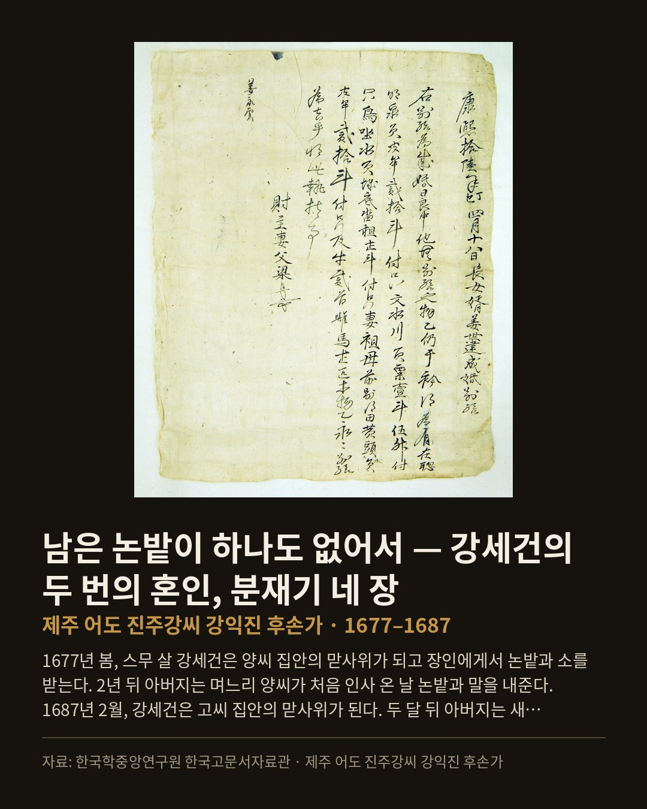
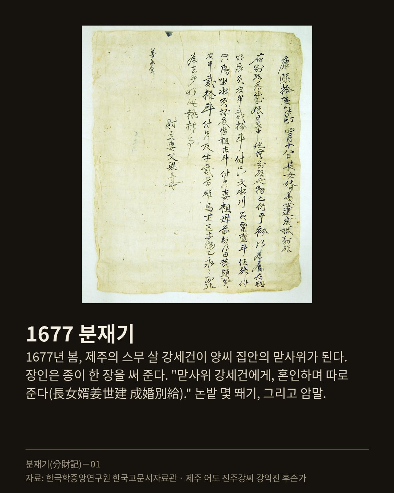

# EP.142 남은 논밭이 하나도 없어서 — 강세건의 두 번의 혼인, 분재기 네 장

제주 어도 진주강씨 강익진 후손가 (문중) · 1677년 봄, 스무 살 강세건은 양씨 집안의 맏사위가 되고 장인에게서 논밭과 소를 받는다. 2년 뒤 아버지는 며느리 양씨가 처음 인사 온 날 논밭과 말을 내준다. 1687년 2월, 강세건은 고씨 집안의 맏사위가 된다. 두 달 뒤 아버지는 새 며느리에게 적는다. '남은 논밭이 하나도 없어서'

- 🌐 [전시 웹페이지](https://changgi.github.io/archive-tools/examples/eodo-kang-ij-bunjae/exhibit.html) (한자 위 한글 독음 · 원문 해석) · [수업 활동지](https://changgi.github.io/archive-tools/examples/eodo-kang-ij-bunjae/handout.html)
- 🎬 영상: [릴스 9:16](https://changgi.github.io/archive-tools-next/media/ep142-eodo-kang-ij-bunjae_reel.mp4) · [가로 16:9](https://changgi.github.io/archive-tools-next/media/ep142-eodo-kang-ij-bunjae_wide.mp4) · 홍보 글: [`promo.md`](promo.md)
- 카드뉴스: [`cards/`](cards/) · SNS 글: [`sns.txt`](sns.txt) · 판독·해석 표: [`selection.csv`](selection.csv)

<!-- DELIVERY -->
## 전달 에디팅 — 이 기록을 이렇게 전합니다

- **핵심 정서** — 먹먹함
- **한 문장** — 강세건은 두 번 장가를 들었다 — 첫 아내 양씨, 두 번째 아내 고씨. 혼인과 첫인사 때마다 양가 부모가 써 준 '별급 문서'가 그 순서를 증언한다.
- **열기** — 아버지는 새 며느리에게 '줄 땅이 없다'고 적었습니다.
- **펼치기** — 분재기－01 → 분재기－02 → 분재기－05 → 분재기－03 (1677–1687년) — 1677(첫 장인 양씨가 맏사위에게) → 1679(아버지가 며느리 양씨에게) → 1687년 2월(둘째 장인 고상운이 맏사위에게) → 1687년 4월(아버지가 며느리 고씨에게)로, 두 번의 혼인을 같은 짝(장인 · 시아버지)으로 나란히 놓았습니다.
- **절정** — "남은 논밭이 하나도 없어서(餘存田地全無乙仍于)" — 화면·공간에서 이 한 줄만 크게, 소리를 줄여 집중
- **여운** — 첫 며느리와 둘째 며느리 사이, 아버지의 땅은 어디로 갔을까요? — 질문으로 끝내고 답은 보는 사람에게
- **감각과 물질** — 같은 '맏사위 강세건'에게 10년 사이 두 장인이 쓴 별급 문서 · 값(무명·냥·원)을 오늘의 물건으로 바꿔 옆에 놓기, 수결 따라 그리기
- **통로와 매개** — 온라인: 릴스(열기) → 카드뉴스(펼치기) → 전시 웹페이지(절정·원문) → 비하인드 카드(여운) / 오프라인: 원본 크기 복제·낭독·참여 벽 / 남기기: 활동지·질문 카드
- **여운 장치** — 결혼 · 이사 때 가족에게 받은 물건과 그 사연 적어 보기
- **전달 에디팅 전** — 4건의 문서를 1677–1687년 연대순으로 놓고 문서명 · 유형 · 해설을 붙인다 — 정확하지만, 지나가면 잊힌다.
- **전달 에디팅 후** — 핵심 정서는 「먹먹함」. 「아버지는 새 며느리에게 '줄 땅이 없다'고 적었습니다.」로 열고, 문서를 대비와 순서로 펼친 뒤, "남은 논밭이 하나도 없어서(餘存田地全無乙仍于)"에서 멈춘다. 같은 '맏사위 강세건'에게 10년 사이 두 장인이 쓴 별급 문서. 마지막엔 「결혼 · 이사 때 가족에게 받은 물건과 그 사연 적어 보기」로 보는 사람이 자기 이야기를 남기고 떠나게 한다.

전문: [`delivery.md`](delivery.md)
<!-- /DELIVERY -->

<!-- CURATOR -->
## 비하인드 — 큐레이터 노트

- **왜 이 문서들인가** — EP.140에서 강세건의 아들 여흥이 호적마다 다른 나이로, 고씨가 '계모'로 적힌 것을 보았습니다. 같은 집안 분재기 24장 가운데 그 까닭을 보여 주는 네 장을 찾았습니다.
- **전하고 싶은 것** — 강세건은 두 번 장가를 들었다 — 첫 아내 양씨, 두 번째 아내 고씨. 혼인과 첫인사 때마다 양가 부모가 써 준 '별급 문서'가 그 순서를 증언한다.
- **이렇게 보이길 바랐다** — 1677(첫 장인 양씨가 맏사위에게) → 1679(아버지가 며느리 양씨에게) → 1687년 2월(둘째 장인 고상운이 맏사위에게) → 1687년 4월(아버지가 며느리 고씨에게)로, 두 번의 혼인을 같은 짝(장인 · 시아버지)으로 나란히 놓았습니다.
- **이렇게 써 주세요** — 조선의 분재와 별급(別給), 혼인 의례(성혼 · 초알), 이두 문서 읽기, 재혼과 가족 구성, 호적과 다른 문서의 교차 검증 수업에 쓰세요.
- **만들며 있었던 일** — 네 장 모두 이두가 섞인 행초서라, 땅 이름과 두락 · 마소의 수는 확실한 것만 옮기고 나머지는 …로 줄였습니다. 자료관 목록 연도(1675 · 1685)는 본문의 '康熙拾陸年丁巳'(1677), '康熙貳拾陸年丁卯'(1687)를 따라 고쳤습니다. 1679년 문서에는 '庚申'이 작게 덧붙어 있어 연도 확인이 필요합니다. 첫 아내 양씨가 언제 왜 세상을 떠났는지는 이 문서들에 없습니다.
- **남겨 둔 질문** — 첫 며느리와 둘째 며느리 사이, 아버지의 땅은 어디로 갔을까요?
- **제작 기록** — 문서 4건 · 1677–1687년 · 원본 사진 4면(문서 전체) · 원문 판독 4건 · 번역 4건 · 못 읽은 글자 □ 1 · 불확실 (?) 0 · 해제에 "확인 필요"를 단 문서 1건

전문: [`curator.md`](curator.md) · 비하인드 카드: [`behind/`](behind/) · 채널별 홍보안: [`channels.md`](channels.md)
<!-- /CURATOR -->

## 이야기 — 사료가 말하는 대로

아버지는 새 며느리에게 '줄 땅이 없다'고 적었습니다.

> **1677 분재기** — 1677년 봄, 제주의 스무 살 강세건이 양씨 집안의 맏사위가 된다. 장인은 종이 한 장을 써 준다. "맏사위 강세건에게, 혼인하며 따로 준다(長女婿姜世建 成婚別給)." 논밭 몇 뙈기, 그리고 암말.
> **1679 분재기** — 2년 뒤, 며느리 양씨가 시댁에 처음 인사를 온다. 시아버지가 붓을 든다. 밭 네 곳, 암말 두 필, 소 한 마리, 수말 한 필. "양씨에게 영원히 허락한다(梁氏亦中 永許爲去乎)." 그 무렵 강세건에게는 갓난 아들 여흥이 있었다.
> **1687 분재기** — 10년 뒤, 1687년 2월. 서른 살 강세건이 다시 '맏사위'가 된다. 이번 장인은 고씨. 종이의 첫 줄이 10년 전과 똑같다. "맏사위 강세건에게 혼인날 따로 준다(長女婿姜世建處中 成婚日別給)." 양씨의 이름은 어디에도 없다.
> **1687 분재기** — 두 달 뒤, 새 며느리 고씨가 첫인사를 온다. 늙은 아버지가 다시 붓을 든다. 자식들 혼인 때마다 땅을 떼어 주었다. 이제 첫 줄부터 다르다. "남은 논밭이 하나도 없어서(餘存田地全無乙仍于)." 아버지는 앞서 며느리에게 주었던 땅을 다시 넘기고, 올해 태어난 여종 아이 하나를 더한다. 8년 사이, 같은 아들의 아내가 두 번 인사를 왔다.

| 표지 | 1번 카드 | 마무리 |
|---|---|---|
|  |  |  |

## 선별 문서 (4점)

| # | 연도 | 유형 | 문서명 | 원본 |
|---|---|---|---|---|
| 1 | 1677 | 분재기 | 분재기(分財記)－01 | [원본 보기](https://archive.aks.ac.kr/viewer/viewer.do#imgnode.do?itemId=book&gubun=booktree&depth=6&upPath=01%5E0168%5EL016818%5EL016818F02%5EL016818F0205&dataId=G002%2BAKS%2BKSM-XE.1675.5011-20220125.B077a_114_00331_XXX&itemType=) |
| 2 | 1679 | 분재기 | 분재기(分財記)－02 | [원본 보기](https://archive.aks.ac.kr/viewer/viewer.do#imgnode.do?itemId=book&gubun=booktree&depth=6&upPath=01%5E0168%5EL016818%5EL016818F02%5EL016818F0205&dataId=G002%2BAKS%2BKSM-XE.1679.5011-20220125.B077a_114_00332_XXX&itemType=) |
| 3 | 1687 | 분재기 | 분재기(分財記)－05 | [원본 보기](https://archive.aks.ac.kr/viewer/viewer.do#imgnode.do?itemId=book&gubun=booktree&depth=6&upPath=01%5E0168%5EL016818%5EL016818F02%5EL016818F0205&dataId=G002%2BAKS%2BKSM-XE.1687.5011-20220125.B077a_114_00335_XXX&itemType=) |
| 4 | 1687 | 분재기 | 분재기(分財記)－03 | [원본 보기](https://archive.aks.ac.kr/viewer/viewer.do#imgnode.do?itemId=book&gubun=booktree&depth=6&upPath=01%5E0168%5EL016818%5EL016818F02%5EL016818F0205&dataId=G002%2BAKS%2BKSM-XE.1685.5011-20220125.B077a_114_00333_XXX&itemType=) |

## 원문 판독과 해석

### 1. 분재기(分財記)－01

**원문 판독**

```
康熙拾陸年丁巳四月十一日 長女婿姜世建 成婚別給
右別給爲遣 婚日良中 他矣衿得之物乙仍于 …
… 文水川員 粟壹斗伍升付 …
… 妻祖母前 … 雌馬 … 永永別給 …
財主 妻父 梁□ (수결)
```

**원문 해석** 강희 16년 정사(1677) 4월 11일, 맏사위 강세건에게 혼인하며 따로 주는 문서. 위와 같이 따로 주는 것은, 혼인날에 (딸이) 제 몫으로 받을 것이므로 … (어느 들의 논 몇 마지기, 문수천 들의 조 한 말 닷 되 지기 밭, 처조모 앞 … 밭, 암말 … 등을) 영원히 따로 준다. 재주 장인 양□ (수결)

**해제** 1677년(숙종 3) 4월 11일 장인 양□(梁□)가 맏사위 강세건(姜世建)의 혼인에 즈음해 논밭과 마소를 따로 떼어 준 별급(別給) 문서입니다. 별급은 정식 상속(분재) 밖에서 혼인 · 과거 급제 · 출산 같은 경사에 재산을 떼어 주는 일입니다. 자료관 목록은 1675년이지만 본문은 '康熙拾陸年丁巳'(1677)입니다. 이해 강세건은 스무 살 안팎으로, 이 양씨가 첫 아내입니다. EP.140에서 강여흥의 외조부가 '梁士哲'로 적힌 것과 맞물리나, 장인 이름 글자는 판독하지 못했습니다. 논밭과 마소의 세목은 행초서와 이두라 확실한 부분만 옮겼습니다.

### 2. 분재기(分財記)－02

**원문 판독**

```
康熙拾捌年(庚申) 五月拾五日 末男世建妻梁氏初謁日別給
右別給事段 … 巨路田員 … 買得田 皮牟拾參斗付只 …
… 皮牟貳石付 … 粟四升付只 … 皮牟一石付只 …
… 及 壯雌馬貳疋 牛一首 三禾雄馬一疋等乙 梁氏亦中 永許爲去乎
後次 有雜談者 持此文辨正事
財主 自筆 媤父 姜 (수결)
```

**원문 해석** 강희 18년(1679) 5월 15일, 막내아들 세건의 아내 양씨가 처음 인사 온 날 따로 주는 문서. 따로 주는 것은 … 거로 들에 사들인 밭(겉보리 열세 말 지기), … 사들인 밭(겉보리 두 섬 지기), … 조 넉 되 지기, … 겉보리 한 섬 지기 … 그리고 튼튼한 암말 두 필, 소 한 마리, 세 살 수말 한 필 등을 양씨에게 영원히 허락한다. 뒷날 딴말하는 자가 있거든 이 문서를 가지고 바로잡을 것. 재주 친필, 시아버지 강 (수결)

**해제** 1679년(숙종 5) 5월 15일 강세건의 아버지 강두형(姜斗烱, 문서에는 성과 수결만)이 막내아들의 아내 양씨가 시가에 처음 인사 온 날(初謁日) 논밭과 마소를 떼어 준 별급 문서입니다. 문서의 '媤父(시아버지)'는 한국에서 만든 글자 '媤'를 씁니다. 겉보리(皮牟) · 조(粟)를 뿌리는 양으로 밭 크기를 적었고, 암말 두 필 · 소 한 마리 · 세 살 수말 한 필이 함께 갔습니다. 본문 연호는 강희 18년(1679, 기미)인데 '庚申'(1680)이 작게 덧붙어 있어 연도 확인이 필요합니다. 강여흥이 무오생(1678)이라면, 그는 이 양씨의 아들입니다.

### 3. 분재기(分財記)－05

**원문 판독**

```
康熙貳拾陸年丁卯貳月貳拾捌日 長女婿姜世建處中
成婚日別給
右別給爲乎段 他矣衿得之物乙仍于 …
… 貳石付 … 粟種壹斗付 …
馬一匹 等物乙 同女婿處中 永永別給爲去乎
後次 雜談隅有去等 持此文 …
財主 自筆 妻父 幼學 高 (수결)
```

**원문 해석** 강희 26년 정묘(1687) 2월 28일, 맏사위 강세건에게 혼인날 따로 주는 문서. 따로 주는 것은 (딸이) 제 몫으로 받을 것이므로 … (두 섬 지기 밭, 조 씨앗 한 말 지기 밭 …) 말 한 필 등을 이 사위에게 영원히 따로 준다. 뒷날 딴말이 있거든 이 문서를 가지고 (바로잡을 것). 재주 친필, 장인 유학 고 (수결)

**해제** 1687년(숙종 13) 2월 28일 유학 고□(高□)가 맏사위 강세건의 혼인날 논밭과 말을 떼어 준 별급 문서입니다. 10년 전 양씨 장인의 문서와 같은 '長女婿姜世建 … 成婚' 형식입니다. 같은 해 12월 준호구(EP.140)에 강세건의 아내 고씨(22세)의 아버지가 '幼學尙雲'으로 적혀 있어, 이 장인은 고상운(高尙雲)으로 보입니다. 서른 살 강세건의 두 번째 혼인이며, 첫 아내 양씨는 그 사이 세상을 떠났거나 혼인이 끝난 것으로 보입니다(문서에는 사유가 없음).

### 4. 분재기(分財記)－03

**원문 판독**

```
康熙貳拾陸年丁卯肆月拾伍日 末男妻高氏初謁日良中別給
右別給事段 各子息初謁日成婚之日 田地等乙 盡數酌定許以 …
爲有如乎 餘存田地全無乙仍于 三婦初謁日良中 別給田地等乙 …
初謁日更爲傳亦 別給爲遣 未加亦 户婢今年生伍所生婢乙 …
身後所生幷以 永永別給爲去乎
後次 有子孫中相爭者 則持此文辨正事
財主 自筆 父 姜 (수결)
```

**원문 해석** 강희 26년 정묘(1687) 4월 15일, 막내아들의 아내 고씨가 처음 인사 온 날 따로 주는 문서. 따로 주는 까닭은, 자식들이 처음 인사 오고 혼인하는 날마다 논밭을 모두 헤아려 정해 주었는데, 남은 논밭이 하나도 없어서, (앞서) 셋째 며느리가 처음 인사 온 날 따로 준 논밭을 … 다시 이 첫인사 날에 넘겨 따로 주고, 더하여 집 종이 올해 낳은 다섯째 소생 여종을 … 뒤에 낳을 자식까지 아울러 영원히 따로 준다. 뒷날 자손 가운데 다투는 자가 있거든 이 문서를 가지고 바로잡을 것. 재주 친필, 아버지 강 (수결)

**해제** 1687년(숙종 13) 4월 15일 강세건의 아버지가 새 며느리 고씨가 처음 인사 온 날 쓴 별급 문서입니다. 자료관 목록은 1685년이지만 본문은 '康熙貳拾陸年丁卯'(1687)입니다. 아버지는 자식들의 혼인과 첫인사 때마다 논밭을 나눠 주어 '남은 논밭이 하나도 없다(餘存田地全無)'고 적고, '셋째 며느리 초알 때 준 논밭'을 다시 넘겨주는 방식과 여종 한 명으로 별급을 채웠습니다. '三婦'를 막내아들의 첫 아내 양씨로 볼 수 있는지는 판단하지 않았습니다(가운데 구절은 판독이 불확실합니다). 8개월 뒤 같은 해 12월 준호구(EP.140)에는 아내 고씨(22세)와 아들 여흥이 함께 적힙니다.

판독·해석·이야기는 이미지에 근거한 초안이며(검토 전 "초안" 표시), 정확한 판독은 원문 확인이 필요합니다. □는 읽지 못한 글자, (?)는 불확실한 글자입니다.
이미지: 한국학중앙연구원 한국고문서자료관 소장·제공. "원본" 링크를 누르면 자료관 뷰어에서 그 문서가 열립니다. 재사용은 자료관에 문의하세요(소장처 동의 필요).
