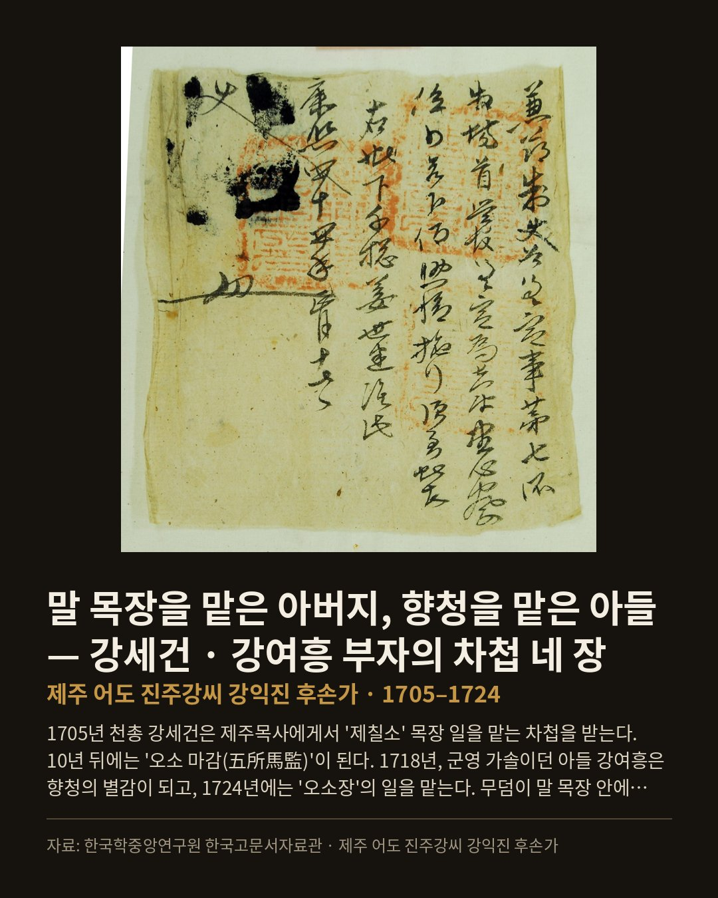
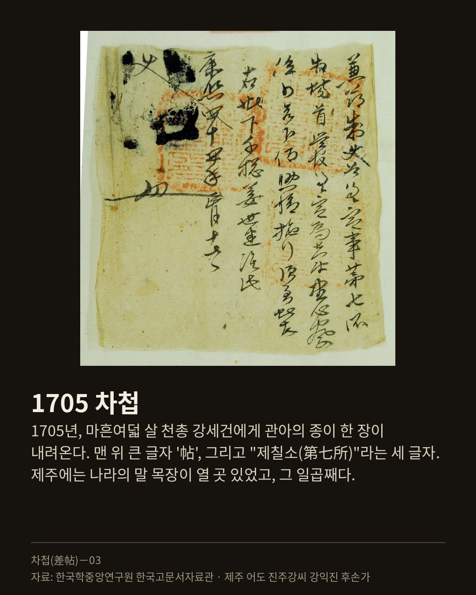

# EP.145 말 목장을 맡은 아버지, 향청을 맡은 아들 — 강세건 · 강여흥 부자의 차첩 네 장

제주 어도 진주강씨 강익진 후손가 (문중) · 1705년 천총 강세건은 제주목사에게서 '제칠소' 목장 일을 맡는 차첩을 받는다. 10년 뒤에는 '오소 마감(五所馬監)'이 된다. 1718년, 군영 가솔이던 아들 강여흥은 향청의 별감이 되고, 1724년에는 '오소장'의 일을 맡는다. 무덤이 말 목장 안에 있던 집안은, 대를 이어 그 목장을 돌보는 일도 맡았다

- 🌐 [전시 웹페이지](https://changgi.github.io/archive-tools/examples/eodo-kang-ij-chacheop/exhibit.html) (한자 위 한글 독음 · 원문 해석) · [수업 활동지](https://changgi.github.io/archive-tools/examples/eodo-kang-ij-chacheop/handout.html)
- 🎬 영상: [릴스 9:16](https://changgi.github.io/archive-tools-next/media/ep145-eodo-kang-ij-chacheop_reel.mp4) · [가로 16:9](https://changgi.github.io/archive-tools-next/media/ep145-eodo-kang-ij-chacheop_wide.mp4) · 홍보 글: [`promo.md`](promo.md)
- 카드뉴스: [`cards/`](cards/) · SNS 글: [`sns.txt`](sns.txt) · 판독·해석 표: [`selection.csv`](selection.csv)

<!-- DELIVERY -->
## 전달 에디팅 — 이 기록을 이렇게 전합니다

- **핵심 정서** — 뿌듯함
- **한 문장** — 아버지는 목장의 감독관(마감)이 되고, 아들은 향청의 별감을 거쳐 다시 목장 일을 맡았다 — 제주 향촌 사회에서 말 목장은 생업이자 벼슬이었다.
- **열기** — 제주의 아버지와 아들은, 대를 이어 나라의 말 목장을 맡았습니다.
- **펼치기** — 차첩－03 → 차첩－04 → 차첩－09 → 차첩－11 (1705–1724년) — 1705(천총 강세건, 제칠소) → 1715(전 별감 강세건, 오소 마감) → 1718(가솔 강여흥, 별감) → 1724(전 별감 강여흥, 오소장)으로, 아버지 둘 · 아들 둘을 나란히 두어 '같은 일을 대물림하는' 모양이 보이게 했습니다.
- **절정** — "오소 마감으로 차정한다(五所馬監 差定)" — 화면·공간에서 이 한 줄만 크게, 소리를 줄여 집중
- **여운** — 아버지가 맡았던 목장을, 아들은 어떤 마음으로 다시 맡았을까요? — 질문으로 끝내고 답은 보는 사람에게
- **감각과 물질** — 같은 서식의 '帖' 네 장 — 받는 이름만 아버지에서 아들로 바뀐다 · 어보·관인 탁본 스탬프를 찍어 보는 체험 · 책장을 넘기는 소리, 확대 열람대
- **통로와 매개** — 온라인: 릴스(열기) → 카드뉴스(펼치기) → 전시 웹페이지(절정·원문) → 비하인드 카드(여운) / 오프라인: 원본 크기 복제·낭독·참여 벽 / 남기기: 활동지·질문 카드
- **여운 장치** — 우리 집안에서 대를 이어 해 온 일 하나 적어 보기
- **전달 에디팅 전** — 4건의 문서를 1705–1724년 연대순으로 놓고 문서명 · 유형 · 해설을 붙인다 — 정확하지만, 지나가면 잊힌다.
- **전달 에디팅 후** — 핵심 정서는 「뿌듯함」. 「제주의 아버지와 아들은, 대를 이어 나라의 말 목장을 맡았습니다.」로 열고, 문서를 대비와 순서로 펼친 뒤, "오소 마감으로 차정한다(五所馬監 差定)"에서 멈춘다. 같은 서식의 '帖' 네 장 — 받는 이름만 아버지에서 아들로 바뀐다. 마지막엔 「우리 집안에서 대를 이어 해 온 일 하나 적어 보기」로 보는 사람이 자기 이야기를 남기고 떠나게 한다.

전문: [`delivery.md`](delivery.md)
<!-- /DELIVERY -->

<!-- CURATOR -->
## 비하인드 — 큐레이터 노트

- **왜 이 문서들인가** — EP.144에서 이 집안의 무덤이 '육소장', 곧 말 목장 안에 있다는 것을 보고, 같은 집안 차첩 50장 가운데 강세건 · 강여흥 부자가 목장 · 향청 일을 맡은 네 장을 골랐습니다.
- **전하고 싶은 것** — 아버지는 목장의 감독관(마감)이 되고, 아들은 향청의 별감을 거쳐 다시 목장 일을 맡았다 — 제주 향촌 사회에서 말 목장은 생업이자 벼슬이었다.
- **이렇게 보이길 바랐다** — 1705(천총 강세건, 제칠소) → 1715(전 별감 강세건, 오소 마감) → 1718(가솔 강여흥, 별감) → 1724(전 별감 강여흥, 오소장)으로, 아버지 둘 · 아들 둘을 나란히 두어 '같은 일을 대물림하는' 모양이 보이게 했습니다.
- **이렇게 써 주세요** — 조선 후기 지방 관아의 임명 문서(차첩), 제주목사의 겸직(방어사 · 절제사), 제주 목장(10소장)과 마감 · 감목관, 향청 · 향임 수업에 쓰세요.
- **만들며 있었던 일** — 차첩은 관아 서리가 빠르게 쓴 초서라 일부 직임 이름(1705년 '제칠소' 다음 글자, 1724년 '오소장' 다음 글자)은 확정하지 못해 …로 두었습니다. 1715년 문서의 연도 글자는 자료관 목록(1715)을 따랐습니다. 발급자 '兼○○使'는 제주목사가 겸한 직함으로 보았습니다.
- **남겨 둔 질문** — 아버지가 맡았던 목장을, 아들은 어떤 마음으로 다시 맡았을까요?
- **제작 기록** — 문서 4건 · 1705–1724년 · 원본 사진 4면(문서 전체) · 원문 판독 4건 · 번역 4건 · 못 읽은 글자 □ 5 · 불확실 (?) 0

전문: [`curator.md`](curator.md) · 비하인드 카드: [`behind/`](behind/) · 채널별 홍보안: [`channels.md`](channels.md)
<!-- /CURATOR -->

## 이야기 — 사료가 말하는 대로

제주의 아버지와 아들은, 대를 이어 나라의 말 목장을 맡았습니다.

> **1705 차첩** — 1705년, 마흔여덟 살 천총 강세건에게 관아의 종이 한 장이 내려온다. 맨 위 큰 글자 '帖', 그리고 "제칠소(第七所)"라는 세 글자. 제주에는 나라의 말 목장이 열 곳 있었고, 그 일곱째다.
> **1715 차첩** — 10년 뒤, 쉰여덟 살. 이번에는 직임이 분명하게 적혀 있다. "오소 마감으로 차정한다(五所馬監 差定)." 다섯째 목장의 말을 돌보고 살피는 일. 그리고 한 줄의 당부. "맡은 일을 가벼이 여기지 말라(不輕察任)."
> **1718 차첩** — 1718년 봄, 이번에는 아들 차례다. 받는 이의 이름이 바뀐다. "가솔 강여흥에게 내린다(右帖下 假率姜汝興)." 직임은 향청의 별감. 아버지가 걸었던 길을, 아들이 그대로 밟기 시작한다.
> **1724 차첩** — 6년 뒤, 1724년. 아들의 차첩에 익숙한 이름이 나온다. "오소장(五所塲)." 9년 전 아버지가 맡았던 바로 그 목장이다. 선대의 무덤도, 아버지의 일도, 이 집안에서는 말 목장 안에 있었다.

| 표지 | 1번 카드 | 마무리 |
|---|---|---|
|  |  |  |

## 선별 문서 (4점)

| # | 연도 | 유형 | 문서명 | 원본 |
|---|---|---|---|---|
| 1 | 1705 | 차첩 | 차첩(差帖)－03 | [원본 보기](https://archive.aks.ac.kr/viewer/viewer.do#imgnode.do?itemId=book&gubun=booktree&depth=6&upPath=01%5E0168%5EL016818%5EL016818F02%5EL016818F0201&dataId=G002%2BAKS%2BKSM-XA.1705.5011-20220125.B077a_114_00049_XXX&itemType=) |
| 2 | 1715 | 차첩 | 차첩(差帖)－04 | [원본 보기](https://archive.aks.ac.kr/viewer/viewer.do#imgnode.do?itemId=book&gubun=booktree&depth=6&upPath=01%5E0168%5EL016818%5EL016818F02%5EL016818F0201&dataId=G002%2BAKS%2BKSM-XA.1715.5011-20220125.B077a_114_00050_XXX&itemType=) |
| 3 | 1718 | 차첩 | 차첩(差帖)－09 | [원본 보기](https://archive.aks.ac.kr/viewer/viewer.do#imgnode.do?itemId=book&gubun=booktree&depth=6&upPath=01%5E0168%5EL016818%5EL016818F02%5EL016818F0201&dataId=G002%2BAKS%2BKSM-XA.1718.5011-20220125.B077a_114_00055_XXX&itemType=) |
| 4 | 1724 | 차첩 | 차첩(差帖)－11 | [원본 보기](https://archive.aks.ac.kr/viewer/viewer.do#imgnode.do?itemId=book&gubun=booktree&depth=6&upPath=01%5E0168%5EL016818%5EL016818F02%5EL016818F0201&dataId=G002%2BAKS%2BKSM-XA.1724.5011-20220125.B077a_114_00057_XXX&itemType=) |

## 원문 판독과 해석

### 1. 차첩(差帖)－03

**원문 판독**

```
兼□□使爲差定事 第七所
… 差定爲去乎
… 照驗施行 須至帖者
右帖下 千摠姜世建 准此
康熙四十四年 … 月十六日
帖
```

**원문 해석** 겸○○사가 차정(임명)하는 일. 제칠소 … 로 차정하니 … 살펴 시행하라. 이에 첩을 내린다. 위 첩을 천총 강세건에게 내리니 이대로 하라. 강희 44년(1705) … 월 16일. (착명) 첩.

**해제** 1705년(숙종 31) 제주목사(겸직 '兼○○使')가 천총(千摠) 강세건에게 내린 차첩(差帖)입니다. 차첩은 관아가 지방의 하급 직임을 맡길 때 주는 임명장으로, '爲差定事 … 差定爲去乎 … 須至帖者 右帖下 ○○ 准此'의 틀을 씁니다. 같은 해 12월 준호구(EP.140)에도 강세건은 '천총'으로 적혀 있습니다. 본문의 '第七所'는 제주의 국영 말 목장 10소장 가운데 일곱째 목장으로 보이며, 그 다음 직임 이름은 초서라 확정하지 못했습니다.

### 2. 차첩(差帖)－04

**원문 판독**

```
兼節制使爲差定事 五所馬監
差定爲去乎 不輕察任向事 合下仰
照驗施行 須至帖者
右帖下 前別監姜世建 准此
康熙五十□年九月二十七日
差定
帖
```

**원문 해석** 겸절제사가 차정하는 일. 오소 마감으로 차정하니, 맡은 일을 가벼이 여기지 말고 살필 것. 마땅히 살펴 시행하라. 이에 첩을 내린다. 위 첩을 전 별감 강세건에게 내리니 이대로 하라. 강희 5○년 9월 27일. 차정. 첩.

**해제** 자료관 목록 1715년(숙종 41), '겸절제사(兼節制使)'가 전 별감 강세건을 '오소 마감(五所馬監)'으로 차정한 차첩입니다. 제주목사는 제주 · 대정 · 정의를 아우르는 군사 직함(병마수군절제사)을 겸했습니다. 마감은 목장의 말을 돌보고 점검하는 감독 직임으로, 강세건은 이때 쉰여덟 살 안팎입니다. '不輕察任向事(맡은 일을 가벼이 여기지 말고 살필 것)'는 차첩의 정해진 당부입니다. 연도의 일의 자리 글자는 획이 겹쳐 확정하지 못했습니다.

### 3. 차첩(差帖)－09

**원문 판독**

```
兼防禦使爲差定事 別
監差定 不輕察任向事 合下仰
照驗施行 須至帖者
右帖下 假率姜汝興 准此
康熙五十七年五月 日
帖
```

**원문 해석** 겸방어사가 차정하는 일. 별감으로 차정하니, 맡은 일을 가벼이 여기지 말고 살필 것. 마땅히 살펴 시행하라. 이에 첩을 내린다. 위 첩을 가솔 강여흥에게 내리니 이대로 하라. 강희 57년(1718) 5월 일. 첩.

**해제** 1718년(숙종 44) 5월 '겸방어사(兼防禦使)'가 가솔(假率) 강여흥을 별감(別監)으로 차정한 차첩입니다. 별감은 지방 향청(鄕廳)에서 좌수를 돕는 향임입니다. 1705년 준호구(EP.140)에서 '군영 가솔'로 적혔던 여흥이 마흔한 살에 향임이 되었고, 2년 뒤 1720년 준호구에는 '유향별감'으로 적힙니다. 같은 해 4월에는 아버지 강세건이 맏손자에게 고씨의 제사를 맡기는 문서(EP.143)를 남겼습니다.

### 4. 차첩(差帖)－11

**원문 판독**

```
兼□□使爲差定事
五所塲 … 差定爲去乎 …
… 照驗施行 須至帖者
右帖下 前別監姜汝興 准此
雍正二年三月 日
帖
```

**원문 해석** 겸○○사가 차정하는 일. 오소장 … 로 차정하니 … 살펴 시행하라. 이에 첩을 내린다. 위 첩을 전 별감 강여흥에게 내리니 이대로 하라. 옹정 2년(1724) 3월 일. 첩.

**해제** 1724년(경종 4) 3월 전 별감 강여흥을 '오소장(五所塲)'의 직임에 차정한 차첩입니다. 9년 전 아버지 강세건이 맡았던 '오소 마감'과 같은 다섯째 목장입니다. 직임 이름 부분은 초서라 확정하지 못했으나, 아버지에 이어 아들이 같은 목장 일을 맡았음은 분명합니다. 이 집안의 선대 묘가 있는 육소장(EP.144)은 바로 이웃 목장입니다.

판독·해석·이야기는 이미지에 근거한 초안이며(검토 전 "초안" 표시), 정확한 판독은 원문 확인이 필요합니다. □는 읽지 못한 글자, (?)는 불확실한 글자입니다.
이미지: 한국학중앙연구원 한국고문서자료관 소장·제공. "원본" 링크를 누르면 자료관 뷰어에서 그 문서가 열립니다. 재사용은 자료관에 문의하세요(소장처 동의 필요).
