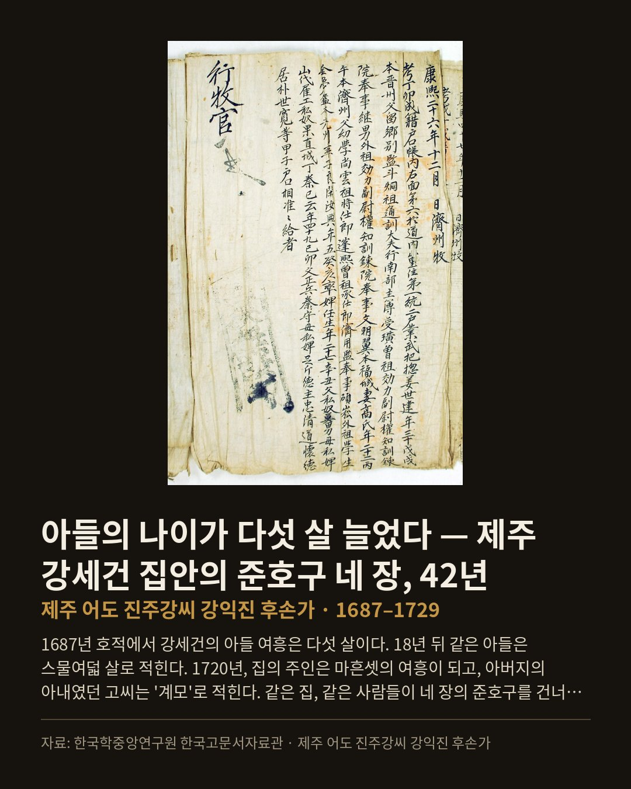
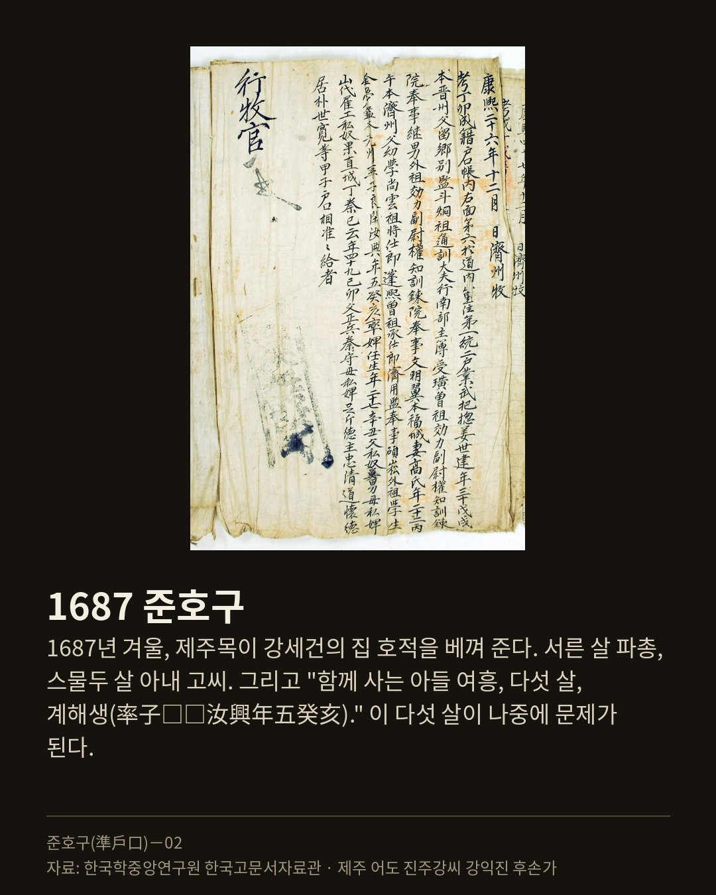

# EP.140 아들의 나이가 다섯 살 늘었다 — 제주 강세건 집안의 준호구 네 장, 42년

제주 어도 진주강씨 강익진 후손가 (문중) · 1687년 호적에서 강세건의 아들 여흥은 다섯 살이다. 18년 뒤 같은 아들은 스물여덟 살로 적힌다. 1720년, 집의 주인은 마흔셋의 여흥이 되고, 아버지의 아내였던 고씨는 '계모'로 적힌다. 같은 집, 같은 사람들이 네 장의 준호구를 건너며 나이와 관계를 바꾼다

- 🌐 [전시 웹페이지](https://changgi.github.io/archive-tools/examples/eodo-kang-ij-hojeok/exhibit.html) (한자 위 한글 독음 · 원문 해석) · [수업 활동지](https://changgi.github.io/archive-tools/examples/eodo-kang-ij-hojeok/handout.html)
- 🎬 영상: [릴스 9:16](https://changgi.github.io/archive-tools-next/media/ep140-eodo-kang-ij-hojeok_reel.mp4) · [가로 16:9](https://changgi.github.io/archive-tools-next/media/ep140-eodo-kang-ij-hojeok_wide.mp4) · 홍보 글: [`promo.md`](promo.md)
- 카드뉴스: [`cards/`](cards/) · SNS 글: [`sns.txt`](sns.txt) · 판독·해석 표: [`selection.csv`](selection.csv)

<!-- DELIVERY -->
## 전달 에디팅 — 이 기록을 이렇게 전합니다

- **핵심 정서** — 의문
- **한 문장** — 같은 아들의 나이와 출생 간지가 호적마다 다르고, 아버지의 아내는 아들 대에 '계모'로 적힌다 — 호적은 사실의 사진이 아니라 신고의 기록이다.
- **열기** — 같은 아들이, 호적마다 다른 해에 태어났습니다.
- **펼치기** — 준호구－02 → 준호구－06 → 준호구－11 → 준호구－13 (1687–1729년) — 1687(아버지가 호주, 아들 다섯 살) → 1705(아들 스물여덟, 군영 가솔) → 1720(아들이 호주, 계모 고씨) → 1729(아들의 아내 · 자녀 · 서얼 아우)로, 호주가 바뀌는 순간을 가운데 두었습니다.
- **절정** — "계모 고씨, 나이 쉰다섯(繼母高氏年伍拾伍)" — 화면·공간에서 이 한 줄만 크게, 소리를 줄여 집중
- **여운** — 여러분 집안의 서류에도, 서로 다르게 적힌 생일이 있나요? — 질문으로 끝내고 답은 보는 사람에게
- **감각과 물질** — 같은 이름 옆에 달라지는 숫자 — 다섯 살과 스물여덟 살, 癸亥와 戊午 · 나의 신분증 만들기 체험 카드
- **통로와 매개** — 온라인: 릴스(열기) → 카드뉴스(펼치기) → 전시 웹페이지(절정·원문) → 비하인드 카드(여운) / 오프라인: 원본 크기 복제·낭독·참여 벽 / 남기기: 활동지·질문 카드
- **여운 장치** — 집안 서류에서 서로 다른 기록 하나 찾아보기
- **전달 에디팅 전** — 4건의 문서를 1687–1729년 연대순으로 놓고 문서명 · 유형 · 해설을 붙인다 — 정확하지만, 지나가면 잊힌다.
- **전달 에디팅 후** — 핵심 정서는 「의문」. 「같은 아들이, 호적마다 다른 해에 태어났습니다.」로 열고, 문서를 대비와 순서로 펼친 뒤, "계모 고씨, 나이 쉰다섯(繼母高氏年伍拾伍)"에서 멈춘다. 같은 이름 옆에 달라지는 숫자 — 다섯 살과 스물여덟 살, 癸亥와 戊午. 마지막엔 「집안 서류에서 서로 다른 기록 하나 찾아보기」로 보는 사람이 자기 이야기를 남기고 떠나게 한다.

전문: [`delivery.md`](delivery.md)
<!-- /DELIVERY -->

<!-- CURATOR -->
## 비하인드 — 큐레이터 노트

- **왜 이 문서들인가** — EP.128에서 강세건의 28년을 전령 · 준호구 · 교지 네 장으로 읽은 뒤, 같은 집안에 남은 준호구 25장 가운데 아들 강여흥이 등장하는 네 장을 골랐습니다.
- **전하고 싶은 것** — 같은 아들의 나이와 출생 간지가 호적마다 다르고, 아버지의 아내는 아들 대에 '계모'로 적힌다 — 호적은 사실의 사진이 아니라 신고의 기록이다.
- **이렇게 보이길 바랐다** — 1687(아버지가 호주, 아들 다섯 살) → 1705(아들 스물여덟, 군영 가솔) → 1720(아들이 호주, 계모 고씨) → 1729(아들의 아내 · 자녀 · 서얼 아우)로, 호주가 바뀌는 순간을 가운데 두었습니다.
- **이렇게 써 주세요** — 조선 후기 호적(준호구)의 구조, 사조(四祖) 기재, 나이 기록의 신뢰성, 제주 향촌 사회와 가족 구성 수업에 쓰세요.
- **만들며 있었던 일** — 네 장 모두 해서로 또렷하나 일부 글자(1687년 아들 앞의 두 글자, 1729년 호주 나이)는 확정하지 못해 …로 두었습니다. 여흥의 나이가 왜 달라졌는지, 고씨가 정말 생모가 아닌지는 판단하지 않고 '문서마다 다르게 적혔다'고만 적었습니다. 노비 기재는 줄였습니다.
- **남겨 둔 질문** — 여러분 집안의 서류에도, 서로 다르게 적힌 생일이 있나요?
- **제작 기록** — 문서 4건 · 1687–1729년 · 원본 사진 4면(문서 전체) · 원문 판독 4건 · 번역 4건 · 못 읽은 글자 □ 2 · 불확실 (?) 0 · 해제에 "확인 필요"를 단 문서 1건

전문: [`curator.md`](curator.md) · 비하인드 카드: [`behind/`](behind/) · 채널별 홍보안: [`channels.md`](channels.md)
<!-- /CURATOR -->

## 이야기 — 사료가 말하는 대로

같은 아들이, 호적마다 다른 해에 태어났습니다.

> **1687 준호구** — 1687년 겨울, 제주목이 강세건의 집 호적을 베껴 준다. 서른 살 파총, 스물두 살 아내 고씨. 그리고 "함께 사는 아들 여흥, 다섯 살, 계해생(率子□□汝興年五癸亥)." 이 다섯 살이 나중에 문제가 된다.
> **1705 준호구** — 18년 뒤, 1705년 호적. 강세건은 마흔여덟, 용양위 부사과 천총이 되었다. 아내 고씨는 마흔. 그리고 아들. "군영 가솔 강여흥, 스물여덟 살, 무오생(假率姜汝興年二十八戊午)." 다섯 살 아이가 18년 뒤 스물셋이 아니라 스물여덟이 되어 있다.
> **1720 준호구** — 1720년, 집의 주인이 바뀐다. 마흔세 살 강여흥. 아버지는 이제 이름만 남았다. 그 아래 한 줄. "계모 고씨, 나이 쉰다섯(繼母高氏年伍拾伍)." 33년 동안 아버지의 아내로 적혀 온 사람이, 아들의 호적에서는 계모가 된다. 외할아버지 칸에는 고씨가 아닌 양씨의 이름이 있다.
> **1729 준호구** — 다시 9년 뒤, 1729년. 계모 고씨는 예순넷, 1687년부터 단 한 번도 병오생에서 흔들리지 않았다. 흔들린 것은 아들의 나이였다. 호주 강여흥 아래로 아내 문씨, 열세 살 딸, "둘째 아들 유성, 다섯 살(次子維聖年五)." 1687년 다섯 살이던 아이의 아들이, 이제 다섯 살이다.

| 표지 | 1번 카드 | 마무리 |
|---|---|---|
|  |  |  |

## 선별 문서 (4점)

| # | 연도 | 유형 | 문서명 | 원본 |
|---|---|---|---|---|
| 1 | 1687 | 준호구 | 준호구(準戶口)－02 | [원본 보기](https://archive.aks.ac.kr/viewer/viewer.do#imgnode.do?itemId=book&gubun=booktree&depth=6&upPath=01%5E0168%5EL016818%5EL016818F02%5EL016818F0204&dataId=G002%2BAKS%2BKSM-XD.1687.5011-20220125.B077a_114_00224_XXX&itemType=) |
| 2 | 1705 | 준호구 | 준호구(準戶口)－06 | [원본 보기](https://archive.aks.ac.kr/viewer/viewer.do#imgnode.do?itemId=book&gubun=booktree&depth=6&upPath=01%5E0168%5EL016818%5EL016818F02%5EL016818F0204&dataId=G002%2BAKS%2BKSM-XD.1705.5011-20220125.B077a_114_00228_XXX&itemType=) |
| 3 | 1720 | 준호구 | 준호구(準戶口)－11 | [원본 보기](https://archive.aks.ac.kr/viewer/viewer.do#imgnode.do?itemId=book&gubun=booktree&depth=6&upPath=01%5E0168%5EL016818%5EL016818F02%5EL016818F0204&dataId=G002%2BAKS%2BKSM-XD.1720.5011-20220125.B077a_114_00233_XXX&itemType=) |
| 4 | 1729 | 준호구 | 준호구(準戶口)－13 | [원본 보기](https://archive.aks.ac.kr/viewer/viewer.do#imgnode.do?itemId=book&gubun=booktree&depth=6&upPath=01%5E0168%5EL016818%5EL016818F02%5EL016818F0204&dataId=G002%2BAKS%2BKSM-XD.1729.5011-20220125.B077a_114_00235_XXX&itemType=) |

## 원문 판독과 해석

### 1. 준호구(準戶口)－02

**원문 판독**

```
康熙二十六年十二月 日濟州牧
考丁卯成籍戶口帳內右面第六於道內山里住第一統二戶
業武把摠姜世建年三十戊戌本晉州 父留鄕別監斗烱 祖通訓大夫行南部主簿受璜
曾祖效力副尉權知訓鍊院奉事繼男 外祖效力副尉權知訓鍊院奉事文明翼本福城
妻高氏年二十二丙午本濟州 父幼學尙雲 祖將仕郞逢熙 曾祖承仕郞濟用監奉事碩崧 外祖學生金夢鎰本光州
率子□□汝興年五癸亥 …
甲子戶口相準給者
```

**원문 해석** 강희 26년(1687) 12월 일, 제주목. 정묘년(1687) 호적대장을 살피니, 우면 제6 어도 내산리에 사는 제1통 제2호. 업무 파총 강세건, 서른 살, 무술생, 본관 진주. 아버지 유향별감 두형, 할아버지 통훈대부 행남부주부 수황, 증조 효력부위 권지훈련원봉사 계남, 외조 효력부위 권지훈련원봉사 문명익(본관 복성). 아내 고씨, 스물두 살, 병오생, 본관 제주. 그 아버지 유학 상운, 할아버지 장사랑 봉희, 증조 승사랑 제용감봉사 석숭, 외조 학생 김몽일(본관 광주). 함께 사는 아들 여흥, 다섯 살, 계해생. (노비 줄임) 갑자년 호적과 서로 맞추어 발급한다.

**해제** 1687년(숙종 13) 12월 제주목이 어도리 강세건(姜世建) 호에 발급한 준호구(準戶口)입니다. 준호구는 3년마다 만드는 호적대장의 내용을 그대로 옮겨 관이 확인해 준 호적 등본입니다. 호주 강세건은 '업무 파총(業武把摠)', 서른 살, 무술생으로 적혔습니다(EP.128의 1681년 준호구에는 스물다섯, 정유생). 아내 고씨는 스물두 살 병오생이며, 부부 각자의 사조(四祖: 아버지 · 할아버지 · 증조 · 외조)를 적는 조선 호적의 형식을 그대로 따릅니다. 아들 여흥(汝興)은 다섯 살 계해생(1683)으로 적혔는데, 뒤의 호적들과 비교하면 이 숫자가 달라집니다. 아들 이름 앞 두 글자는 확정하지 못했습니다. 끝에 '갑자년(1684) 호구와 서로 맞춘다'고 적어 앞선 호적과 대조했음을 밝힙니다.

### 2. 준호구(準戶口)－06

**원문 판독**

```
康熙四十四年十二月 日濟州牧
考乙酉成籍戶口帳內右面第六於道內山里住第一統二戶
秉節校尉龍驤衛副司果千摠姜世健年四十八戊戌本晉州 父留鄕座首斗烱
祖通訓大夫行南部主簿禦侮將軍訓鍊院僉正留鄕別監受璜 曾祖效力副尉權知訓鍊院奉事繼男
外祖效力副尉權知訓鍊院奉事文明翼本福城
妻高氏年四十丙午本濟州 …
率子假率姜汝興年二十八戊午 …
壬午戶口相準給者
```

**원문 해석** 강희 44년(1705) 12월 일, 제주목. 을유년(1705) 호적대장을 살피니, 우면 제6 어도 내산리 제1통 제2호. 병절교위 용양위부사과 천총 강세건, 마흔여덟 살, 무술생, 본관 진주. 아버지 유향좌수 두형, 할아버지 통훈대부 행남부주부 어모장군 훈련원첨정 유향별감 수황, 증조 계남, 외조 문명익. 아내 고씨, 마흔 살, 병오생. 함께 사는 아들, 군영 가솔 강여흥, 스물여덟 살, 무오생. (노비 줄임) 임오년 호적과 서로 맞추어 발급한다.

**해제** 1705년(숙종 31) 제주목이 발급한 강세건 호의 준호구입니다. 1703년에 받은 '병절교위 용양위부사과' 교지(EP.128)가 그대로 직함에 들어왔고, 파총에서 천총(千摠)으로 올랐습니다. 이름은 '世建' 대신 '世健'으로 적혔습니다. 마흔여덟 살 무술생은 1687년의 서른 살 무술생과 맞습니다. 그런데 아들 여흥은 '스물여덟 살 무오생(1678)'으로 적혔습니다. 1687년 준호구대로라면 스물세 살 계해생이어야 합니다. 출생 간지가 계해에서 무오로, 다섯 해 앞당겨졌습니다. 여흥은 아버지가 1681년에 그랬듯 군영의 '가솔(假率)'로 적혀 있습니다. 아버지의 직함은 '유향별감'에서 '유향좌수'로 바뀌었습니다.

### 3. 준호구(準戶口)－11

**원문 판독**

```
康熙五十九年十二月 日濟州牧
考庚子成籍戶口帳內右面第五於道內山里住第五統二戶
留鄕別監姜汝興年四十三戊午本晉州 父秉節校尉龍驤衛副司果留鄕別監世健
祖留鄕座首斗烱 曾祖通訓大夫行南部主簿禦侮將軍訓鍊院僉正留鄕別監受璜
外祖宣畧將軍行忠武衛副司猛梁士哲本濟州
繼母高氏年伍拾伍丙午本濟州
妻文氏年二十四丁丑本福城 父業武假率友任 祖校生就章 …
孼弟仁順府奴免役書員安吉年十六乙酉 …
```

**원문 해석** 강희 59년(1720) 12월 일, 제주목. 경자년(1720) 호적대장을 살피니, 우면 제5 어도 내산리 제5통 제2호. 유향별감 강여흥, 마흔세 살, 무오생, 본관 진주. 아버지 병절교위 용양위부사과 유향별감 세건, 할아버지 유향좌수 두형, 증조 수황, 외조 선략장군 행충무위부사맹 양사철(본관 제주). 계모 고씨, 쉰다섯 살, 병오생, 본관 제주. 아내 문씨, 스물네 살, 정축생, 본관 복성. 그 아버지 업무 가솔 우임, 할아버지 교생 취장 …. 서얼 아우 인순부 노 면역 서원 안길, 열여섯 살, 을유생. (노비 줄임)

**해제** 1720년(숙종 46) 제주목이 발급한 준호구입니다. 호주가 아버지 강세건에서 아들 강여흥(姜汝興)으로 바뀌었습니다. 아버지는 나이 없이 직함과 이름만 '父' 칸에 적혀, 이 무렵 세상을 떠난 것으로 보입니다. 여흥은 마흔세 살 무오생으로, 1705년 기록(무오생)과 맞고 1687년 기록(계해생)과는 맞지 않습니다. 눈에 띄는 것은 '외조 양사철(梁士哲)'과 '계모 고씨(繼母高氏)'입니다. 아버지의 아내로 1687년부터 함께 적혀 온 고씨가 아들의 호적에서는 계모로, 아들의 외조부는 고씨의 아버지(고상운)가 아닌 양씨로 적혔습니다. 고씨는 병오생 쉰다섯 살로 1687년 · 1705년 기록과 나이가 맞습니다. 여흥의 아내 문씨는 스물네 살, 그리고 을유생(1705) 서얼 아우가 인순부 노로서 면역된 서원으로 함께 적혔습니다. 무엇이 사실인지는 이 문서들만으로 판단하지 않았습니다.

### 4. 준호구(準戶口)－13

**원문 판독**

```
雍正七年十二月 日濟州牧
考己酉成籍戶口帳內右面第五於道內山里住第五統三戶
留鄕別監姜汝興年…戊午本晉州 父秉節校尉龍驤衛副司果留鄕別監世健 …
外祖宣畧將軍行忠武衛副司猛梁士哲本濟州
繼母高氏年六十四丙午
妻文氏年三十三丁丑本福城 父業武假率友任 祖校生就章 …
率子相聖年… 庚寅次女氏年十三丁酉 次子維聖年五乙巳
率孼弟仁順府奴免役…吉年二十五乙酉 …
```

**원문 해석** 옹정 7년(1729) 12월 일, 제주목. 기유년(1729) 호적대장을 살피니, 우면 제5 어도 내산리 제5통 제3호. 유향별감 강여흥, (나이 …) 무오생, 본관 진주. 아버지 세건, 할아버지 두형, 증조 수황, 외조 양사철. 계모 고씨, 예순네 살, 병오생. 아내 문씨, 서른세 살, 정축생, 본관 복성. 함께 사는 아들 상성 …, (庚寅 …) 둘째 딸 열세 살 정유생, 둘째 아들 유성 다섯 살 을사생. 함께 사는 서얼 아우 인순부 노 면역 …길, 스물다섯 살, 을유생. (노비 줄임)

**해제** 1729년(영조 5) 제주목이 발급한 강여흥 호의 준호구입니다. 집은 제5통 제3호로 적혔습니다. 계모 고씨는 예순네 살 병오생, 아내 문씨는 서른세 살 정축생으로 1720년 기록과 나이가 정확히 9년씩 늘었습니다. 1687년 이후 고씨의 나이는 네 장 모두 병오생으로 한결같습니다. 아들 상성(相聖), 열세 살 정유생 딸, 다섯 살 을사생 둘째 아들 유성(維聖)이 더해졌고, 1720년의 서얼 아우도 스물다섯 살 을유생으로 이어집니다. 호주 나이 글자는 훼손으로 읽지 못했습니다. '庚寅次女' 부분은 해석을 확정하지 못했습니다. 여흥의 출생은 이 문서에서도 무오생입니다.

판독·해석·이야기는 이미지에 근거한 초안이며(검토 전 "초안" 표시), 정확한 판독은 원문 확인이 필요합니다. □는 읽지 못한 글자, (?)는 불확실한 글자입니다.
이미지: 한국학중앙연구원 한국고문서자료관 소장·제공. "원본" 링크를 누르면 자료관 뷰어에서 그 문서가 열립니다. 재사용은 자료관에 문의하세요(소장처 동의 필요).
