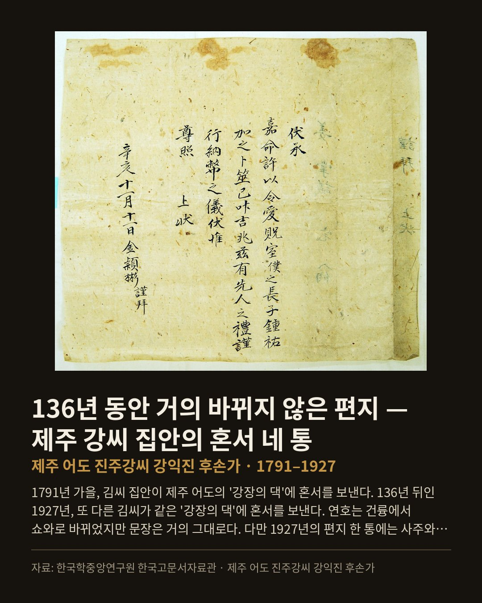
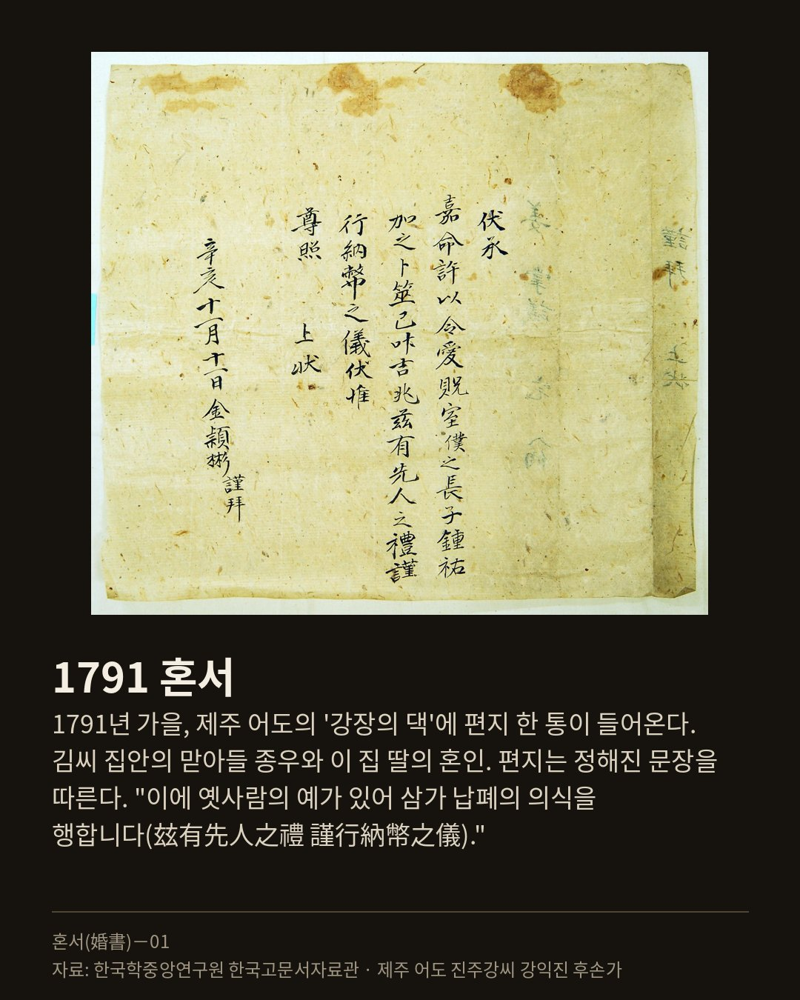

# EP.141 136년 동안 거의 바뀌지 않은 편지 — 제주 강씨 집안의 혼서 네 통

제주 어도 진주강씨 강익진 후손가 (문중) · 1791년 가을, 김씨 집안이 제주 어도의 '강장의 댁'에 혼서를 보낸다. 136년 뒤인 1927년, 또 다른 김씨가 같은 '강장의 댁'에 혼서를 보낸다. 연호는 건륭에서 쇼와로 바뀌었지만 문장은 거의 그대로다. 다만 1927년의 편지 한 통에는 사주와 '길한 날'이 새로 적혀 있다

- 🌐 [전시 웹페이지](https://changgi.github.io/archive-tools/examples/eodo-kang-ij-honseo/exhibit.html) (한자 위 한글 독음 · 원문 해석) · [수업 활동지](https://changgi.github.io/archive-tools/examples/eodo-kang-ij-honseo/handout.html)
- 🎬 영상: [릴스 9:16](https://changgi.github.io/archive-tools-next/media/ep141-eodo-kang-ij-honseo_reel.mp4) · [가로 16:9](https://changgi.github.io/archive-tools-next/media/ep141-eodo-kang-ij-honseo_wide.mp4) · 홍보 글: [`promo.md`](promo.md)
- 카드뉴스: [`cards/`](cards/) · SNS 글: [`sns.txt`](sns.txt) · 판독·해석 표: [`selection.csv`](selection.csv)

<!-- DELIVERY -->
## 전달 에디팅 — 이 기록을 이렇게 전합니다

- **핵심 정서** — 잔잔함
- **한 문장** — 혼서는 정해진 문장을 거의 그대로 베끼는 문서다 — 그래서 136년 사이에 달라진 몇 글자(연호, 음력 표기, 사주와 길일)가 오히려 크게 보인다.
- **열기** — 136년 동안, 청혼 편지의 문장은 거의 바뀌지 않았습니다.
- **펼치기** — 혼서－01 → 혼서－03 → 혼서－09 → 혼서－10 (1791–1927년) — 1791(강장의 댁으로 온 혼서) → 1850(강씨가 양생원 댁에 보낸 혼서) → 1927년 4월(사주를 보고 날을 정한 편지) → 1927년 12월(그날의 혼서)로, 받는 쪽과 보내는 쪽을 바꿔 보고 마지막에 한 혼인의 두 통을 나란히 두었습니다.
- **절정** — "이에 옛사람의 예가 있어 삼가 납폐의 의식을 행합니다(玆有先人之禮 謹行納幣之儀)" — 화면·공간에서 이 한 줄만 크게, 소리를 줄여 집중
- **여운** — 136년 뒤에도 같은 문장을 쓴다는 것은, 무엇을 지키는 일이었을까요? — 질문으로 끝내고 답은 보는 사람에게
- **감각과 물질** — 거의 같은 문장 네 통 — 연호와 날짜, 그리고 '사주' 몇 글자만 다르다
- **통로와 매개** — 온라인: 릴스(열기) → 카드뉴스(펼치기) → 전시 웹페이지(절정·원문) → 비하인드 카드(여운) / 오프라인: 원본 크기 복제·낭독·참여 벽 / 남기기: 활동지·질문 카드
- **여운 장치** — 집안에 전하는 오래된 편지나 청첩장의 문장 비교해 보기
- **전달 에디팅 전** — 4건의 문서를 1791–1927년 연대순으로 놓고 문서명 · 유형 · 해설을 붙인다 — 정확하지만, 지나가면 잊힌다.
- **전달 에디팅 후** — 핵심 정서는 「잔잔함」. 「136년 동안, 청혼 편지의 문장은 거의 바뀌지 않았습니다.」로 열고, 문서를 대비와 순서로 펼친 뒤, "이에 옛사람의 예가 있어 삼가 납폐의 의식을 행합니다(玆有先人之禮 謹行納幣之儀)"에서 멈춘다. 거의 같은 문장 네 통 — 연호와 날짜, 그리고 '사주' 몇 글자만 다르다. 마지막엔 「집안에 전하는 오래된 편지나 청첩장의 문장 비교해 보기」로 보는 사람이 자기 이야기를 남기고 떠나게 한다.

전문: [`delivery.md`](delivery.md)
<!-- /DELIVERY -->

<!-- CURATOR -->
## 비하인드 — 큐레이터 노트

- **왜 이 문서들인가** — EP.140까지 강세건 집안의 호적을 읽은 뒤, 같은 집안의 혼서 11통 가운데 처음(1791)과 끝(1927)이 같은 '강장의 댁'으로 온 것을 보고 네 통을 골랐습니다.
- **전하고 싶은 것** — 혼서는 정해진 문장을 거의 그대로 베끼는 문서다 — 그래서 136년 사이에 달라진 몇 글자(연호, 음력 표기, 사주와 길일)가 오히려 크게 보인다.
- **이렇게 보이길 바랐다** — 1791(강장의 댁으로 온 혼서) → 1850(강씨가 양생원 댁에 보낸 혼서) → 1927년 4월(사주를 보고 날을 정한 편지) → 1927년 12월(그날의 혼서)로, 받는 쪽과 보내는 쪽을 바꿔 보고 마지막에 한 혼인의 두 통을 나란히 두었습니다.
- **이렇게 써 주세요** — 조선 후기~근대의 혼례 절차(납채 · 연길 · 납폐), 편지 서식, 연호와 날짜 표기의 변화, 문중 문서의 전승 수업에 쓰세요.
- **만들며 있었던 일** — 네 통 모두 해서로 또렷합니다. 1791년 보낸 사람 이름 가운데 글자는 확정하지 못해 □로 두었습니다. 1927년 12월 혼서는 자료관 목록에 1960년으로 되어 있으나, 본문의 丁卯와 같은 해 4월 편지의 보낸 사람 · 신랑 이름 · 날짜가 맞아 1927년으로 보았습니다. 1850년 강씨가 보낸 혼서가 왜 강씨 집에 남았는지는 판단하지 않았습니다.
- **남겨 둔 질문** — 136년 뒤에도 같은 문장을 쓴다는 것은, 무엇을 지키는 일이었을까요?
- **제작 기록** — 문서 4건 · 1791–1927년 · 원본 사진 8면(문서 전체) · 원문 판독 4건 · 번역 4건 · 못 읽은 글자 □ 1 · 불확실 (?) 0 · 해제에 "확인 필요"를 단 문서 1건

전문: [`curator.md`](curator.md) · 비하인드 카드: [`behind/`](behind/) · 채널별 홍보안: [`channels.md`](channels.md)
<!-- /CURATOR -->

## 이야기 — 사료가 말하는 대로

136년 동안, 청혼 편지의 문장은 거의 바뀌지 않았습니다.

> **1791 혼서** — 1791년 가을, 제주 어도의 '강장의 댁'에 편지 한 통이 들어온다. 김씨 집안의 맏아들 종우와 이 집 딸의 혼인. 편지는 정해진 문장을 따른다. "이에 옛사람의 예가 있어 삼가 납폐의 의식을 행합니다(玆有先人之禮 謹行納幣之儀)."
> **1850 혼서** — 59년 뒤, 1850년. 이번에는 강씨 집안이 편지를 쓴다. 강익진이 아들 영운을 장가보내며 양생원 댁에 보내는 혼서. "옛 예법을 따라 글을 갖추어 납폐합니다(式遵古禮 具書納幣)." 점괘 구절은 빠졌고, 문장은 더 짧아졌다.
> **1927 혼서** — 그리고 1927년 초여름. 나주김씨 김계형이 맏아들 맹옥의 혼인을 두고 편지를 쓴다. 이번에는 사주가 등장한다. "사주를 살펴보니 길함이 많고 흉함이 적다(考其四柱 則吉多凶少)." 날짜도 정해졌다. 12월 24일. 연호는 쇼와, 그 옆에 '음력'이라는 글자가 붙는다.
> **1927 혼서** — 1927년 12월 24일, 정한 바로 그날. 같은 김계형이 다시 쓴다. 겉봉에는 '강장의 댁', 136년 전과 같은 주소. 본문의 마지막도 같다. "옛사람의 예가 있어 삼가 납폐의 의식을 행합니다(玆有先人之禮 謹行納幣之儀)." 연호는 빠졌고, 간지만 남았다. 문장이 지킨 것은 136년이었다.

| 표지 | 1번 카드 | 마무리 |
|---|---|---|
|  |  |  |

## 선별 문서 (4점)

| # | 연도 | 유형 | 문서명 | 원본 |
|---|---|---|---|---|
| 1 | 1791 | 혼서 | 혼서(婚書)－01 | [원본 보기](https://archive.aks.ac.kr/viewer/viewer.do#imgnode.do?itemId=book&gubun=booktree&depth=6&upPath=01%5E0168%5EL016818%5EL016818F02%5EL016818F0206&dataId=G002%2BAKS%2BKSM-XF.1791.5011-20220125.B077a_114_00457_XXX&itemType=) |
| 2 | 1850 | 혼서 | 혼서(婚書)－03 | [원본 보기](https://archive.aks.ac.kr/viewer/viewer.do#imgnode.do?itemId=book&gubun=booktree&depth=6&upPath=01%5E0168%5EL016818%5EL016818F02%5EL016818F0206&dataId=G002%2BAKS%2BKSM-XF.1850.5011-20220125.B077a_114_00459_XXX&itemType=) |
| 3 | 1927 | 혼서 | 혼서(婚書)－09 | [원본 보기](https://archive.aks.ac.kr/viewer/viewer.do#imgnode.do?itemId=book&gubun=booktree&depth=6&upPath=01%5E0168%5EL016818%5EL016818F02%5EL016818F0206&dataId=G002%2BAKS%2BKSM-XF.1927.5011-20220125.B077a_114_00465_XXX&itemType=) |
| 4 | 1927 | 혼서 | 혼서(婚書)－10 | [원본 보기](https://archive.aks.ac.kr/viewer/viewer.do#imgnode.do?itemId=book&gubun=booktree&depth=6&upPath=01%5E0168%5EL016818%5EL016818F02%5EL016818F0206&dataId=G002%2BAKS%2BKSM-XF.1960.5011-20220125.B077a_114_00466_XXX&itemType=) |

## 원문 판독과 해석

### 1. 혼서(婚書)－01

**원문 판독**

```
伏承
嘉命 許以令愛 貺室僕之長子鍾祐
加之卜筮 已叶吉兆 玆有先人之禮 謹
行納幣之儀 伏惟
尊照 上狀
辛亥十月十一日 金□彬 謹拜
(겉면) 姜掌議 宅 入納
```

**원문 해석** 엎드려 아름다운 명을 받드니, 따님을 저의 맏아들 종우의 아내로 허락하셨습니다. 거기에 점을 쳐 보니 이미 길한 조짐에 맞았습니다. 이에 옛사람의 예가 있어 삼가 납폐의 의식을 행합니다. 엎드려 바라건대 살펴 주십시오. 편지를 올립니다. 신해년 10월 11일 김□빈 삼가 절합니다. (겉면) 강장의 댁에 들입니다.

**해제** 신해년(자료관 목록 1791, 정조 15) 10월 11일 김□빈(金□彬)이 맏아들 종우(鍾祐)를 강씨 집안 딸과 혼인시키며 신부 집 '강장의(姜掌議) 댁'에 보낸 혼서(婚書)입니다. 혼서는 납폐(納幣) 때 신랑 집이 폐백과 함께 보내는 편지로, '허락해 주셔서(許以令愛 貺室) … 옛사람의 예에 따라(先人之禮) 납폐를 행한다'는 정해진 문장을 씁니다. 이 혼서는 '점을 쳐 길한 조짐에 맞았다(加之卜筮 已叶吉兆)'는 구절을 더했습니다. 장의(掌議)는 향교 · 서원의 임원 직함입니다. 연호 없이 간지만 썼습니다. 보낸 사람 이름 가운데 글자는 확정하지 못했습니다.

### 2. 혼서(婚書)－03

**원문 판독**

```
伏蒙
尊慈許以
令愛貺室 僕之子永運 式遵古
禮 具書納幣 伏惟
鑑察 不宣
道光三十年十月十三日 晉州後人姜益鎭 狀上
(겉면) 梁生員 宅 入納
```

**원문 해석** 엎드려 너그러이 허락해 주심을 입어, 따님을 저의 아들 영운의 아내로 주셨습니다. 옛 예법을 따라 글을 갖추어 납폐합니다. 엎드려 바라건대 살펴 주십시오. 다 적지 못합니다. 도광 30년(1850) 10월 13일 진주 후인 강익진이 편지를 올립니다. (겉면) 양생원 댁에 들입니다.

**해제** 1850년(철종 1, 道光 30) 10월 13일 진주강씨 강익진(姜益鎭)이 아들 영운(永運)의 혼인을 위해 '양생원(梁生員) 댁'에 보낸 혼서입니다. 이번에는 강씨 집안이 신랑 집, 곧 보내는 쪽입니다. 1791년 혼서와 견주면 점괘 구절이 빠지고 '옛 예법을 따라 글을 갖추어 납폐한다(式遵古禮 具書納幣)'로 줄었으며, 청 연호 '道光'과 '진주 후인(晉州後人)'이라는 본관 표기가 들어갔습니다. 소장 문중의 이름인 강익진 본인이 쓴 혼서입니다. 받는 집에 가야 할 편지가 왜 보낸 집에 남았는지(초안 · 사본 · 되돌려받음 등)는 판단하지 않았습니다.

### 3. 혼서(婚書)－09

**원문 판독**

```
時維孟夏
尊體百福 僕之長子金孟玉 年旣長成
未有伉儷 伏聞 貴宅有淑女之譽
縱乏東床之選
尊慈許以後 考其四柱 則吉多凶少
是月老之因緣也 涓吉十二月二十四
日也 是日納幣行禮之儀不備 伏惟
尊照 謹拜 上狀
昭和貳年陰四月二十八日 羅州后人金桂瀅
```

**원문 해석** 때는 초여름, 존체 두루 평안하신지요. 저의 맏아들 김맹옥이 이미 다 자랐으나 아직 짝이 없습니다. 엎드려 듣건대 귀댁에 어진 따님이 있다 하니, 훌륭한 사위감은 못 되더라도 너그러이 허락하신 뒤 두 사람의 사주를 살펴보니 길함이 많고 흉함이 적어, 월하노인이 맺어 준 인연입니다. 좋은 날을 가려 보니 12월 24일입니다. 이날 납폐하고 예를 행하겠습니다. 다 갖추지 못합니다. 엎드려 바라건대 살펴 주십시오. 삼가 절하며 편지를 올립니다. 쇼와 2년(1927) 음력 4월 28일 나주 후인 김계형.

**해제** 1927년(昭和 2) 음력 4월 28일 나주김씨 김계형(金桂瀅)이 맏아들 김맹옥(金孟玉)의 혼인을 두고 강씨 집에 보낸 편지입니다. 혼서의 첫머리 '時維孟夏 尊體百福'과 '年旣長成 未有伉儷'는 1888년 혼서(같은 집안 소장)에도 보이는 근대 혼서의 서식이지만, 이 편지는 납폐 당일의 혼서가 아니라 혼인 허락 뒤 사주를 맞춰 보고 '길일은 12월 24일(涓吉十二月二十四日)'이라고 알리는 연길(涓吉) 편지의 성격이 강합니다. 일본 연호 '昭和'와 함께 '陰(음력)'을 따로 밝혀 쓴 점이 눈에 띕니다. '縱乏東床之選'의 읽기는 원문 확인이 필요합니다.

### 4. 혼서(婚書)－10

**원문 판독**

```
時維季冬
尊體百福 僕之子孟玉 年旣長成 未有
伉儷 伏蒙
尊慈許以令愛貺室 玆有先人之禮 謹
行納幣之儀 不備 伏惟
尊照 上狀
丁卯拾貳月貳拾四日 羅州后人 金桂瀅 謹拜
(겉면) 姜掌議 宅 下執事 入納
```

**원문 해석** 때는 늦겨울, 존체 두루 평안하신지요. 저의 아들 맹옥이 이미 다 자랐으나 아직 짝이 없었는데, 엎드려 너그러이 따님을 아내로 허락해 주심을 입었습니다. 이에 옛사람의 예가 있어 삼가 납폐의 의식을 행합니다. 다 갖추지 못합니다. 엎드려 바라건대 살펴 주십시오. 편지를 올립니다. 정묘년 12월 24일 나주 후인 김계형 삼가 절합니다. (겉면) 강장의 댁 하집사께 들입니다.

**해제** 정묘년 12월 24일 김계형이 아들 맹옥의 납폐 날에 '강장의 댁'으로 보낸 혼서입니다. 자료관 목록에는 1960년으로 되어 있으나, 같은 집안에 전하는 1927년 음력 4월 편지(같은 보낸 사람 김계형, 같은 신랑 맹옥)가 길일로 알린 '12월 24일'과 이 혼서의 날짜 '丁卯(1927)拾貳月貳拾四日'이 맞아 1927년의 혼서로 보았습니다. 겉면의 '姜掌議 宅'은 1791년 혼서와 같은 받는 이 표기이며, 본문의 '玆有先人之禮 謹行納幣之儀'도 136년 전 문장과 같습니다. 이 혼서는 일본 연호 없이 간지만 썼습니다.

판독·해석·이야기는 이미지에 근거한 초안이며(검토 전 "초안" 표시), 정확한 판독은 원문 확인이 필요합니다. □는 읽지 못한 글자, (?)는 불확실한 글자입니다.
이미지: 한국학중앙연구원 한국고문서자료관 소장·제공. "원본" 링크를 누르면 자료관 뷰어에서 그 문서가 열립니다. 재사용은 자료관에 문의하세요(소장처 동의 필요).
