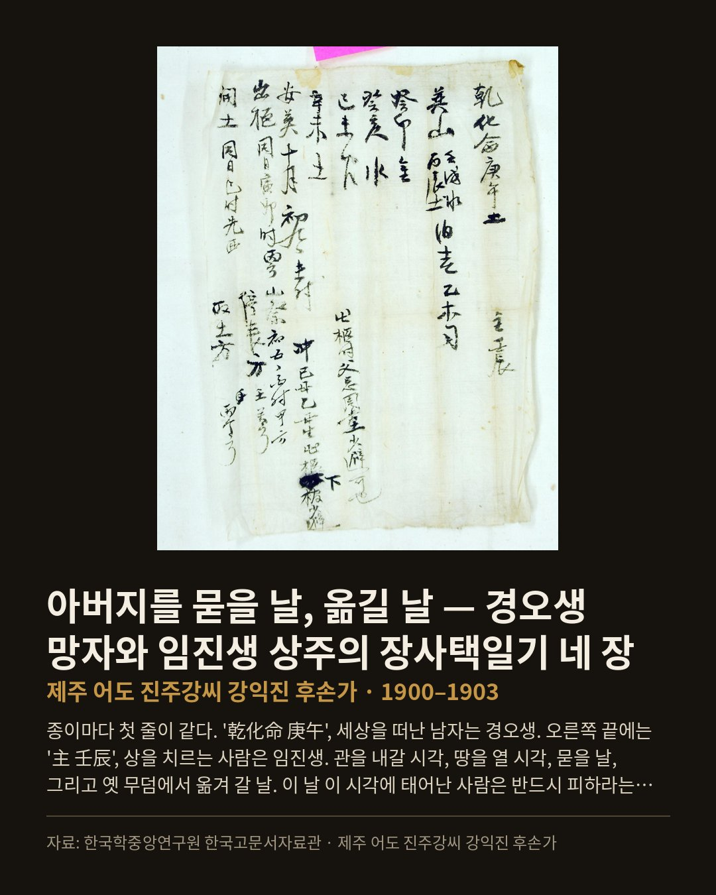
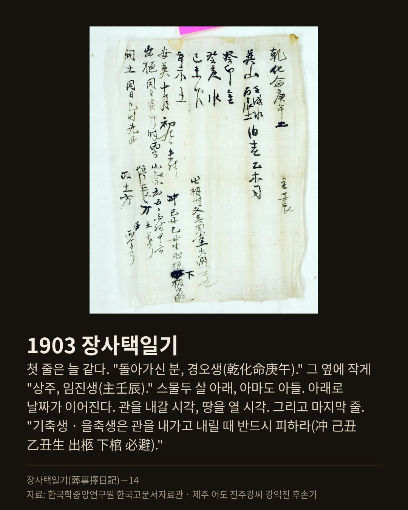

# EP.149 아버지를 묻을 날, 옮길 날 — 경오생 망자와 임진생 상주의 장사택일기 네 장

제주 어도 진주강씨 강익진 후손가 (문중) · 종이마다 첫 줄이 같다. '乾化命 庚午', 세상을 떠난 남자는 경오생. 오른쪽 끝에는 '主 壬辰', 상을 치르는 사람은 임진생. 관을 내갈 시각, 땅을 열 시각, 묻을 날, 그리고 옛 무덤에서 옮겨 갈 날. 이 날 이 시각에 태어난 사람은 반드시 피하라는 줄까지. 한 아들이 아버지의 무덤을 위해 고른 날짜들이 종이 네 장에 남았다

- 🌐 [전시 웹페이지](https://changgi.github.io/archive-tools/examples/eodo-kang-ij-jangsa/exhibit.html) (한자 위 한글 독음 · 원문 해석) · [수업 활동지](https://changgi.github.io/archive-tools/examples/eodo-kang-ij-jangsa/handout.html)
- 🎬 영상: [릴스 9:16](https://changgi.github.io/archive-tools-next/media/ep149-eodo-kang-ij-jangsa_reel.mp4) · [가로 16:9](https://changgi.github.io/archive-tools-next/media/ep149-eodo-kang-ij-jangsa_wide.mp4) · 홍보 글: [`promo.md`](promo.md)
- 카드뉴스: [`cards/`](cards/) · SNS 글: [`sns.txt`](sns.txt) · 판독·해석 표: [`selection.csv`](selection.csv)

<!-- DELIVERY -->
## 전달 에디팅 — 이 기록을 이렇게 전합니다

- **핵심 정서** — 고요함
- **한 문장** — 혼인이 날짜에서 시작했듯 장례도 날짜에서 시작했다 — 관을 내갈 시각, 땅을 열 시각, 묻을 날, 옮길 날, 그리고 그 자리를 피해야 할 사람들의 띠까지.
- **열기** — 아버지를 묻을 날, 어떤 해에 태어난 사람은 자리를 피해야 했습니다.
- **펼치기** — 장사택일기－14 → 장사택일기－17 → 장사택일기－16 → 장사택일기－20 (1900–1903년) — 안장 택일(관 내가기 · 땅 열기 · 하관) → 안장 날 두 후보(윤2월 · 음4월) → 이장(遷移) 택일 → 옛 무덤(舊山)에서 옮기는 날로, 절차의 순서대로 놓았습니다. 자료관 목록 연도(1900 · 1903)는 서로 다르나 문서에는 간지 연도가 없어 차례를 확정하지 못했습니다.
- **절정** — "옛 산에서 옮김, 8월 23일(旧山 … 遷移 八月二十三日)" — 화면·공간에서 이 한 줄만 크게, 소리를 줄여 집중
- **여운** — 아버지를 묻을 날을 고르며, 아들은 무엇을 가장 오래 따졌을까요? — 질문으로 끝내고 답은 보는 사람에게
- **감각과 물질** — 종이마다 같은 첫 줄 '乾化命 庚午'와 끝의 '主 壬辰' — 그 사이에 바뀌는 날짜들
- **통로와 매개** — 온라인: 릴스(열기) → 카드뉴스(펼치기) → 전시 웹페이지(절정·원문) → 비하인드 카드(여운) / 오프라인: 원본 크기 복제·낭독·참여 벽 / 남기기: 활동지·질문 카드
- **여운 장치** — 집안 어른의 제삿날 · 기일이 언제인지, 왜 그날인지 물어보기
- **전달 에디팅 전** — 4건의 문서를 1900–1903년 연대순으로 놓고 문서명 · 유형 · 해설을 붙인다 — 정확하지만, 지나가면 잊힌다.
- **전달 에디팅 후** — 핵심 정서는 「고요함」. 「아버지를 묻을 날, 어떤 해에 태어난 사람은 자리를 피해야 했습니다.」로 열고, 문서를 대비와 순서로 펼친 뒤, "옛 산에서 옮김, 8월 23일(旧山 … 遷移 八月二十三日)"에서 멈춘다. 종이마다 같은 첫 줄 '乾化命 庚午'와 끝의 '主 壬辰' — 그 사이에 바뀌는 날짜들. 마지막엔 「집안 어른의 제삿날 · 기일이 언제인지, 왜 그날인지 물어보기」로 보는 사람이 자기 이야기를 남기고 떠나게 한다.

전문: [`delivery.md`](delivery.md)
<!-- /DELIVERY -->

<!-- CURATOR -->
## 비하인드 — 큐레이터 노트

- **왜 이 문서들인가** — EP.148의 혼례택일기(혼인 날 고르기)를 읽은 뒤, 같은 집안에 남은 장사택일기 25장을 보았습니다. 그 가운데 '乾化命 庚午 · 主 壬辰'으로 시작하는 종이가 여러 장이어서, 한 망자의 장례 · 이장 과정을 보여 주는 네 장을 골랐습니다.
- **전하고 싶은 것** — 혼인이 날짜에서 시작했듯 장례도 날짜에서 시작했다 — 관을 내갈 시각, 땅을 열 시각, 묻을 날, 옮길 날, 그리고 그 자리를 피해야 할 사람들의 띠까지.
- **이렇게 보이길 바랐다** — 안장 택일(관 내가기 · 땅 열기 · 하관) → 안장 날 두 후보(윤2월 · 음4월) → 이장(遷移) 택일 → 옛 무덤(舊山)에서 옮기는 날로, 절차의 순서대로 놓았습니다. 자료관 목록 연도(1900 · 1903)는 서로 다르나 문서에는 간지 연도가 없어 차례를 확정하지 못했습니다.
- **이렇게 써 주세요** — 조선 후기~근대 상장례 절차(출구 · 개토 · 하관 · 안장 · 이장), 택일과 풍수(좌향 · 방위), '피해야 할 띠(冲)' 관념, 상주 제도 수업에 쓰세요.
- **만들며 있었던 일** — 네 장 모두 짧은 행초서 메모라 날짜 · 시각 · 간지는 또렷한 것만 옮기고, 산 이름과 좌향의 일부는 …로 두었습니다. '乾化命'은 '세상을 떠난 남자(망자)의 생년'으로, '主'는 상주로 풀었습니다. 망자가 누구인지, EP.148의 경오생 신랑과 같은 사람인지는 이름이 없어 판단하지 않았습니다.
- **남겨 둔 질문** — 아버지를 묻을 날을 고르며, 아들은 무엇을 가장 오래 따졌을까요?
- **제작 기록** — 문서 4건 · 1900–1903년 · 원본 사진 4면(문서 전체) · 원문 판독 4건 · 번역 4건 · 못 읽은 글자 □ 2 · 불확실 (?) 1

전문: [`curator.md`](curator.md) · 비하인드 카드: [`behind/`](behind/) · 채널별 홍보안: [`channels.md`](channels.md)
<!-- /CURATOR -->

## 이야기 — 사료가 말하는 대로

아버지를 묻을 날, 어떤 해에 태어난 사람은 자리를 피해야 했습니다.

> **1903 장사택일기** — 첫 줄은 늘 같다. "돌아가신 분, 경오생(乾化命庚午)." 그 옆에 작게 "상주, 임진생(主壬辰)." 스물두 살 아래, 아마도 아들. 아래로 날짜가 이어진다. 관을 내갈 시각, 땅을 열 시각. 그리고 마지막 줄. "기축생 · 을축생은 관을 내가고 내릴 때 반드시 피하라(冲 己丑 乙丑生 出柩 下棺 必避)."
> **1900 장사택일기** — 또 한 장. 이번에는 날이 두 개다. "안장, 윤2월 22일 미시(安葬 閏二月二十二日未時)." 그 아래 다시, "안장, 음력 4월 24일 미시." 첫 날로는 안 되었던 걸까. 두 번째 날 앞에는 산신에게 먼저 고하는 제사, 산제가 붙었다.
> **1900 장사택일기** — 그리고 어느 해 정월, 아들은 아버지의 무덤을 옮기기로 한다. "이장, 정월 13일 묘시(遷移 正月十三日卯時)." 관은 서쪽으로 백 걸음 밖에 내놓는다. 피해야 할 사람은 이제 네 띠로 늘었다.
> **1900 장사택일기** — 마지막은 좁고 긴 쪽지 한 장. 큰 글씨로 "옛 산에서 옮김, 8월 23일(旧山 … 遷移 八月二十三日)." 묻을 날, 다시 고른 날, 옮길 날, 또 옮길 날. 한 사람의 무덤을 위해 아들은 몇 번이나 날을 골랐을까.

| 표지 | 1번 카드 | 마무리 |
|---|---|---|
|  |  |  |

## 선별 문서 (4점)

| # | 연도 | 유형 | 문서명 | 원본 |
|---|---|---|---|---|
| 1 | 1903 | 장사택일기 | 장사택일기(葬事擇日記)－14 | [원본 보기](https://archive.aks.ac.kr/viewer/viewer.do#imgnode.do?itemId=book&gubun=booktree&depth=6&upPath=01%5E0168%5EL016818%5EL016818F02%5EL016818F0207&dataId=G002%2BAKS%2BKSM-XG.1903.5011-20220125.B077a_114_00486_XXX&itemType=) |
| 2 | 1900 | 장사택일기 | 장사택일기(葬事擇日記)－17 | [원본 보기](https://archive.aks.ac.kr/viewer/viewer.do#imgnode.do?itemId=book&gubun=booktree&depth=6&upPath=01%5E0168%5EL016818%5EL016818F02%5EL016818F0207&dataId=G002%2BAKS%2BKSM-XG.1900.5011-20220125.B077a_114_00489_XXX&itemType=) |
| 3 | 1900 | 장사택일기 | 장사택일기(葬事擇日記)－16 | [원본 보기](https://archive.aks.ac.kr/viewer/viewer.do#imgnode.do?itemId=book&gubun=booktree&depth=6&upPath=01%5E0168%5EL016818%5EL016818F02%5EL016818F0207&dataId=G002%2BAKS%2BKSM-XG.1900.5011-20220125.B077a_114_00488_XXX&itemType=) |
| 4 | 1900 | 장사택일기 | 장사택일기(葬事擇日記)－20 | [원본 보기](https://archive.aks.ac.kr/viewer/viewer.do#imgnode.do?itemId=book&gubun=booktree&depth=6&upPath=01%5E0168%5EL016818%5EL016818F02%5EL016818F0207&dataId=G002%2BAKS%2BKSM-XG.1900.5011-20220125.B077a_114_00492_XXX&itemType=) |

## 원문 판독과 해석

### 1. 장사택일기(葬事擇日記)－14

**원문 판독**

```
乾化命庚午 土
主壬辰
莫山 … 坐 …
癸卯金 癸亥水 己未火 辛未土
安葬 十一月初□ 辰時
出柩 同日 寅卯時 …
開土 同日巳時 先酉
… 破土方 …
冲 己丑 乙丑生 出柩 下棺 必避 …
```

**원문 해석** 돌아가신 남자, 경오생(토). 상주 임진생. … 산의 … 좌(묏자리 방향). (택한 날의 네 기둥) 계묘(금) · 계해(수) · 기미(화) · 신미(토). 안장(묻기): 11월 초○일 진시. 출구(관 내가기): 같은 날 인시 · 묘시. 개토(땅 열기): 같은 날 사시, 먼저 유(酉) 방향부터. … 파토 방향 …. 충(冲): 기축생 · 을축생은 관을 내가고 내릴 때 반드시 피할 것.

**해제** 경오생 망자(乾化命 庚午)의 안장 날을 고른 장사택일기(葬事擇日記)입니다. 오른쪽 끝의 '主 壬辰'은 상주(主喪)가 임진생이라는 뜻으로, 망자보다 스물두 살 아래이니 아들로 보입니다. 안장일과 그날의 네 기둥(간지 · 오행), 관을 집에서 내가는 출구(出柩) 시각, 무덤 자리의 흙을 처음 여는 개토(開土) 시각과 방향을 차례로 적고, 끝에 '기축생 · 을축생은 관을 내가고 내릴 때 반드시 피하라(出柩下棺必避)'고 적었습니다. 그날의 기운과 부딪치는(冲) 띠의 사람을 자리에서 물리는 풍속입니다. 산 이름과 좌향은 확정하지 못했습니다.

### 2. 장사택일기(葬事擇日記)－17

**원문 판독**

```
乾化命庚午 土
主壬辰
已作 甲戌火 辛未土 吉乙木
己酉土 戊辰木 壬寅金 丁未水
開不安 葬云
安葬 閏二月二十二日未時
啓殯開壙 辰時 先南
停取 庚辛方
冲 壬申 丙申生
己亥土 庚午土 壬寅金 丁未水
停取 庚辛方 冲 壬申 丙申生
安葬 陰四月二十四日未時
山祭 十九日子時
啓殯開壙 全日 辰巳時 …
```

**원문 해석** 돌아가신 남자, 경오생(토). 상주 임진생. … (첫 후보) 안장: 윤2월 22일 미시. 빈소를 열고 무덤 구덩이를 파는 것(계빈 · 개광)은 진시, 남쪽부터. 머무를 곳은 경 · 신 방향. 임신생 · 병신생은 피함. … (둘째 후보) 안장: 음력 4월 24일 미시. 산신제: 19일 자시. 계빈 · 개광: 같은 날 진시 · 사시 ….

**해제** 같은 경오생 망자 · 임진생 상주의 장사택일기로, 안장 날 후보 둘을 함께 적었습니다. 첫째는 '윤2월 22일 미시', 둘째는 '음력 4월 24일 미시'이며, 둘째에는 무덤을 쓰기 전 산신에게 올리는 산제(山祭)를 닷새 앞선 19일 자시로 잡았습니다. 위쪽에 작게 적힌 '開不安 葬云'은 (어떤 날은) 무덤을 열기에 편치 않다는 판단으로 읽히나 확정하지 못했습니다. 계빈(啓殯)은 빈소를 여는 일, 개광(開壙)은 무덤 구덩이를 파는 일입니다. 윤2월이 든 해와 맞춰 보면 연도를 좁힐 수 있으나, 이 문서만으로는 정하지 않았습니다.

### 3. 장사택일기(葬事擇日記)－16

**원문 판독**

```
乾化命庚午
主壬辰
癸山 … 空
遷移 正月十三日卯時 先破酉
出柩 午時 酉方 百步外
冲 乙未 辛未生 必避
冲 甲子 庚子生 必避
```

**원문 해석** 돌아가신 남자, 경오생. 상주 임진생. 계산(癸山) … 공(空). 이장(옮기기): 정월 13일 묘시, 먼저 유(酉) 방향을 연다. 관을 내가는 것은 오시, 유 방향 백 걸음 밖으로. 을미생 · 신미생은 반드시 피할 것. 갑자생 · 경자생은 반드시 피할 것.

**해제** 같은 망자의 무덤을 옮기는 이장(遷移) 날을 고른 장사택일기입니다. '정월 13일 묘시'에 무덤을 열고(먼저 유 방향부터), 오시에 관을 '유 방향 백 걸음 밖(酉方 百步外)'으로 내간다고 적었습니다. 피해야 할 띠가 두 줄(을미 · 신미생, 갑자 · 경자생)로 늘었습니다. 첫 줄 '癸山 … 空'은 새 묏자리의 방향(계좌)과 관련된 풍수 표기로 보이나, 가운데 글자를 확정하지 못했습니다. 이 집안이 왜 무덤을 옮겼는지는 문서에 없습니다.

### 4. 장사택일기(葬事擇日記)－20

**원문 판독**

```
乾化命庚午
主壬辰
旧山 莫作 遷移 八月二十三日 辰時 先破 □方
出柩 未時 甲子(?)方
```

**원문 해석** 돌아가신 남자, 경오생. 상주 임진생. 옛 산(구산)에서 옮김: 8월 23일 진시, 먼저 ○ 방향을 연다. 관을 내가는 것은 미시, 갑자(?) 방향.

**해제** 길쭉한 쪽지에 큰 글씨로 '옛 산(旧山)'에서 옮기는 날만 적은 장사택일기입니다. 같은 망자 · 상주이며, 이장 날이 '8월 23일 진시'로 앞 장의 '정월 13일'과 다릅니다. 같은 무덤을 옮기려 날을 다시 잡았는지, 서로 다른 해의 이장인지는 알 수 없습니다. '莫作'은 '(이 산에서는 더) 짓지 말라'로 읽힐 여지가 있으나 확정하지 못했습니다. 이 집안 장사택일기 25장 가운데 '乾化命 庚午 · 主 壬辰'으로 시작하는 것이 여러 장이어서, 한 망자의 장례와 이장에 여러 번 날을 고른 흔적이 남았습니다.

판독·해석·이야기는 이미지에 근거한 초안이며(검토 전 "초안" 표시), 정확한 판독은 원문 확인이 필요합니다. □는 읽지 못한 글자, (?)는 불확실한 글자입니다.
이미지: 한국학중앙연구원 한국고문서자료관 소장·제공. "원본" 링크를 누르면 자료관 뷰어에서 그 문서가 열립니다. 재사용은 자료관에 문의하세요(소장처 동의 필요).
