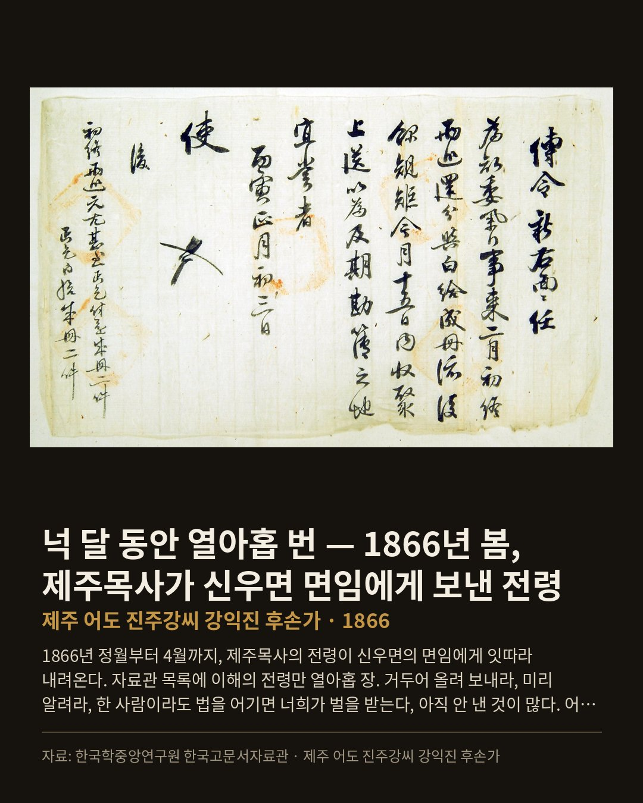
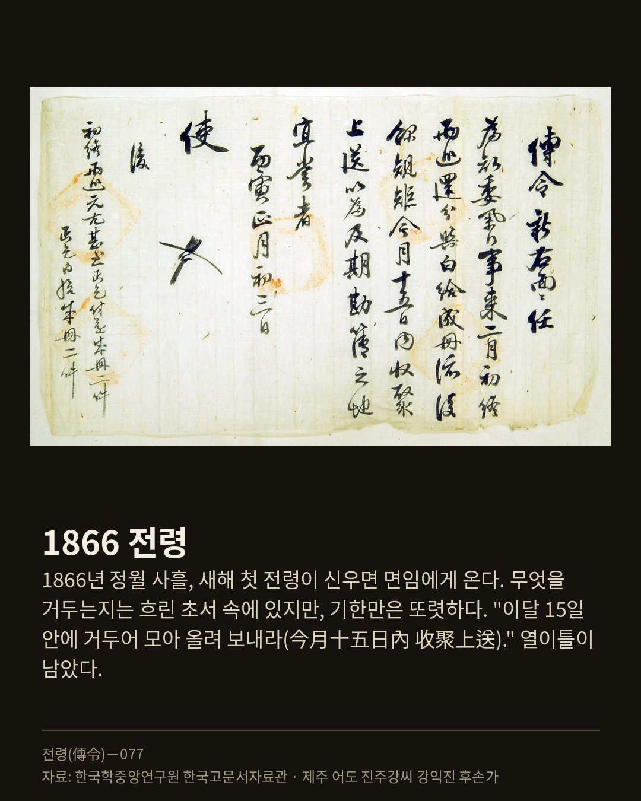

# EP.147 넉 달 동안 열아홉 번 — 1866년 봄, 제주목사가 신우면 면임에게 보낸 전령

제주 어도 진주강씨 강익진 후손가 (문중) · 1866년 정월부터 4월까지, 제주목사의 전령이 신우면의 면임에게 잇따라 내려온다. 자료관 목록에 이해의 전령만 열아홉 장. 거두어 올려 보내라, 미리 알려라, 한 사람이라도 법을 어기면 너희가 벌을 받는다, 아직 안 낸 것이 많다. 어도 강씨 집에 남은 이 종이들은, 마을과 관아 사이에 선 한 사람이 받아 든 봄의 무게다

- 🌐 [전시 웹페이지](https://changgi.github.io/archive-tools/examples/eodo-kang-ij-jeonryeong/exhibit.html) (한자 위 한글 독음 · 원문 해석) · [수업 활동지](https://changgi.github.io/archive-tools/examples/eodo-kang-ij-jeonryeong/handout.html)
- 🎬 영상: [릴스 9:16](https://changgi.github.io/archive-tools-next/media/ep147-eodo-kang-ij-jeonryeong_reel.mp4) · [가로 16:9](https://changgi.github.io/archive-tools-next/media/ep147-eodo-kang-ij-jeonryeong_wide.mp4) · 홍보 글: [`promo.md`](promo.md)
- 카드뉴스: [`cards/`](cards/) · SNS 글: [`sns.txt`](sns.txt) · 판독·해석 표: [`selection.csv`](selection.csv)

<!-- DELIVERY -->
## 전달 에디팅 — 이 기록을 이렇게 전합니다

- **핵심 정서** — 긴장
- **한 문장** — 목사는 쓰고, 면임은 받는다 — 거두어 올리라, 알리라, 단속하라, 독촉하라. 넉 달 사이 열아홉 장의 전령은 마을의 '중간 관리자'가 진 무게를 보여 준다.
- **열기** — 1866년 봄, 제주목사의 명령은 넉 달 동안 열아홉 번 내려왔습니다.
- **펼치기** — 전령－077 → 전령－080 → 전령－088 → 전령－091 (1866년) — 정월 3일(기한 안에 거두어 올려 보내라) → 정월 15일(사흘 뒤 도착, 맡은 일을 못 하면 벌한다) → 3월 29일(한 사람이라도 법을 어기면 면임이 벌을 받는다) → 4월 5일(아직 안 낸 것이 많다, 열흘 안에)로, 명령의 말이 점점 거칠어지는 흐름으로 놓았습니다.
- **절정** — "만약 한 백성이라도 법을 어기면, 그 면 · 동의 임원에게 알고도 고하지 않은 죄를 묻는다(若有一民犯科 則該面洞任 當施以知情不告之律)" — 화면·공간에서 이 한 줄만 크게, 소리를 줄여 집중
- **여운** — 명령서 열아홉 장을 받아 든 면임은, 마을 사람들에게 무엇이라 말했을까요? — 질문으로 끝내고 답은 보는 사람에게
- **감각과 물질** — 같은 '傳令 新右面任'으로 시작해 큰 '使' 자와 수결로 끝나는 종이가 넉 달 동안 쌓인다
- **통로와 매개** — 온라인: 릴스(열기) → 카드뉴스(펼치기) → 전시 웹페이지(절정·원문) → 비하인드 카드(여운) / 오프라인: 원본 크기 복제·낭독·참여 벽 / 남기기: 활동지·질문 카드
- **여운 장치** — 내가 받아 본 공문 · 안내문 하나를 '받는 사람' 입장에서 다시 읽기
- **전달 에디팅 전** — 4건의 문서를 1866년 연대순으로 놓고 문서명 · 유형 · 해설을 붙인다 — 정확하지만, 지나가면 잊힌다.
- **전달 에디팅 후** — 핵심 정서는 「긴장」. 「1866년 봄, 제주목사의 명령은 넉 달 동안 열아홉 번 내려왔습니다.」로 열고, 문서를 대비와 순서로 펼친 뒤, "만약 한 백성이라도 법을 어기면, 그 면 · 동의 임원에게 알고도 고하지 않은 죄를 묻는다(若有一民犯科 則該面洞任 當施以知情不告之律)"에서 멈춘다. 같은 '傳令 新右面任'으로 시작해 큰 '使' 자와 수결로 끝나는 종이가 넉 달 동안 쌓인다. 마지막엔 「내가 받아 본 공문 · 안내문 하나를 '받는 사람' 입장에서 다시 읽기」로 보는 사람이 자기 이야기를 남기고 떠나게 한다.

전문: [`delivery.md`](delivery.md)
<!-- /DELIVERY -->

<!-- CURATOR -->
## 비하인드 — 큐레이터 노트

- **왜 이 문서들인가** — EP.128에서 1675년 강세건이 받은 전령 한 장을 읽었습니다. 같은 집안 전령 100장 가운데 1866년(병인) 한 해 것이 열아홉 장으로 가장 많아, 그 가운데 날짜가 또렷한 네 장을 골랐습니다.
- **전하고 싶은 것** — 목사는 쓰고, 면임은 받는다 — 거두어 올리라, 알리라, 단속하라, 독촉하라. 넉 달 사이 열아홉 장의 전령은 마을의 '중간 관리자'가 진 무게를 보여 준다.
- **이렇게 보이길 바랐다** — 정월 3일(기한 안에 거두어 올려 보내라) → 정월 15일(사흘 뒤 도착, 맡은 일을 못 하면 벌한다) → 3월 29일(한 사람이라도 법을 어기면 면임이 벌을 받는다) → 4월 5일(아직 안 낸 것이 많다, 열흘 안에)로, 명령의 말이 점점 거칠어지는 흐름으로 놓았습니다.
- **이렇게 써 주세요** — 조선 후기 지방 행정(목사 · 면임 · 동임), 전령의 서식과 도착 기록(到付), 연좌와 '知情不告', 환곡 · 부세 독촉 수업에 쓰세요.
- **만들며 있었던 일** — 전령은 관아 서리가 빠르게 쓴 행초서라, 무엇을 거두는지(곡식 · 세의 종류)와 일부 구절은 확정하지 못해 …로 두었습니다. 면임이 강씨 집안 사람이었는지는 문서에 이름이 없어 '이 집에 남았다'고만 적었습니다. 1866년은 병인양요가 일어난 해이나, 이 전령들과의 관련은 판단하지 않았습니다.
- **남겨 둔 질문** — 명령서 열아홉 장을 받아 든 면임은, 마을 사람들에게 무엇이라 말했을까요?
- **제작 기록** — 문서 4건 · 1866년 · 원본 사진 4면(문서 전체) · 원문 판독 4건 · 번역 4건

전문: [`curator.md`](curator.md) · 비하인드 카드: [`behind/`](behind/) · 채널별 홍보안: [`channels.md`](channels.md)
<!-- /CURATOR -->

## 이야기 — 사료가 말하는 대로

1866년 봄, 제주목사의 명령은 넉 달 동안 열아홉 번 내려왔습니다.

> **1866 전령** — 1866년 정월 사흘, 새해 첫 전령이 신우면 면임에게 온다. 무엇을 거두는지는 흐린 초서 속에 있지만, 기한만은 또렷하다. "이달 15일 안에 거두어 모아 올려 보내라(今月十五日內 收聚上送)." 열이틀이 남았다.
> **1866 전령** — 열이틀 뒤, 두 번째 전령. 이번에는 경고가 먼저다. 일이 잘못되면 면임과 동임에게 "맡은 일을 못 한 죄를 묻는다(當施以不任不飭之律)." 종이 귀퉁이에 받은 쪽이 적었다. "18일 도착(十八日到付)." 명령은 사흘을 걸어서 왔다.
> **1866 전령** — 두 달 반 뒤, 3월 그믐. 이번 전령은 한 줄이 무겁다. "만약 한 백성이라도 법을 어기면, 그 면 · 동의 임원에게 알고도 고하지 않은 죄를 묻는다(若有一民犯科 則該面洞任 當施以知情不告之律)." 마을의 잘못은, 마을을 맡은 사람의 잘못이 된다.
> **1866 전령** — 다시 엿새 뒤, 4월 5일. 첫 줄부터 다급하다. '불같이(星火).' 그리고 "아직 내지 않은 것이 많다(未納尙多)." 열흘을 주겠다, 전처럼 하면 무겁게 다스린다. 넉 달 동안 열아홉 장. 그 종이들은 모두 어도의 한 집에 쌓여 남았다.

| 표지 | 1번 카드 | 마무리 |
|---|---|---|
|  |  |  |

## 선별 문서 (4점)

| # | 연도 | 유형 | 문서명 | 원본 |
|---|---|---|---|---|
| 1 | 1866 | 전령 | 전령(傳令)－077 | [원본 보기](https://archive.aks.ac.kr/viewer/viewer.do#imgnode.do?itemId=book&gubun=booktree&depth=6&upPath=01%5E0168%5EL016818%5EL016818F02%5EL016818F0203&dataId=G002%2BAKS%2BKSM-XC.1866.5011-20220125.B077a_114_00173_XXX&itemType=) |
| 2 | 1866 | 전령 | 전령(傳令)－080 | [원본 보기](https://archive.aks.ac.kr/viewer/viewer.do#imgnode.do?itemId=book&gubun=booktree&depth=6&upPath=01%5E0168%5EL016818%5EL016818F02%5EL016818F0203&dataId=G002%2BAKS%2BKSM-XC.1866.5011-20220125.B077a_114_00176_XXX&itemType=) |
| 3 | 1866 | 전령 | 전령(傳令)－088 | [원본 보기](https://archive.aks.ac.kr/viewer/viewer.do#imgnode.do?itemId=book&gubun=booktree&depth=6&upPath=01%5E0168%5EL016818%5EL016818F02%5EL016818F0203&dataId=G002%2BAKS%2BKSM-XC.1866.5011-20220125.B077a_114_00184_XXX&itemType=) |
| 4 | 1866 | 전령 | 전령(傳令)－091 | [원본 보기](https://archive.aks.ac.kr/viewer/viewer.do#imgnode.do?itemId=book&gubun=booktree&depth=6&upPath=01%5E0168%5EL016818%5EL016818F02%5EL016818F0203&dataId=G002%2BAKS%2BKSM-XC.1866.5011-20220125.B077a_114_00187_XXX&itemType=) |

## 원문 판독과 해석

### 1. 전령(傳令)－077

**원문 판독**

```
傳令 新右面任
爲知委事 … 來二月初 …
… 毋論 …
… 今月十五日內 收聚
上送 以爲及期 … 之地
宜當者
丙寅正月初三日
使 (수결)
```

**원문 해석** 전령. 신우면 면임에게. 미리 알리는 일. … 오는 2월 초 … 따지지 말고 … 이달 15일 안에 거두어 모아 올려 보내, 기한에 맞출 수 있게 하는 것이 마땅하다. 병인년(1866) 정월 3일. 사(使) (수결).

**해제** 병인년(자료관 목록 1866, 고종 3) 정월 3일 제주목사가 신우면(新右面) 면임(面任)에게 내린 전령(傳令)입니다. 전령은 관아가 아랫사람에게 내리는 명령서로, 맨 앞에 받는 이('新右面任')를, 끝에 큰 '使' 자와 목사의 수결을 둡니다. 신우면은 애월 일대로, 어도리가 속한 면입니다. '이달 15일 안에 거두어 모아 올려 보내라(今月十五日內 收聚上送)'는 기한이 분명하나, 무엇을 거두는지는 초서라 확정하지 못했습니다. 왼쪽 끝에 처리 내역으로 보이는 작은 글씨가 있습니다.

### 2. 전령(傳令)－080

**원문 판독**

```
… 之說 入於 … 則 … 面洞 …
當施以不任不飭之律 別般 …
勸 … 乃已 申明知委 而 … 擧行
… 亦 卽 報 宜當者
丙寅正月十五日
使 (수결)
(왼쪽 아래) 十八日到付
```

**원문 해석** … 하는 말이 (관아에) 들어오면 … 면 · 동 (임원)에게 맡은 일을 못 하고 단속하지 못한 죄를 물을 것이다. 각별히 … 권하여 … 그치게 하고, 거듭 밝혀 알려 … 거행하며, … 곧 보고하는 것이 마땅하다. 병인년(1866) 정월 15일. 사(使) (수결). (왼쪽 아래) 18일 도착.

**해제** 정월 15일 제주목사가 내린 전령입니다. 앞부분이 잘렸지만 '맡은 일을 못 하고 단속하지 못한 죄(不任不飭之律)'를 면 · 동의 임원에게 물리겠다는 경고가 남아 있습니다. 왼쪽 아래 작은 글씨 '十八日到付'는 이 전령이 사흘 뒤인 18일에 도착했음을 적은 수령 기록입니다. 관아(제주성)에서 애월까지 명령이 닿는 데 걸린 시간을 보여 줍니다. 본문의 앞뒤 사정은 확정하지 못했습니다.

### 3. 전령(傳令)－088

**원문 판독**

```
所居洞里 使之務本 安業是矣
如是令飭之後 若有一民犯科
則該面洞任 當施以知情不告
之律 惕念擧行爲於 形止 亦
卽馳報 宜當者
丙寅三月二十九日
使 (수결)
```

**원문 해석** 사는 마을에서 (백성이) 근본(농사)에 힘쓰고 생업에 편안히 머물게 하라. 이렇게 명하여 단속한 뒤에도 만약 한 백성이라도 법을 어기면, 그 면 · 동의 임원에게 알고도 고하지 않은 죄를 물을 것이니, 두려운 마음으로 거행하고 그 형편을 곧 달려와 보고하는 것이 마땅하다. 병인년(1866) 3월 29일. 사(使) (수결).

**해제** 3월 29일 제주목사의 전령으로, 네 장 가운데 가장 또렷하게 읽힙니다. 백성을 '농사에 힘쓰고 생업에 편안하게(務本安業)' 하라고 하면서, '한 백성이라도 법을 어기면(若有一民犯科)' 면 · 동의 임원에게 '알고도 고하지 않은 죄(知情不告之律)'를 묻겠다고 합니다. 마을 하나의 잘못을 그 마을 임원이 대신 지는 구조로, 조선 지방 행정이 면임 · 동임에게 맡긴 책임의 무게를 보여 줍니다. 앞부분이 잘려 어떤 일이 계기였는지는 알 수 없습니다.

### 4. 전령(傳令)－091

**원문 판독**

```
傳令 新右面任
爲星火 … 事 昨秋 …
… 前 磨勘之例 而 … 當
前未納尙多 …
… 然今初十日內 依 …
… 畢納是矣 若復如前 …
則 … 當重勘 惕念擧行 宜當
者
丙寅四月初五日
使 (수결)
```

**원문 해석** 전령. 신우면 면임에게. 불같이 급히 … 하는 일. 지난가을 … 앞서 셈하여 마감하는 예가 있는데 … 아직 내지 않은 것이 많다. … 이제 초열흘 안에 … 다 내도록 하라. 만약 다시 전처럼 … 하면 무겁게 다스릴 것이니, 두려운 마음으로 거행하는 것이 마땅하다. 병인년(1866) 4월 5일. 사(使) (수결).

**해제** 4월 5일 제주목사의 전령입니다. '불같이 급하게(星火)'로 시작해 '아직 내지 않은 것이 많다(未納尙多)', '초열흘 안에 다 내라(初十日內 … 畢納)', '전처럼 하면 무겁게 다스린다(當重勘)'로 이어지는 독촉입니다. 지난가을(昨秋)의 무엇을 거두는지는 초서라 확정하지 못했으나, 곡식 · 부세의 미납을 면임에게 책임 지워 거두게 하는 전령으로 보입니다. 자료관 목록상 이 집안에는 1866년 전령이 열아홉 장 있으며, 이 문서는 그 가운데 4월의 것입니다.

판독·해석·이야기는 이미지에 근거한 초안이며(검토 전 "초안" 표시), 정확한 판독은 원문 확인이 필요합니다. □는 읽지 못한 글자, (?)는 불확실한 글자입니다.
이미지: 한국학중앙연구원 한국고문서자료관 소장·제공. "원본" 링크를 누르면 자료관 뷰어에서 그 문서가 열립니다. 재사용은 자료관에 문의하세요(소장처 동의 필요).
