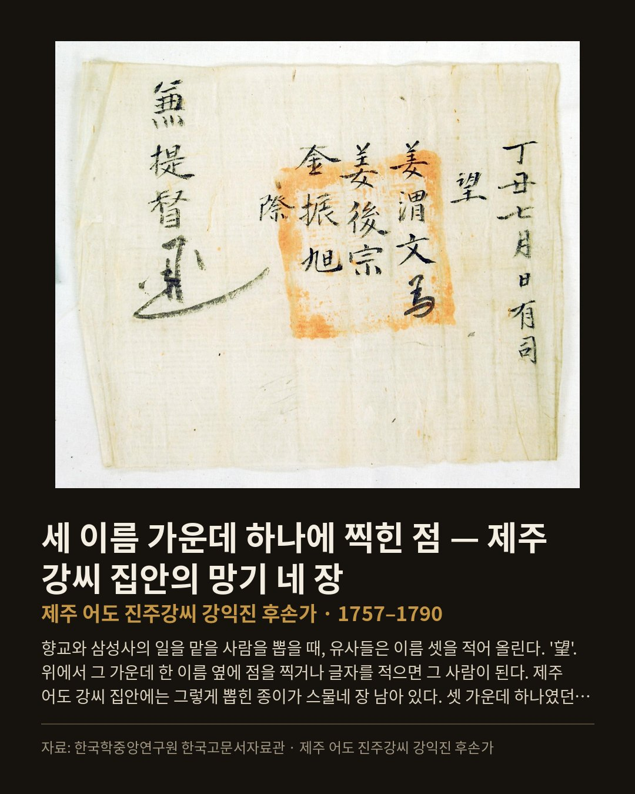
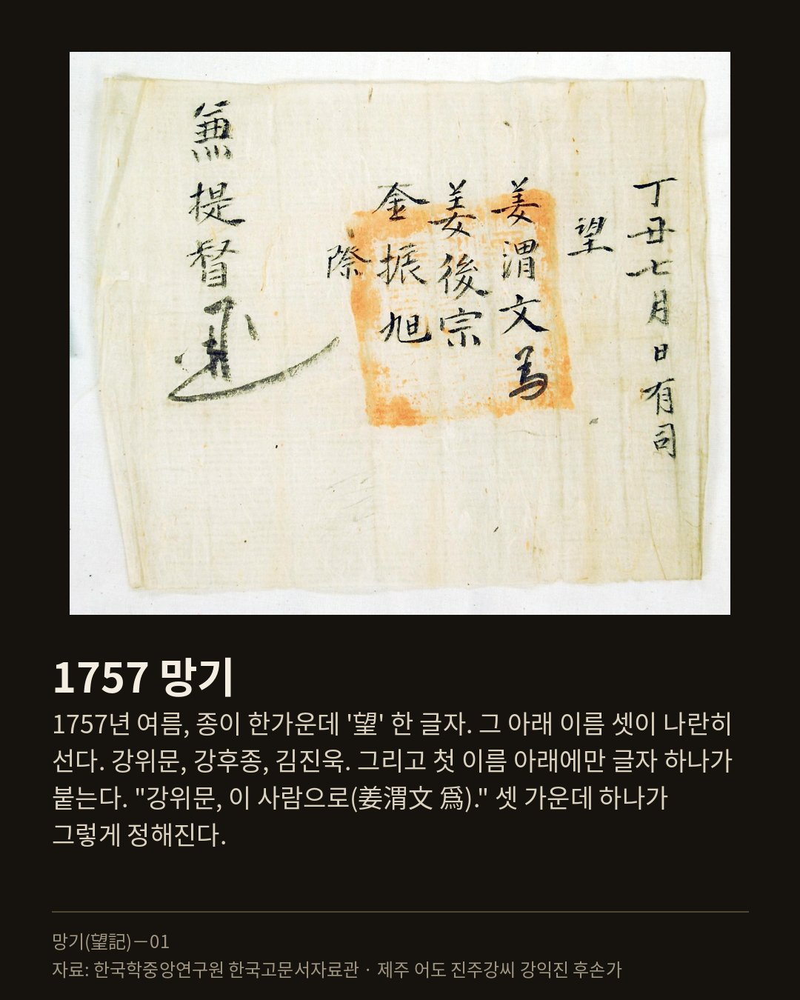

# EP.150 세 이름 가운데 하나에 찍힌 점 — 제주 강씨 집안의 망기 네 장

제주 어도 진주강씨 강익진 후손가 (문중) · 향교와 삼성사의 일을 맡을 사람을 뽑을 때, 유사들은 이름 셋을 적어 올린다. '望'. 위에서 그 가운데 한 이름 옆에 점을 찍거나 글자를 적으면 그 사람이 된다. 제주 어도 강씨 집안에는 그렇게 뽑힌 종이가 스물네 장 남아 있다. 셋 가운데 하나였던 강위문, 셋 가운데 하나였던 강인주, 그리고 혼자 이름이 올라간 강인주

- 🌐 [전시 웹페이지](https://changgi.github.io/archive-tools/examples/eodo-kang-ij-manggi/exhibit.html) (한자 위 한글 독음 · 원문 해석) · [수업 활동지](https://changgi.github.io/archive-tools/examples/eodo-kang-ij-manggi/handout.html)
- 🎬 영상: [릴스 9:16](https://changgi.github.io/archive-tools-next/media/ep150-eodo-kang-ij-manggi_reel.mp4) · [가로 16:9](https://changgi.github.io/archive-tools-next/media/ep150-eodo-kang-ij-manggi_wide.mp4) · 홍보 글: [`promo.md`](promo.md)
- 카드뉴스: [`cards/`](cards/) · SNS 글: [`sns.txt`](sns.txt) · 판독·해석 표: [`selection.csv`](selection.csv)

<!-- DELIVERY -->
## 전달 에디팅 — 이 기록을 이렇게 전합니다

- **핵심 정서** — 뿌듯함
- **한 문장** — 후보 셋을 올리고(三望) 한 사람에게 점을 찍는(落點) 방식은 조정의 벼슬만이 아니었다 — 제주의 향교와 삼성사도 같은 종이로 사람을 뽑았다.
- **열기** — 이름 셋이 올라가고, 한 이름 옆에만 점이 찍혔습니다.
- **펼치기** — 망기－01 → 망기－02 → 망기－06 → 망기－07 (1757–1790년) — 강위문이 셋 가운데 뽑힌 두 장(향교 겸제독 · 삼성사 선생) → 강인주가 셋 가운데 뽑힌 한 장 → 강인주 혼자 올라간 한 장(단망)으로, 후보가 셋에서 하나로 줄어드는 모양을 마지막에 두었습니다. 150번째 편입니다.
- **절정** — "강위문, 이 사람으로(姜渭文 爲)" — 화면·공간에서 이 한 줄만 크게, 소리를 줄여 집중
- **여운** — 셋 가운데 하나로 뽑히는 것과 혼자 이름이 올라가는 것, 어느 쪽이 더 무거웠을까요? — 질문으로 끝내고 답은 보는 사람에게
- **감각과 물질** — 세 이름 가운데 하나 옆의 '爲', 그리고 굵은 점 하나
- **통로와 매개** — 온라인: 릴스(열기) → 카드뉴스(펼치기) → 전시 웹페이지(절정·원문) → 비하인드 카드(여운) / 오프라인: 원본 크기 복제·낭독·참여 벽 / 남기기: 활동지·질문 카드
- **여운 장치** — 내가 누군가를 추천했던 경험, 혹은 추천받은 경험 적어 보기
- **전달 에디팅 전** — 4건의 문서를 1757–1790년 연대순으로 놓고 문서명 · 유형 · 해설을 붙인다 — 정확하지만, 지나가면 잊힌다.
- **전달 에디팅 후** — 핵심 정서는 「뿌듯함」. 「이름 셋이 올라가고, 한 이름 옆에만 점이 찍혔습니다.」로 열고, 문서를 대비와 순서로 펼친 뒤, "강위문, 이 사람으로(姜渭文 爲)"에서 멈춘다. 세 이름 가운데 하나 옆의 '爲', 그리고 굵은 점 하나. 마지막엔 「내가 누군가를 추천했던 경험, 혹은 추천받은 경험 적어 보기」로 보는 사람이 자기 이야기를 남기고 떠나게 한다.

전문: [`delivery.md`](delivery.md)
<!-- /DELIVERY -->

<!-- CURATOR -->
## 비하인드 — 큐레이터 노트

- **왜 이 문서들인가** — EP.145에서 강세건 · 강여흥이 관아의 차첩으로 직임을 받은 것을 보았습니다. 같은 집안에는 관아가 아니라 향교 · 삼성사 쪽에서 사람을 뽑은 망기가 24장 남아 있어, 그 가운데 낙점이 또렷한 네 장을 골랐습니다.
- **전하고 싶은 것** — 후보 셋을 올리고(三望) 한 사람에게 점을 찍는(落點) 방식은 조정의 벼슬만이 아니었다 — 제주의 향교와 삼성사도 같은 종이로 사람을 뽑았다.
- **이렇게 보이길 바랐다** — 강위문이 셋 가운데 뽑힌 두 장(향교 겸제독 · 삼성사 선생) → 강인주가 셋 가운데 뽑힌 한 장 → 강인주 혼자 올라간 한 장(단망)으로, 후보가 셋에서 하나로 줄어드는 모양을 마지막에 두었습니다. 150번째 편입니다.
- **이렇게 써 주세요** — 조선의 인사 방식(삼망 · 단망 · 낙점), 향교와 향촌 사회, 제주 삼성사(고 · 양 · 부 세 성씨의 시조 사당), 지방 유림의 직임 수업에 쓰세요.
- **만들며 있었던 일** — 네 장 모두 짧은 해서라 이름과 직임은 또렷합니다. 다만 연호 없이 간지만 있어, 자료관 목록 연도(1757 · 1765 · 1783 · 1790)를 따르면서도 60년 뒤일 가능성을 적었습니다(강인주라는 이름이 EP.144의 1828년 등장에도 나오기 때문). '兼提督' · '先生'이 맡은 일의 정확한 범위는 판단하지 않았습니다.
- **남겨 둔 질문** — 셋 가운데 하나로 뽑히는 것과 혼자 이름이 올라가는 것, 어느 쪽이 더 무거웠을까요?
- **제작 기록** — 문서 4건 · 1757–1790년 · 원본 사진 4면(문서 전체) · 원문 판독 4건 · 번역 4건 · 못 읽은 글자 □ 1 · 불확실 (?) 0

전문: [`curator.md`](curator.md) · 비하인드 카드: [`behind/`](behind/) · 채널별 홍보안: [`channels.md`](channels.md)
<!-- /CURATOR -->

## 이야기 — 사료가 말하는 대로

이름 셋이 올라가고, 한 이름 옆에만 점이 찍혔습니다.

> **1757 망기** — 1757년 여름, 종이 한가운데 '望' 한 글자. 그 아래 이름 셋이 나란히 선다. 강위문, 강후종, 김진욱. 그리고 첫 이름 아래에만 글자 하나가 붙는다. "강위문, 이 사람으로(姜渭文 爲)." 셋 가운데 하나가 그렇게 정해진다.
> **1765 망기** — 8년 뒤, 이번에는 삼성묘다. 제주 세 성씨의 시조를 모신 사당. 또 이름 셋, 또 '望'. 그 가운데 줄에 다시 그 이름이 있다. "강위문, 이 사람으로(姜渭文 爲)." 같은 사람이 두 번, 셋 가운데 하나로 뽑힌다.
> **1783 망기** — 다음 세대의 이름은 강인주. 계묘년, 향교 유사가 또 셋을 올린다. 강인주, 고운보, 김상신. 이번에는 글자 대신 붓이 바로 내려간다. 첫 이름 아래로 굵고 긴 한 획. 점 하나가 한 사람을 정한다.
> **1790 망기** — 그리고 경술년 가을, 마지막 종이. '望' 아래 이름이 하나뿐이다. "강인주(姜仁周)." 셋 가운데 고를 필요가 없는 종이. 이 집안의 망기 스물네 장은, 이름 셋에서 이름 하나로 가는 길을 남겼다.

| 표지 | 1번 카드 | 마무리 |
|---|---|---|
|  |  |  |

## 선별 문서 (4점)

| # | 연도 | 유형 | 문서명 | 원본 |
|---|---|---|---|---|
| 1 | 1757 | 망기 | 망기(望記)－01 | [원본 보기](https://archive.aks.ac.kr/viewer/viewer.do#imgnode.do?itemId=book&gubun=booktree&depth=6&upPath=01%5E0168%5EL016818%5EL016818F02%5EL016818F0203&dataId=G002%2BAKS%2BKSM-XC.1757.5011-20220125.B077a_114_00197_XXX&itemType=) |
| 2 | 1765 | 망기 | 망기(望記)－02 | [원본 보기](https://archive.aks.ac.kr/viewer/viewer.do#imgnode.do?itemId=book&gubun=booktree&depth=6&upPath=01%5E0168%5EL016818%5EL016818F02%5EL016818F0203&dataId=G002%2BAKS%2BKSM-XC.1765.5011-20220125.B077a_114_00198_XXX&itemType=) |
| 3 | 1783 | 망기 | 망기(望記)－06 | [원본 보기](https://archive.aks.ac.kr/viewer/viewer.do#imgnode.do?itemId=book&gubun=booktree&depth=6&upPath=01%5E0168%5EL016818%5EL016818F02%5EL016818F0203&dataId=G002%2BAKS%2BKSM-XC.1783.5011-20220125.B077a_114_00202_XXX&itemType=) |
| 4 | 1790 | 망기 | 망기(望記)－07 | [원본 보기](https://archive.aks.ac.kr/viewer/viewer.do#imgnode.do?itemId=book&gubun=booktree&depth=6&upPath=01%5E0168%5EL016818%5EL016818F02%5EL016818F0203&dataId=G002%2BAKS%2BKSM-XC.1790.5011-20220125.B077a_114_00203_XXX&itemType=) |

## 원문 판독과 해석

### 1. 망기(望記)－01

**원문 판독**

```
丁丑七月 日 有司
望
姜渭文 爲
姜後宗
金振旭
除
兼提督 (수결)
```

**원문 해석** 정축년 7월 일, 유사. 후보로 올림(望): 강위문 — 이 사람으로 함(爲), 강후종, 김진욱. 임명(除): 겸제독. (수결)

**해제** 정축년(자료관 목록 1757, 영조 33) 7월 유사(有司)가 '겸제독(兼提督)'을 뽑으려고 후보 셋을 올린 망기(望記)입니다. 망기는 후보 이름을 적어 올리는 문서로, 조정에서 벼슬을 내릴 때 후보 셋(三望)을 올리고 임금이 한 사람에게 점을 찍던(落點) 방식을 향촌 기구도 그대로 썼습니다. 강위문(姜渭文) · 강후종 · 김진욱 셋 가운데 강위문 이름 아래에 '爲(이 사람으로 한다)'가 적혀 그가 뽑혔습니다. 붉은 도장이 이름 위에 찍혔습니다. 겸제독은 향교의 교육 · 관리와 관련된 직임으로 보입니다.

### 2. 망기(望記)－02

**원문 판독**

```
乙酉正月 日 三姓廟掌議
望
金德闓
姜渭文 爲
鄭泰僑
除
先生 (수결)
```

**원문 해석** 을유년 정월 일, 삼성묘 장의. 후보로 올림: 김덕개, 강위문 — 이 사람으로 함, 정태교. 임명: 선생. (수결)

**해제** 을유년(자료관 목록 1765) 정월 삼성묘(三姓廟) 장의(掌議)가 '선생(先生)'을 뽑으려고 올린 망기입니다. 삼성묘는 제주 고 · 양 · 부 세 성씨의 시조를 모신 사당(지금의 삼성사)으로, 그곳의 일을 맡은 유림이 후보를 올렸습니다. 8년 전 겸제독에 뽑혔던 강위문이 이번에도 셋 가운데 가운데에 이름이 올랐고, 그 아래쪽에 '爲'가 적혀 뽑힌 것으로 보입니다. 장의는 향교 · 서원 · 사당의 임원 직함으로, EP.141 혼서의 받는 이 '강장의 댁'의 그 직함입니다.

### 3. 망기(望記)－06

**원문 판독**

```
癸卯□月 日 鄕校有司
望
姜仁周 (점)
高雲普
金尙信
除
兼提督 (수결)
```

**원문 해석** 계묘년 ○월 일, 향교 유사. 후보로 올림: 강인주 (점), 고운보, 김상신. 임명: 겸제독. (수결)

**해제** 계묘년(자료관 목록 1783) 향교 유사가 겸제독 후보로 강인주(姜仁周) · 고운보 · 김상신을 올린 망기입니다. 강인주 이름 아래 길게 내려 그은 굵은 획이 낙점입니다. 강위문의 망기와 같은 겸제독 자리입니다. 이 집안 망기에는 강인주의 이름이 여러 장(1774 · 1779 · 1783 · 1790 목록 연도) 나옵니다. 다만 EP.144의 무자년(1828) 등장에도 '강인주'가 있어, 이 망기들이 간지가 같은 60년 뒤(1843 등)의 것일 가능성도 있습니다. 이 문서만으로 정하지 않았습니다.

### 4. 망기(望記)－07

**원문 판독**

```
庚戌八月 日 鄕校靑衿有司
望
姜仁周
除
兼提督 (수결)
```

**원문 해석** 경술년 8월 일, 향교 청금 유사. 후보로 올림: 강인주. 임명: 겸제독. (수결)

**해제** 경술년(자료관 목록 1790) 8월 향교 청금유사(靑衿有司)가 겸제독 후보로 강인주 한 사람만 올린 망기입니다. 후보를 하나만 올리는 것을 단망(單望)이라 하며, 사실상 그 사람을 정해 올린 것입니다. 청금(靑衿)은 향교에 이름을 올린 유생을 가리킵니다. 세 사람 가운데 하나로 뽑히던 강인주가 이 문서에서는 홀로 올랐습니다. 연도는 앞 장과 같은 이유로 60년 뒤(1850)일 가능성도 있습니다.

판독·해석·이야기는 이미지에 근거한 초안이며(검토 전 "초안" 표시), 정확한 판독은 원문 확인이 필요합니다. □는 읽지 못한 글자, (?)는 불확실한 글자입니다.
이미지: 한국학중앙연구원 한국고문서자료관 소장·제공. "원본" 링크를 누르면 자료관 뷰어에서 그 문서가 열립니다. 재사용은 자료관에 문의하세요(소장처 동의 필요).
