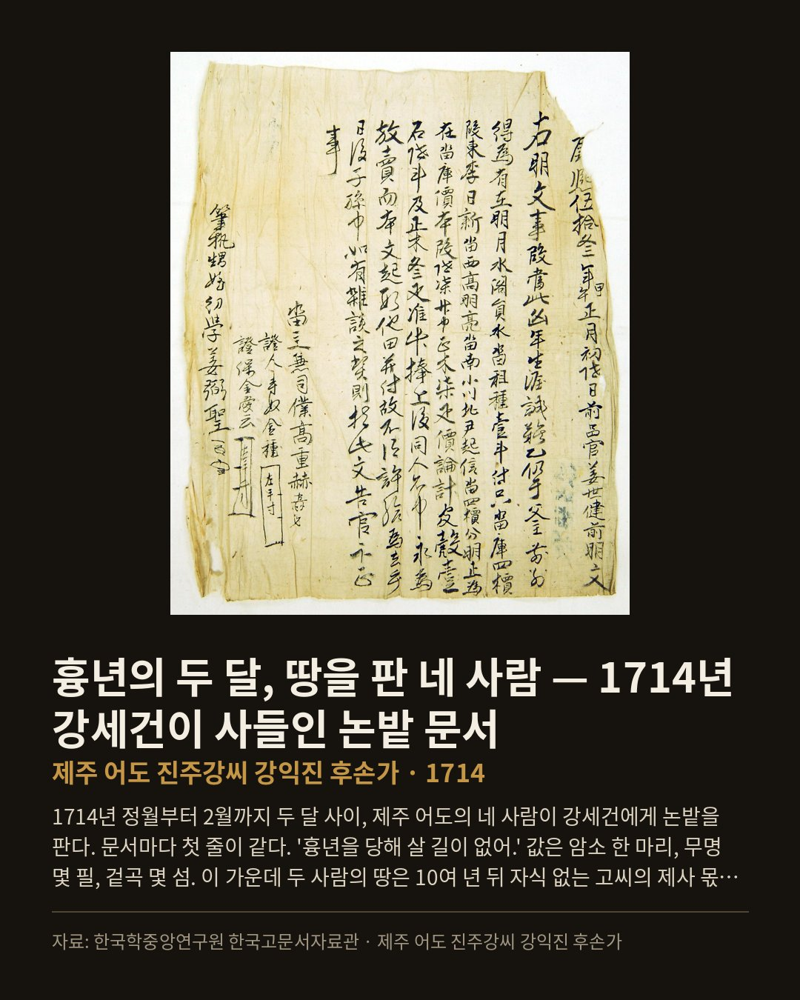
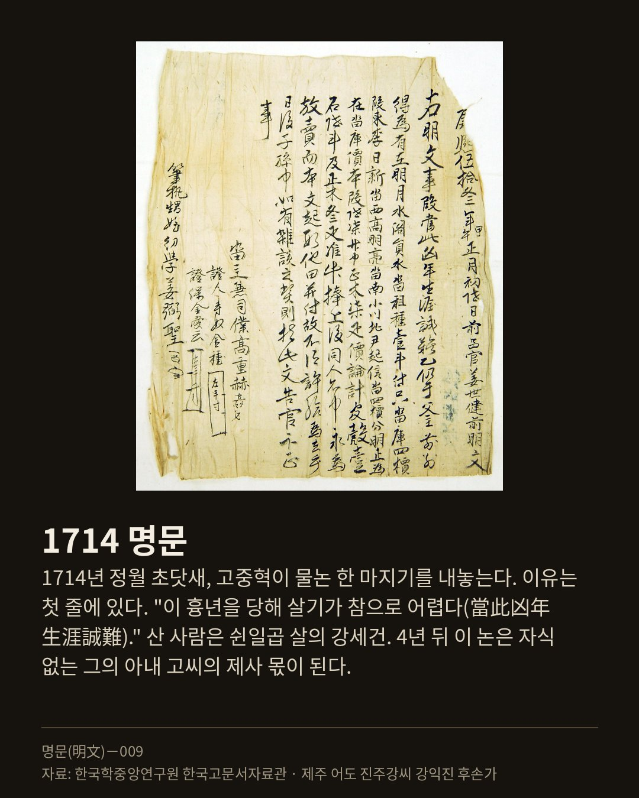

# EP.146 흉년의 두 달, 땅을 판 네 사람 — 1714년 강세건이 사들인 논밭 문서

제주 어도 진주강씨 강익진 후손가 (문중) · 1714년 정월부터 2월까지 두 달 사이, 제주 어도의 네 사람이 강세건에게 논밭을 판다. 문서마다 첫 줄이 같다. '흉년을 당해 살 길이 없어.' 값은 암소 한 마리, 무명 몇 필, 겉곡 몇 섬. 이 가운데 두 사람의 땅은 10여 년 뒤 자식 없는 고씨의 제사 몫과 손주며느리의 선물로 다시 문서에 나타난다

- 🌐 [전시 웹페이지](https://changgi.github.io/archive-tools/examples/eodo-kang-ij-myeongmun/exhibit.html) (한자 위 한글 독음 · 원문 해석) · [수업 활동지](https://changgi.github.io/archive-tools/examples/eodo-kang-ij-myeongmun/handout.html)
- 🎬 영상: [릴스 9:16](https://changgi.github.io/archive-tools-next/media/ep146-eodo-kang-ij-myeongmun_reel.mp4) · [가로 16:9](https://changgi.github.io/archive-tools-next/media/ep146-eodo-kang-ij-myeongmun_wide.mp4) · 홍보 글: [`promo.md`](promo.md)
- 카드뉴스: [`cards/`](cards/) · SNS 글: [`sns.txt`](sns.txt) · 판독·해석 표: [`selection.csv`](selection.csv)

<!-- DELIVERY -->
## 전달 에디팅 — 이 기록을 이렇게 전합니다

- **핵심 정서** — 씁쓸함
- **한 문장** — 1714년 두 달 사이 네 사람이 '흉년을 당해 살 길이 없다'는 같은 문장으로 강세건에게 땅을 팔았다 — 한 집안의 재산이 늘어난 자리에는 다른 집들의 굶주림이 있었다.
- **열기** — 1714년 제주, 네 사람이 같은 첫 줄로 땅을 팔았습니다.
- **펼치기** — 명문－009 → 명문－010 → 명문－012 → 명문－011 (1714년) — 1월 5일(고중혁, 물논) → 1월 16일(김태환, 조상 밭) → 2월 25일(이성사촌 문승양, '살기 어려워') → 2월 28일('기근의 해')로, 날짜 순서대로 놓아 두 달의 속도가 느껴지게 했습니다.
- **절정** — "이 흉년을 당해 살기가 참으로 어렵다(當此凶年 生涯誠難)" — 화면·공간에서 이 한 줄만 크게, 소리를 줄여 집중
- **여운** — 같은 해 같은 문장으로 땅을 판 네 사람은, 그 뒤 어떻게 살았을까요? — 질문으로 끝내고 답은 보는 사람에게
- **감각과 물질** — 네 장의 첫 줄이 똑같다 — '當此荒年' · 값(무명·냥·원)을 오늘의 물건으로 바꿔 옆에 놓기, 수결 따라 그리기
- **통로와 매개** — 온라인: 릴스(열기) → 카드뉴스(펼치기) → 전시 웹페이지(절정·원문) → 비하인드 카드(여운) / 오프라인: 원본 크기 복제·낭독·참여 벽 / 남기기: 활동지·질문 카드
- **여운 장치** — 흉년 · 불황 때 가족이 내린 결정 하나 들어 보기
- **전달 에디팅 전** — 4건의 문서를 1714년 연대순으로 놓고 문서명 · 유형 · 해설을 붙인다 — 정확하지만, 지나가면 잊힌다.
- **전달 에디팅 후** — 핵심 정서는 「씁쓸함」. 「1714년 제주, 네 사람이 같은 첫 줄로 땅을 팔았습니다.」로 열고, 문서를 대비와 순서로 펼친 뒤, "이 흉년을 당해 살기가 참으로 어렵다(當此凶年 生涯誠難)"에서 멈춘다. 네 장의 첫 줄이 똑같다 — '當此荒年'. 마지막엔 「흉년 · 불황 때 가족이 내린 결정 하나 들어 보기」로 보는 사람이 자기 이야기를 남기고 떠나게 한다.

전문: [`delivery.md`](delivery.md)
<!-- /DELIVERY -->

<!-- CURATOR -->
## 비하인드 — 큐레이터 노트

- **왜 이 문서들인가** — EP.143의 분재기에서 고씨가 내준 밭이 '고중혁에게서 산 밭', '김태환에게서 산 밭'이었던 것을 보고, 같은 집안 명문 91장에서 그 매매 문서를 찾았습니다. 둘 다 1714년 초에 있었습니다.
- **전하고 싶은 것** — 1714년 두 달 사이 네 사람이 '흉년을 당해 살 길이 없다'는 같은 문장으로 강세건에게 땅을 팔았다 — 한 집안의 재산이 늘어난 자리에는 다른 집들의 굶주림이 있었다.
- **이렇게 보이길 바랐다** — 1월 5일(고중혁, 물논) → 1월 16일(김태환, 조상 밭) → 2월 25일(이성사촌 문승양, '살기 어려워') → 2월 28일('기근의 해')로, 날짜 순서대로 놓아 두 달의 속도가 느껴지게 했습니다.
- **이렇게 써 주세요** — 조선 후기 토지 매매 문서(명문)의 서식, 사표(四標) · 두락, 현물 화폐(소 · 무명 · 곡식), 흉년과 토지 집중, 제주 향촌 사회 수업에 쓰세요.
- **만들며 있었던 일** — 네 장 모두 행초서에 종이가 구겨져 있어, 땅 이름 · 사표 · 값의 일부와 1714년 2월 28일 문서의 판 사람 이름은 확정하지 못해 …와 □로 두었습니다. 1714년 무렵 제주의 흉년은 문서의 문장('當此荒年', '當此飢荒之年')을 따랐고, 그 규모는 이 문서들로 판단하지 않았습니다.
- **남겨 둔 질문** — 같은 해 같은 문장으로 땅을 판 네 사람은, 그 뒤 어떻게 살았을까요?
- **제작 기록** — 문서 4건 · 1714년 · 원본 사진 4면(문서 전체) · 원문 판독 4건 · 번역 4건 · 못 읽은 글자 □ 7 · 불확실 (?) 0

전문: [`curator.md`](curator.md) · 비하인드 카드: [`behind/`](behind/) · 채널별 홍보안: [`channels.md`](channels.md)
<!-- /CURATOR -->

## 이야기 — 사료가 말하는 대로

1714년 제주, 네 사람이 같은 첫 줄로 땅을 팔았습니다.

> **1714 명문** — 1714년 정월 초닷새, 고중혁이 물논 한 마지기를 내놓는다. 이유는 첫 줄에 있다. "이 흉년을 당해 살기가 참으로 어렵다(當此凶年 生涯誠難)." 산 사람은 쉰일곱 살의 강세건. 4년 뒤 이 논은 자식 없는 그의 아내 고씨의 제사 몫이 된다.
> **1714 명문** — 열하루 뒤, 이번엔 김태환이다. 그가 내놓는 것은 조상 때부터 물려받은 밭. 첫 줄이 거의 같다. "흉년을 당해 살 길이 없어(當此荒年 生涯末由)." 값은 암소 한 마리. 이 밭도 11년 뒤 다른 문서에 다시 나타난다.
> **1714 명문** — 한 달여 뒤, 2월 25일. 이번에 땅을 내놓는 사람은 남이 아니다. 문서 첫머리에 이렇게 적었다. "이성 사촌 강세건에게(異姓四寸 前品官姜世健前)." 외가 쪽 사촌. 그도 같은 말로 시작한다. 흉년이라 살기가 어렵다고.
> **1714 명문** — 사흘 뒤, 2월 28일. 네 번째 문서. 증인은 사흘 전과 같은 이만보. 첫 줄은 이제 이렇게 바뀐다. "이 기근의 해를 당해(當此飢荒之年)." 두 달 사이 네 사람이 땅을 팔았고, 한 사람이 그 땅을 샀다. 그 땅은 훗날 그 집안 할머니의 제사와 손주의 혼인을 지탱한다.

| 표지 | 1번 카드 | 마무리 |
|---|---|---|
|  |  |  |

## 선별 문서 (4점)

| # | 연도 | 유형 | 문서명 | 원본 |
|---|---|---|---|---|
| 1 | 1714 | 명문 | 명문(明文)－009 | [원본 보기](https://archive.aks.ac.kr/viewer/viewer.do#imgnode.do?itemId=book&gubun=booktree&depth=6&upPath=01%5E0168%5EL016818%5EL016818F02%5EL016818F0205&dataId=G002%2BAKS%2BKSM-XE.1714.5011-20220125.B077a_114_00364_XXX&itemType=) |
| 2 | 1714 | 명문 | 명문(明文)－010 | [원본 보기](https://archive.aks.ac.kr/viewer/viewer.do#imgnode.do?itemId=book&gubun=booktree&depth=6&upPath=01%5E0168%5EL016818%5EL016818F02%5EL016818F0205&dataId=G002%2BAKS%2BKSM-XE.1714.5011-20220125.B077a_114_00365_XXX&itemType=) |
| 3 | 1714 | 명문 | 명문(明文)－012 | [원본 보기](https://archive.aks.ac.kr/viewer/viewer.do#imgnode.do?itemId=book&gubun=booktree&depth=6&upPath=01%5E0168%5EL016818%5EL016818F02%5EL016818F0205&dataId=G002%2BAKS%2BKSM-XE.1714.5011-20220125.B077a_114_00367_XXX&itemType=) |
| 4 | 1714 | 명문 | 명문(明文)－011 | [원본 보기](https://archive.aks.ac.kr/viewer/viewer.do#imgnode.do?itemId=book&gubun=booktree&depth=6&upPath=01%5E0168%5EL016818%5EL016818F02%5EL016818F0205&dataId=G002%2BAKS%2BKSM-XE.1714.5011-20220125.B077a_114_00366_XXX&itemType=) |

## 원문 판독과 해석

### 1. 명문(明文)－009

**원문 판독**

```
康熙伍拾參年甲午正月初伍日 前品官姜世健前明文
右明文事段 當此凶年 生涯誠難乙仍于 父主前 …
衿得爲有在 明月水陷員 水畓 租種壹斗付只 …
… 四標段 東李日新畓 西高明亮畓 南小川 北尹起信畓 四標分明爲
在 當庫價本段 … 正木參疋 准計捧上後 同人處中 永永爲
放賣 而本文記段 他田幷付 故不得許給爲去乎
日後子孫中 如有雜談之弊則 持此文告官卞正
事
畓主 兼司僕 高重赫 (착명)
證人 寺奴 金□ (左手寸)
```

**원문 해석** 강희 53년 갑오(1714) 정월 5일, 전 품관 강세건에게 주는 명문. 이 명문의 일은, 이 흉년을 당해 살기가 참으로 어려우므로, 아버지에게서 몫으로 받은 명월수함 들의 물논(볍씨 한 말 지기)을 … 사표는 동쪽 이일신의 논, 서쪽 고명량의 논, 남쪽 작은 내, 북쪽 윤기신의 논으로 분명합니다. 이 논의 값은 … 무명 세 필로 쳐서 받고 이 사람에게 영원히 팝니다. 본래 문서는 다른 땅과 함께 붙어 있어 내주지 못합니다. 뒷날 자손 가운데 딴말하는 폐단이 있거든 이 문서를 가지고 관에 고하여 바로잡을 것. 논 주인 겸사복 고중혁 (착명). 증인 시노 김□ (왼손 마디 그림).

**해제** 1714년(숙종 40) 정월 5일 겸사복 고중혁(高重赫)이 물논 한 마지기를 전 품관 강세건에게 판 명문(明文)입니다. 명문은 땅 · 노비를 사고팔 때 판 사람이 산 사람에게 써 주는 증서로, '右明文事段 … 永永放賣 … 持此文告官卞正事'의 틀을 씁니다. 판 까닭을 '이 흉년을 당해 살기가 참으로 어렵다(當此凶年 生涯誠難)'고 적었습니다. 사표(四標)는 땅의 동서남북 경계입니다. 4년 뒤 1718년 강세건이 둘째 아내 고씨의 묘 관리 몫으로 맏손자에게 넘긴 땅에 '고중혁에게서 사들인(高重赫處買得)' 땅이 들어 있습니다(EP.143). 글을 모르는 증인은 왼손 손가락 마디를 그려 서명(左手寸)했습니다.

### 2. 명문(明文)－010

**원문 판독**

```
康熙伍拾參年甲午正月拾陸日 姜世健前明文
右明文事段 當此荒年 生涯末由
勢不得已 流來祖上田 巨伊田員 皮牟貳拾
斗付只 四標 東金愛雲田 西小路 南 …
田北姜西數田 四標爲 …
價本段 陸疋論計 雌牛壹首 …
… 同姜世健前 永永放賣爲乎矣
本文記段 他田幷付乙仍于 不得許與是去乎
日後 同生族類中 相爭雜談是去等
持此文記 告官卞正事
田主 金太還 (착명)
證人 金愛雲 (착명)
筆執 文□□
```

**원문 해석** 강희 53년 갑오(1714) 정월 16일, 강세건에게 주는 명문. 이 명문의 일은, 이 흉년을 당해 살 길이 없어 어쩔 수 없이, 조상 때부터 내려온 거이전 들의 밭(겉보리 스무 말 지기)을 … 사표는 동쪽 김애운의 밭, 서쪽 작은 길, 남쪽 …, 북쪽 강서수의 밭. 값은 (무명) 여섯 필로 쳐서 암소 한 마리 … 를 받고 강세건에게 영원히 팝니다. 본래 문서는 다른 땅과 붙어 있어 내주지 못합니다. 뒷날 동기 · 친족 가운데 다투는 말이 있거든 이 문서를 가지고 관에 고하여 바로잡을 것. 밭 주인 김태환. 증인 김애운. 필집 문□□.

**해제** 11일 뒤인 1714년 정월 16일 김태환(金太還)이 '조상 때부터 내려온 밭(流來祖上田)'을 강세건에게 판 명문입니다. 첫 줄은 '흉년을 당해 살 길이 없어 어쩔 수 없이(當此荒年 生涯末由 勢不得已)'입니다. 값은 무명 여섯 필어치로 쳐서 '암소 한 마리(雌牛壹首)' 등으로 받았습니다. 동쪽 경계의 땅 주인 김애운이 증인을 섰습니다. 11년 뒤 1725년, 고씨가 맏손자며느리에게 내준 밭 가운데 '김태환에게서 사들인 밭(金太還處買得田)'이 있습니다(EP.143). 값의 일부와 필집 이름은 확정하지 못했습니다.

### 3. 명문(明文)－012

**원문 판독**

```
康熙伍拾叁年甲午貳月貳拾伍日 異姓四寸 前品官姜世健前明文
右明文事段 當此荒年 生活爲難乙仍于 …
不得已 當祖 … 山里 … 前田員 皮牟叁斗付只 …
東朴生男 … 西姜汝敏 … 南小路 北金淡 …
標爲如分明爲在 田庫 同世健處 永永放賣爲遣 價
本段 中木五疋以 論計 皮穀貳石叁斗及 六禾雌牛一首 …
准計捧上爲乎矣 本文記段 他田幷付是乎等以 不得許給
日後良中 或有子孫族類中 雜談是去等 持此文卞正事
田主 異姓四寸 文承洋 (착명)
證人 李萬寶 (착명)
筆執 儒生 安仙基 (착명)
```

**원문 해석** 강희 53년 갑오(1714) 2월 25일, 이성 사촌 전 품관 강세건에게 주는 명문. 이 명문의 일은, 이 흉년을 당해 살기가 어려우므로 어쩔 수 없이 … 산리 … 앞 들의 밭(겉보리 서 말 지기)을 … 사표는 동쪽 박생남 …, 서쪽 강여민 …, 남쪽 작은 길, 북쪽 김담 … 으로 분명한 이 밭을 세건에게 영원히 팝니다. 값은 중목 다섯 필로 쳐서 겉곡 두 섬 서 말과 여섯 살 암소 한 마리 … 를 받았습니다. 본래 문서는 다른 땅과 붙어 있어 내주지 못합니다. 뒷날 자손 · 친족 가운데 딴말이 있거든 이 문서를 가지고 바로잡을 것. 밭 주인 이성 사촌 문승양. 증인 이만보. 필집 유생 안선기.

**해제** 1714년 2월 25일 문승양(文承洋)이 밭 서 마지기를 강세건에게 판 명문입니다. 판 사람은 자신을 강세건의 '이성 사촌(異姓四寸)'이라 적었습니다. 강세건의 외조부가 문명익(文明翼)이므로(EP.140 준호구), 외가 쪽 사촌으로 보입니다. 첫 줄은 '흉년을 당해 살기가 어려워(當此荒年 生活爲難)'이고, 값으로 겉곡 두 섬 서 말과 '여섯 살 암소 한 마리(六禾雌牛一首)'를 받았습니다. 흉년에는 친척 사이에서도 땅이 오갔음을 보여 줍니다. 구겨진 종이라 땅 이름과 사표 일부는 확정하지 못했습니다.

### 4. 명문(明文)－011

**원문 판독**

```
康熙伍拾參年甲午二月貳拾捌日 前品官 …
右明文事段 當此飢荒之年 生涯末由乙仍
于 勢不得已 … 衿得田 … 員 粟
陸升付只 四標段 東玄石 … 及 …
南北 … 田 四標爲如分明爲 …
價本段 陸禾雌牛壹首 皮穀伍斗 …
准計捧上爲遣 同人處 永永放賣 …
… 本文記段 他田幷付 …
… 持此文記以 告官卞正事
田主 張□□ (착명)
證人 李萬寶 (착명)
筆執 文□□
```

**원문 해석** 강희 53년 갑오(1714) 2월 28일, 전 품관 (강세건)에게 주는 명문. 이 명문의 일은, 이 기근의 해를 당해 살 길이 없으므로 어쩔 수 없이 … 몫으로 받은 … 들의 밭(조 엿 되 지기)을 … 사표는 동쪽 현석 … 으로 분명합니다. 값으로 여섯 살 암소 한 마리와 겉곡 닷 말 … 을 받고 이 사람에게 영원히 팝니다. … 본래 문서는 다른 땅과 붙어 있어 … 뒷날 … 이 문서를 가지고 관에 고하여 바로잡을 것. 밭 주인 장□□. 증인 이만보. 필집 문□□.

**해제** 사흘 뒤인 1714년 2월 28일, 또 한 사람이 조 엿 되 지기의 작은 밭을 강세건에게 판 명문입니다. 첫 줄은 '이 기근의 해를 당해(當此飢荒之年)'로, 앞의 세 장과 같은 사정을 적었습니다. 값은 여섯 살 암소 한 마리와 겉곡 닷 말입니다. 증인 이만보(李萬寶)는 사흘 전 문승양의 명문에도 증인으로 서 있어, 같은 마을에서 매매가 잇따랐음을 보여 줍니다. 판 사람의 이름은 초서와 종이 구김으로 확정하지 못했습니다. 이 집안 명문 91장 가운데 1713–1716년 목록 연도를 단 것이 열 장입니다.

판독·해석·이야기는 이미지에 근거한 초안이며(검토 전 "초안" 표시), 정확한 판독은 원문 확인이 필요합니다. □는 읽지 못한 글자, (?)는 불확실한 글자입니다.
이미지: 한국학중앙연구원 한국고문서자료관 소장·제공. "원본" 링크를 누르면 자료관 뷰어에서 그 문서가 열립니다. 재사용은 자료관에 문의하세요(소장처 동의 필요).
