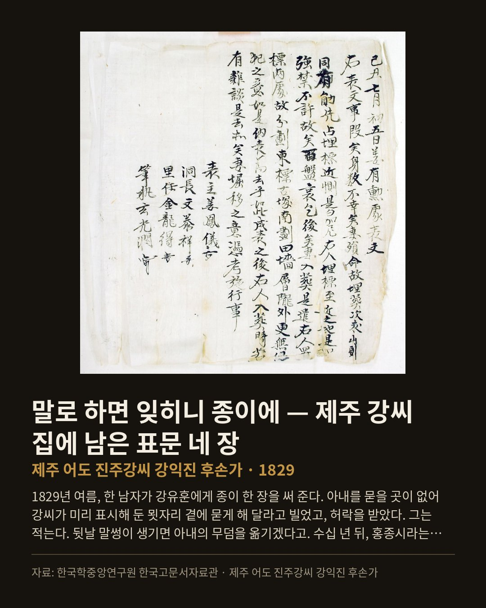
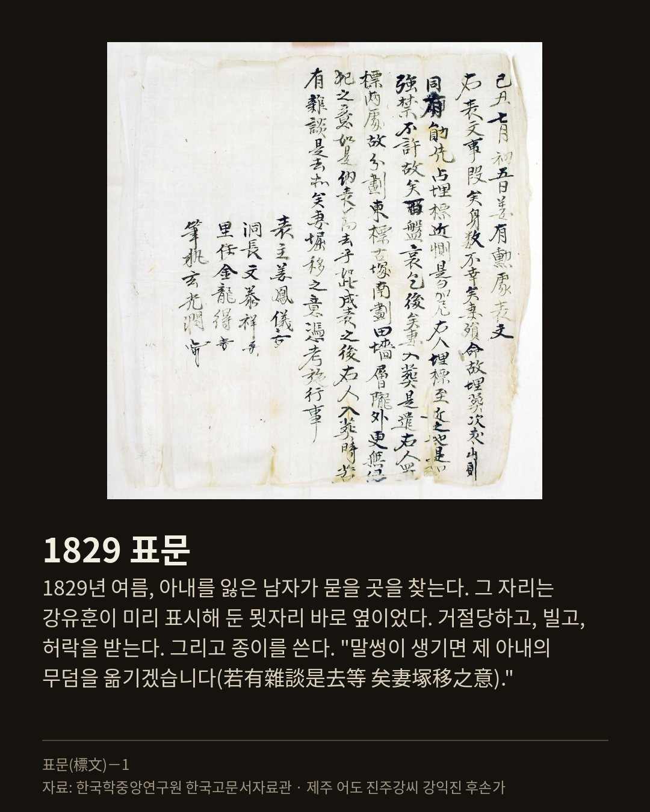

# EP.153 말로 하면 잊히니 종이에 — 제주 강씨 집에 남은 표문 네 장

제주 어도 진주강씨 강익진 후손가 (문중) · 1829년 여름, 한 남자가 강유훈에게 종이 한 장을 써 준다. 아내를 묻을 곳이 없어 강씨가 미리 표시해 둔 묏자리 곁에 묻게 해 달라고 빌었고, 허락을 받았다. 그는 적는다. 뒷날 말썽이 생기면 아내의 무덤을 옮기겠다고. 수십 년 뒤, 홍종시라는 사람은 같은 집에 세 번 돈을 빌리며 같은 종류의 종이를 남긴다. '가을에 갚겠다'

- 🌐 [전시 웹페이지](https://changgi.github.io/archive-tools/examples/eodo-kang-ij-pyomun/exhibit.html) (한자 위 한글 독음 · 원문 해석) · [수업 활동지](https://changgi.github.io/archive-tools/examples/eodo-kang-ij-pyomun/handout.html)
- 🎬 영상: [릴스 9:16](https://changgi.github.io/archive-tools-next/media/ep153-eodo-kang-ij-pyomun_reel.mp4) · [가로 16:9](https://changgi.github.io/archive-tools-next/media/ep153-eodo-kang-ij-pyomun_wide.mp4) · 홍보 글: [`promo.md`](promo.md)
- 카드뉴스: [`cards/`](cards/) · SNS 글: [`sns.txt`](sns.txt) · 판독·해석 표: [`selection.csv`](selection.csv)

<!-- DELIVERY -->
## 전달 에디팅 — 이 기록을 이렇게 전합니다

- **핵심 정서** — 담담함
- **한 문장** — 표문은 관아가 아니라 사람과 사람 사이의 약속을 종이로 묶어 두는 문서다 — 묏자리를 빌린 사람은 '무덤을 옮기겠다'고, 돈을 빌린 사람은 '가을에 갚겠다'고 적었다.
- **열기** — 아내를 묻게 해 준 이웃에게, 그는 '말썽이 나면 무덤을 옮기겠다'고 적었습니다.
- **펼치기** — 표문－1 → 표문－3 → 표문－4 → 표문－5 (1829년) — 1829년 묏자리 표문(강유훈에게) → 계사년 8월 홍종시 → 계사년 11월 홍종시(돈 빌림) → 을미년 6월 홍종시(다시 빌림)로, 묘에서 돈으로, 한 번에서 세 번으로 흐르게 놓았습니다.
- **절정** — "말썽이 생기면 제 아내의 무덤을 옮기겠습니다(若有雜談是去等 矣妻塚移之意)" — 화면·공간에서 이 한 줄만 크게, 소리를 줄여 집중
- **여운** — 약속을 종이에 적는 일은, 상대를 믿지 못해서였을까요, 아니면 서로를 지키기 위해서였을까요? — 질문으로 끝내고 답은 보는 사람에게
- **감각과 물질** — '若有雜談' · '若有相左之端' — 말썽이 생기면 이 종이로 증거를 삼는다는 같은 끝맺음
- **통로와 매개** — 온라인: 릴스(열기) → 카드뉴스(펼치기) → 전시 웹페이지(절정·원문) → 비하인드 카드(여운) / 오프라인: 원본 크기 복제·낭독·참여 벽 / 남기기: 활동지·질문 카드
- **여운 장치** — 가족 사이에 말로만 한 약속 하나를 글로 적어 보기
- **전달 에디팅 전** — 4건의 문서를 1829년 연대순으로 놓고 문서명 · 유형 · 해설을 붙인다 — 정확하지만, 지나가면 잊힌다.
- **전달 에디팅 후** — 핵심 정서는 「담담함」. 「아내를 묻게 해 준 이웃에게, 그는 '말썽이 나면 무덤을 옮기겠다'고 적었습니다.」로 열고, 문서를 대비와 순서로 펼친 뒤, "말썽이 생기면 제 아내의 무덤을 옮기겠습니다(若有雜談是去等 矣妻塚移之意)"에서 멈춘다. '若有雜談' · '若有相左之端' — 말썽이 생기면 이 종이로 증거를 삼는다는 같은 끝맺음. 마지막엔 「가족 사이에 말로만 한 약속 하나를 글로 적어 보기」로 보는 사람이 자기 이야기를 남기고 떠나게 한다.

전문: [`delivery.md`](delivery.md)
<!-- /DELIVERY -->

<!-- CURATOR -->
## 비하인드 — 큐레이터 노트

- **왜 이 문서들인가** — EP.144에서 강씨 집안이 묘를 지키려 관아에 낸 소지를, EP.152에서 강익진의 아버지 유훈의 이름을 보았습니다. 같은 집안 표문 다섯 장 가운데 그 유훈에게 써 준 한 장과, 한 사람이 세 번 써 준 차용 표문 세 장을 골랐습니다.
- **전하고 싶은 것** — 표문은 관아가 아니라 사람과 사람 사이의 약속을 종이로 묶어 두는 문서다 — 묏자리를 빌린 사람은 '무덤을 옮기겠다'고, 돈을 빌린 사람은 '가을에 갚겠다'고 적었다.
- **이렇게 보이길 바랐다** — 1829년 묏자리 표문(강유훈에게) → 계사년 8월 홍종시 → 계사년 11월 홍종시(돈 빌림) → 을미년 6월 홍종시(다시 빌림)로, 묘에서 돈으로, 한 번에서 세 번으로 흐르게 놓았습니다.
- **이렇게 써 주세요** — 조선 후기 사적 문서(표문 · 수표 · 다짐)의 쓰임, 묘지 분쟁과 화해, 농촌의 소액 금융(가을 갚기 · 변리), 증인 · 필집의 역할 수업에 쓰세요.
- **만들며 있었던 일** — 네 장 모두 행초서로 빠르게 쓴 짧은 문서라, 금액 숫자(도장에 가린 글자)와 일부 구절은 확정하지 못해 □ · …로 두었습니다. 홍종시 표문 세 장은 연호 없이 간지(계사 · 을미)만 있고 자료관 목록 연도도 미상이어서 몇 년인지 정하지 않았습니다. 1829년 표문의 표주 성은 '姜'인지 확정하지 못했습니다.
- **남겨 둔 질문** — 약속을 종이에 적는 일은, 상대를 믿지 못해서였을까요, 아니면 서로를 지키기 위해서였을까요?
- **제작 기록** — 문서 4건 · 1829년 · 원본 사진 4면(문서 전체) · 원문 판독 4건 · 번역 4건 · 못 읽은 글자 □ 3 · 불확실 (?) 0

전문: [`curator.md`](curator.md) · 비하인드 카드: [`behind/`](behind/) · 채널별 홍보안: [`channels.md`](channels.md)
<!-- /CURATOR -->

## 이야기 — 사료가 말하는 대로

아내를 묻게 해 준 이웃에게, 그는 '말썽이 나면 무덤을 옮기겠다'고 적었습니다.

> **1829 표문** — 1829년 여름, 아내를 잃은 남자가 묻을 곳을 찾는다. 그 자리는 강유훈이 미리 표시해 둔 묏자리 바로 옆이었다. 거절당하고, 빌고, 허락을 받는다. 그리고 종이를 쓴다. "말썽이 생기면 제 아내의 무덤을 옮기겠습니다(若有雜談是去等 矣妻塚移之意)."
> ** 표문** — 그리고 다른 사람, 다른 해. 홍종시라는 사람이 같은 집에 종이를 쓴다. 글씨는 급하고, 사정은 다 읽히지 않는다. 하지만 한 마디는 보인다. '가을에(準秋).' 그가 이 집에 남긴 세 장 가운데 첫 장이다.
> ** 표문** — 석 달 뒤, 겨울. 이번엔 분명하다. "급히 쓸 곳이 있어 돈 2□냥을 빌려 쓴다(緊用處 … 錢文貳□兩 債用)." 한 해 안에, 본전과 이자를 함께. 금액 위에는 도장을 꾹 눌렀다. 아무도 숫자를 고칠 수 없게.
> ** 표문** — 두 해 뒤 여름, 세 번째 종이. 같은 이름, 같은 첫 줄. "급히 쓸 곳이 있어(緊急有用處)." 그리고 같은 약속, 가을에. 묏자리를 빌린 사람도, 돈을 빌린 사람도, 이 집에 종이를 남겼다. 그 종이들이 갚은 증거인지 갚지 못한 증거인지, 이제는 알 수 없다.

| 표지 | 1번 카드 | 마무리 |
|---|---|---|
|  |  |  |

## 선별 문서 (4점)

| # | 연도 | 유형 | 문서명 | 원본 |
|---|---|---|---|---|
| 1 | 1829 | 표문 | 표문(標文)－1 | [원본 보기](https://archive.aks.ac.kr/viewer/viewer.do#imgnode.do?itemId=book&gubun=booktree&depth=6&upPath=01%5E0168%5EL016818%5EL016818F02%5EL016818F0204&dataId=G002%2BAKS%2BKSM-XD.1829.5011-20220125.B077a_114_00322_XXX&itemType=) |
| 2 | — | 표문 | 표문(標文)－3 | [원본 보기](https://archive.aks.ac.kr/viewer/viewer.do#imgnode.do?itemId=book&gubun=booktree&depth=6&upPath=01%5E0168%5EL016818%5EL016818F02%5EL016818F0204&dataId=G002%2BAKS%2BKSM-XD.9999.5011-20220125.B077a_114_00324_XXX&itemType=) |
| 3 | — | 표문 | 표문(標文)－4 | [원본 보기](https://archive.aks.ac.kr/viewer/viewer.do#imgnode.do?itemId=book&gubun=booktree&depth=6&upPath=01%5E0168%5EL016818%5EL016818F02%5EL016818F0204&dataId=G002%2BAKS%2BKSM-XD.9999.5011-20220125.B077a_114_00325_XXX&itemType=) |
| 4 | — | 표문 | 표문(標文)－5 | [원본 보기](https://archive.aks.ac.kr/viewer/viewer.do#imgnode.do?itemId=book&gubun=booktree&depth=6&upPath=01%5E0168%5EL016818%5EL016818F02%5EL016818F0204&dataId=G002%2BAKS%2BKSM-XD.9999.5011-20220125.B077a_114_00326_XXX&itemType=) |

## 원문 판독과 해석

### 1. 표문(標文)－1

**원문 판독**

```
己丑七月初五日 姜有勳處 表文
右表文事段 矣身妻 不幸殞命 故 埋葬次 …
則 同有勳 先占埋標 近側是白加尼 右人 埋標至近之地是如
强禁不許 故 矣身 百般哀乞後 矣妻 入葬是遣 右人
埋標內 處 故 分劃東標 古塚南劃 田墻層隴外 更無侵
犯之意 如是 納表爲去乎 此成表之後 右人入葬時 若
有雜談是去等 矣妻塚移之意 憑考施行事
表主 □鳳儀
洞長 文泰祥
里任 金龍得
筆執 玄光潤
```

**원문 해석** 기축년(1829) 7월 5일, 강유훈에게 주는 표문. 이 표문의 일은, 제 아내가 불행히 목숨을 잃어 묻으려 하였는데, 강유훈이 먼저 묏자리 표시(埋標)를 해 둔 곳 바로 곁이었습니다. 그 사람이 표시한 곳에 너무 가깝다며 굳게 막고 허락하지 않으므로, 제가 온갖 말로 애걸한 끝에 아내를 묻었습니다. 그 사람의 표시 안쪽이므로 동쪽 표시와 옛 무덤 남쪽으로 금을 긋고, 밭담 · 층진 둔덕 밖으로는 다시 침범할 뜻이 없음을 이렇게 표문으로 바칩니다. 이 표문을 쓴 뒤 그 사람이 (그 자리에) 장사 지낼 때 만약 말썽이 생기면 제 아내의 무덤을 옮기겠으니, 이것을 증거로 삼아 시행할 것. 표주 □봉의. 동장 문태상. 이임 김용득. 필집 현광윤.

**해제** 기축년(자료관 목록 1829, 순조 29) 7월 5일, 아내를 잃은 한 남자가 강유훈(姜有勳)에게 써 준 표문(表文 · 標文)입니다. 표문은 사람 사이의 약속 · 다짐을 증거로 남기는 사적 문서입니다. 강유훈은 EP.152 팔고조도에서 강익진의 아버지로 나오는 '有勛'과 같은 이름입니다. 그가 미리 묏자리를 표시(埋標)해 둔 곳 바로 곁에 이 남자가 아내를 묻으려 하자 강유훈이 막았고, '온갖 말로 애걸한 끝에(百般哀乞)' 허락을 받았습니다. 그는 경계를 동쪽 표시 · 옛 무덤 남쪽 · 밭담과 둔덕으로 긋고, 뒷날 말썽이 생기면 '아내의 무덤을 옮기겠다(矣妻塚移)'고 약속합니다. 동장 · 이임(마을 임원)이 증인으로 서명했습니다. EP.144의 1841년 소지(이웃 무덤과 소나무 경계)와 비슷한 사정을, 관아 대신 마을 안에서 푼 문서입니다. 표주의 성 글자는 확정하지 못했습니다.

### 2. 표문(標文)－3

**원문 판독**

```
癸巳八月十二日 前標文
右標文段 … 同負 若干家 …
今同 … 存子 … 以 …
… 決定爲 時 無以備 …
根 … 準 秋 … 上來 標事
自筆標主 洪鍾時 (수결)
```

**원문 해석** 계사년 8월 12일, (강씨) 앞으로 주는 표문. 이 표문은 … 함께 진 (빚) 약간 … 지금 … 정하였으나 그때 갖출 길이 없어 … 가을에 맞추어 … 올려 보내기로 하는 표문. 표주 홍종시 친필 (수결).

**해제** 계사년 8월 12일 홍종시(洪鍾時)가 강씨 집 앞으로 써 준 표문입니다. 행초서가 빠르고 구절 사이가 끊겨 내용 일부만 읽었으나, '가을에 맞추어(準秋)', '올려 보낸다(上來)' 같은 구절로 보아 갚을 것을 가을로 미루는 약속으로 보입니다. 같은 사람이 같은 해 11월과 을미년 6월에도 표문을 써 주어, 모두 세 장이 이 집에 남았습니다. 표주 스스로 썼다는 '自筆'이 붙어 따로 필집이 없습니다. 연호가 없고 자료관 목록 연도도 미상이어서 계사년이 몇 년인지 정하지 않았습니다.

### 3. 표문(標文)－4

**원문 판독**

```
癸巳十一月二十日 前標文
右標文段 緊用處 故 前
錢文貳□兩 債用後 限周年
並本利 準 秋 … 來 標日後
若有相左之端 以此標爲證事
標主自筆 洪鍾時 (도장) (수결)
```

**원문 해석** 계사년 11월 20일, (강씨) 앞으로 주는 표문. 이 표문은, 급히 쓸 곳이 있어 앞서 돈 2□냥을 빌려 쓴 뒤, 한 해를 기한으로 본전과 이자를 아울러 가을에 맞추어 … 갚되, 표를 쓴 뒤 만약 서로 어긋나는 일이 있으면 이 표로 증거를 삼을 것. 표주 친필 홍종시 (도장) (수결).

**해제** 석 달 뒤 계사년 11월 20일 홍종시가 다시 써 준 차용 표문입니다. '급히 쓸 곳이 있어(緊用處)' 돈(錢文)을 빌리고, '한 해를 기한으로(限周年) 본전과 이자를 아울러(並本利)' 갚겠다고 적었습니다. 금액 숫자 위에 둥근 도장을 겹쳐 찍어 고쳐 쓰지 못하게 했는데, 그 때문에 숫자 한 글자를 확정하지 못했습니다(貳□兩). 끝의 '서로 어긋나는 일이 있으면 이 표로 증거를 삼는다(若有相左之端 以此標爲證)'는 차용증의 오래된 끝맺음입니다.

### 4. 표문(標文)－5

**원문 판독**

```
乙未六月初四日 前標文
右標文段 緊急有用處 故
錢文貳□兩 債用後 限今年 具
邊 準 秋 … 以 …
… 事
標主 洪鍾時 (수결)
```

**원문 해석** 을미년 6월 4일, (강씨) 앞으로 주는 표문. 이 표문은, 급히 쓸 곳이 있어 돈 2□냥을 빌려 쓴 뒤, 올해 안에 이자를 갖추어 가을에 맞추어 … 갚을 것. 표주 홍종시 (수결).

**해제** 을미년 6월 4일, 홍종시가 세 번째로 써 준 차용 표문입니다. 이번에도 '급히 쓸 곳(緊急有用處)'이 있어 돈을 빌렸고, 기한은 '올해 안(限今年)', 이자는 '변리를 갖추어(具邊)' 갚겠다고 했습니다. 계사년에서 을미년으로 두 해가 지나, 앞의 빚을 갚고 다시 빌린 것인지 갚지 못한 채 더 빌린 것인지는 문서만으로 알 수 없습니다. 이 표문들이 갚은 뒤 돌려받지 않은 것인지, 갚지 못해 남은 것인지도 판단하지 않았습니다. 금액 숫자 한 글자와 뒷부분 구절은 확정하지 못했습니다.

판독·해석·이야기는 이미지에 근거한 초안이며(검토 전 "초안" 표시), 정확한 판독은 원문 확인이 필요합니다. □는 읽지 못한 글자, (?)는 불확실한 글자입니다.
이미지: 한국학중앙연구원 한국고문서자료관 소장·제공. "원본" 링크를 누르면 자료관 뷰어에서 그 문서가 열립니다. 재사용은 자료관에 문의하세요(소장처 동의 필요).
