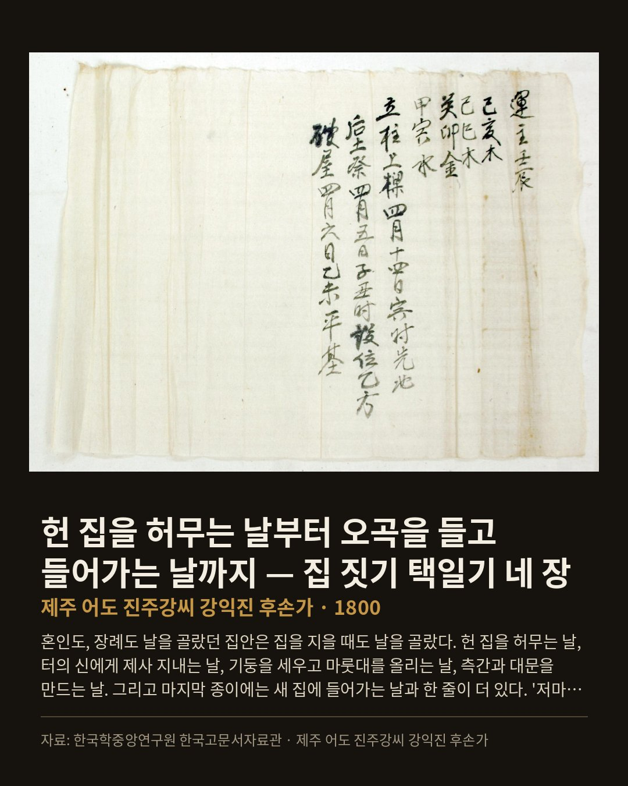
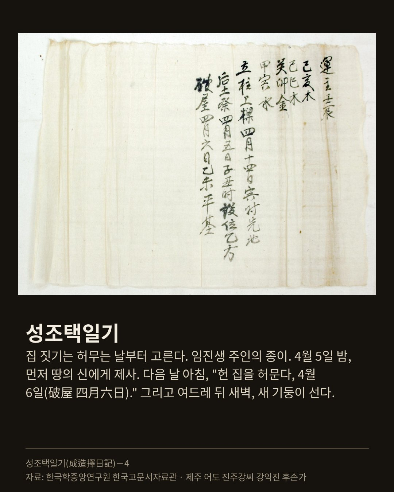
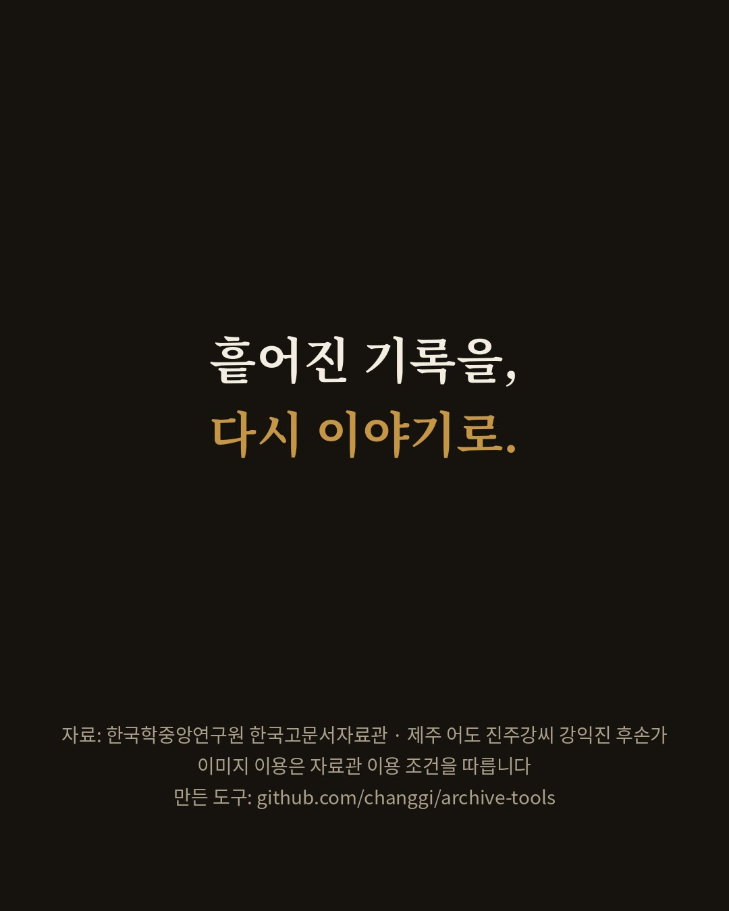

# EP.151 헌 집을 허무는 날부터 오곡을 들고 들어가는 날까지 — 집 짓기 택일기 네 장

제주 어도 진주강씨 강익진 후손가 (문중) · 혼인도, 장례도 날을 골랐던 집안은 집을 지을 때도 날을 골랐다. 헌 집을 허무는 날, 터의 신에게 제사 지내는 날, 기둥을 세우고 마룻대를 올리는 날, 측간과 대문을 만드는 날. 그리고 마지막 종이에는 새 집에 들어가는 날과 한 줄이 더 있다. '저마다 오곡을 들고'

- 🌐 [전시 웹페이지](https://changgi.github.io/archive-tools/examples/eodo-kang-ij-seongjo/exhibit.html) (한자 위 한글 독음 · 원문 해석) · [수업 활동지](https://changgi.github.io/archive-tools/examples/eodo-kang-ij-seongjo/handout.html)
- 🎬 영상: [릴스 9:16](https://changgi.github.io/archive-tools-next/media/ep151-eodo-kang-ij-seongjo_reel.mp4) · [가로 16:9](https://changgi.github.io/archive-tools-next/media/ep151-eodo-kang-ij-seongjo_wide.mp4) · 홍보 글: [`promo.md`](promo.md)
- 카드뉴스: [`cards/`](cards/) · SNS 글: [`sns.txt`](sns.txt) · 판독·해석 표: [`selection.csv`](selection.csv)

<!-- DELIVERY -->
## 전달 에디팅 — 이 기록을 이렇게 전합니다

- **핵심 정서** — 설렘
- **한 문장** — 집 한 채에도 순서와 날짜가 있었다 — 허물기, 터 제사, 기둥 세우기와 상량, 측간과 대문, 그리고 오곡을 들고 들어가는 날.
- **열기** — 새 집에 들어가는 날, 식구들은 저마다 곡식을 들고 갔습니다.
- **펼치기** — 성조택일기－4 → 성조택일기－1 → 성조택일기－2 → 입댁택일기 (1800년) — 헌 집 허물기 · 터 제사 · 상량(4월) → 기둥 · 상량 날 고르기 → 상량 · 측간 · 대문 → 입택으로, 집이 지어지는 순서대로 놓았습니다. 네 장이 같은 집의 것인지는 알 수 없어, '공정의 순서'로만 이었습니다.
- **절정** — "저마다 오곡을 들고 집에 들어간다(各持五穀 入宅)" — 화면·공간에서 이 한 줄만 크게, 소리를 줄여 집중
- **여운** — 식구들이 저마다 들고 간 오곡은, 새 집에 무엇을 바라는 마음이었을까요? — 질문으로 끝내고 답은 보는 사람에게
- **감각과 물질** — '破屋'에서 '入宅'까지 — 공정 이름 옆에 붙은 날짜와 시각과 방향
- **통로와 매개** — 온라인: 릴스(열기) → 카드뉴스(펼치기) → 전시 웹페이지(절정·원문) → 비하인드 카드(여운) / 오프라인: 원본 크기 복제·낭독·참여 벽 / 남기기: 활동지·질문 카드
- **여운 장치** — 우리 집에 이사 온 날 무엇을 했는지 가족에게 물어보기
- **전달 에디팅 전** — 4건의 문서를 1800년 연대순으로 놓고 문서명 · 유형 · 해설을 붙인다 — 정확하지만, 지나가면 잊힌다.
- **전달 에디팅 후** — 핵심 정서는 「설렘」. 「새 집에 들어가는 날, 식구들은 저마다 곡식을 들고 갔습니다.」로 열고, 문서를 대비와 순서로 펼친 뒤, "저마다 오곡을 들고 집에 들어간다(各持五穀 入宅)"에서 멈춘다. '破屋'에서 '入宅'까지 — 공정 이름 옆에 붙은 날짜와 시각과 방향. 마지막엔 「우리 집에 이사 온 날 무엇을 했는지 가족에게 물어보기」로 보는 사람이 자기 이야기를 남기고 떠나게 한다.

전문: [`delivery.md`](delivery.md)
<!-- /DELIVERY -->

<!-- CURATOR -->
## 비하인드 — 큐레이터 노트

- **왜 이 문서들인가** — EP.148(혼인 택일)과 EP.149(장례 택일)에 이어, 같은 집안 치부기록류에 남은 성조(집 짓기) · 입택(새 집 들기) 택일기 다섯 장 가운데 공정이 다른 네 장을 골랐습니다. 택일 3부작의 마지막 편입니다.
- **전하고 싶은 것** — 집 한 채에도 순서와 날짜가 있었다 — 허물기, 터 제사, 기둥 세우기와 상량, 측간과 대문, 그리고 오곡을 들고 들어가는 날.
- **이렇게 보이길 바랐다** — 헌 집 허물기 · 터 제사 · 상량(4월) → 기둥 · 상량 날 고르기 → 상량 · 측간 · 대문 → 입택으로, 집이 지어지는 순서대로 놓았습니다. 네 장이 같은 집의 것인지는 알 수 없어, '공정의 순서'로만 이었습니다.
- **이렇게 써 주세요** — 전통 건축의 공정(파옥 · 개기 · 입주 · 상량 · 입택), 가택신앙(터주 · 성주), 택일 문화, 이사 풍습의 변화 수업에 쓰세요.
- **만들며 있었던 일** — 네 장 모두 짧은 행초서 메모이고 연호가 없어, 날짜와 공정 이름만 또렷한 것을 옮기고 간지 · 방위의 일부는 …로 두었습니다. 자료관 목록 연도는 두 장이 1800, 두 장이 미상입니다. 4월 성조택일기의 '運主 壬辰'이 EP.149의 상주 임진생과 같은 사람인지는 판단하지 않았습니다. '宅土祭'는 터주(땅의 신)에게 지내는 제사로 보았습니다.
- **남겨 둔 질문** — 식구들이 저마다 들고 간 오곡은, 새 집에 무엇을 바라는 마음이었을까요?
- **제작 기록** — 문서 4건 · 1800년 · 원본 사진 4면(문서 전체) · 원문 판독 4건 · 번역 4건 · 못 읽은 글자 □ 0 · 불확실 (?) 10

전문: [`curator.md`](curator.md) · 비하인드 카드: [`behind/`](behind/) · 채널별 홍보안: [`channels.md`](channels.md)
<!-- /CURATOR -->

## 이야기 — 사료가 말하는 대로

새 집에 들어가는 날, 식구들은 저마다 곡식을 들고 갔습니다.

> ** 성조택일기** — 집 짓기는 허무는 날부터 고른다. 임진생 주인의 종이. 4월 5일 밤, 먼저 땅의 신에게 제사. 다음 날 아침, "헌 집을 허문다, 4월 6일(破屋 四月六日)." 그리고 여드레 뒤 새벽, 새 기둥이 선다.
> **1800 성조택일기** — 기둥을 세우는 날은 한 번에 정해지지 않는다. 신묘생 주인의 종이에는 날이 셋이다. 2월 초엿새, 초이레, 그리고 4월 17일. 날마다 한 마디가 붙는다. "먼저 남쪽부터(先南)." 그리고 마지막엔 "먼저 북쪽부터(先北)."
> **1800 성조택일기** — 이번에는 겨울 공사. 11월 22일 상량, 그리고 이틀 뒤 줄이 하나 더 있다. "측간을 짓는다, 11월 24일(作廁 十一月二十四日)." 뒷간 하나에도 날을 골랐다. 마지막 줄은 대문, 집이 세상을 향해 열릴 방향이다.
> ** 입댁택일기** — 그리고 마지막 종이. 이번에는 식구 모두의 이름 대신 생년이 줄을 선다. 집주인, 주부, 아들, 딸. 들어갈 날은 4월 13일 새벽. 그 아래 한 줄. "저마다 오곡을 들고 집에 들어간다(各持五穀 入宅)." 허물고, 세우고, 마침내 곡식을 안고 들어간다.

| 표지 | 1번 카드 | 마무리 |
|---|---|---|
|  |  |  |

## 선별 문서 (4점)

| # | 연도 | 유형 | 문서명 | 원본 |
|---|---|---|---|---|
| 1 | — | 성조택일기 | 성조택일기(成造擇日記)－4 | [원본 보기](https://archive.aks.ac.kr/viewer/viewer.do#imgnode.do?itemId=book&gubun=booktree&depth=6&upPath=01%5E0168%5EL016818%5EL016818F02%5EL016818F0207&dataId=G002%2BAKS%2BKSM-XG.9999.5011-20220125.B077a_114_00504_XXX&itemType=) |
| 2 | 1800 | 성조택일기 | 성조택일기(成造擇日記)－1 | [원본 보기](https://archive.aks.ac.kr/viewer/viewer.do#imgnode.do?itemId=book&gubun=booktree&depth=6&upPath=01%5E0168%5EL016818%5EL016818F02%5EL016818F0207&dataId=G002%2BAKS%2BKSM-XG.1800.5011-20220125.B077a_114_00501_XXX&itemType=) |
| 3 | 1800 | 성조택일기 | 성조택일기(成造擇日記)－2 | [원본 보기](https://archive.aks.ac.kr/viewer/viewer.do#imgnode.do?itemId=book&gubun=booktree&depth=6&upPath=01%5E0168%5EL016818%5EL016818F02%5EL016818F0207&dataId=G002%2BAKS%2BKSM-XG.1800.5011-20220125.B077a_114_00502_XXX&itemType=) |
| 4 | — | 입댁택일기 | 입댁택일기(入宅擇日記) | [원본 보기](https://archive.aks.ac.kr/viewer/viewer.do#imgnode.do?itemId=book&gubun=booktree&depth=6&upPath=01%5E0168%5EL016818%5EL016818F02%5EL016818F0207&dataId=G002%2BAKS%2BKSM-XG.9999.5011-20220125.B077a_114_00505_XXX&itemType=) |

## 원문 판독과 해석

### 1. 성조택일기(成造擇日記)－4

**원문 판독**

```
運主 壬辰
己亥木 己巳木 癸卯金 甲寅水
立柱上樑 四月十四日 寅時 先北(?)
宅土祭 四月五日 子丑時 設位 乙方
破屋 四月六日 乙未 平基(?)
```

**원문 해석** 운주(집주인) 임진생. (택한 날의 네 기둥) 기해(목) · 기사(목) · 계묘(금) · 갑인(수). 기둥 세우고 마룻대 올리기(입주 · 상량): 4월 14일 인시, 먼저 북쪽(?)부터. 터주 제사: 4월 5일 자시 · 축시, 제자리는 을(乙) 방향. 헌 집 허물기: 4월 6일 을미일, 터 고르기(?).

**해제** 집을 새로 짓기 위해 날을 고른 성조택일기(成造擇日記)입니다. 첫 줄 '運主 壬辰'은 이 집의 운을 받는 주인이 임진생이라는 뜻입니다. 순서가 흥미롭습니다. 4월 5일 밤 터의 신에게 먼저 제사를 지내고(宅土祭, 제자리는 을 방향), 이튿날 6일에 헌 집을 허물고(破屋), 4월 14일 새벽 인시에 기둥을 세우고 마룻대를 올립니다(立柱上樑). 열흘 사이에 허물고 다시 세우는 일정입니다. 임진생 주인이 EP.149의 상주(임진생)와 같은 사람인지는 판단하지 않았습니다. 연호가 없고 자료관 목록 연도도 미상입니다.

### 2. 성조택일기(成造擇日記)－1

**원문 판독**

```
宅主 辛卯 …
造屋 … 吉 …
癸亥水 丙辰土 壬子木 乙巳火
立柱上樑 二月初六日 巳時 先南
… 丙辰土 癸丑木 …
立柱上樑 二月初七日 丑時 先南
開基(?) 二月二十日 巳午時 先南(?)
癸亥水 丁巳土 癸巳水 癸丑木
立柱上樑 四月十七日 丑時 先北
```

**원문 해석** 집주인 신묘생 …. 집 짓기 … 좋음 …. (첫 후보) 입주 · 상량: 2월 초6일 사시, 먼저 남쪽부터. (둘째 후보) 입주 · 상량: 2월 초7일 축시, 먼저 남쪽부터. 터 닦기(?): 2월 20일 사시 · 오시. (셋째 후보) 입주 · 상량: 4월 17일 축시, 먼저 북쪽부터.

**해제** 신묘생 집주인을 위해 입주 · 상량 날을 세 번 골라 적은 성조택일기입니다. 2월 6일 사시, 2월 7일 축시, 4월 17일 축시가 차례로 적혔고, 각 날의 네 기둥(간지 · 오행)과 '먼저 남쪽부터(先南)', '먼저 북쪽부터(先北)'처럼 기둥을 세우기 시작할 방향을 붙였습니다. 사이에 터를 닦는 날(開基로 읽음)이 2월 20일로 적혀 있습니다. 후보가 여럿인 것은 날씨 · 일손 · 재목 사정에 따라 날을 다시 잡아야 했던 사정을 보여 주는 것으로 보입니다. 종이 가장자리가 해져 주인의 생년 일부와 둘째 후보의 간지 일부를 읽지 못했습니다.

### 3. 성조택일기(成造擇日記)－2

**원문 판독**

```
宅主 辛卯 …
壬辰 … 吉 戊土日
癸亥水 乙丑金 癸巳水 丁巳土
立柱上樑 十一月二十二日 巳時 先西(?)
開基(?) 十一月二十日 巳午時 先西(?)
作廁 十一月二十四日
作門 丙午 … 乾門(?)
```

**원문 해석** 집주인 신묘생 …. … 좋은 날은 무토일. (택한 날의 네 기둥) 계해(수) · 을축(금) · 계사(수) · 정사(토). 입주 · 상량: 11월 22일 사시, 먼저 서쪽(?)부터. 터 닦기(?): 11월 20일 사시 · 오시. 측간 짓기: 11월 24일. 대문 내기: 병오 … 건(乾) 방향 문(?).

**해제** 같은 신묘생 집주인으로 보이는 성조택일기로, 이번에는 겨울(11월)의 일정입니다. 11월 20일 터를 닦고(開基로 읽음), 22일 입주 · 상량, 그리고 24일에 '측간을 짓는다(作廁)'는 줄이 따로 있습니다. 뒷간 하나도 날을 골라 지었던 셈입니다. 마지막 줄 '作門'은 대문을 내는 일로, 문의 방향(丙午 · 乾)을 적은 것으로 보이나 확정하지 못했습니다. 앞 장의 2월 · 4월 일정과 같은 집인지, 다른 해의 공사인지는 알 수 없습니다. 종이 가운데가 물에 젖어 일부 글자가 번졌습니다.

### 4. 입댁택일기(入宅擇日記)

**원문 판독**

```
宅主 丁丑(?) 水
主婦 庚辰(?) 金 …
男 甲申 土
女 …
… 丁未 水
庚申金 辛巳金 丁巳火 壬寅金
四月十三日 寅時 入宅 …
各持五穀 入宅 …
庚寅金 壬午木 壬辰水 庚辰金
… 十一月 一日 辰時 入宅 …
各持五穀 入宅 …
```

**원문 해석** 집주인 정축생(?)(수). 주부 경진생(?)(금) …. 아들 갑신생(토). 딸 …. … 정미생(수). (첫 후보) 4월 13일 인시에 새 집에 들어감 …. 저마다 오곡을 들고 집에 들어간다 …. (둘째 후보) … 11월 1일 진시에 새 집에 들어감 …. 저마다 오곡을 들고 집에 들어간다 ….

**해제** 새 집에 들어갈(入宅) 날을 고른 입택택일기(入宅擇日記)입니다. 자료관 목록은 '입댁택일기'로 적었습니다. 맨 앞에 집주인 · 주부 · 아들 · 딸 등 식구의 생년과 오행을 차례로 적어, 들어가는 날이 식구 모두와 어긋나지 않게 맞춰 보았음을 알 수 있습니다. 날은 '4월 13일 인시'와 '11월 1일 진시' 두 후보이며, 두 번 모두 '저마다 오곡을 들고 집에 들어간다(各持五穀 入宅)'는 줄이 붙었습니다. 새 집에 곡식을 들고 들어가 풍족함을 비는 풍속입니다. 식구의 생년 일부는 확정하지 못했고, 연도는 미상입니다.

판독·해석·이야기는 이미지에 근거한 초안이며(검토 전 "초안" 표시), 정확한 판독은 원문 확인이 필요합니다. □는 읽지 못한 글자, (?)는 불확실한 글자입니다.
이미지: 한국학중앙연구원 한국고문서자료관 소장·제공. "원본" 링크를 누르면 자료관 뷰어에서 그 문서가 열립니다. 재사용은 자료관에 문의하세요(소장처 동의 필요).
