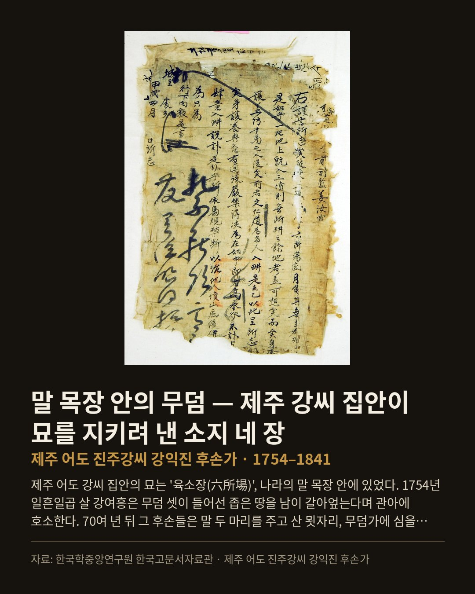
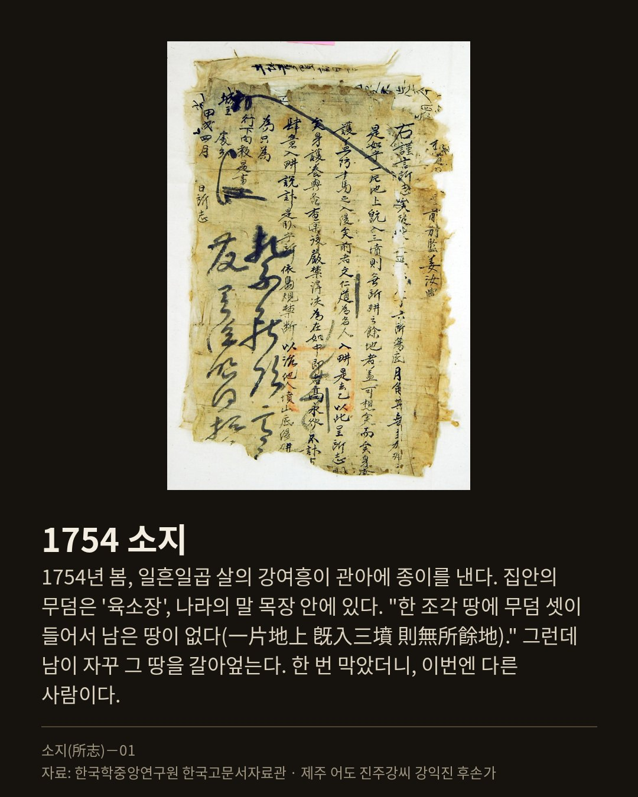

# EP.144 말 목장 안의 무덤 — 제주 강씨 집안이 묘를 지키려 낸 소지 네 장

제주 어도 진주강씨 강익진 후손가 (문중) · 제주 어도 강씨 집안의 묘는 '육소장(六所場)', 나라의 말 목장 안에 있었다. 1754년 일흔일곱 살 강여흥은 무덤 셋이 들어선 좁은 땅을 남이 갈아엎는다며 관아에 호소한다. 70여 년 뒤 그 후손들은 말 두 마리를 주고 산 묏자리, 무덤가에 심을 소나무, 남의 무덤과의 경계를 하나하나 관아에 확인받는다

- 🌐 [전시 웹페이지](https://changgi.github.io/archive-tools/examples/eodo-kang-ij-soji/exhibit.html) (한자 위 한글 독음 · 원문 해석) · [수업 활동지](https://changgi.github.io/archive-tools/examples/eodo-kang-ij-soji/handout.html)
- 🎬 영상: [릴스 9:16](https://changgi.github.io/archive-tools-next/media/ep144-eodo-kang-ij-soji_reel.mp4) · [가로 16:9](https://changgi.github.io/archive-tools-next/media/ep144-eodo-kang-ij-soji_wide.mp4) · 홍보 글: [`promo.md`](promo.md)
- 카드뉴스: [`cards/`](cards/) · SNS 글: [`sns.txt`](sns.txt) · 판독·해석 표: [`selection.csv`](selection.csv)

<!-- DELIVERY -->
## 전달 에디팅 — 이 기록을 이렇게 전합니다

- **핵심 정서** — 단단함
- **한 문장** — 네 장 모두 '육소장(六所場)'이라는 같은 땅을 말한다 — 말 목장 안에 묘를 쓴 집안이, 갈아엎는 사람 · 산 땅 · 소나무 · 이웃 무덤과의 경계를 차례로 관아에 확인받았다.
- **열기** — 제주 강씨 집안의 무덤은, 나라의 말 목장 안에 있었습니다.
- **펼치기** — 소지－01 → 소지－03 → 소지－04 → 소지－05 (1754–1841년) — 1754(남이 무덤가를 갈아엎음, 금지 요청) → 1827(말 두 마리로 산 묏자리, 입지 요청) → 1828(문중 네 사람이 소나무 심기를 함께 청함) → 1841(이웃 무덤과의 경계 소나무, 입지 요청)으로, '빼앗기지 않으려는 문서'가 '미리 확인받는 문서'로 바뀌는 흐름을 보이게 했습니다.
- **절정** — "한 조각 땅에 무덤 셋이 들어서 남은 땅이 없다(一片地上 旣入三墳 則無所餘地)" — 화면·공간에서 이 한 줄만 크게, 소리를 줄여 집중
- **여운** — 무덤 곁에 심은 소나무는, 누구를 위한 경계였을까요? — 질문으로 끝내고 답은 보는 사람에게
- **감각과 물질** — 네 장 모두 같은 지명 '六所塲' — 70여 년 동안 같은 땅을 지킨 기록 · 연명한 이름을 벽에 길게 나열하고 관아 마당처럼 서서 읽는 동선
- **통로와 매개** — 온라인: 릴스(열기) → 카드뉴스(펼치기) → 전시 웹페이지(절정·원문) → 비하인드 카드(여운) / 오프라인: 원본 크기 복제·낭독·참여 벽 / 남기기: 활동지·질문 카드
- **여운 장치** — 우리 동네 땅 이름에 남은 옛 쓰임 찾아보기
- **전달 에디팅 전** — 4건의 문서를 1754–1841년 연대순으로 놓고 문서명 · 유형 · 해설을 붙인다 — 정확하지만, 지나가면 잊힌다.
- **전달 에디팅 후** — 핵심 정서는 「단단함」. 「제주 강씨 집안의 무덤은, 나라의 말 목장 안에 있었습니다.」로 열고, 문서를 대비와 순서로 펼친 뒤, "한 조각 땅에 무덤 셋이 들어서 남은 땅이 없다(一片地上 旣入三墳 則無所餘地)"에서 멈춘다. 네 장 모두 같은 지명 '六所塲' — 70여 년 동안 같은 땅을 지킨 기록. 마지막엔 「우리 동네 땅 이름에 남은 옛 쓰임 찾아보기」로 보는 사람이 자기 이야기를 남기고 떠나게 한다.

전문: [`delivery.md`](delivery.md)
<!-- /DELIVERY -->

<!-- CURATOR -->
## 비하인드 — 큐레이터 노트

- **왜 이 문서들인가** — EP.140–143에서 강세건 · 강여흥 3대의 호적과 분재기를 읽은 뒤, 같은 집안 소지 22장 가운데 묘와 관련된 네 장을 골랐습니다. 첫 장은 일흔일곱 살의 강여흥이 낸 것입니다.
- **전하고 싶은 것** — 네 장 모두 '육소장(六所場)'이라는 같은 땅을 말한다 — 말 목장 안에 묘를 쓴 집안이, 갈아엎는 사람 · 산 땅 · 소나무 · 이웃 무덤과의 경계를 차례로 관아에 확인받았다.
- **이렇게 보이길 바랐다** — 1754(남이 무덤가를 갈아엎음, 금지 요청) → 1827(말 두 마리로 산 묏자리, 입지 요청) → 1828(문중 네 사람이 소나무 심기를 함께 청함) → 1841(이웃 무덤과의 경계 소나무, 입지 요청)으로, '빼앗기지 않으려는 문서'가 '미리 확인받는 문서'로 바뀌는 흐름을 보이게 했습니다.
- **이렇게 써 주세요** — 조선 후기 소지와 제사(題辭), 입지(立旨) 발급, 산송(山訟)과 묘지 분쟁, 제주 목장(소장) 제도, 풍수 용어 수업에 쓰세요.
- **만들며 있었던 일** — 본문은 해서라 대부분 읽었으나 손상된 1754년 문서의 일부와 관아의 제사(초서)는 확정하지 못해 …로 두었습니다. '육소장'을 제주 10소장 가운데 여섯째 목장으로 본 것은 지명 표기에 따른 판단입니다. 풍수 용어(입수 · 득 · 파 · 좌)는 원문대로 두고 풀이를 붙였습니다.
- **남겨 둔 질문** — 무덤 곁에 심은 소나무는, 누구를 위한 경계였을까요?
- **제작 기록** — 문서 4건 · 1754–1841년 · 원본 사진 4면(문서 전체) · 원문 판독 4건 · 번역 4건 · 못 읽은 글자 □ 2 · 불확실 (?) 0 · 해제에 "확인 필요"를 단 문서 1건

전문: [`curator.md`](curator.md) · 비하인드 카드: [`behind/`](behind/) · 채널별 홍보안: [`channels.md`](channels.md)
<!-- /CURATOR -->

## 이야기 — 사료가 말하는 대로

제주 강씨 집안의 무덤은, 나라의 말 목장 안에 있었습니다.

> **1754 소지** — 1754년 봄, 일흔일곱 살의 강여흥이 관아에 종이를 낸다. 집안의 무덤은 '육소장', 나라의 말 목장 안에 있다. "한 조각 땅에 무덤 셋이 들어서 남은 땅이 없다(一片地上 旣入三墳 則無所餘地)." 그런데 남이 자꾸 그 땅을 갈아엎는다. 한 번 막았더니, 이번엔 다른 사람이다.
> **1827 소지** — 73년 뒤, 1827년. 강익진은 다툼이 생기기 전에 먼저 관아를 찾는다. 어버이 묏자리 두 곳. 그중 하나는 값을 말로 치렀다. "육지에서 온 풍수 임진황에게 수말 두 필을 주고 샀다(陸來風水 林鎭璜處 雄馬二匹給價買得)." 그는 뒷날을 위해 관의 확인서를 원한다.
> **1828 소지** — 이듬해 봄, 이번에는 네 사람이 이름을 나란히 적는다. 강인주, 강인걸, 강유훈, 강재훈. 청하는 것은 단 하나. "산을 가꾸려 소나무를 심고자 한다(養山次 植松計料)." 말이 뛰노는 목장 안, 무덤 곁에 나무를 심는 일도 관의 확인을 받는다.
> **1841 소지** — 14년 뒤, 1841년 겨울. 강익진의 선대 묘 바로 앞에 남이 제 어머니를 묻었다. 싸움 끝에 둘은 나무로 선을 긋는다. "소나무를 심어 경계로 삼았다(許植松□界)." 하지만 나무는 자라고 사람은 바뀐다. 그는 이번에도 관의 확인을 받아 둔다. 87년 동안, 이 집안은 같은 땅을 종이로 지켰다.

| 표지 | 1번 카드 | 마무리 |
|---|---|---|
|  |  |  |

## 선별 문서 (4점)

| # | 연도 | 유형 | 문서명 | 원본 |
|---|---|---|---|---|
| 1 | 1754 | 소지 | 소지(所志)－01 | [원본 보기](https://archive.aks.ac.kr/viewer/viewer.do#imgnode.do?itemId=book&gubun=booktree&depth=6&upPath=01%5E0168%5EL016818%5EL016818F02%5EL016818F0202&dataId=G002%2BAKS%2BKSM-XB.1754.5011-20220125.B077a_114_00004_XXX&itemType=) |
| 2 | 1827 | 소지 | 소지(所志)－03 | [원본 보기](https://archive.aks.ac.kr/viewer/viewer.do#imgnode.do?itemId=book&gubun=booktree&depth=6&upPath=01%5E0168%5EL016818%5EL016818F02%5EL016818F0202&dataId=G002%2BAKS%2BKSM-XB.1827.5011-20220125.B077a_114_00006_XXX&itemType=) |
| 3 | 1828 | 소지 | 소지(所志)－04 | [원본 보기](https://archive.aks.ac.kr/viewer/viewer.do#imgnode.do?itemId=book&gubun=booktree&depth=6&upPath=01%5E0168%5EL016818%5EL016818F02%5EL016818F0202&dataId=G002%2BAKS%2BKSM-XB.1828.5011-20220125.B077a_114_00007_XXX&itemType=) |
| 4 | 1841 | 소지 | 소지(所志)－05 | [원본 보기](https://archive.aks.ac.kr/viewer/viewer.do#imgnode.do?itemId=book&gubun=booktree&depth=6&upPath=01%5E0168%5EL016818%5EL016818F02%5EL016818F0202&dataId=G002%2BAKS%2BKSM-XB.1841.5011-20220125.B077a_114_00008_XXX&itemType=) |

## 원문 판독과 해석

### 1. 소지(所志)－01

**원문 판독**

```
前別監姜汝興
右謹言所志矣段 … 六所塲底 …
是如乎 一片地上 旣入三墳 則無所餘地者 蓋可想矣 …
… □馬之入侵 矣前者 文仁道爲名人 入耕是去乙 以此呈訴 …
矣身護養 … 嚴禁得決爲在如中 即今 高永發 …
肆意入耕 … 依島規禁斷 以治他人 …
爲只爲 行下向敎是事
城主 處分
甲戌四月 日 所志
```

**원문 해석** 전 별감 강여흥. 삼가 아뢰는 소지입니다. … 육소장 아래 … 한 조각 땅에 이미 무덤 셋이 들어서 남은 땅이 없다는 것은 짐작하실 만합니다. 그런데 저는 … (무덤을) 보살펴 … (마소)가 들어와 짓밟는 것을 … 지난번 문인도라는 사람이 들어와 밭을 갈기에 이 일로 호소하여 … 엄금하라는 판결을 받았는데, 지금 고영발이 … 허락도 없이 … 제멋대로 들어와 밭을 갑니다. … 섬의 규례에 따라 금지하고 남을 다스려 주시도록 처분해 주십시오. 성주께서 처분하소서. 갑술년 4월 일 소지.

**해제** 갑술년(자료관 목록 1754, 영조 30) 4월 전 별감 강여흥(姜汝興)이 제주 목사(城主)에게 올린 소지(所志)입니다. EP.140–143의 그 강여흥이라면 이때 일흔일곱 살(무오생)입니다. '한 조각 땅에 이미 무덤 셋이 들어서 남은 땅이 없다(一片地上 旣入三墳 則無所餘地)'는 묘역에 남이 들어와 밭을 갈아(入耕) 생긴 분쟁입니다. 앞서 문인도가 갈았을 때 금지 판결을 받았는데 이번에는 고영발이 다시 갈았다며 '섬의 규례(島規)'대로 막아 달라고 청합니다. 묘가 있는 '육소장(六所塲)'은 조선이 제주에 둔 국영 말 목장(10소장) 가운데 여섯째 목장으로 보이며, 마소가 들어와 무덤을 짓밟는 일(□馬之入侵)도 함께 호소한 것으로 읽힙니다. 문서 위쪽이 손상되었고, 관아의 제사(題辭)는 초서라 판독하지 못했습니다.

### 2. 소지(所志)－03

**원문 판독**

```
於道內里 姜益鎭
右謹陳所志事段 矣身爲親点地於六所塲 …
巳龍丙午入首 卯得戌破 丙坐之原是白遣 又於本里 …
德旧水員 癸丁龍丙入首 艮得戌破 巳坐之
處 陸來風水 林鎭璜處 雄馬二匹給價買得 …
是乎矣 若有日後他人執爭之弊是良置 後考次 立旨成
給 以爲憑考之意 望良白只爲
行下向敎是事
城主 處分
丁亥八月 日
```

**원문 해석** 어도 내리 강익진. 삼가 아뢰는 소지의 일은, 제가 어버이를 위하여 육소장에 묏자리를 잡았으니 … 사룡(巳龍)이 병오(丙午)로 들어오고 물은 묘(卯)에서 얻어 술(戌)로 빠지는 병좌(丙坐)의 언덕입니다. 또 이 마을 … 덕구수 들에 계정룡(癸丁龍)이 병(丙)으로 들어오고 물은 간(艮)에서 얻어 술(戌)로 빠지는 사좌(巳坐)의 자리를, 육지에서 온 풍수 임진황에게 수말 두 필을 값으로 주고 샀습니다. … 뒷날 남이 차지하려 다투는 폐단이 있을까 하여, 뒷날 증거로 삼도록 입지(立旨)를 만들어 주시기를 바랍니다. 성주께서 처분하소서. 정해년 8월 일.

**해제** 정해년(자료관 목록 1827, 순조 27) 8월 어도 내리의 강익진(姜益鎭)이 어버이 묏자리 두 곳에 대해 입지(立旨: 관이 사실을 확인해 주는 증명)를 청한 소지입니다. 강익진은 EP.141의 1850년 혼서를 쓴 그 사람이며, 이 소장처의 이름이 된 인물입니다. 첫 자리는 육소장 안, 둘째 자리는 '육지에서 온 풍수(陸來風水) 임진황(林鎭璜)'에게 '수말 두 필(雄馬二匹)'을 값으로 주고 샀다고 적었습니다. 말이 화폐처럼 쓰인 제주의 모습입니다. '巳龍丙午入首 卯得戌破 丙坐' 같은 구절은 산줄기가 들어오는 방향, 물이 들고 나는 방향, 묘의 방향을 적는 풍수 표기입니다. 관아의 제사는 초서라 판독하지 못했습니다.

### 3. 소지(所志)－04

**원문 판독**

```
等狀
右謹陳所志矣段 矣徒等 先祖入葬於六所塲內 … 峰下 而養山
次 植松計料是乎所 敢此仰訴爲白去乎 後考立旨成給 望良白只爲
行下向敎是事
城主 處分
戊子二月 日
於道內 姜仁周 姜仁傑 姜有勳 姜在勳
```

**원문 해석** 등장(여럿이 함께 내는 소지). 삼가 아뢰는 소지입니다. 저희들은 선조를 육소장 안 … 봉우리 아래에 모셨는데, 산을 가꾸기 위해 소나무를 심으려 하오니 감히 이렇게 우러러 호소합니다. 뒷날 증거가 되도록 입지를 만들어 주시기를 바랍니다. 성주께서 처분하소서. 무자년 2월 일. 어도 내 강인주 · 강인걸 · 강유훈 · 강재훈.

**해제** 무자년(자료관 목록 1828, 순조 28) 2월 어도의 강씨 네 사람이 함께 낸 등장(等狀)입니다. 선조의 묘가 있는 육소장 안의 산을 가꾸려(養山) 소나무를 심겠다며, 그 사실을 뒷날 증거로 삼게 입지를 청했습니다. 목장 안에 나무를 심는 일은 관의 허락이 필요했던 것으로 보입니다. 짧은 해서 본문에 관아의 큰 초서 제사가 붙어 있으며, 첫머리 '依所訴'만 읽힙니다. 네 사람과 강익진의 관계는 이 문서로는 알 수 없습니다.

### 4. 소지(所志)－05

**원문 판독**

```
於道里居 姜益鎭
右謹陳所志矣段 矣身先墓 在於六所塲內 …
麓 而 … 前稍間處 大靜甘山里 姜八起爲名人 葬其母 故
伊時爭執 則同人 … 限界之意 爲言 故 同八起之葬 …
許植松□界是乎乃 年久之後 不無以限界之松 …
之慮是如乎 後考次 立旨成給爲只爲
行下向敎是事
城主 處分
辛丑十一月 日
```

**원문 해석** 어도리에 사는 강익진. 삼가 아뢰는 소지입니다. 저의 선대 묘가 육소장 안 … 기슭에 있는데, 그 앞 조금 떨어진 곳에 대정 감산리의 강팔기라는 사람이 제 어머니를 묻었습니다. 그때 다투었더니 그 사람이 경계를 정하자고 말하므로, 팔기의 무덤 … 소나무를 심어 경계로 삼게 했으나, 해가 오래 지나면 경계의 소나무를 두고 … 염려가 없지 않습니다. 뒷날 증거로 삼도록 입지를 만들어 주십시오. 성주께서 처분하소서. 신축년 11월 일.

**해제** 신축년(자료관 목록 1841, 헌종 7) 11월 강익진이 다시 낸 소지입니다. 선대 묘 앞에 대정현 감산리의 강팔기(姜八起)가 어머니를 묻어 다툼이 생겼고, 경계를 정하자는 그의 말에 따라 소나무를 심어 경계로 삼았다고 적었습니다. 그러나 '해가 오래 지나면(年久之後)' 그 소나무 경계를 두고 다시 다툼이 생길까 염려하여 입지를 청했습니다. 묘지를 둘러싼 다툼(산송)이 소송으로 가기 전에 합의를 관의 증명으로 묶어 두려는 문서입니다. '許植松□界' 가운데 한 글자는 확정하지 못했습니다.

판독·해석·이야기는 이미지에 근거한 초안이며(검토 전 "초안" 표시), 정확한 판독은 원문 확인이 필요합니다. □는 읽지 못한 글자, (?)는 불확실한 글자입니다.
이미지: 한국학중앙연구원 한국고문서자료관 소장·제공. "원본" 링크를 누르면 자료관 뷰어에서 그 문서가 열립니다. 재사용은 자료관에 문의하세요(소장처 동의 필요).
