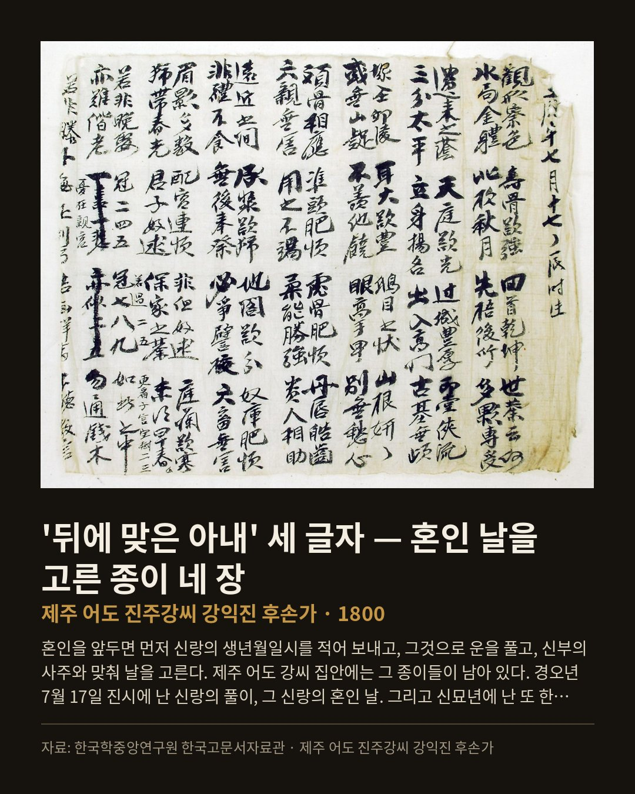
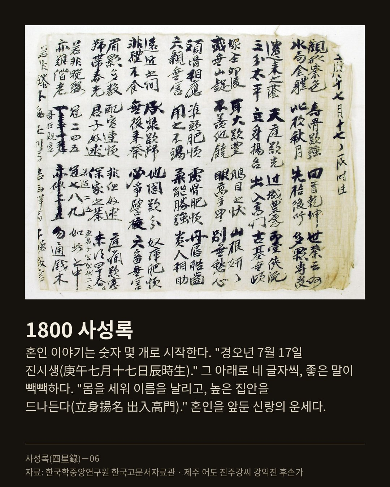

# EP.148 '뒤에 맞은 아내' 세 글자 — 혼인 날을 고른 종이 네 장

제주 어도 진주강씨 강익진 후손가 (문중) · 혼인을 앞두면 먼저 신랑의 생년월일시를 적어 보내고, 그것으로 운을 풀고, 신부의 사주와 맞춰 날을 고른다. 제주 어도 강씨 집안에는 그 종이들이 남아 있다. 경오년 7월 17일 진시에 난 신랑의 풀이, 그 신랑의 혼인 날. 그리고 신묘년에 난 또 한 신랑의 택일기에는 신부가 둘이다. 두 번째 이름 앞에는 '後娶', 뒤에 맞은 아내라고 적혀 있다

- 🌐 [전시 웹페이지](https://changgi.github.io/archive-tools/examples/eodo-kang-ij-taekil/exhibit.html) (한자 위 한글 독음 · 원문 해석) · [수업 활동지](https://changgi.github.io/archive-tools/examples/eodo-kang-ij-taekil/handout.html)
- 🎬 영상: [릴스 9:16](https://changgi.github.io/archive-tools-next/media/ep148-eodo-kang-ij-taekil_reel.mp4) · [가로 16:9](https://changgi.github.io/archive-tools-next/media/ep148-eodo-kang-ij-taekil_wide.mp4) · 홍보 글: [`promo.md`](promo.md)
- 카드뉴스: [`cards/`](cards/) · SNS 글: [`sns.txt`](sns.txt) · 판독·해석 표: [`selection.csv`](selection.csv)

<!-- DELIVERY -->
## 전달 에디팅 — 이 기록을 이렇게 전합니다

- **핵심 정서** — 아련함
- **한 문장** — 혼인은 날짜를 고르는 일에서 시작했다 — 신랑 · 신부의 여덟 글자(사주)를 나란히 쓰고 좋은 날을 고른 종이가, 한 남자의 두 번째 혼인까지 기록하고 있었다.
- **열기** — 혼인 날을 고른 종이에, 신부가 두 명 적혀 있었습니다.
- **펼치기** — 사성록－06 → 혼례택일기－1 → 혼례택일기－3 → 혼례택일기－2 (1800년) — 경오생 신랑의 운세 풀이(사성록) → 같은 신랑의 택일기 → 신묘생 신랑의 택일기(첫 신부와 '後娶') → 같은 신랑의 두 번째 혼인 택일기로, '같은 사주'를 따라 두 쌍을 잇게 놓았습니다. EP.142(강세건의 두 번의 혼인)와도 겹쳐 보입니다.
- **절정** — "뒤에 맞은 아내, 11월 13일 혼례(後娶 行禮 十一月十三日)" — 화면·공간에서 이 한 줄만 크게, 소리를 줄여 집중
- **여운** — 두 번째 신부의 사주를 적은 사람은, 첫 신부의 사주가 적힌 같은 종이를 보며 무슨 생각을 했을까요? — 질문으로 끝내고 답은 보는 사람에게
- **감각과 물질** — '乾'과 '坤' 두 사람의 여덟 글자가 나란히 — 그 옆에 홀로 붙은 '後娶'
- **통로와 매개** — 온라인: 릴스(열기) → 카드뉴스(펼치기) → 전시 웹페이지(절정·원문) → 비하인드 카드(여운) / 오프라인: 원본 크기 복제·낭독·참여 벽 / 남기기: 활동지·질문 카드
- **여운 장치** — 가족의 결혼 날짜와 그 날을 고른 이유 물어보기
- **전달 에디팅 전** — 4건의 문서를 1800년 연대순으로 놓고 문서명 · 유형 · 해설을 붙인다 — 정확하지만, 지나가면 잊힌다.
- **전달 에디팅 후** — 핵심 정서는 「아련함」. 「혼인 날을 고른 종이에, 신부가 두 명 적혀 있었습니다.」로 열고, 문서를 대비와 순서로 펼친 뒤, "뒤에 맞은 아내, 11월 13일 혼례(後娶 行禮 十一月十三日)"에서 멈춘다. '乾'과 '坤' 두 사람의 여덟 글자가 나란히 — 그 옆에 홀로 붙은 '後娶'. 마지막엔 「가족의 결혼 날짜와 그 날을 고른 이유 물어보기」로 보는 사람이 자기 이야기를 남기고 떠나게 한다.

전문: [`delivery.md`](delivery.md)
<!-- /DELIVERY -->

<!-- CURATOR -->
## 비하인드 — 큐레이터 노트

- **왜 이 문서들인가** — EP.141의 혼서(납폐 편지)를 읽은 뒤, 혼서보다 앞 단계인 사주와 택일 문서를 같은 집안 치부기록류에서 찾았습니다. 그 가운데 신랑 사주가 겹치는 네 장을 골랐습니다.
- **전하고 싶은 것** — 혼인은 날짜를 고르는 일에서 시작했다 — 신랑 · 신부의 여덟 글자(사주)를 나란히 쓰고 좋은 날을 고른 종이가, 한 남자의 두 번째 혼인까지 기록하고 있었다.
- **이렇게 보이길 바랐다** — 경오생 신랑의 운세 풀이(사성록) → 같은 신랑의 택일기 → 신묘생 신랑의 택일기(첫 신부와 '後娶') → 같은 신랑의 두 번째 혼인 택일기로, '같은 사주'를 따라 두 쌍을 잇게 놓았습니다. EP.142(강세건의 두 번의 혼인)와도 겹쳐 보입니다.
- **이렇게 써 주세요** — 조선 후기 혼례 절차(사성 · 연길 · 납폐), 사주팔자와 오행 표기, 택일 문화, 재혼(후취)의 기록 방식 수업에 쓰세요.
- **만들며 있었던 일** — 네 장 모두 연호 없이 간지만 있어 몇 년의 혼인인지 알 수 없습니다(자료관 목록은 모두 1800년). 사성록의 운세 풀이는 네 글자 구절이 이어진 행초서라 또렷한 구절만 옮겼고, 택일기의 오행 · 십신 표기(比肩 · 正官 등)는 원문대로 두었습니다. 신랑이 강씨 집안 누구인지는 문서에 이름이 없어 판단하지 않았습니다.
- **남겨 둔 질문** — 두 번째 신부의 사주를 적은 사람은, 첫 신부의 사주가 적힌 같은 종이를 보며 무슨 생각을 했을까요?
- **제작 기록** — 문서 4건 · 1800년 · 원본 사진 4면(문서 전체) · 원문 판독 4건 · 번역 4건 · 못 읽은 글자 □ 4 · 불확실 (?) 0

전문: [`curator.md`](curator.md) · 비하인드 카드: [`behind/`](behind/) · 채널별 홍보안: [`channels.md`](channels.md)
<!-- /CURATOR -->

## 이야기 — 사료가 말하는 대로

혼인 날을 고른 종이에, 신부가 두 명 적혀 있었습니다.

> **1800 사성록** — 혼인 이야기는 숫자 몇 개로 시작한다. "경오년 7월 17일 진시생(庚午七月十七日辰時生)." 그 아래로 네 글자씩, 좋은 말이 빽빽하다. "몸을 세워 이름을 날리고, 높은 집안을 드나든다(立身揚名 出入高門)." 혼인을 앞둔 신랑의 운세다.
> **1800 혼례택일기** — 그 신랑의 여덟 글자 옆에, 한 살 어린 신부의 여덟 글자가 놓인다. 신미년 6월, 자시생. 두 사람의 사주를 맞춰 본 사람이 날을 적는다. "좋은 날을 가리니 4월 초사흘에 예를 행한다(涓吉 四月初三日 行禮)."
> **1800 혼례택일기** — 또 다른 신랑, 신묘년 5월 25일 인시생. 그의 종이에는 신부가 둘이다. 오른쪽에 을유생 첫 신부, 그리고 왼쪽에 두 글자가 붙는다. "뒤에 맞은 아내, 11월 13일 혼례(後娶 行禮 十一月十三日)." 첫 신부에게 무슨 일이 있었는지, 종이는 말하지 않는다.
> **1800 혼례택일기** — 그리고 같은 두 사람만 다시 옮겨 적은 한 장. 이번에는 '後娶'도, 첫 신부도 없다. 신랑과 새 신부의 여덟 글자, 그리고 큰 글씨 한 줄. "11월 13일 혼례, 좋다(行禮 十一月十三日 可)." 두 번째 혼인은, 첫 번째처럼 날짜에서 다시 시작했다.

| 표지 | 1번 카드 | 마무리 |
|---|---|---|
|  |  |  |

## 선별 문서 (4점)

| # | 연도 | 유형 | 문서명 | 원본 |
|---|---|---|---|---|
| 1 | 1800 | 사성록 | 사성록(四星錄)－06 | [원본 보기](https://archive.aks.ac.kr/viewer/viewer.do#imgnode.do?itemId=book&gubun=booktree&depth=6&upPath=01%5E0168%5EL016818%5EL016818F02%5EL016818F0207&dataId=G002%2BAKS%2BKSM-XG.1800.5011-20220125.B077a_114_00515_XXX&itemType=) |
| 2 | 1800 | 혼례택일기 | 혼례택일기(婚禮擇日記)－1 | [원본 보기](https://archive.aks.ac.kr/viewer/viewer.do#imgnode.do?itemId=book&gubun=booktree&depth=6&upPath=01%5E0168%5EL016818%5EL016818F02%5EL016818F0207&dataId=G002%2BAKS%2BKSM-XG.1800.5011-20220125.B077a_114_00498_XXX&itemType=) |
| 3 | 1800 | 혼례택일기 | 혼례택일기(婚禮擇日記)－3 | [원본 보기](https://archive.aks.ac.kr/viewer/viewer.do#imgnode.do?itemId=book&gubun=booktree&depth=6&upPath=01%5E0168%5EL016818%5EL016818F02%5EL016818F0207&dataId=G002%2BAKS%2BKSM-XG.1800.5011-20220125.B077a_114_00500_XXX&itemType=) |
| 4 | 1800 | 혼례택일기 | 혼례택일기(婚禮擇日記)－2 | [원본 보기](https://archive.aks.ac.kr/viewer/viewer.do#imgnode.do?itemId=book&gubun=booktree&depth=6&upPath=01%5E0168%5EL016818%5EL016818F02%5EL016818F0207&dataId=G002%2BAKS%2BKSM-XG.1800.5011-20220125.B077a_114_00499_XXX&itemType=) |

## 원문 판독과 해석

### 1. 사성록(四星錄)－06

**원문 판독**

```
庚午七月十七日辰時生
觀所察色 水尙金體 … 此於秋月 …
天庭 … 立身揚名 出入高門 …
… 配宮 … 承 … 必爭 …
… 更有子宮 … 早春 …
```

**원문 해석** 경오년 7월 17일 진시(오전 7–9시)에 태어남. 빛을 살피니 물이 쇠를 받드는 몸이요, 가을 달에 (태어났으니) … 이마(天庭)는 … 몸을 세워 이름을 날리고, 높은 집안을 드나들 것이다. … 배우자 자리(配宮)는 … 또 자식 자리(子宮)는 … 이른 봄 ….

**해제** '경오년 7월 17일 진시생'의 사주와 관상을 네 글자 구절로 풀어 놓은 사성록(四星錄)입니다. 사성(四星)은 태어난 해 · 달 · 날 · 시를 가리키며, 혼인을 앞두고 신랑 집이 신부 집에 보내는 '사주단자'와 그 풀이를 아울러 부릅니다. '물이 쇠를 받드는 몸(水尙金體)', '몸을 세워 이름을 날리고 높은 집안을 드나든다(立身揚名 出入高門)'처럼 좋은 말을 늘어놓고, 배우자 자리(配宮) · 자식 자리(子宮)를 따로 짚습니다. 행초서 구절이 빽빽하여 또렷한 구절만 옮겼습니다. 같은 생년월일시가 다음 택일기의 신랑(乾)과 같습니다. 연호가 없어 몇 년인지는 알 수 없습니다.

### 2. 혼례택일기(婚禮擇日記)－1

**원문 판독**

```
乾 庚午七月十七日辰時
庚午土 劫財 七殺
甲申水 正財 劫財
辛巳金 比肩 正官
壬辰水 傷官 正印
坤 辛未六月辛 … 日子時
丙申 … 乙酉 … 丙子 …
涓吉 四月初三日 行禮
□吉 十□月 二十□日 行禮 … 可
```

**원문 해석** 신랑(乾): 경오년 7월 17일 진시. 경오(토) · 갑신(수) · 신사(금) · 임진(수) — 겁재 · 칠살 · 정재 · 비견 · 정관 · 상관 · 정인. 신부(坤): 신미년 6월 신○일 자시. 병신 · 을유 · 병자 …. 좋은 날을 가리니 4월 초3일에 예를 행함. (또) 10○월 2○일에 예를 행함이 좋다.

**해제** 앞의 사성록과 같은 '경오년 7월 17일 진시'의 신랑(乾)과 '신미년 6월 자시'의 신부(坤)의 사주를 나란히 적고 혼례 날을 고른 혼례택일기(婚禮擇日記)입니다. 신랑 사주는 해 · 달 · 날 · 시의 네 기둥(庚午 · 甲申 · 辛巳 · 壬辰)과 각각의 오행(土 · 水 · 金 · 水), 그리고 명리학의 십신(겁재 · 칠살 · 정재 · 비견 · 정관 · 상관 · 정인)을 붙였습니다. 신랑이 한 살 위입니다. '涓吉 四月初三日 行禮'와 함께 왼쪽에 큰 글씨로 다른 날짜가 '可'로 적혀, 날을 두 번 고르거나 절차별(납채 · 혼례)로 날을 정한 것으로 보입니다. 왼쪽 날짜 글자는 확정하지 못했습니다.

### 3. 혼례택일기(婚禮擇日記)－3

**원문 판독**

```
乾 辛卯五月二十五日寅時 …
甲午金 … 丙子水 … 庚寅木 …
坤 乙酉 … 月二十二日戌時生
乙酉水 傷官 正印 丙戌土 … 壬午木 … 庚戌金 …
吉期 正月 … 十□日
後娶 行禮 十一月十三日
坤 己丑八月十六日申時
癸酉金 丁丑水 戊申土
行禮 十一月十三日
```

**원문 해석** 신랑(乾): 신묘년 5월 25일 인시. 갑오(금) · 병자(수) · 경인(목) …. 신부(坤): 을유년 ○월 22일 술시생. 을유(수) · 병술(토) · 임오(목) · 경술(금) …. 좋은 때는 정월 … 1○일. 뒤에 맞은 아내(後娶): 혼례 11월 13일. 신부(坤): 기축년 8월 16일 신시. 계유(금) · 정축(수) · 무신(토). 혼례 11월 13일.

**해제** '신묘년 5월 25일 인시'에 난 신랑의 택일기입니다. 오른쪽에 첫 신부(을유생, 술시)의 사주와 '좋은 때(吉期) 정월 …'을, 왼쪽에 '後娶(뒤에 맞은 아내)'라는 제목 아래 두 번째 신부(기축생, 8월 16일 신시)의 사주와 '혼례 11월 13일'을 적었습니다. 한 종이에 한 남자의 두 번의 혼인이 함께 있는 셈입니다. 첫 혼인이 어떻게 끝났는지(사별 · 파혼 등)는 적혀 있지 않습니다. 오른쪽 위가 크게 찢겨 첫 신부 쪽 날짜 일부를 읽지 못했습니다. 두 번째 신부의 사주와 혼례일은 다음 장과 같습니다.

### 4. 혼례택일기(婚禮擇日記)－2

**원문 판독**

```
乾 辛卯五月二十五日寅時
甲午金 丙子水 庚寅木
坤 己丑八月十六日申時
癸酉金 丁丑水 戊申土
行禮 十一月十三日 可
```

**원문 해석** 신랑(乾): 신묘년 5월 25일 인시. 갑오(금) · 병자(수) · 경인(목). 신부(坤): 기축년 8월 16일 신시. 계유(금) · 정축(수) · 무신(토). 혼례는 11월 13일이 좋다(可).

**해제** 앞 장의 '後娶' 부분만 따로, 큼직하게 정서한 혼례택일기입니다. 신랑은 같은 '신묘년 5월 25일 인시', 신부는 같은 '기축년 8월 16일 신시', 혼례일도 같은 '11월 13일'이고, 끝에 '可(좋다)' 한 글자를 크게 썼습니다. 오른쪽 위에 작은 글씨로 '生 · 比 · 比 · 克'처럼 오행의 상생 · 상극을 따진 흔적이 있습니다. 앞 장이 날을 고르는 '초안'이라면 이 장은 신부 집에 보내거나 남겨 둔 '확정본'으로 보입니다. 신부가 신랑보다 두 살 위입니다.

판독·해석·이야기는 이미지에 근거한 초안이며(검토 전 "초안" 표시), 정확한 판독은 원문 확인이 필요합니다. □는 읽지 못한 글자, (?)는 불확실한 글자입니다.
이미지: 한국학중앙연구원 한국고문서자료관 소장·제공. "원본" 링크를 누르면 자료관 뷰어에서 그 문서가 열립니다. 재사용은 자료관에 문의하세요(소장처 동의 필요).
