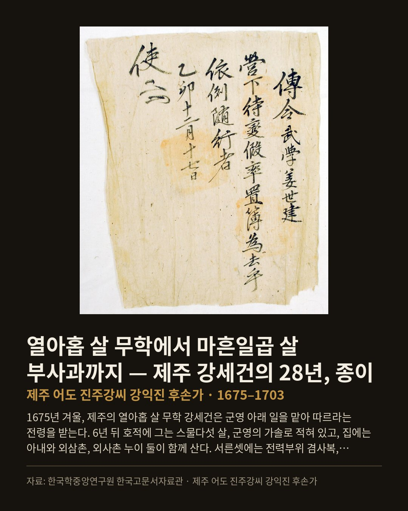
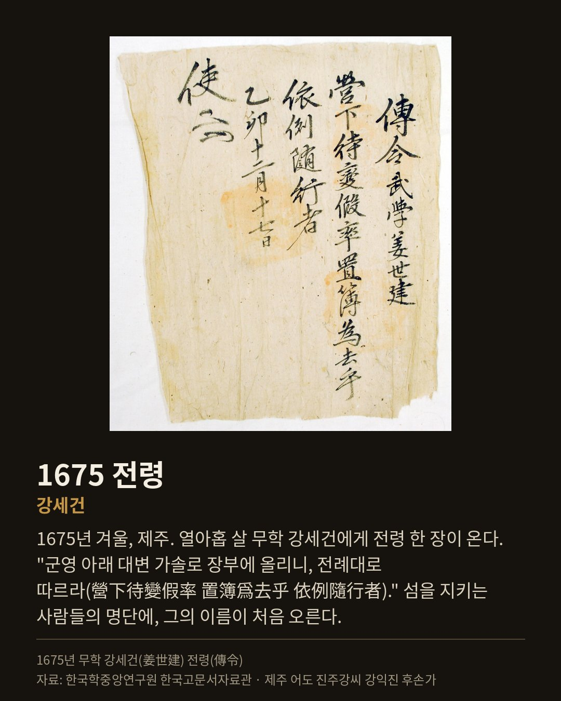

# EP.128 열아홉 살 무학에서 마흔일곱 살 부사과까지 — 제주 강세건의 28년, 종이 네 장

제주 어도 진주강씨 강익진 후손가 (문중) · 1675년 겨울, 제주의 열아홉 살 무학 강세건은 군영 아래 일을 맡아 따르라는 전령을 받는다. 6년 뒤 호적에 그는 스물다섯 살, 군영의 가솔로 적혀 있고, 집에는 아내와 외삼촌, 외사촌 누이 둘이 함께 산다. 서른셋에는 전력부위 겸사복, 마흔일곱에는 병절교위 용양위 부사과가 된다. 같은 이름이 네 장의 종이를 건너 28년을 걷는다

- 🌐 [전시 웹페이지](https://changgi.github.io/archive-tools/examples/eodo-kang-ij/exhibit.html) (한자 위 한글 독음 · 원문 해석) · [수업 활동지](https://changgi.github.io/archive-tools/examples/eodo-kang-ij/handout.html)
- 🎬 영상: [릴스 9:16](https://changgi.github.io/archive-tools-next/media/ep128-eodo-kang-ij_reel.mp4) · [가로 16:9](https://changgi.github.io/archive-tools-next/media/ep128-eodo-kang-ij_wide.mp4) · 홍보 글: [`promo.md`](promo.md)
- 카드뉴스: [`cards/`](cards/) · SNS 글: [`sns.txt`](sns.txt) · 판독·해석 표: [`selection.csv`](selection.csv)

<!-- DELIVERY -->
## 전달 에디팅 — 이 기록을 이렇게 전합니다

- **핵심 정서** — 담담함
- **한 문장** — 섬의 한 무관 지망생도 나라의 명단에 이름을 올리고, 식구를 거두며, 한 계단씩 올라갔다 — 네 장의 종이가 그 28년을 남겼다.
- **열기** — 열아홉 살 섬 청년의 이름이, 28년 동안 네 장의 종이를 건너갑니다.
- **펼치기** — 무학 강세건 전령 → 강세건 준호구 → 강세건 전력부위 겸사복 고신 → 강세건 병절교위 용양위 부사과 고 (1675–1703년) — 1675년 전령(19세) → 1681년 준호구(25세, 집안 식구) → 1689년 고신(33세) → 1703년 고신(47세) 순으로, 나이를 함께 적어 한 사람의 생애가 보이게 구성했습니다.
- **절정** — "군영 아래 대변 가솔로 장부에 올리니, 전례대로 따르라(營下待變假率 置簿爲去乎 依例隨行者)" — 화면·공간에서 이 한 줄만 크게, 소리를 줄여 집중
- **여운** — 외삼촌과 외사촌 누이들을 거둔 스물다섯의 가장은, 서른셋에 금군이 되던 날 누구에게 먼저 알렸을까요? — 질문으로 끝내고 답은 보는 사람에게
- **감각과 물질** — 같은 이름 '姜世建'에 밑줄을 그은 종이 네 장과, 장마다 붙인 나이 19 · 25 · 33 · 47 · 나의 신분증 만들기 체험 카드 · 어보·관인 탁본 스탬프를 찍어 보는 체험
- **통로와 매개** — 온라인: 릴스(열기) → 카드뉴스(펼치기) → 전시 웹페이지(절정·원문) → 비하인드 카드(여운) / 오프라인: 원본 크기 복제·낭독·참여 벽 / 남기기: 활동지·질문 카드
- **여운 장치** — 내 이름이 처음 오른 명단 떠올리기
- **전달 에디팅 전** — 4건의 문서를 1675–1703년 연대순으로 놓고 문서명 · 유형 · 해설을 붙인다 — 정확하지만, 지나가면 잊힌다.
- **전달 에디팅 후** — 핵심 정서는 「담담함」. 「열아홉 살 섬 청년의 이름이, 28년 동안 네 장의 종이를 건너갑니다.」로 열고, 문서를 대비와 순서로 펼친 뒤, "군영 아래 대변 가솔로 장부에 올리니, 전례대로 따르라(營下待變假率 置簿爲去乎 依例隨行者)"에서 멈춘다. 같은 이름 '姜世建'에 밑줄을 그은 종이 네 장과, 장마다 붙인 나이 19 · 25 · 33 · 47. 마지막엔 「내 이름이 처음 오른 명단 떠올리기」로 보는 사람이 자기 이야기를 남기고 떠나게 한다.

전문: [`delivery.md`](delivery.md)
<!-- /DELIVERY -->

<!-- CURATOR -->
## 비하인드 — 큐레이터 노트

- **왜 이 문서들인가** — 수백 장의 전령 · 차첩 · 호적 가운데, 가장 이른 네 장이 모두 같은 사람 강세건의 것이었습니다. 한 사람의 젊은 날부터 중년까지를 따라갈 수 있었습니다.
- **전하고 싶은 것** — 섬의 한 무관 지망생도 나라의 명단에 이름을 올리고, 식구를 거두며, 한 계단씩 올라갔다 — 네 장의 종이가 그 28년을 남겼다.
- **이렇게 보이길 바랐다** — 1675년 전령(19세) → 1681년 준호구(25세, 집안 식구) → 1689년 고신(33세) → 1703년 고신(47세) 순으로, 나이를 함께 적어 한 사람의 생애가 보이게 구성했습니다.
- **이렇게 써 주세요** — 조선의 군역과 무관 경력, 제주의 군영과 금군(겸사복), 호적으로 읽는 가족 구성, 생애사 쓰기 수업에 쓰세요.
- **만들며 있었던 일** — 전령 · 고신의 본문과 준호구는 해서라 대체로 확실하나, 준호구의 몇몇 이름자와 호수, 두 고신 왼쪽의 작은 행서는 읽지 못했거나 (?)로 두었습니다. 겸사복 · 부사과 임명의 까닭, 강익진과 강세건의 관계, EP.101 어도 강씨(강봉지 후손가)와의 관계는 확인하지 않았습니다.
- **남겨 둔 질문** — 외삼촌과 외사촌 누이들을 거둔 스물다섯의 가장은, 서른셋에 금군이 되던 날 누구에게 먼저 알렸을까요?
- **제작 기록** — 문서 4건 · 1675–1703년 · 원본 사진 4면(문서 전체) · 원문 판독 4건 · 번역 4건 · 못 읽은 글자 □ 2 · 불확실 (?) 11 · 해제에 "확인 필요"를 단 문서 3건

전문: [`curator.md`](curator.md) · 비하인드 카드: [`behind/`](behind/) · 채널별 홍보안: [`channels.md`](channels.md)
<!-- /CURATOR -->

## 이야기 — 사료가 말하는 대로

열아홉 살 섬 청년의 이름이, 28년 동안 네 장의 종이를 건너갑니다.

> **1675 전령** — 1675년 겨울, 제주. 열아홉 살 무학 강세건에게 전령 한 장이 온다. "군영 아래 대변 가솔로 장부에 올리니, 전례대로 따르라(營下待變假率 置簿爲去乎 依例隨行者)." 섬을 지키는 사람들의 명단에, 그의 이름이 처음 오른다.
> **1681 준호구** — 6년 뒤, 그의 집이 호적에 적힌다. "업무 영가솔 강세건, 나이 25세(業武營假率姜世建年貳拾伍)." 아내 양씨, 그리고 쉰아홉의 외삼촌과 외사촌 누이 둘. 스물다섯 살 무관 지망생은, 외가 식구까지 거두는 집의 가장이었다.
> **1689 고신** — 8년 뒤, 서울 병조의 고신이 바다를 건너온다. "업무 강세건을 전력부위 겸사복으로 삼는다(業武姜世建爲展力副尉兼司僕者)." 서른셋. 임금을 호위하는 금군의 이름을 얻었다.
> **1703 고신** — 그리고 14년 뒤. "겸사복 강세건을 병절교위 용양위 부사과로 삼는다(兼司僕姜世建爲秉節校尉龍驤衛副司果者)." 마흔일곱. 열아홉의 무학에서 28년, 같은 이름이 종이 네 장을 건너왔다.

| 표지 | 1번 카드 | 마무리 |
|---|---|---|
|  |  |  |

## 선별 문서 (4점)

| # | 연도 | 유형 | 문서명 | 원본 |
|---|---|---|---|---|
| 1 | 1675 | 전령 | 1675년 무학 강세건(姜世建) 전령(傳令) | [원본 보기](https://archive.aks.ac.kr/viewer/viewer.do#imgnode.do?itemId=book&gubun=booktree&depth=6&upPath=01%5E0168%5EL016818%5EL016818F02%5EL016818F0203&dataId=G002%2BAKS%2BKSM-XC.1675.5011-20220125.B077a_114_00097_XXX&itemType=) |
| 2 | 1681 | 준호구 | 1681년 강세건(姜世建) 준호구(準戶口) | [원본 보기](https://archive.aks.ac.kr/viewer/viewer.do#imgnode.do?itemId=book&gubun=booktree&depth=6&upPath=01%5E0168%5EL016818%5EL016818F02%5EL016818F0204&dataId=G002%2BAKS%2BKSM-XD.1681.5011-20220125.B077a_114_00223_XXX&itemType=) |
| 3 | 1689 | 고신 | 1689년 강세건(姜世建) 전력부위 겸사복 고신(告身) | [원본 보기](https://archive.aks.ac.kr/viewer/viewer.do#imgnode.do?itemId=book&gubun=booktree&depth=6&upPath=01%5E0168%5EL016818%5EL016818F02%5EL016818F0201&dataId=G002%2BAKS%2BKSM-XA.1689.5011-20220125.B077a_114_00001_XXX&itemType=) |
| 4 | 1703 | 고신 | 1703년 강세건(姜世建) 병절교위 용양위 부사과 고신(告身) | [원본 보기](https://archive.aks.ac.kr/viewer/viewer.do#imgnode.do?itemId=book&gubun=booktree&depth=6&upPath=01%5E0168%5EL016818%5EL016818F02%5EL016818F0201&dataId=G002%2BAKS%2BKSM-XA.1703.5011-20220125.B077a_114_00002_XXX&itemType=) |

## 원문 판독과 해석

### 1. 1675년 무학 강세건(姜世建) 전령(傳令)

**원문 판독**

```
傳令 武學姜世建
營下待變假率置簿爲去乎
依例隨行者
乙卯十二月十七日
使 (수결)
```

**원문 해석** 전령. 무학 강세건. 군영 아래 대변 가솔로 장부에 올리니, 전례에 따라 수행할 것. 을묘년(1675) 12월 17일. 사(수결).

**해제** 1675년(숙종 1, 乙卯) 12월 제주 목사가 무학(武學) 강세건(姜世建)에게 내린 전령입니다. '대변 가솔(待變假率)'은 변란에 대비해 군영(營) 아래 딸려 두는 인원으로, 그를 장부에 올리니 전례대로 따라 거행하라는 명령입니다. 무학은 무예를 익히며 무과를 준비하던 사람을 이릅니다. 6년 뒤 호적의 나이(1681년 25세, 정유생)로 보면 이때 열아홉 살입니다. 발급자 '사(使)'는 제주 목사로 보입니다. 종이 위쪽이 비스듬히 잘려 있습니다.

### 2. 1681년 강세건(姜世建) 준호구(準戶口)

**원문 판독**

```
康熙二十年十二月　日濟州牧
考辛酉成籍戶口帳內右面第六於音非道內山里□第一統第□戶
業武營假率姜世建年貳拾伍丁酉本晉州父留(?)鄕別監斗炯(?)祖南
部主簿受璜(?)曾祖權知訓鍊院奉事繼男外祖權知訓鍊院奉事
文明翼本福城妻梁(?)氏年參拾壬辰本濟州父宣略將軍行忠佐衛副
司猛士珀(?)祖留鄕別監時柱曾祖老職嘉善大夫渾外祖留鄕別監金(?)聲(?)
諧本金海率外三寸正兵城丁文唱位年伍拾玖癸亥率外四寸妹文召史年貳
拾壬寅次外四寸妹文召史年拾陸丙午等戊午戶口相準
行牧官 (수결)
```

**원문 해석** 강희 20년(1681) 12월 일, 제주목. 신유년에 만든 호적 장부를 살펴보니, 우면 제6 어음비도 내산리 제1통 제□호. 업무 영가솔 강세건, 나이 25세 정유생, 본관 진주. 아버지 유향별감 두형(?), 할아버지 남부 주부 수황(?), 증조할아버지 권지 훈련원 봉사 계남, 외할아버지 권지 훈련원 봉사 문명익(본관 복성). 아내 양(?)씨, 나이 30세 임진생, 본관 제주. 아내의 아버지 선략장군 행 충좌위 부사맹 사박(?), 할아버지 유향별감 시주, 증조할아버지 노직 가선대부 혼, 외할아버지 유향별감 김성해(?)(본관 김해). 데리고 사는 외삼촌 정병 성정 문창위, 나이 59세 계해생. 외사촌 누이 문소사, 나이 20세 임인생. 둘째 외사촌 누이 문소사, 나이 16세 병오생. 이상은 무오년 호적과 맞추어 보았다. 행 목관(수결).

**해제** 1681년(숙종 7, 康熙 20, 辛酉) 제주목이 강세건 집의 호적을 베껴 확인해 준 준호구(準戶口)입니다. 강세건은 '업무 영가솔(業武營假率)' — 무업에 종사하며 군영에 딸린 사람으로 적혀, 6년 전 전령의 '대변 가솔'과 이어집니다. 나이 25세 정유생(1657)이니 1675년에는 19세였습니다. 집에는 30세 아내 양씨와 함께, 외삼촌 문창위(59세)와 외사촌 누이 두 사람이 살고 있어, 외가 식구를 거둔 살림이었음을 알 수 있습니다. 여자의 이름 대신 '소사(召史)'라고 적은 것도 이 시기 호적의 방식입니다. 마을 이름 '어음비(於音非)'는 지금의 애월읍 어음리 일대로 보입니다. 몇몇 이름자와 호수는 흐려 □ · (?)로 두었습니다. 끝에 '무오년(1678) 호구와 맞추어 보았다(戊午戶口相準)'고 적고 목관이 수결했습니다.

### 3. 1689년 강세건(姜世建) 전력부위 겸사복 고신(告身)

**원문 판독**

```
兵曹康熙二十八年五月
初一日奉
敎業武姜世建爲展
力副尉兼司僕
者
康熙二十八年　月　日
(작은 글씨: 濟州牧使 … 依事目 …)
行判書
參判
參知
參議臣金(?)
正郞
佐郞臣尹(?)
```

**원문 해석** 병조에서 강희 28년(1689) 5월 1일에 교지를 받들어, 업무 강세건을 전력부위 겸사복으로 삼는다. 강희 28년 □월 □일. (작은 글씨: 제주 목사의 … 규정에 따라 … ) 행판서, 참판, 참지, 참의 신 김□, 정랑, 좌랑 신 윤□.

**해제** 1689년(숙종 15, 康熙 28, 己巳) 병조(兵曹)가 왕명을 받들어 업무 강세건을 전력부위(展力副尉, 종9품 무관 품계) 겸사복(兼司僕)으로 임명한 고신입니다. 겸사복은 임금을 가까이 호위하는 금군(禁軍)의 하나로, 제주 사람에게는 말을 바치거나 공을 세운 대가로 이런 자리가 내려지기도 했다고 알려져 있으나, 강세건의 경우는 확인하지 않았습니다. 왼쪽의 작은 행서는 '濟州牧使'와 '依事目'이 보여 제주 목사의 보고와 규정에 따른 임명임을 적은 것으로 보이나 나머지는 읽지 못했습니다. 이때 강세건은 33세입니다. 연호 위에 병조의 관인이 찍혔습니다.

### 4. 1703년 강세건(姜世建) 병절교위 용양위 부사과 고신(告身)

**원문 판독**

```
兵曹康熙四十二年四月
十八日奉
敎兼司僕姜世建爲秉節
校尉龍驤衛副司果者
康熙四十二年十月　日
(작은 글씨: 濟州牧使 … 自備 …)
判書
參判
參知
參議臣金(?)
正郞
佐郞臣尹(?)
```

**원문 해석** 병조에서 강희 42년(1703) 4월 18일에 교지를 받들어, 겸사복 강세건을 병절교위 용양위 부사과로 삼는다. 강희 42년 10월 일. (작은 글씨: 제주 목사의 … 스스로 갖추어 … ) 판서, 참판, 참지, 참의 신 김□, 정랑, 좌랑 신 윤□.

**해제** 1703년(숙종 29, 康熙 42, 癸未) 병조가 겸사복 강세건을 병절교위(秉節校尉, 종6품 무관 품계) 용양위(龍驤衛) 부사과(副司果, 종6품 군직)로 올린 고신입니다. 왕명을 받든 날(4월 18일)과 고신의 날짜(10월)가 다른데, 서울에서 정한 일이 문서로 만들어져 제주에 닿기까지의 시차로 보이나 확인하지 않았습니다. 왼쪽 작은 행서에 '濟州牧使'와 '自備' 같은 글자가 보여, 스스로 무엇을 갖추어 바친 공에 따른 것으로 짐작되나 읽지 못한 글자가 많아 판단하지 않았습니다. 이때 47세로, 1675년 전령에서 28년 뒤입니다.

판독·해석·이야기는 이미지에 근거한 초안이며(검토 전 "초안" 표시), 정확한 판독은 원문 확인이 필요합니다. □는 읽지 못한 글자, (?)는 불확실한 글자입니다.
이미지: 한국학중앙연구원 한국고문서자료관 소장·제공. "원본" 링크를 누르면 자료관 뷰어에서 그 문서가 열립니다. 재사용은 자료관에 문의하세요(소장처 동의 필요).
