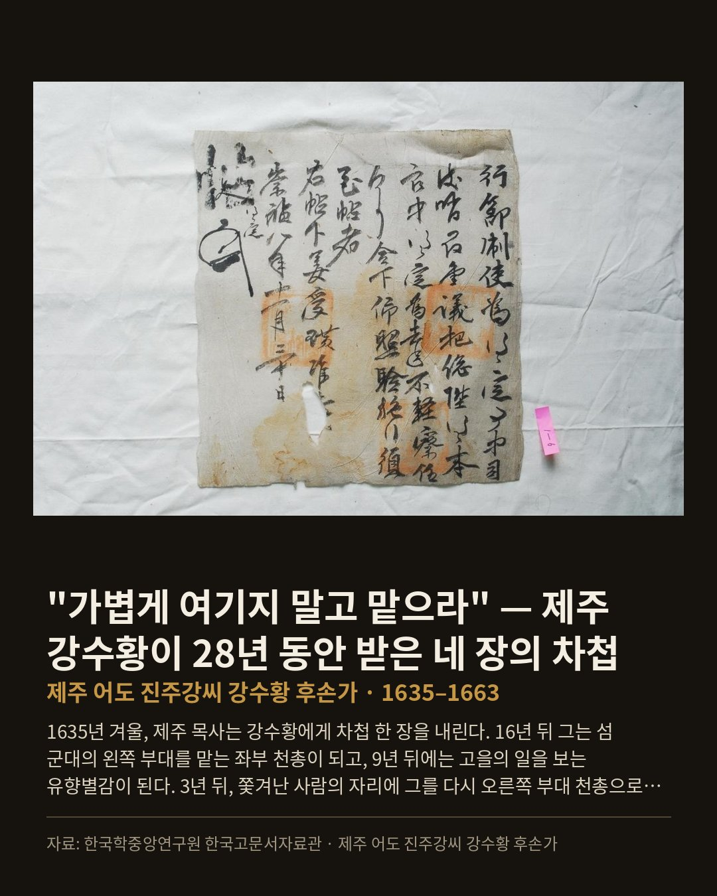
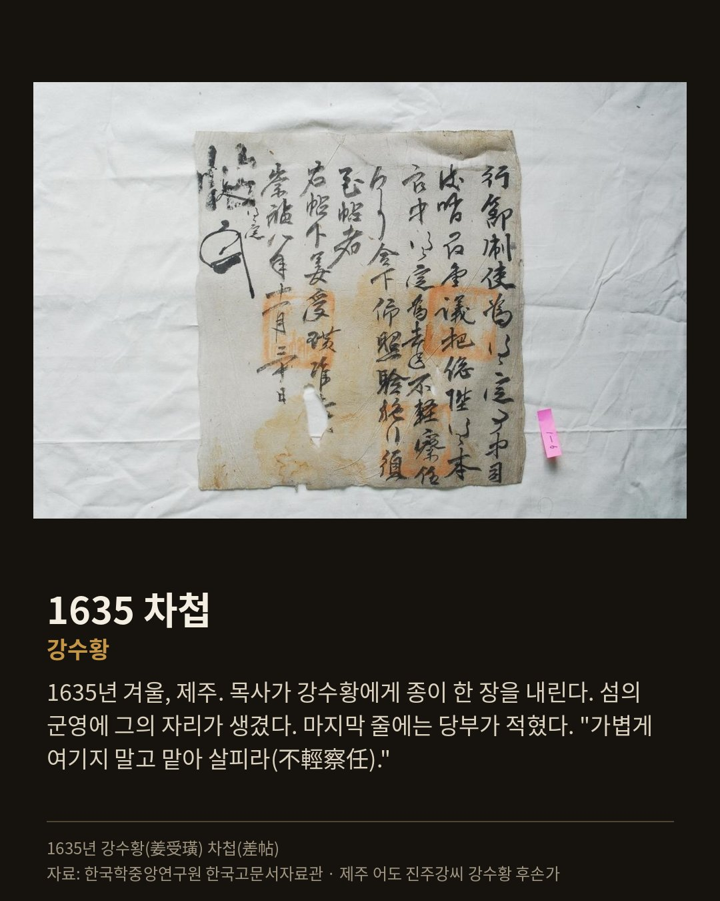
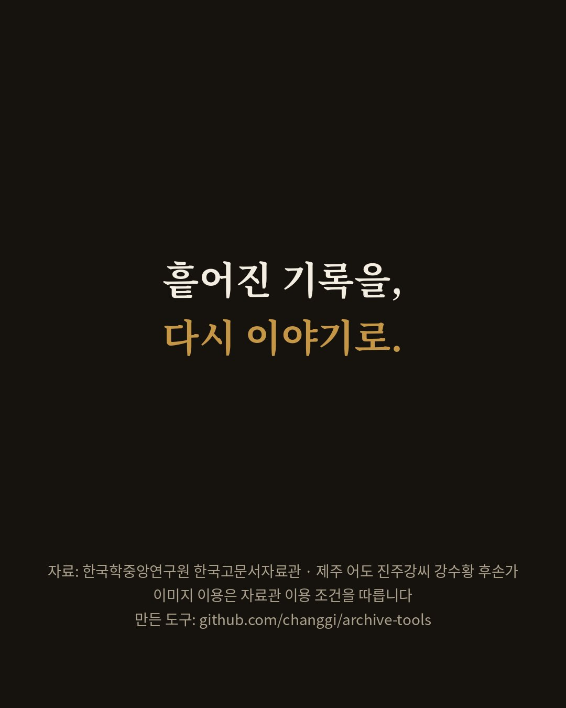

# EP.138 "가볍게 여기지 말고 맡으라" — 제주 강수황이 28년 동안 받은 네 장의 차첩

제주 어도 진주강씨 강수황 후손가 (문중) · 1635년 겨울, 제주 목사는 강수황에게 차첩 한 장을 내린다. 16년 뒤 그는 섬 군대의 왼쪽 부대를 맡는 좌부 천총이 되고, 9년 뒤에는 고을의 일을 보는 유향별감이 된다. 3년 뒤, 쫓겨난 사람의 자리에 그를 다시 오른쪽 부대 천총으로 앉힌다. 네 장 모두 같은 말로 끝난다. 가볍게 여기지 말고 맡아 살피라

- 🌐 [전시 웹페이지](https://changgi.github.io/archive-tools/examples/eodo-kang-sh-chacheop/exhibit.html) (한자 위 한글 독음 · 원문 해석) · [수업 활동지](https://changgi.github.io/archive-tools/examples/eodo-kang-sh-chacheop/handout.html)
- 🎬 영상: [릴스 9:16](https://changgi.github.io/archive-tools-next/media/ep138-eodo-kang-sh-chacheop_reel.mp4) · [가로 16:9](https://changgi.github.io/archive-tools-next/media/ep138-eodo-kang-sh-chacheop_wide.mp4) · 홍보 글: [`promo.md`](promo.md)
- 카드뉴스: [`cards/`](cards/) · SNS 글: [`sns.txt`](sns.txt) · 판독·해석 표: [`selection.csv`](selection.csv)

<!-- DELIVERY -->
## 전달 에디팅 — 이 기록을 이렇게 전합니다

- **핵심 정서** — 묵직함
- **한 문장** — 작은 자리의 임명장에도 당부가 있었다 — 누군가 떠난 자리를 이어받으며, 섬의 한 사람은 28년 동안 같은 말을 네 번 들었다.
- **열기** — 28년 동안 같은 사람에게, 같은 당부가 네 번 왔습니다. "가볍게 여기지 말라."
- **펼치기** — 강수황 차첩 → 강수황 좌부 천총 차첩 → 강수황 유향별감 차첩 → 강수황 우부 천총 차첩 (1635–1663년) — 1635년 첫 차첩 → 1651년 좌부 천총 → 1660년 유향별감(김숭의 자리) → 1663년 우부 천총(쫓겨난 고자이의 자리) 순으로, 반복되는 당부와 '누구의 자리'라는 말이 쌓이게 구성했습니다.
- **절정** — "가볍게 여기지 말고 맡아 살피라(不輕察任)" — 화면·공간에서 이 한 줄만 크게, 소리를 줄여 집중
- **여운** — 쫓겨난 사람의 자리에 앉던 날, 강수황은 무엇을 가장 조심했을까요? — 질문으로 끝내고 답은 보는 사람에게
- **감각과 물질** — 크게 쓴 '帖' 자 네 개와, 네 번 되풀이된 '不輕察任' · 어보·관인 탁본 스탬프를 찍어 보는 체험 · 책장을 넘기는 소리, 확대 열람대
- **통로와 매개** — 온라인: 릴스(열기) → 카드뉴스(펼치기) → 전시 웹페이지(절정·원문) → 비하인드 카드(여운) / 오프라인: 원본 크기 복제·낭독·참여 벽 / 남기기: 활동지·질문 카드
- **여운 장치** — 이어받은 자리에서 지키고 싶은 한 가지 적기
- **전달 에디팅 전** — 4건의 문서를 1635–1663년 연대순으로 놓고 문서명 · 유형 · 해설을 붙인다 — 정확하지만, 지나가면 잊힌다.
- **전달 에디팅 후** — 핵심 정서는 「묵직함」. 「28년 동안 같은 사람에게, 같은 당부가 네 번 왔습니다. "가볍게 여기지 말라."」로 열고, 문서를 대비와 순서로 펼친 뒤, "가볍게 여기지 말고 맡아 살피라(不輕察任)"에서 멈춘다. 크게 쓴 '帖' 자 네 개와, 네 번 되풀이된 '不輕察任'. 마지막엔 「이어받은 자리에서 지키고 싶은 한 가지 적기」로 보는 사람이 자기 이야기를 남기고 떠나게 한다.

전문: [`delivery.md`](delivery.md)
<!-- /DELIVERY -->

<!-- CURATOR -->
## 비하인드 — 큐레이터 노트

- **왜 이 문서들인가** — 수백 장의 차첩 가운데 가장 이른 네 장이 모두 이 집안의 이름이 된 강수황의 것이었습니다. 네 장 모두 '不輕察任'이라는 같은 당부로 끝났습니다.
- **전하고 싶은 것** — 작은 자리의 임명장에도 당부가 있었다 — 누군가 떠난 자리를 이어받으며, 섬의 한 사람은 28년 동안 같은 말을 네 번 들었다.
- **이렇게 보이길 바랐다** — 1635년 첫 차첩 → 1651년 좌부 천총 → 1660년 유향별감(김숭의 자리) → 1663년 우부 천총(쫓겨난 고자이의 자리) 순으로, 반복되는 당부와 '누구의 자리'라는 말이 쌓이게 구성했습니다.
- **이렇게 써 주세요** — 조선의 지방 군제(천총 · 파총)와 향청(좌수 · 별감), 차첩과 고신의 차이, 명청 교체기의 연호, 이두(本良中 · 爲去乎) 읽기 수업에 쓰세요.
- **만들며 있었던 일** — 1651 · 1660 · 1663년 차첩은 해서라 확실한 편이나, 1635년 첫 장은 초서가 섞여 맡긴 자리 이름을 읽지 못했습니다. 김숭 · 고자이의 이름자 하나씩은 (?)로 두었고, 고자이가 쫓겨난 까닭과 '전 첨정'의 경위는 확인하지 않았습니다.
- **남겨 둔 질문** — 쫓겨난 사람의 자리에 앉던 날, 강수황은 무엇을 가장 조심했을까요?
- **제작 기록** — 문서 4건 · 1635–1663년 · 원본 사진 4면(문서 전체) · 원문 판독 4건 · 번역 4건 · 못 읽은 글자 □ 3 · 불확실 (?) 9

전문: [`curator.md`](curator.md) · 비하인드 카드: [`behind/`](behind/) · 채널별 홍보안: [`channels.md`](channels.md)
<!-- /CURATOR -->

## 이야기 — 사료가 말하는 대로

28년 동안 같은 사람에게, 같은 당부가 네 번 왔습니다. "가볍게 여기지 말라."

> **1635 차첩** — 1635년 겨울, 제주. 목사가 강수황에게 종이 한 장을 내린다. 섬의 군영에 그의 자리가 생겼다. 마지막 줄에는 당부가 적혔다. "가볍게 여기지 말고 맡아 살피라(不輕察任)."
> **1651 차첩** — 16년 뒤, 연호가 바뀌어 있다. 명의 숭정이 아니라 청의 순치. 그사이 나라는 전쟁을 치렀다. 그리고 같은 사람에게 다시 첩이 온다. "좌부 천총에 차정한다(左部千總差定)." 섬 군대의 왼쪽 부대를, 그가 맡는다.
> **1660 차첩** — 9년 뒤, 이번엔 군대가 아니라 고을의 일이다. "유향별감 김숭의 자리에 차정한다(留鄕別監金嵩本良中差定)." 누군가 떠난 자리에, 강수황이 앉는다.
> **1663 차첩** — 그리고 1663년 정월. 마지막 장은 이렇게 시작한다. "우부 천총 고자이가 쫓겨난 자리에(右部千總高自邇汰去本良中)." 28년 동안 네 번, 같은 당부가 적혔다. 가볍게 여기지 말라. 그가 그 말을 지켰는지는, 남은 종이 수가 말해 준다.

| 표지 | 1번 카드 | 마무리 |
|---|---|---|
|  |  |  |

## 선별 문서 (4점)

| # | 연도 | 유형 | 문서명 | 원본 |
|---|---|---|---|---|
| 1 | 1635 | 차첩 | 1635년 강수황(姜受璜) 차첩(差帖) | [원본 보기](https://archive.aks.ac.kr/viewer/viewer.do#imgnode.do?itemId=book&gubun=booktree&depth=6&upPath=01%5E0168%5EL016817%5EL016817F02%5EL016817F0201&dataId=G002%2BAKS%2BKSM-XA.1635.5011-20220125.B077a_110_00127_XXX&itemType=) |
| 2 | 1651 | 차첩 | 1651년 강수황(姜受璜) 좌부 천총 차첩(差帖) | [원본 보기](https://archive.aks.ac.kr/viewer/viewer.do#imgnode.do?itemId=book&gubun=booktree&depth=6&upPath=01%5E0168%5EL016817%5EL016817F02%5EL016817F0201&dataId=G002%2BAKS%2BKSM-XA.1651.5011-20220125.B077a_110_00128_XXX&itemType=) |
| 3 | 1660 | 차첩 | 1660년 강수황(姜受璜) 유향별감 차첩(差帖) | [원본 보기](https://archive.aks.ac.kr/viewer/viewer.do#imgnode.do?itemId=book&gubun=booktree&depth=6&upPath=01%5E0168%5EL016817%5EL016817F02%5EL016817F0201&dataId=G002%2BAKS%2BKSM-XA.1660.5011-20220125.B077a_110_00130_XXX&itemType=) |
| 4 | 1663 | 차첩 | 1663년 강수황(姜受璜) 우부 천총 차첩(差帖) | [원본 보기](https://archive.aks.ac.kr/viewer/viewer.do#imgnode.do?itemId=book&gubun=booktree&depth=6&upPath=01%5E0168%5EL016817%5EL016817F02%5EL016817F0201&dataId=G002%2BAKS%2BKSM-XA.1663.5011-20220125.B077a_110_00131_XXX&itemType=) |

## 원문 판독과 해석

### 1. 1635년 강수황(姜受璜) 차첩(差帖)

**원문 판독**

```
行節制使爲差定事□(?)本(?)目(?)
次哨(?)官(?)□議把總陞(?)□本(?)
官中差定爲去乎不輕察任
向事合下仰照驗施行須
至帖者
右帖下姜受璜准此
崇禎八年十一月三十日
差定
帖 (수결)
```

**원문 해석** 행 절제사가 차정하는 일. … (자리)에 차정하니, 가볍게 여기지 말고 맡아 살필 일로 아울러 내리니 살펴 시행하라. 이 첩은 강수황에게 내리니 이대로 하라. 숭정 8년(1635) 11월 30일. 차정. 첩(수결).

**해제** 1635년(인조 13, 崇禎 8) 11월 제주 목사가 강수황(姜受璜)에게 내린 차첩(差帖)입니다. 차첩은 목사 · 병사 같은 지방 장관이 군직이나 향직에 사람을 임명할 때 주는 문서로, 왕이 내리는 고신(교지)보다 낮은 자리의 임명장입니다. 발급자 '행 절제사(行節制使)'는 병마수군절제사를 겸한 제주 목사입니다. 이 장은 초서가 섞여 맡긴 자리의 이름(把總 등)을 확실히 읽지 못했습니다. 숭정 연호는 명나라의 것으로, 병자호란(1636) 직전의 해입니다. 큰 글씨 '帖'과 수결이 왼쪽에, 관인이 여러 군데 찍혔습니다.

### 2. 1651년 강수황(姜受璜) 좌부 천총 차첩(差帖)

**원문 판독**

```
行節制使爲差定事左部
千總差定爲去乎不輕察任
向事合下仰照驗施行須至帖者
右帖下前僉正姜受璜准此
順治八年十二月初六日
差定
帖
```

**원문 해석** 행 절제사가 차정하는 일. 좌부 천총에 차정하니, 가볍게 여기지 말고 맡아 살필 일로 아울러 내리니 살펴 시행하라. 이 첩은 전 첨정 강수황에게 내리니 이대로 하라. 순치 8년(1651) 12월 6일. 차정. 첩.

**해제** 1651년(효종 2, 順治 8) 제주 목사가 '전 첨정(前僉正)' 강수황을 좌부 천총(左部千總)에 임명한 차첩입니다. 천총은 지방 군영에서 부(部) 하나를 거느리는 장교로, 좌부는 왼쪽 부대입니다. '전 첨정'은 그가 앞서 종4품 첨정의 품계나 자리를 지녔다는 뜻으로 보입니다. 16년 사이 연호가 명의 '숭정'에서 청의 '순치'로 바뀌었습니다. 해서로 또렷이 썼고, 관인이 세 군데 찍혔습니다.

### 3. 1660년 강수황(姜受璜) 유향별감 차첩(差帖)

**원문 판독**

```
行節制使爲差定事留鄕別監
金嵩(?)本良中差定爲去乎不輕察任
向事合下仰照驗施行須至帖者
右帖下姜受璜准此
順治十七年三月十九日
差定
帖 (수결)
```

**원문 해석** 행 절제사가 차정하는 일. 유향별감 김숭(?)의 자리에 차정하니, 가볍게 여기지 말고 맡아 살필 일로 아울러 내리니 살펴 시행하라. 이 첩은 강수황에게 내리니 이대로 하라. 순치 17년(1660) 3월 19일. 차정. 첩(수결).

**해제** 1660년(현종 1, 順治 17) 강수황을 유향별감(留鄕別監)으로 임명한 차첩입니다. 유향소(留鄕所, 향청)는 고을 양반들이 수령을 돕고 풍속을 살피던 곳으로, 별감은 좌수 다음의 자리입니다. '김숭(?)의 자리에(金嵩本良中)'는 '本(本位)'와 이두 '良中(-에)'를 써서, 앞서 그 자리에 있던 김숭을 대신해 앉힌다는 뜻입니다. 군직(천총)에서 향직(별감)으로 옮긴 셈입니다. 이름 둘째 글자는 (?)로 두었고, 아래쪽이 찢겨 나갔습니다.

### 4. 1663년 강수황(姜受璜) 우부 천총 차첩(差帖)

**원문 판독**

```
行節制使爲差定事
右部千總高自邇(?)汰去
本良中差定爲去乎不
輕察任向事合下仰照
驗施行須至帖者
右帖下前僉正姜受璜准此
康熙二年正月初七日
差定
帖 (수결)
```

**원문 해석** 행 절제사가 차정하는 일. 우부 천총 고자이(?)가 쫓겨난 자리에 차정하니, 가볍게 여기지 말고 맡아 살필 일로 아울러 내리니 살펴 시행하라. 이 첩은 전 첨정 강수황에게 내리니 이대로 하라. 강희 2년(1663) 정월 7일. 차정. 첩(수결).

**해제** 1663년(현종 4, 康熙 2) 강수황을 우부 천총(右部千總)에 임명한 차첩입니다. '고자이(?)가 쫓겨난 자리에(高自邇汰去本良中)'의 '汰去'는 직무에서 내쳐졌다는 뜻으로, 앞사람이 어떤 일로 물러나게 되었음을 보여 줍니다(까닭은 적혀 있지 않음). 12년 전 좌부 천총이었던 강수황이 이번엔 오른쪽 부대를 맡았습니다. 1635년 첫 차첩에서 28년 뒤입니다. 이름 셋째 글자는 (?)로 두었습니다. 같은 집안에는 이후 18~19세기의 차첩이 수십 장 이어집니다.

판독·해석·이야기는 이미지에 근거한 초안이며(검토 전 "초안" 표시), 정확한 판독은 원문 확인이 필요합니다. □는 읽지 못한 글자, (?)는 불확실한 글자입니다.
이미지: 한국학중앙연구원 한국고문서자료관 소장·제공. "원본" 링크를 누르면 자료관 뷰어에서 그 문서가 열립니다. 재사용은 자료관에 문의하세요(소장처 동의 필요).
