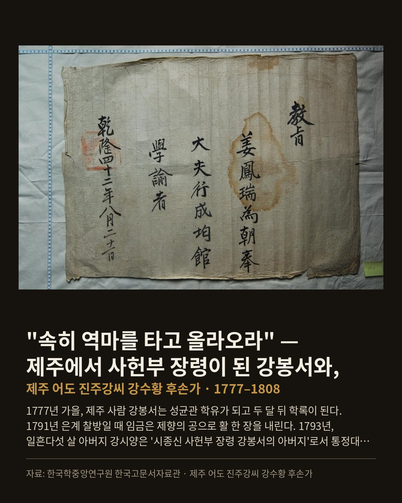
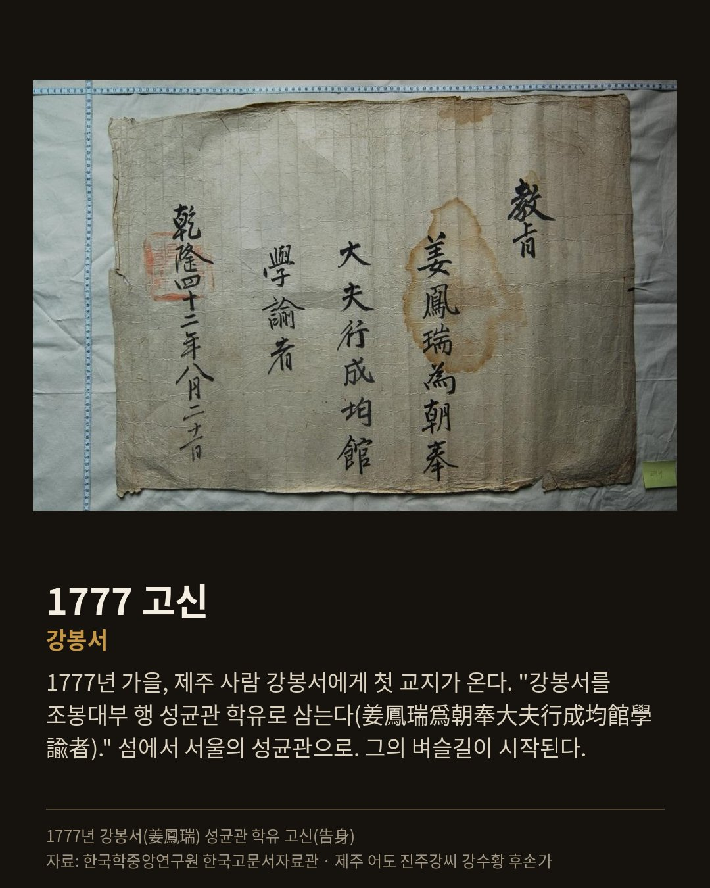
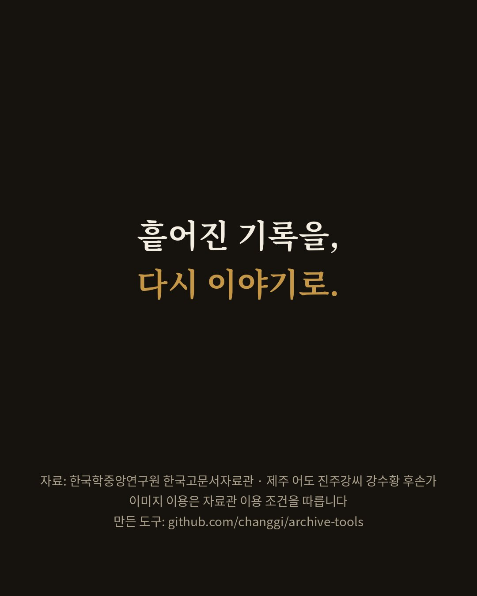

# EP.129 "속히 역마를 타고 올라오라" — 제주에서 사헌부 장령이 된 강봉서와, 일흔다섯 아버지의 품계

제주 어도 진주강씨 강수황 후손가 (문중) · 1777년 가을, 제주 사람 강봉서는 성균관 학유가 되고 두 달 뒤 학록이 된다. 1791년 은계 찰방일 때 임금은 제향의 공으로 활 한 장을 내린다. 1793년, 일흔다섯 살 아버지 강시양은 '시종신 사헌부 장령 강봉서의 아버지'로서 통정대부 품계를 받는다. 1808년 봄, 다시 유지가 온다. 그대를 사헌부 장령으로 삼으니, 속히 역마를 타고 올라오라

- 🌐 [전시 웹페이지](https://changgi.github.io/archive-tools/examples/eodo-kang-sh/exhibit.html) (한자 위 한글 독음 · 원문 해석) · [수업 활동지](https://changgi.github.io/archive-tools/examples/eodo-kang-sh/handout.html)
- 🎬 영상: [릴스 9:16](https://changgi.github.io/archive-tools/examples/media/ep129-eodo-kang-sh_reel.mp4) · [가로 16:9](https://changgi.github.io/archive-tools/examples/media/ep129-eodo-kang-sh_wide.mp4) · 홍보 글: [`promo.md`](promo.md)
- 카드뉴스: [`cards/`](cards/) · SNS 글: [`sns.txt`](sns.txt) · 판독·해석 표: [`selection.csv`](selection.csv)

<!-- DELIVERY -->
## 전달 에디팅 — 이 기록을 이렇게 전합니다

- **핵심 정서** — 자랑스러움
- **한 문장** — 섬에서 출발한 벼슬길도 나라의 한가운데에 닿았다 — 그 길은 아버지의 이름까지 높였다.
- **열기** — 제주의 한 선비에게 임금이 썼습니다. "속히 역마를 타고 올라오라."
- **펼치기** — 강봉서 성균관 학유 고신 → 강봉서 성균관 학록 고신 → 은계 찰방 강봉서에게 내린 유지 → 강시양 통정대부 고신 → 강봉서 사헌부 장령 유지 → 강봉서 제원도 찰방 고신 (1777–1808년) — 1777년 첫 두 고신 → 1791년 활을 내린 유지 → 1793년 아버지의 고신 → 1808년 장령 유지와 찰방 고신 순으로, 한 사람의 31년과 그 영예가 아버지에게 닿는 장면을 가운데에 두었습니다.
- **절정** — "그대를 사헌부 장령으로 삼으니, 속히 역마를 타고 올라오라(爾其斯速 乘馹上來)" — 화면·공간에서 이 한 줄만 크게, 소리를 줄여 집중
- **여운** — 역마를 타고 바다 건너 서울로 가던 날, 강봉서는 제주의 아버지를 떠올렸을까요? — 질문으로 끝내고 답은 보는 사람에게
- **감각과 물질** — 유지 두 장 — '활 한 장'과 '역마를 타고' — 사이에 아버지의 교지 한 장 · 어보·관인 탁본 스탬프를 찍어 보는 체험 · 역마 방울·말발굽 소리와 함께 펼치는 두루마리
- **통로와 매개** — 온라인: 릴스(열기) → 카드뉴스(펼치기) → 전시 웹페이지(절정·원문) → 비하인드 카드(여운) / 오프라인: 원본 크기 복제·낭독·참여 벽 / 남기기: 활동지·질문 카드
- **여운 장치** — 부모님께 자랑이 되었던 순간 하나 적기
- **전달 에디팅 전** — 6건의 문서를 1777–1808년 연대순으로 놓고 문서명 · 유형 · 해설을 붙인다 — 정확하지만, 지나가면 잊힌다.
- **전달 에디팅 후** — 핵심 정서는 「자랑스러움」. 「제주의 한 선비에게 임금이 썼습니다. "속히 역마를 타고 올라오라."」로 열고, 문서를 대비와 순서로 펼친 뒤, "그대를 사헌부 장령으로 삼으니, 속히 역마를 타고 올라오라(爾其斯速 乘馹上來)"에서 멈춘다. 유지 두 장 — '활 한 장'과 '역마를 타고' — 사이에 아버지의 교지 한 장. 마지막엔 「부모님께 자랑이 되었던 순간 하나 적기」로 보는 사람이 자기 이야기를 남기고 떠나게 한다.

전문: [`delivery.md`](delivery.md)
<!-- /DELIVERY -->

<!-- CURATOR -->
## 비하인드 — 큐레이터 노트

- **왜 이 문서들인가** — 고신 사이에 유지 두 장이 있었고, 그중 하나는 '속히 역마를 타고 올라오라'는 부름이었습니다. 제주 사람이 서울의 대간 자리에 불려 가는 장면이 그대로 남아 있었습니다.
- **전하고 싶은 것** — 섬에서 출발한 벼슬길도 나라의 한가운데에 닿았다 — 그 길은 아버지의 이름까지 높였다.
- **이렇게 보이길 바랐다** — 1777년 첫 두 고신 → 1791년 활을 내린 유지 → 1793년 아버지의 고신 → 1808년 장령 유지와 찰방 고신 순으로, 한 사람의 31년과 그 영예가 아버지에게 닿는 장면을 가운데에 두었습니다.
- **이렇게 써 주세요** — 조선의 관직 체계(성균관 · 찰방 · 사헌부), 유지와 고신 같은 왕명 문서, 시종신 부모 가자 제도, 제주 사람의 중앙 진출 수업에 쓰세요.
- **만들며 있었던 일** — 여섯 장 모두 정서라 판독이 확실한 편이나, 두 승지의 이름과 1808년 유지 겉봉 첫 글자는 흐립니다. 강봉서의 문과 급제 연도, '본릉'이 어느 능인지, 강수황과의 관계는 확인하지 않았고, 1793년 고신은 문서의 연호를 따라 자료관 목록(1792)과 한 해 다릅니다.
- **남겨 둔 질문** — 역마를 타고 바다 건너 서울로 가던 날, 강봉서는 제주의 아버지를 떠올렸을까요?
- **제작 기록** — 문서 6건 · 1777–1808년 · 원본 사진 8면(문서 전체) · 원문 판독 6건 · 번역 6건 · 못 읽은 글자 □ 0 · 불확실 (?) 3 · 해제에 "확인 필요"를 단 문서 2건

전문: [`curator.md`](curator.md) · 비하인드 카드: [`behind/`](behind/) · 채널별 홍보안: [`channels.md`](channels.md)
<!-- /CURATOR -->

## 이야기 — 사료가 말하는 대로

제주의 한 선비에게 임금이 썼습니다. "속히 역마를 타고 올라오라."

> **1777 고신** — 1777년 가을, 제주 사람 강봉서에게 첫 교지가 온다. "강봉서를 조봉대부 행 성균관 학유로 삼는다(姜鳳瑞爲朝奉大夫行成均館學諭者)." 섬에서 서울의 성균관으로. 그의 벼슬길이 시작된다.
> **1777 고신** — 두 달 뒤, 또 한 장. "강봉서를 조산대부 행 성균관 학록으로 삼는다(姜鳳瑞爲朝散大夫行成均館學錄者)." 한 계단. 섬에서 온 선비가 서울에서 한 걸음씩 오른다.
> **1791 유지** — 14년 뒤, 그는 강원도 역을 맡은 은계 찰방이다. 왕릉 제사를 맡아 치른 그에게, 임금의 유지가 온다. "그대가 전사관이었으므로 활 한 장을 내린다(爾以典祀官 上弦弓一張賜給)." 섬사람의 손에, 임금이 내린 활이 들렸다.
> **1793 고신** — 2년 뒤, 교지는 아버지에게 간다. 일흔다섯 살 강시양. 옆에 작은 글씨로 까닭이 적혔다. "사헌부 장령 강봉서의 아버지이므로 법전대로 품계를 올린다(司憲府掌令姜鳳瑞父依法典加資事)." 아들의 벼슬이, 늙은 아버지의 이름을 높였다.
> **1808 유지** — 그리고 1808년 봄, 다시 유지가 온다. "그대를 사헌부 장령으로 삼으니, 속히 역마를 타고 올라오라(爾其斯速 乘馹上來)." 15년 만에, 같은 자리가 그를 다시 불렀다.
> **1808 고신** — 넉 달 뒤, 교지 한 장. "강봉서를 통훈대부 행 제원도 찰방으로 삼는다(姜鳳瑞爲通訓大夫行濟原道察訪者)." 1777년 학유에서 31년. 섬에서 출발한 그의 길은, 서울과 지방을 몇 번이고 오갔다.

| 표지 | 1번 카드 | 마무리 |
|---|---|---|
|  |  |  |

## 선별 문서 (6점)

| # | 연도 | 유형 | 문서명 | 원본 |
|---|---|---|---|---|
| 1 | 1777 | 고신 | 1777년 강봉서(姜鳳瑞) 성균관 학유 고신(告身) | [원본 보기](https://archive.aks.ac.kr/viewer/viewer.do#imgnode.do?itemId=book&gubun=booktree&depth=6&upPath=01%5E0168%5EL016817%5EL016817F02%5EL016817F0201&dataId=G002%2BAKS%2BKSM-XA.1777.5011-20220125.B077a_110_00006_XXX&itemType=) |
| 2 | 1777 | 고신 | 1777년 강봉서(姜鳳瑞) 성균관 학록 고신(告身) | [원본 보기](https://archive.aks.ac.kr/viewer/viewer.do#imgnode.do?itemId=book&gubun=booktree&depth=6&upPath=01%5E0168%5EL016817%5EL016817F02%5EL016817F0201&dataId=G002%2BAKS%2BKSM-XA.1777.5011-20220125.B077a_110_00007_XXX&itemType=) |
| 3 | 1791 | 유지 | 1791년 은계 찰방 강봉서(姜鳳瑞)에게 내린 유지(有旨) | [원본 보기](https://archive.aks.ac.kr/viewer/viewer.do#imgnode.do?itemId=book&gubun=booktree&depth=6&upPath=01%5E0168%5EL016817%5EL016817F02%5EL016817F0201&dataId=G002%2BAKS%2BKSM-XA.1791.5011-20220125.B077a_110_00024_XXX&itemType=) |
| 4 | 1793 | 고신 | 1793년 강시양(姜時揚) 통정대부 고신(告身) | [원본 보기](https://archive.aks.ac.kr/viewer/viewer.do#imgnode.do?itemId=book&gubun=booktree&depth=6&upPath=01%5E0168%5EL016817%5EL016817F02%5EL016817F0201&dataId=G002%2BAKS%2BKSM-XA.1793.5011-20220125.B077a_110_00005_XXX&itemType=) |
| 5 | 1808 | 유지 | 1808년 강봉서(姜鳳瑞) 사헌부 장령 유지(有旨) | [원본 보기](https://archive.aks.ac.kr/viewer/viewer.do#imgnode.do?itemId=book&gubun=booktree&depth=6&upPath=01%5E0168%5EL016817%5EL016817F02%5EL016817F0201&dataId=G002%2BAKS%2BKSM-XA.1808.5011-20220125.B077a_110_00025_XXX&itemType=) |
| 6 | 1808 | 고신 | 1808년 강봉서(姜鳳瑞) 제원도 찰방 고신(告身) | [원본 보기](https://archive.aks.ac.kr/viewer/viewer.do#imgnode.do?itemId=book&gubun=booktree&depth=6&upPath=01%5E0168%5EL016817%5EL016817F02%5EL016817F0201&dataId=G002%2BAKS%2BKSM-XA.1808.5011-20220125.B077a_110_00023_XXX&itemType=) |

## 원문 판독과 해석

### 1. 1777년 강봉서(姜鳳瑞) 성균관 학유 고신(告身)

**원문 판독**

```
敎旨
姜鳳瑞爲朝奉
大夫行成均館
學諭者
乾隆四十二年八月二十日
```

**원문 해석** 교지. 강봉서를 조봉대부 행 성균관 학유로 삼는다. 건륭 42년(1777) 8월 20일.

**해제** 1777년(정조 1, 乾隆 42, 丁酉) 8월 강봉서(姜鳳瑞)를 조봉대부(朝奉大夫) 행 성균관 학유(學諭, 종9품)로 임명한 고신입니다. 성균관의 학유 · 학록 같은 자리는 문과 급제자가 처음 받는 벼슬로 흔히 쓰였으므로, 강봉서가 이 무렵 문과에 급제했을 가능성이 있으나 이 집안 문서에서 홍패는 확인하지 못했습니다. 품계가 관직보다 높아 '행(行)'을 붙였습니다. 가운데 큰 물 얼룩이 있습니다.

### 2. 1777년 강봉서(姜鳳瑞) 성균관 학록 고신(告身)

**원문 판독**

```
敎旨
姜鳳瑞爲朝散
大夫行成均館
學錄者
乾隆四十二年十月十七日
```

**원문 해석** 교지. 강봉서를 조산대부 행 성균관 학록으로 삼는다. 건륭 42년(1777) 10월 17일.

**해제** 같은 해 10월, 두 달 만에 강봉서를 조산대부(朝散大夫) 행 성균관 학록(學錄, 정9품)으로 올린 고신입니다. 학유에서 학록으로 한 계단 올랐습니다. 연호 위에 어보가 찍혔고, 위 가장자리에 물 얼룩이 있습니다.

### 3. 1791년 은계 찰방 강봉서(姜鳳瑞)에게 내린 유지(有旨)

**원문 판독**

```
銀溪察訪姜鳳瑞開拆
左副承旨柳(?) (수결)
本陵享事係是曠典爾以
典祀官上弦弓一張賜
給使院吏賫傳爾其
領受事有
旨
乾隆五十六年三月十二日
```

**원문 해석** (겉) 은계 찰방 강봉서가 열어 볼 것. 좌부승지 유□(수결). 본릉의 제향은 오래도록 드물게 행하는 큰 의식인데, 그대가 전사관(典祀官)으로 일했으므로 상현궁 한 장을 내린다. 승정원 아전을 시켜 가지고 가 전하게 하니 그대는 받으라는 유지가 있었다. 건륭 56년(1791) 3월 12일.

**해제** 1791년(정조 15, 乾隆 56, 辛亥) 3월 승정원 좌부승지가 왕명을 받들어 은계도 찰방(銀溪察訪) 강봉서에게 보낸 유지(有旨)입니다. 유지는 승지가 임금의 뜻을 받아 지방의 관원에게 보내는 명령서입니다. 본릉(本陵)의 제향이 '오래도록 드문 큰 의식(曠典)'이었는데 강봉서가 그 제사를 맡은 전사관(典祀官)이었으므로 활(上弦弓) 한 장을 상으로 내리고, 승정원 아전이 직접 가지고 가 전하게 했습니다. 은계도는 강원도 북부의 역도(驛道)이고 찰방은 역을 관리하는 자리입니다. 어느 능의 제향인지는 확인하지 못했습니다.

### 4. 1793년 강시양(姜時揚) 통정대부 고신(告身)

**원문 판독**

```
敎旨
姜時揚爲
通政大夫
者
乾隆五十八年七月初四日
年七十五侍從臣司憲府掌令姜鳳瑞
父依法典加資事承
傳
```

**원문 해석** 교지. 강시양을 통정대부로 삼는다. 건륭 58년(1793) 7월 4일. (작은 글씨) 나이 일흔다섯, 시종신 사헌부 장령 강봉서의 아버지이므로 법전에 따라 품계를 올리라는 전교를 받듦.

**해제** 1793년(정조 17, 乾隆 58, 癸丑) 7월 강봉서의 아버지 강시양(姜時揚)에게 통정대부(정3품 당상 품계)를 내린 고신입니다. 왼쪽 작은 글씨가 까닭을 밝힙니다. 나이 75세인 데다, 임금을 가까이 모시는 시종신(侍從臣)인 사헌부 장령(掌令) 강봉서의 아버지이므로 법전에 따라 품계를 올린다는 것입니다. 조선에서는 시종신의 늙은 부모에게 품계를 올려 주는 제도가 있었습니다. 이로써 강봉서가 1793년에 이미 사헌부 장령이었음을 알 수 있습니다. 자료관 목록에는 1792년으로 되어 있으나 문서의 연호(乾隆 58)를 따랐습니다.

### 5. 1808년 강봉서(姜鳳瑞) 사헌부 장령 유지(有旨)

**원문 판독**

```
司(?)憲府掌令姜鳳瑞開拆
左承旨李(?) (수결)
今以爾爲司憲府
掌令爾其斯速
乘馹上來事有
旨
嘉慶十三年二月十五日
```

**원문 해석** (겉) 사헌부 장령 강봉서가 열어 볼 것. 좌승지 이□(수결). 이제 그대를 사헌부 장령으로 삼으니, 그대는 속히 역마를 타고 올라오라는 유지가 있었다. 가경 13년(1808) 2월 15일.

**해제** 1808년(순조 8, 嘉慶 13, 戊辰) 2월 좌승지가 강봉서에게 보낸 유지입니다. 그를 사헌부 장령(정4품)으로 삼으니 '속히 역마를 타고 올라오라(斯速乘馹上來)'고 했습니다. 지방에 있는 사람을 서울 관직에 부를 때 역마를 내주어 빨리 올라오게 한 것입니다. 1793년 고신에서 이미 장령으로 불렸으므로, 15년 만에 다시 같은 자리에 부름을 받은 셈입니다. 겉봉의 첫 글자는 흐려 (?)로 두었습니다. 가장자리가 찢겨 나갔습니다.

### 6. 1808년 강봉서(姜鳳瑞) 제원도 찰방 고신(告身)

**원문 판독**

```
敎旨
姜鳳瑞爲通訓
大夫行濟原道
察訪者
嘉慶十三年六月二十二日
```

**원문 해석** 교지. 강봉서를 통훈대부 행 제원도 찰방으로 삼는다. 가경 13년(1808) 6월 22일.

**해제** 같은 해 6월 강봉서를 통훈대부(通訓大夫, 정3품 당하 품계) 행 제원도(濟原道) 찰방으로 임명한 고신입니다. 제원도는 충청도 금산 일대의 역도입니다. 봄에 장령으로 부름을 받고 넉 달 뒤 다시 지방의 역을 맡게 된 셈입니다. 1777년 첫 고신에서 31년 뒤입니다. 날짜의 '二十二'는 두 글자를 붙여 썼습니다. 연호 위에 어보가 찍혔고, 왼쪽 위에 물 얼룩이 있습니다.

판독·해석·이야기는 이미지에 근거한 초안이며(검토 전 "초안" 표시), 정확한 판독은 원문 확인이 필요합니다. □는 읽지 못한 글자, (?)는 불확실한 글자입니다.
이미지: 한국학중앙연구원 한국고문서자료관 소장·제공. "원본" 링크를 누르면 자료관 뷰어에서 그 문서가 열립니다. 재사용은 자료관에 문의하세요(소장처 동의 필요).
