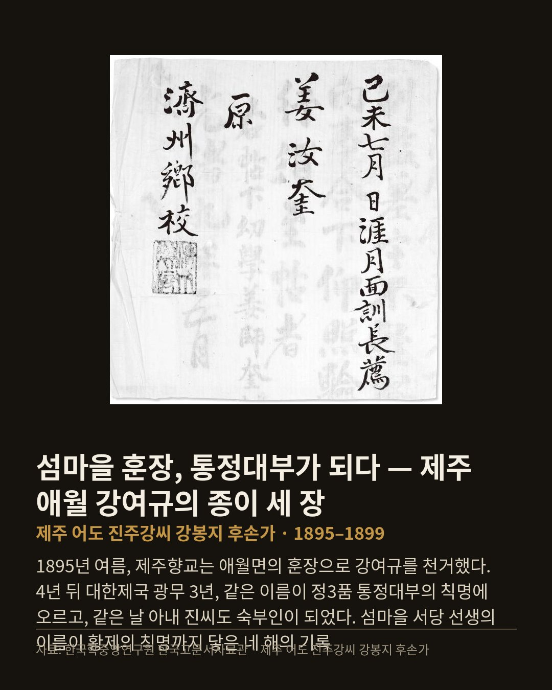
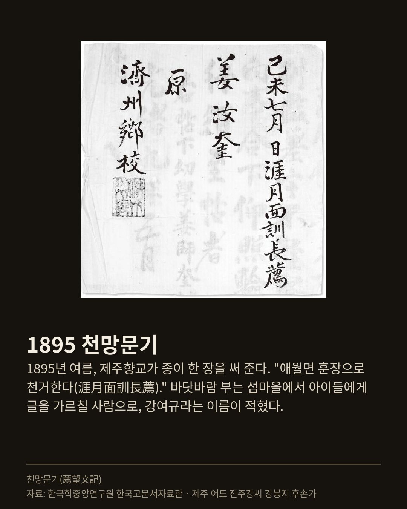
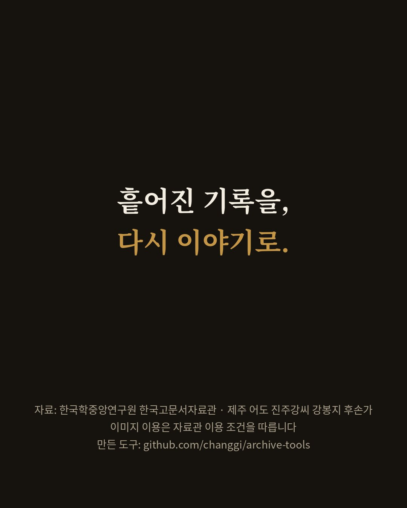

# EP.101 섬마을 훈장, 통정대부가 되다 — 제주 애월 강여규의 종이 세 장

제주 어도 진주강씨 강봉지 후손가 (문중) · 1895년 여름, 제주향교는 애월면의 훈장으로 강여규를 천거했다. 4년 뒤 대한제국 광무 3년, 같은 이름이 정3품 통정대부의 칙명에 오르고, 같은 날 아내 진씨도 숙부인이 되었다. 섬마을 서당 선생의 이름이 황제의 칙명까지 닿은 네 해의 기록

- 🌐 [전시 웹페이지](https://changgi.github.io/archive-tools/examples/eodo-kang/exhibit.html) (한자 위 한글 독음 · 원문 해석) · [수업 활동지](https://changgi.github.io/archive-tools/examples/eodo-kang/handout.html)
- 🎬 영상: [릴스 9:16](https://changgi.github.io/archive-tools-next/media/ep101-eodo-kang_reel.mp4) · [가로 16:9](https://changgi.github.io/archive-tools-next/media/ep101-eodo-kang_wide.mp4) · 홍보 글: [`promo.md`](promo.md)
- 카드뉴스: [`cards/`](cards/) · SNS 글: [`sns.txt`](sns.txt) · 판독·해석 표: [`selection.csv`](selection.csv)

<!-- DELIVERY -->
## 전달 에디팅 — 이 기록을 이렇게 전합니다

- **핵심 정서** — 뿌듯함
- **한 문장** — 변방의 섬에도 글을 가르치는 사람이 있었고, 나라는 그 이름을 기억했다는 것.
- **열기** — 제주 섬마을 훈장의 이름이, 4년 뒤 황제의 칙명에 올랐습니다.
- **펼치기** — 천망문기 → 칙명－1 → 칙명－2 (1895–1899년) — 향교의 추천장 → 남편의 칙명 → 같은 날 아내의 칙명, 세 장을 네 해의 이야기로 이었습니다.
- **절정** — "애월면 훈장으로 천거한다(涯月面訓長薦)" — 화면·공간에서 이 한 줄만 크게, 소리를 줄여 집중
- **여운** — 여러분 마을에서 '선생님'으로 불린 사람은 누구였을까요? — 질문으로 끝내고 답은 보는 사람에게
- **감각과 물질** — 바닷바람과 향교 도장의 붉은 빛, 종이 세 장 · 어보·관인 탁본 스탬프를 찍어 보는 체험
- **통로와 매개** — 온라인: 릴스(열기) → 카드뉴스(펼치기) → 전시 웹페이지(절정·원문) → 비하인드 카드(여운) / 오프라인: 원본 크기 복제·낭독·참여 벽 / 남기기: 활동지·질문 카드
- **여운 장치** — 우리 동네 첫 선생님 찾아보기
- **전달 에디팅 전** — 3건의 문서를 1895–1899년 연대순으로 놓고 문서명 · 유형 · 해설을 붙인다 — 정확하지만, 지나가면 잊힌다.
- **전달 에디팅 후** — 핵심 정서는 「뿌듯함」. 「제주 섬마을 훈장의 이름이, 4년 뒤 황제의 칙명에 올랐습니다.」로 열고, 문서를 대비와 순서로 펼친 뒤, "애월면 훈장으로 천거한다(涯月面訓長薦)"에서 멈춘다. 바닷바람과 향교 도장의 붉은 빛, 종이 세 장. 마지막엔 「우리 동네 첫 선생님 찾아보기」로 보는 사람이 자기 이야기를 남기고 떠나게 한다.

전문: [`delivery.md`](delivery.md)
<!-- /DELIVERY -->

<!-- CURATOR -->
## 비하인드 — 큐레이터 노트

- **왜 이 문서들인가** — 제주 문서는 드물고, 그중에서도 '섬마을 훈장'이 황제의 칙명까지 이어지는 한 사람의 기록은 더 드물었습니다.
- **전하고 싶은 것** — 변방의 섬에도 글을 가르치는 사람이 있었고, 나라는 그 이름을 기억했다는 것.
- **이렇게 보이길 바랐다** — 향교의 추천장 → 남편의 칙명 → 같은 날 아내의 칙명, 세 장을 네 해의 이야기로 이었습니다.
- **이렇게 써 주세요** — 제주 교육사, 대한제국의 문서 제도(교지→칙명), 외명부 작호를 다루는 수업에 쓰세요.
- **만들며 있었던 일** — 천망문기 첫 글자(己/乙)와 칙명 작은 글씨의 관청 이름은 판독이 불확실합니다.
- **남겨 둔 질문** — 여러분 마을에서 '선생님'으로 불린 사람은 누구였을까요?
- **제작 기록** — 문서 3건 · 1895–1899년 · 원본 사진 3면(문서 전체) · 원문 판독 3건 · 번역 3건 · 못 읽은 글자 □ 0 · 불확실 (?) 2 · 해제에 "확인 필요"를 단 문서 1건

전문: [`curator.md`](curator.md) · 비하인드 카드: [`behind/`](behind/) · 채널별 홍보안: [`channels.md`](channels.md)
<!-- /CURATOR -->

## 이야기 — 사료가 말하는 대로

제주 섬마을 훈장의 이름이, 4년 뒤 황제의 칙명에 올랐습니다.

> **1895 천망문기** — 1895년 여름, 제주향교가 종이 한 장을 써 준다. "애월면 훈장으로 천거한다(涯月面訓長薦)." 바닷바람 부는 섬마을에서 아이들에게 글을 가르칠 사람으로, 강여규라는 이름이 적혔다.
> **1899 칙명** — 4년 뒤, 서울에서 칙명이 내려온다. "강여규를 정3품 통정대부로 삼는다(姜汝奎正三品通政大夫者)." 나라의 이름이 대한제국으로 바뀐 광무 3년, 섬마을 훈장의 이름이 황제의 문서에 올랐다.
> **1899 칙명** — 같은 날, 아내에게도 종이가 왔다. "유인 진씨를 숙부인으로 봉한다(孺人秦氏封淑夫人者)." 남편의 품계를 따라 아내의 이름도 함께 올라갔다. 섬마을 부부의 네 해가 종이 세 장에 남았다.

| 표지 | 1번 카드 | 마무리 |
|---|---|---|
|  |  |  |

## 선별 문서 (3점)

| # | 연도 | 유형 | 문서명 | 원본 |
|---|---|---|---|---|
| 1 | 1895 | 천망문기 | 천망문기(薦望文記) | [원본 보기](https://archive.aks.ac.kr/viewer/viewer.do#imgnode.do?itemId=book&gubun=booktree&depth=6&upPath=01%5E0168%5EL016822%5EL016822F02%5EL016822F0203&dataId=G002%2BAKS%2BKSM-XC.1895.5011-20220125.B077a_110_00500_XXX&itemType=) |
| 2 | 1899 | 칙명 | 칙명(勅命)－1 | [원본 보기](https://archive.aks.ac.kr/viewer/viewer.do#imgnode.do?itemId=book&gubun=booktree&depth=6&upPath=01%5E0168%5EL016822%5EL016822F02%5EL016822F0201&dataId=G002%2BAKS%2BKSM-XA.1899.5011-20220125.B077a_110_00494_XXX&itemType=) |
| 3 | 1899 | 칙명 | 칙명(勅命)－2 | [원본 보기](https://archive.aks.ac.kr/viewer/viewer.do#imgnode.do?itemId=book&gubun=booktree&depth=6&upPath=01%5E0168%5EL016822%5EL016822F02%5EL016822F0201&dataId=G002%2BAKS%2BKSM-XA.1899.5011-20220125.B077a_110_00495_XXX&itemType=) |

## 원문 판독과 해석

### 1. 천망문기(薦望文記)

**원문 판독**

```
己(乙?)未七月 日 涯月面訓長薦
姜汝奎
原
濟州鄕校 (도장)
```

**원문 해석** 을미년(1895) 7월 일. 애월면 훈장으로 천거함. 강여규. 원(原, 본래의 천거 대상이라는 표시로 보임). 제주향교.

**해제** 1895년(고종 32, 乙未) 7월, 제주향교가 애월면의 훈장(訓長, 마을 글방의 선생)으로 강여규(姜汝奎)를 천거한 천망문기입니다. 천망(薦望)은 어떤 자리에 앉힐 사람을 추천해 올리는 일로, 향교가 고을의 학문 담당자를 추천했음을 보여 줍니다. 첫 글자는 '己'처럼 보이지만 자료관 연대(1895, 乙未)를 따르면 '乙'이라 판독이 불확실하며, 이름 아래 '原'의 뜻도 확인이 필요합니다. 아래에 제주향교의 도장이 찍혀 있습니다.

### 2. 칙명(勅命)－1

**원문 판독**

```
勅命
姜汝奎正三
品通政大夫
者
光武三年九月十一日 (도장)
(왼쪽 작은 글씨) 嘉禮都監(?)寫字官(?)加資事奉
勅
```

**원문 해석** 칙명. 강여규를 정3품 통정대부로 삼는다. 광무 3년(1899) 9월 11일. (왼쪽 작은 글씨) 가례도감(?) 사자관(?)으로 품계를 올려 주는 일로 칙명을 받듦.

**해제** 1899년(광무 3) 9월 11일, 대한제국 황제가 강여규에게 정3품 통정대부(通政大夫)의 품계를 내린 칙명(勅命)입니다. 대한제국 선포(1897) 뒤에는 임금의 명령 문서가 '교지(敎旨)'에서 황제의 '칙명'으로 바뀌었습니다. 통정대부는 당상관에 드는 품계입니다. 왼쪽의 작은 글씨는 품계를 올려 준 까닭(加資事)을 적은 것인데, 흘림이라 앞부분의 관청 · 직책 이름은 판독이 불확실합니다.

### 3. 칙명(勅命)－2

**원문 판독**

```
勅命
孺人秦氏
封淑夫人
者
光武三年九月十一日 (도장)
(왼쪽 작은 글씨) 正三品通政大夫 …
妻依法典從夫職
```

**원문 해석** 칙명. 유인 진씨를 숙부인으로 봉한다. 광무 3년(1899) 9월 11일. (왼쪽 작은 글씨) 정3품 통정대부 … 의 아내이니 법전에 따라 남편의 직품을 따름.

**해제** 1899년(광무 3) 9월 11일, 강여규의 아내 진씨(秦氏)를 숙부인(淑夫人)으로 봉한 칙명입니다. 조선과 대한제국에서는 관원의 아내에게 남편의 품계에 맞는 외명부 작호를 내렸는데, 정3품 당상관의 아내는 숙부인이 됩니다. 유인(孺人)은 품계가 없는 선비의 아내를 부르는 말이라, 같은 날 남편과 함께 아내의 호칭도 올라간 것을 알 수 있습니다. 작은 글씨의 '依法典從夫職'은 법전에 따라 남편의 직품을 따른다는 뜻입니다.

판독·해석·이야기는 이미지에 근거한 초안이며(검토 전 "초안" 표시), 정확한 판독은 원문 확인이 필요합니다. □는 읽지 못한 글자, (?)는 불확실한 글자입니다.
이미지: 한국학중앙연구원 한국고문서자료관 소장·제공. "원본" 링크를 누르면 자료관 뷰어에서 그 문서가 열립니다. 재사용은 자료관에 문의하세요(소장처 동의 필요).
