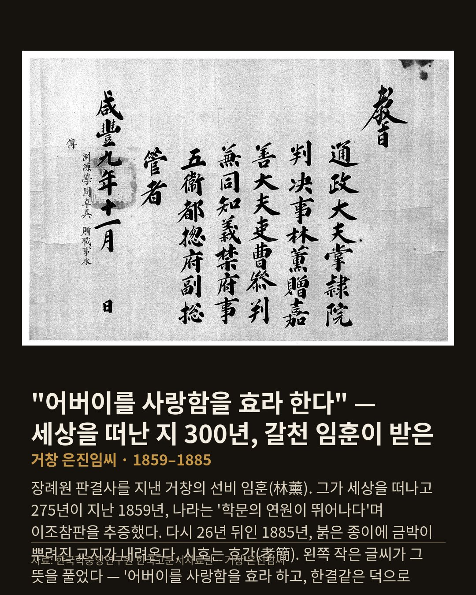
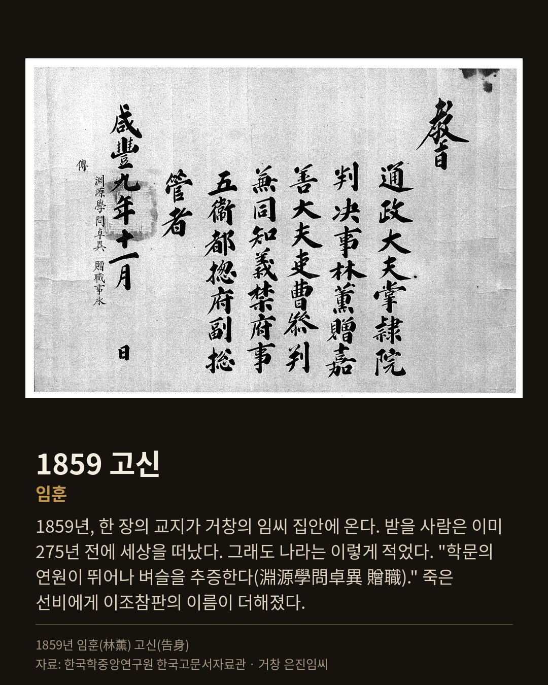
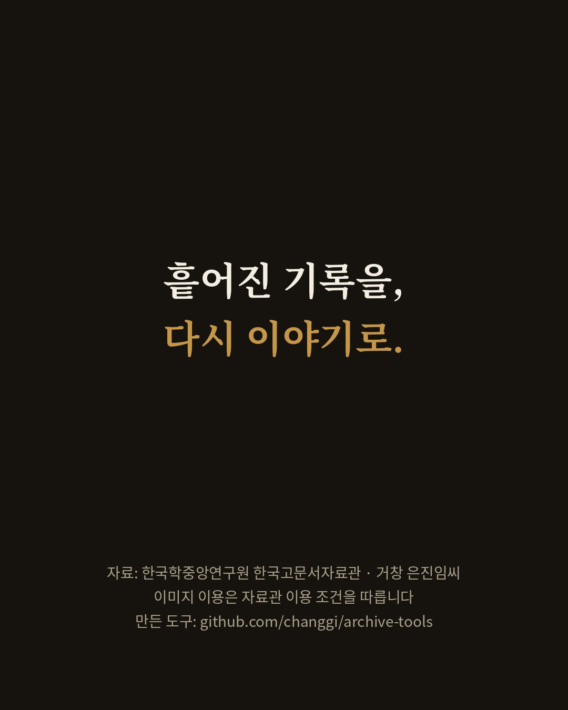

# EP.104 "어버이를 사랑함을 효라 한다" — 세상을 떠난 지 300년, 갈천 임훈이 받은 이름

거창 은진임씨 (문중) · 장례원 판결사를 지낸 거창의 선비 임훈(林薰). 그가 세상을 떠나고 275년이 지난 1859년, 나라는 '학문의 연원이 뛰어나다'며 이조참판을 추증했다. 다시 26년 뒤인 1885년, 붉은 종이에 금박이 뿌려진 교지가 내려온다. 시호는 효간(孝簡). 왼쪽 작은 글씨가 그 뜻을 풀었다 — '어버이를 사랑함을 효라 하고, 한결같은 덕으로 게으르지 않음을 간이라 한다'

- 🌐 [전시 웹페이지](https://changgi.github.io/archive-tools/examples/eunjin-im/exhibit.html) (한자 위 한글 독음 · 원문 해석) · [수업 활동지](https://changgi.github.io/archive-tools/examples/eunjin-im/handout.html)
- 🎬 영상: [릴스 9:16](https://changgi.github.io/archive-tools-next/media/ep104-eunjin-im_reel.mp4) · [가로 16:9](https://changgi.github.io/archive-tools-next/media/ep104-eunjin-im_wide.mp4) · 홍보 글: [`promo.md`](promo.md)
- 카드뉴스: [`cards/`](cards/) · SNS 글: [`sns.txt`](sns.txt) · 판독·해석 표: [`selection.csv`](selection.csv)

<!-- DELIVERY -->
## 전달 에디팅 — 이 기록을 이렇게 전합니다

- **핵심 정서** — 경건함
- **한 문장** — 한 사람의 삶을 나라가 다시 읽는 데 300년이 걸리기도 한다 — 그리고 그 결론이 '어버이를 사랑했다'였다.
- **열기** — 세상을 떠난 지 300년, 한 선비의 삶이 두 글자가 되었습니다.
- **펼치기** — 임훈 고신 → 임훈 증시교지 (1859–1885년) — 1859년의 '학문의 연원' → 1885년의 시호 두 글자와 뜻풀이로, 이름이 점점 짧아지며 깊어지는 순서로 구성했습니다.
- **절정** — "자애롭고 어버이를 사랑함을 효라 하고, 한결같은 덕으로 게으르지 않음을 간이라 한다(慈惠愛親曰孝 一德不懈曰簡)" — 화면·공간에서 이 한 줄만 크게, 소리를 줄여 집중
- **여운** — 죽은 뒤에 받는 이름과 살아서 듣는 칭찬 가운데, 어느 쪽이 더 무거울까요? — 질문으로 끝내고 답은 보는 사람에게
- **감각과 물질** — 붉은 종이 위 금박, 작은 글씨의 뜻풀이 두 줄 · 어보·관인 탁본 스탬프를 찍어 보는 체험
- **통로와 매개** — 온라인: 릴스(열기) → 카드뉴스(펼치기) → 전시 웹페이지(절정·원문) → 비하인드 카드(여운) / 오프라인: 원본 크기 복제·낭독·참여 벽 / 남기기: 활동지·질문 카드
- **여운 장치** — 나를 두 글자로 남긴다면 — 이름 짓기
- **전달 에디팅 전** — 2건의 문서를 1859–1885년 연대순으로 놓고 문서명 · 유형 · 해설을 붙인다 — 정확하지만, 지나가면 잊힌다.
- **전달 에디팅 후** — 핵심 정서는 「경건함」. 「세상을 떠난 지 300년, 한 선비의 삶이 두 글자가 되었습니다.」로 열고, 문서를 대비와 순서로 펼친 뒤, "자애롭고 어버이를 사랑함을 효라 하고, 한결같은 덕으로 게으르지 않음을 간이라 한다(慈惠愛親曰孝 一德不懈曰簡)"에서 멈춘다. 붉은 종이 위 금박, 작은 글씨의 뜻풀이 두 줄. 마지막엔 「나를 두 글자로 남긴다면 — 이름 짓기」로 보는 사람이 자기 이야기를 남기고 떠나게 한다.

전문: [`delivery.md`](delivery.md)
<!-- /DELIVERY -->

<!-- CURATOR -->
## 비하인드 — 큐레이터 노트

- **왜 이 문서들인가** — 시호 교지에는 시호의 뜻풀이가 작은 글씨로 붙는데, 이 교지는 그 한 줄이 이야기의 전부였습니다. 붉은 종이와 금박도 다른 교지와 달랐습니다.
- **전하고 싶은 것** — 한 사람의 삶을 나라가 다시 읽는 데 300년이 걸리기도 한다 — 그리고 그 결론이 '어버이를 사랑했다'였다.
- **이렇게 보이길 바랐다** — 1859년의 '학문의 연원' → 1885년의 시호 두 글자와 뜻풀이로, 이름이 점점 짧아지며 깊어지는 순서로 구성했습니다.
- **이렇게 써 주세요** — 시호 제도(시법), 추증, 유교의 효 개념을 다루는 수업과 '나를 두 글자로' 글쓰기 활동에 쓰세요.
- **만들며 있었던 일** — 함께 받은 1861년 고신 2장과 1871년 시호망(시호 후보 목록)은 이미지가 없거나 이번에 읽지 않았습니다. 임훈의 생몰년(1500–1584)은 일반적으로 알려진 값입니다.
- **남겨 둔 질문** — 죽은 뒤에 받는 이름과 살아서 듣는 칭찬 가운데, 어느 쪽이 더 무거울까요?
- **제작 기록** — 문서 2건 · 1859–1885년 · 원본 사진 2면(문서 전체) · 원문 판독 2건 · 번역 2건

전문: [`curator.md`](curator.md) · 비하인드 카드: [`behind/`](behind/) · 채널별 홍보안: [`channels.md`](channels.md)
<!-- /CURATOR -->

## 이야기 — 사료가 말하는 대로

세상을 떠난 지 300년, 한 선비의 삶이 두 글자가 되었습니다.

> **1859 고신** — 1859년, 한 장의 교지가 거창의 임씨 집안에 온다. 받을 사람은 이미 275년 전에 세상을 떠났다. 그래도 나라는 이렇게 적었다. "학문의 연원이 뛰어나 벼슬을 추증한다(淵源學問卓異 贈職)." 죽은 선비에게 이조참판의 이름이 더해졌다.
> **1885 증시교지** — 다시 26년 뒤, 붉은 종이에 금박이 뿌려진 교지가 내려온다. 시호는 효간(孝簡). 그 왼쪽에 작은 글씨로 뜻을 풀었다. "자애롭고 어버이를 사랑함을 효라 하고, 한결같은 덕으로 게으르지 않음을 간이라 한다(慈惠愛親曰孝 一德不懈曰簡)." 300년이 지나, 한 사람의 삶이 두 글자가 되었다.

| 표지 | 1번 카드 | 마무리 |
|---|---|---|
|  |  |  |

## 선별 문서 (2점)

| # | 연도 | 유형 | 문서명 | 원본 |
|---|---|---|---|---|
| 1 | 1859 | 고신 | 1859년 임훈(林薰) 고신(告身) | [원본 보기](https://archive.aks.ac.kr/viewer/viewer.do#imgnode.do?itemId=book&gubun=booktree&depth=6&upPath=01%5E0150%5EL015024%5EL015024F02%5EL015024F0201&dataId=G002%2BAKS%2BKSM-XA.1859.1111-20101008.B053a_078_00001_XXX&itemType=) |
| 2 | 1885 | 증시교지 | 1885년 임훈(林薰) 증시교지(贈諡敎旨) | [원본 보기](https://archive.aks.ac.kr/viewer/viewer.do#imgnode.do?itemId=book&gubun=booktree&depth=6&upPath=01%5E0150%5EL015024%5EL015024F02%5EL015024F0201&dataId=G002%2BAKS%2BKSM-XA.1885.1111-20101008.B053a_078_00005_XXX&itemType=) |

## 원문 판독과 해석

### 1. 1859년 임훈(林薰) 고신(告身)

**원문 판독**

```
敎旨
通政大夫掌隷院
判決事林薰贈嘉
善大夫吏曹參判
兼同知義禁府事
五衛都摠府副摠
管者
咸豐九年十一月　日 (도장)
(작은 글씨) 淵源學問卓異 贈職事承
傳
```

**원문 해석** 교지. 통정대부 장례원 판결사 임훈에게 가선대부 이조참판 겸 동지의금부사 오위도총부 부총관을 추증한다. 함풍 9년(1859) 11월 일. (작은 글씨) 학문의 연원이 뛰어나 벼슬을 추증하라는 전교를 받듦.

**해제** 1859년(철종 10, 咸豐 9) 11월, 세상을 떠난 갈천(葛川) 임훈(林薰)에게 종2품 가선대부 이조참판 등을 추증(追贈)한 교지입니다. 이름 앞의 '통정대부 장례원 판결사(정3품)'는 그가 생전에 지낸 마지막 품계와 벼슬이고, '贈' 뒤가 죽은 뒤에 높여 준 벼슬입니다. 왼쪽 작은 글씨는 추증한 까닭으로, '학문의 연원이 뛰어나다(淵源學問卓異)'는 임금의 전교(傳敎)를 받들었다고 적었습니다. 임훈(1500–1584)이 세상을 떠난 지 275년 뒤의 일입니다.

### 2. 1885년 임훈(林薰) 증시교지(贈諡敎旨)

**원문 판독**

```
敎旨
贈資憲大夫吏曹判
書兼知義禁府事五
衛都摠府都摠管行
通政大夫掌隷院判
決事林薰
贈諡孝簡公者
(작은 글씨) 慈惠愛親曰孝
一德不懈曰簡
光緖十一年四月　日 (도장)
```

**원문 해석** 교지. 자헌대부 이조판서 겸 지의금부사 오위도총부 도총관에 추증된, 통정대부 장례원 판결사를 지낸 임훈에게 효간공이라는 시호를 내린다. 광서 11년(1885) 4월 일. (작은 글씨) 자애롭고 어버이를 사랑함을 효(孝)라 하고, 한결같은 덕으로 게으르지 않음을 간(簡)이라 한다.

**해제** 1885년(고종 22, 光緖 11) 4월, 임훈에게 '효간(孝簡)'이라는 시호(諡號)를 내린 증시교지(贈諡敎旨)입니다. 이 사이에 추증 품계가 정2품 자헌대부 이조판서로 더 올라 있습니다. 시호는 세상을 떠난 이의 생애를 두 글자로 평가해 내리는 이름으로, 시호 글자마다 정해진 뜻풀이(시법)를 작은 글씨로 덧붙입니다. '慈惠愛親曰孝 一德不懈曰簡' — 붉은 종이에 금박을 뿌린 이 교지는 그 뜻풀이까지 그대로 남겼습니다.

판독·해석·이야기는 이미지에 근거한 초안이며(검토 전 "초안" 표시), 정확한 판독은 원문 확인이 필요합니다. □는 읽지 못한 글자, (?)는 불확실한 글자입니다.
이미지: 한국학중앙연구원 한국고문서자료관 소장·제공. "원본" 링크를 누르면 자료관 뷰어에서 그 문서가 열립니다. 재사용은 자료관에 문의하세요(소장처 동의 필요).
