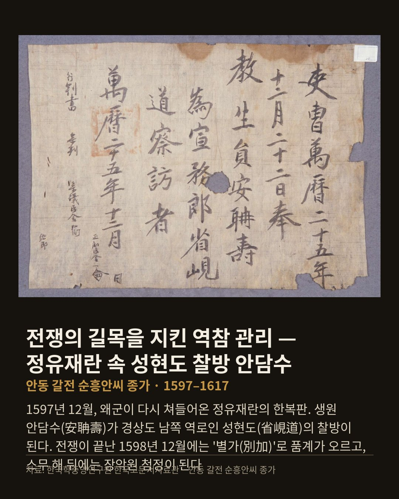
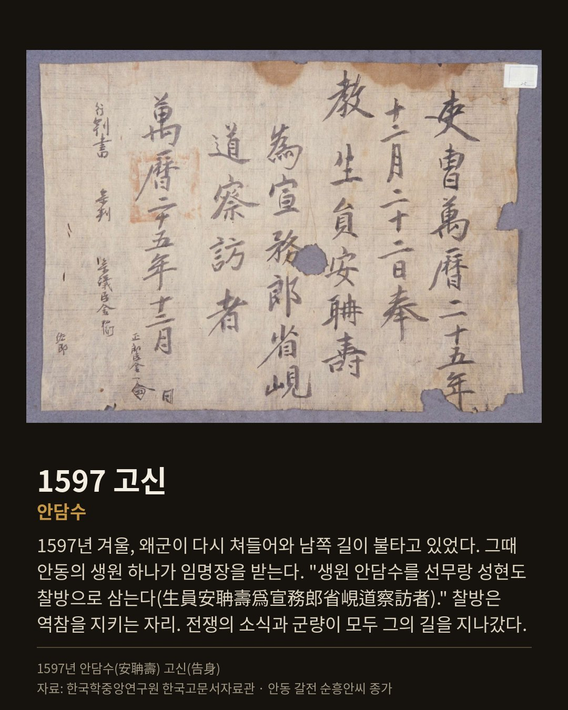
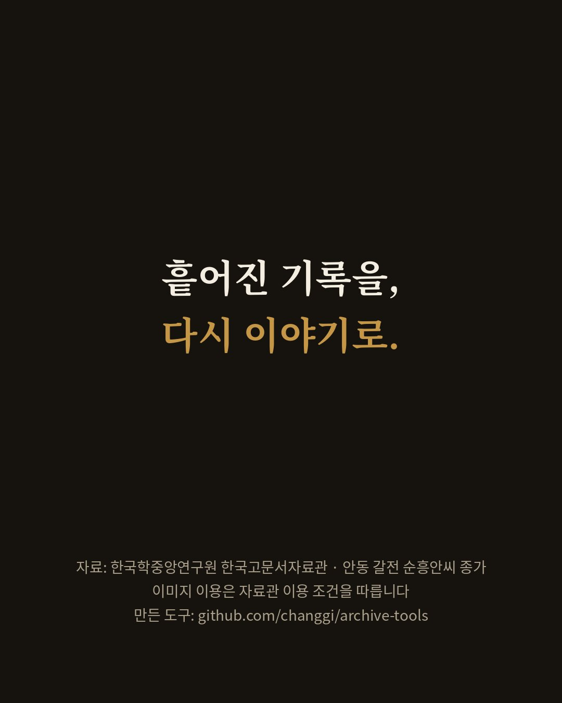

# EP.78 전쟁의 길목을 지킨 역참 관리 — 정유재란 속 성현도 찰방 안담수

안동 갈전 순흥안씨 종가 (문중) · 1597년 12월, 왜군이 다시 쳐들어온 정유재란의 한복판. 생원 안담수(安聃壽)가 경상도 남쪽 역로인 성현도(省峴道)의 찰방이 된다. 전쟁이 끝난 1598년 12월에는 '별가(別加)'로 품계가 오르고, 스무 해 뒤에는 장악원 첨정이 된다

- 🌐 [전시 웹페이지](https://changgi.github.io/archive-tools/examples/galjeon/exhibit.html) (한자 위 한글 독음 · 원문 해석) · [수업 활동지](https://changgi.github.io/archive-tools/examples/galjeon/handout.html)
- 🎬 영상: [릴스 9:16](https://changgi.github.io/archive-tools-next/media/ep78-galjeon_reel.mp4) · [가로 16:9](https://changgi.github.io/archive-tools-next/media/ep78-galjeon_wide.mp4) · 홍보 글: [`promo.md`](promo.md)
- 카드뉴스: [`cards/`](cards/) · SNS 글: [`sns.txt`](sns.txt) · 판독·해석 표: [`selection.csv`](selection.csv)


<!-- DELIVERY -->
## 전달 에디팅 — 이 기록을 이렇게 전합니다

- **핵심 정서** — 후방의 전쟁
- **한 문장** — 전쟁은 칼만이 아니라 길(역참)과 소식, 군량으로도 치러졌다는 것.
- **열기** — 1597년, 전쟁이 지나가는 길을 지킨 사람이 있었습니다.
- **펼치기** — 안담수 고신 (1597–1617년) — 1597년 임명 → 1598년 '무술년 12월 별가'의 작은 글씨 → 20년 뒤 궁중 음악 관청으로, 말발굽에서 음악으로 장면을 바꿨습니다.
- **절정** — "안담수를 통훈대부 행 장악원 첨정으로 삼는다(安聃壽爲通訓大夫行掌樂院僉正者)" — 화면·공간에서 이 한 줄만 크게, 소리를 줄여 집중
- **여운** — 전쟁 소식을 실어 나른 역졸들의 이름은 어디에 남아 있을까요? — 질문으로 끝내고 답은 보는 사람에게
- **감각과 물질** — 역참 길 지도 위 말 한 필, 작은 글씨 "별가"를 돋보기로 · 어보·관인 탁본 스탬프를 찍어 보는 체험
- **통로와 매개** — 온라인: 릴스(열기) → 카드뉴스(펼치기) → 전시 웹페이지(절정·원문) → 비하인드 카드(여운) / 오프라인: 원본 크기 복제·낭독·참여 벽 / 남기기: 활동지·질문 카드
- **여운 장치** — 전쟁 소식을 나른 사람에게 한 줄
- **전달 에디팅 전** — 3건의 문서를 1597–1617년 연대순으로 놓고 문서명 · 유형 · 해설을 붙인다 — 정확하지만, 지나가면 잊힌다.
- **전달 에디팅 후** — 핵심 정서는 「후방의 전쟁」. 「1597년, 전쟁이 지나가는 길을 지킨 사람이 있었습니다.」로 열고, 문서를 대비와 순서로 펼친 뒤, "안담수를 통훈대부 행 장악원 첨정으로 삼는다(安聃壽爲通訓大夫行掌樂院僉正者)"에서 멈춘다. 역참 길 지도 위 말 한 필, 작은 글씨 "별가"를 돋보기로. 마지막엔 「전쟁 소식을 나른 사람에게 한 줄」로 보는 사람이 자기 이야기를 남기고 떠나게 한다.

전문: [`delivery.md`](delivery.md)
<!-- /DELIVERY -->

<!-- CURATOR -->
## 비하인드 — 큐레이터 노트

- **왜 이 문서들인가** — 정유재란 한복판에 역참을 맡은 찰방의 임명장, 전쟁이 끝난 달의 '별가(특별 승진)'가 이어져 있었습니다.
- **전하고 싶은 것** — 전쟁은 칼만이 아니라 길(역참)과 소식, 군량으로도 치러졌다는 것.
- **이렇게 보이길 바랐다** — 1597년 임명 → 1598년 '무술년 12월 별가'의 작은 글씨 → 20년 뒤 궁중 음악 관청으로, 말발굽에서 음악으로 장면을 바꿨습니다.
- **이렇게 써 주세요** — 임진·정유재란의 후방, 교통·통신을 다루는 수업에 쓰세요.
- **만들며 있었던 일** — '별가'가 전쟁 공로 때문인지는 추정입니다. 성현도의 관할 범위는 시기에 따라 달라 확인이 필요합니다.
- **남겨 둔 질문** — 전쟁 소식을 실어 나른 역졸들의 이름은 어디에 남아 있을까요?
- **제작 기록** — 문서 3건 · 1597–1617년 · 원본 사진 3면(문서 전체) · 원문 판독 3건 · 번역 3건 · 해제에 "확인 필요"를 단 문서 1건

전문: [`curator.md`](curator.md)
<!-- /CURATOR -->

## 이야기 — 사료가 말하는 대로

1597년, 전쟁이 지나가는 길을 지킨 사람이 있었습니다.

> **1597 고신** — 1597년 겨울, 왜군이 다시 쳐들어와 남쪽 길이 불타고 있었다. 그때 안동의 생원 하나가 임명장을 받는다. "생원 안담수를 선무랑 성현도 찰방으로 삼는다(生員安聃壽爲宣務郎省峴道察訪者)." 찰방은 역참을 지키는 자리. 전쟁의 소식과 군량이 모두 그의 길을 지나갔다.
> **1598 고신** — 1598년 겨울, 전쟁이 끝났다. 그리고 한 달 뒤 또 한 장의 고신이 온다. 자리는 그대로, 품계만 한 칸 올랐다. 왼쪽 구석의 작은 글씨가 이유를 짐작하게 한다. "무술년 12월 특별히 더함(戊戌十二月別加)." 전쟁의 길을 끝까지 지킨 사람에게 주는 보답이었다.
> **1617 고신** — 그리고 스무 해 뒤. 말발굽 소리 대신 음악이 있는 곳이다. "안담수를 통훈대부 행 장악원 첨정으로 삼는다(安聃壽爲通訓大夫行掌樂院僉正者)." 전쟁의 길에서 시작한 벼슬살이는 궁중의 악기 소리 곁에서 마무리되었다.

| 표지 | 1번 카드 | 마무리 |
|---|---|---|
|  |  |  |

## 선별 문서 (3점)

| # | 연도 | 유형 | 문서명 | 원본 |
|---|---|---|---|---|
| 1 | 1597 | 고신 | 1597년 안담수(安聃壽) 고신(告身) | [원본 보기](https://archive.aks.ac.kr/viewer/viewer.do#imgnode.do?itemId=book&gubun=booktree&depth=6&upPath=01%5E0167%5EL016764%5EL016764F02%5EL016764F0201&dataId=G002%2BAKS%2BKSM-XA.1597.1111-20101008.B028a_043_00006_XXX&itemType=) |
| 2 | 1598 | 고신 | 1598년 안담수(安聃壽) 고신(告身) | [원본 보기](https://archive.aks.ac.kr/viewer/viewer.do#imgnode.do?itemId=book&gubun=booktree&depth=6&upPath=01%5E0167%5EL016764%5EL016764F02%5EL016764F0201&dataId=G002%2BAKS%2BKSM-XA.1598.1111-20101008.B028a_043_00007_XXX&itemType=) |
| 3 | 1617 | 고신 | 1617년 안담수(安聃壽) 고신(告身) | [원본 보기](https://archive.aks.ac.kr/viewer/viewer.do#imgnode.do?itemId=book&gubun=booktree&depth=6&upPath=01%5E0167%5EL016764%5EL016764F02%5EL016764F0201&dataId=G002%2BAKS%2BKSM-XA.1617.1111-20101008.B028a_043_00031_XXX&itemType=) |

## 원문 판독과 해석

### 1. 1597년 안담수(安聃壽) 고신(告身)

**원문 판독**

```
吏曹萬曆二十五年
十二月二十二日奉
敎 生員安聃壽
爲宣務郎省峴
道察訪者
萬曆二十五年十二月　日
行判書　參判　參議臣金 [수결]
正郞臣金 [수결]　佐郞
(이조 인)
```

**원문 해석** 이조에서 만력 25년(1597) 12월 22일 왕명을 받들어, 생원 안담수를 선무랑(종6품) 성현도 찰방으로 삼는다. 만력 25년 12월 일. 행판서, 참판, 참의 신 김[서명], 정랑 신 김[서명], 좌랑.

**해제** 정유재란(1597)이 한창이던 12월, 생원 안담수를 종6품 선무랑의 품계로 성현도(省峴道) 찰방에 임명한 이조 고신입니다. 찰방(察訪)은 역(驛)과 역마·역졸을 관리하는 관원이며, 성현도는 경상도 청도 일대를 중심으로 한 역로로, 부산에서 서울로 이어지는 길목에 있었습니다. 이 무렵 명나라 군대와 조선군이 울산성을 공격하던 때여서, 역참은 군량·문서·병력이 오가는 핵심 통로였습니다. 성현도의 관할 범위는 시기에 따라 달라 확인이 필요합니다.

### 2. 1598년 안담수(安聃壽) 고신(告身)

**원문 판독**

```
吏曹萬曆二十六年
十二月十二日奉
敎 宣務郎省峴道
察訪安聃壽爲
宣敎郎省峴道
察訪者
萬曆二十六年十二月　日
(소자) 戊戌十二月別加
判書　參判　參議臣李 [수결]
正郞臣申
佐郞臣南 [수결]
(이조 인)
```

**원문 해석** 이조에서 만력 26년(1598) 12월 12일 왕명을 받들어, 선무랑 성현도 찰방 안담수를 선교랑 성현도 찰방으로 삼는다. 만력 26년 12월 일. (작은 글씨) 무술년 12월 별가. 판서, 참판, 참의 신 이[서명], 정랑 신 신, 좌랑 신 남[서명].

**해제** 1년 뒤인 1598년 12월, 같은 성현도 찰방 자리에서 품계만 선무랑(종6품 하)에서 선교랑(종6품 상)으로 올려 준 고신입니다. 왼쪽의 '戊戌十二月別加'는 정기 인사가 아닌 특별한 사유로 품계를 더해 준다는 표시입니다. 이해 11월 노량해전으로 7년 전쟁이 끝났으므로, 전쟁 중 역참을 지킨 노고에 대한 포상으로 볼 여지가 있습니다(추정).

### 3. 1617년 안담수(安聃壽) 고신(告身)

**원문 판독**

```
敎旨
安聃壽爲通[訓]
大夫行掌樂院
僉正者
萬曆四十五年二月　日
(시명지보)
```

**원문 해석** 교지. 안담수를 통훈대부(정3품 당하) 행 장악원 첨정으로 삼는다. 만력 45년(1617) 2월 일.

**해제** 1617년(광해군 9), 안담수를 정3품 당하관 통훈대부의 품계로 궁중 음악을 맡은 장악원(掌樂院)의 첨정(종4품)에 임명한 교지입니다. 품계가 관직보다 높아 '행(行)'을 붙였습니다. 역참의 길을 지키던 관원이 20년 뒤 궁중의 음악 관청에 있게 된 이력의 마지막 장면입니다. 오른쪽 위가 떨어져 '訓' 자는 보충했습니다.

판독·해석·이야기는 이미지에 근거한 초안이며(검토 전 "초안" 표시), 정확한 판독은 원문 확인이 필요합니다. □는 읽지 못한 글자, (?)는 불확실한 글자입니다.
이미지: 한국학중앙연구원 한국고문서자료관 소장·제공. "원본" 링크를 누르면 자료관 뷰어에서 그 문서가 열립니다. 재사용은 자료관에 문의하세요(소장처 동의 필요).
