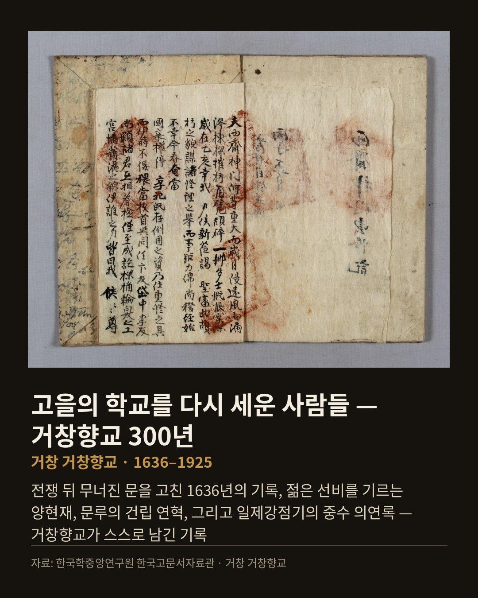
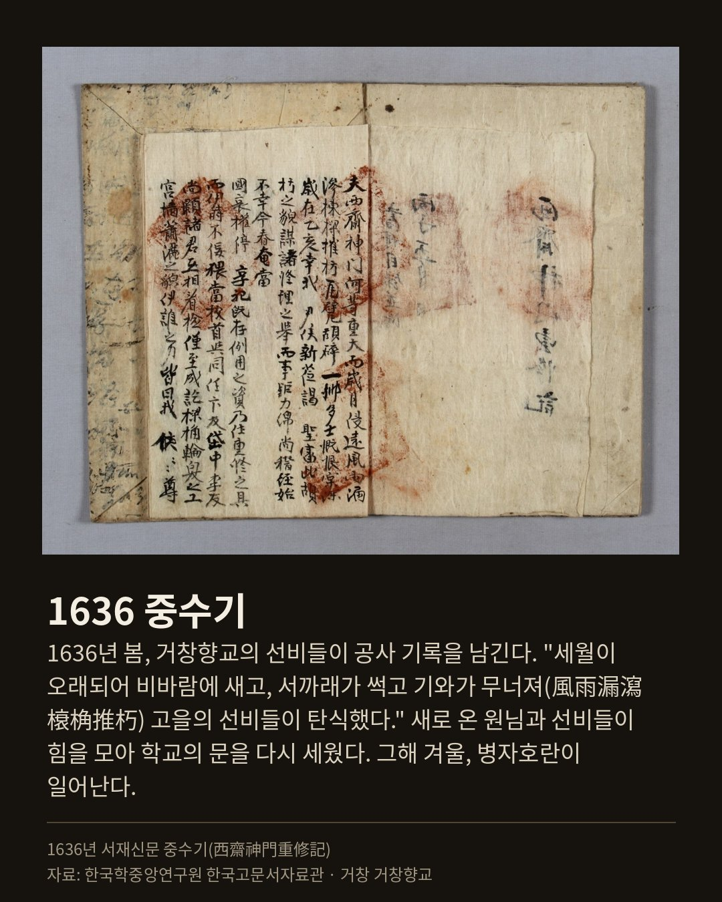
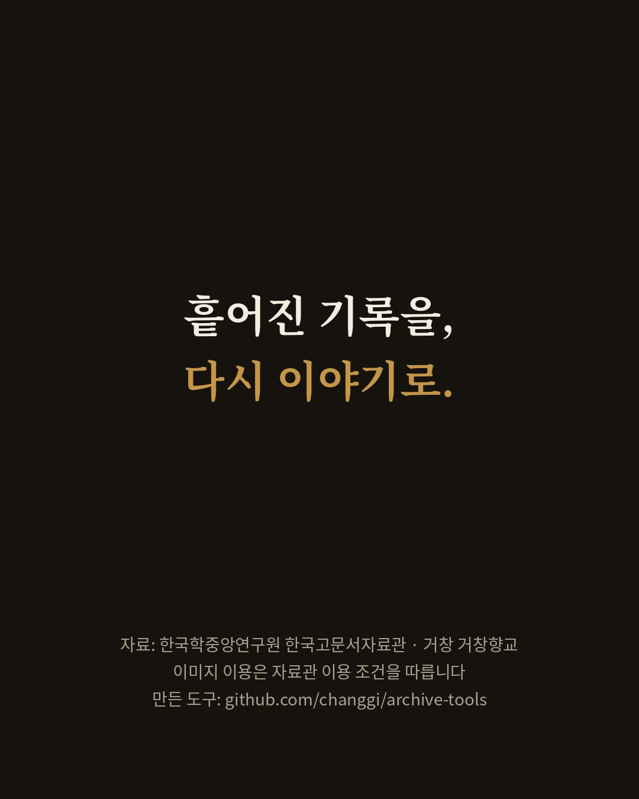

# EP.25 고을의 학교를 다시 세운 사람들 — 거창향교 300년

거창 거창향교 (향교) · 전쟁 뒤 무너진 문을 고친 1636년의 기록, 젊은 선비를 기르는 양현재, 문루의 건립 연혁, 그리고 일제강점기의 중수 의연록 — 거창향교가 스스로 남긴 기록

- 🌐 [전시 웹페이지](https://changgi.github.io/archive-tools/examples/geochang-hyanggyo/exhibit.html) (한자 위 한글 독음 · 원문 해석) · [수업 활동지](https://changgi.github.io/archive-tools/examples/geochang-hyanggyo/handout.html)
- 🎬 영상: [릴스 9:16](https://changgi.github.io/archive-tools/examples/media/ep25-geochang_reel.mp4) · [가로 16:9](https://changgi.github.io/archive-tools/examples/media/ep25-geochang_wide.mp4) · 홍보 글: [`promo.md`](promo.md)
- 카드뉴스: [`cards/`](cards/) · SNS 글: [`sns.txt`](sns.txt) · 판독·해석 표: [`selection.csv`](selection.csv)


<!-- CURATOR -->
## 비하인드 — 큐레이터 노트

- **왜 이 문서들인가** — 향교 사람들이 스스로 남긴 300년의 공사 기록이 있어, '고을의 학교를 누가 다시 세웠나'를 보여 줄 수 있었습니다.
- **전하고 싶은 것** — 공공의 학교는 고을 사람들이 힘을 모아 지켜 온 것이라는 것.
- **이렇게 보이길 바랐다** — 비바람에 무너진 건물에 대한 탄식으로 시작해, 1925년 의연록으로 마무리했습니다.
- **이렇게 써 주세요** — 향교와 지역 교육사, 공공시설 유지의 역사 수업에 쓰세요.
- **만들며 있었던 일** — 세로 영상 글자 맞춤 문제로 다시 만들었습니다(v0.5.0). 공사 기록은 여러 면짜리 책이라 일부 면만 판독했습니다(원본 묶음에는 전체).
- **남겨 둔 질문** — 1925년 의연금을 낸 사람들은 향교에서 무엇을 기대했을까요?
- **제작 기록** — 문서 4건 · 1636–1925년 · 원본 사진 58면(문서 전체) · 원문 판독 4건 · 번역 4건 · 못 읽은 글자 □ 3 · 불확실 (?) 18 · 해제에 "확인 필요"를 단 문서 1건

전문: [`curator.md`](curator.md)
<!-- /CURATOR -->

## 이야기 — 사료가 말하는 대로

고을의 학교는 누가, 어떻게 다시 세웠을까요?

> **1636 중수기** — 1636년 봄, 거창향교의 선비들이 공사 기록을 남긴다. "세월이 오래되어 비바람에 새고, 서까래가 썩고 기와가 무너져(風雨漏瀉 榱桷推朽) 고을의 선비들이 탄식했다." 새로 온 원님과 선비들이 힘을 모아 학교의 문을 다시 세웠다. 그해 겨울, 병자호란이 일어난다.
> **1735 양현재절목** — 100년 뒤인 1735년, 새로 온 현감이 향교에 기숙사를 짓는다. 이름은 '어진 이를 기르는 집', 양현재. 그는 학생들을 모아 말한다. "그 이름을 돌아보고 그 뜻을 생각하라(顧其名而思其義)." 학생들은 일어나 꿇어앉아 답했다. "누가 감히 분발하지 않겠습니까(疇敢不興)."
> **1809 중건록** — 향교의 문루 춘풍루는 1716년 대성전 앞에 처음 섰다. 1748년에는 명륜당 앞으로 옮겼고, 1809년 다시 지으며 그 연혁을 첫 장에 적었다. "성묘 앞에 처음 세우고(刱立于聖廟前)… 명륜당 앞으로 옮겨 세웠다(移建于明倫堂前)." 공사를 맡은 사람의 이름도 하나하나 남겼다.
> **1925 중수의연록** — 그리고 1925년, 일제강점기. 공식 학교의 자리를 잃은 향교를 지역 사람들이 성금으로 고친다. 서문은 이렇게 시작한다. "향교는 백성을 가르치고 풍속을 바꾸는 곳이다(校者 敎民化俗之所也)." 300년 동안, 이 학교는 고을 사람들이 스스로 고치고 지켜 왔다.

| 표지 | 1번 카드 | 마무리 |
|---|---|---|
|  |  |  |

## 선별 문서 (4점)

| # | 연도 | 유형 | 문서명 | 원본 |
|---|---|---|---|---|
| 1 | 1636 | 중수기 | 1636년 서재신문 중수기(西齋神門重修記) | [원본 보기](https://archive.aks.ac.kr/viewer/viewer.do#imgnode.do?itemId=book&gubun=booktree&depth=6&upPath=02%5E0248%5EL024807%5EL024807F02%5EL024807F0207&dataId=G002%2BAKS%2BKSM-XG.1636.4888-20101008.B016a_026_00047_YYY&itemType=) |
| 2 | 1735 | 양현재절목 | 1735년 양현재절목(養賢齋節目) | [원본 보기](https://archive.aks.ac.kr/viewer/viewer.do#imgnode.do?itemId=book&gubun=booktree&depth=6&upPath=02%5E0248%5EL024807%5EL024807F02%5EL024807F0203&dataId=G002%2BAKS%2BKSM-XC.1735.4888-20101008.B016a_026_00023_YYY&itemType=) |
| 3 | 1809 | 중건록 | 1809년 춘풍루 중건록(春風樓重建錄) | [원본 보기](https://archive.aks.ac.kr/viewer/viewer.do#imgnode.do?itemId=book&gubun=booktree&depth=6&upPath=02%5E0248%5EL024807%5EL024807F02%5EL024807F0207&dataId=G002%2BAKS%2BKSM-XG.1809.4888-20101008.B016a_026_00048_YYY&itemType=) |
| 4 | 1925 | 중수의연록 | 1925년 교궁 중수의연록(校宮重修義捐錄) | [원본 보기](https://archive.aks.ac.kr/viewer/viewer.do#imgnode.do?itemId=book&gubun=booktree&depth=6&upPath=02%5E0248%5EL024807%5EL024807F02%5EL024807F0207&dataId=G002%2BAKS%2BKSM-XG.1925.4888-20101008.B016a_026_00051_YYY&itemType=) |

## 원문 판독과 해석

### 1. 1636년 서재신문 중수기(西齋神門重修記)

**원문 판독**

```
(오른쪽 면 — 표지 쪽) 西齋(?)神(?)門(?)重修記(?) / 丙子三月 / 春(?)秋(?)日(?)□□□ (도장 여러 개, 판독 불확실)
(왼쪽 면 — 본문)
夫西齋神門所繫重大而歲月侵遠風雨漏瀉
榱桷推朽瓦甓危頹一邦多士慨恨寧旣
歲在乙亥幸我 侯新莅謁 聖廟此頹
朽之貌謀諸修理之擧而事鉅力綿尙稽經始
不幸今春奄當
國哀攀辨(?) 享祀旣存例用之資乃任重修之具
而伊時不俟(?)限當校首(?)與同任亦反(?)盛中李友(?)
尙顥諸君互相着檢俾至成訖榱桷輪奐之工
宮墻肅濔之貌伊誰之力皆曰我 侯之尊
(다음 쪽으로 이어짐)
```

**원문 해석** 서재(西齋)와 신문(神門)은 매우 중요한데, 세월이 오래되어 비바람에 새고, 서까래가 썩고 기와와 벽돌이 위태롭게 무너져 고을의 많은 선비가 탄식하고 한스러워한 지 오래였다. 을해년(1635)에 다행히 우리 원님(侯)이 새로 부임하여 성묘(문묘)에 참배하고 이 무너진 모습을 보고 수리할 방도를 의논했으나, 일은 크고 힘은 약해 아직 시작하지 못했다. 불행히 올봄 갑자기 나라의 상(國哀)을 당했는데, … 제사에 쓰고 남은 비용으로 고치는 일을 맡기니, … 이상호 등 여러 사람이 서로 감독하여 마침내 완성하였다. 서까래가 새로 빛나고 담장이 엄숙해진 것은 누구의 힘인가. 모두 우리 원님의 덕이라 한다. … (이하 다음 쪽)

**해제** 1636년(인조 14, 丙子) 3월, 거창향교의 서재(유생 기숙사)와 신문(사당 출입문)을 고친 경위를 적은 중수기의 첫 장입니다. '國哀'는 1635년 12월 인조의 왕비 인열왕후가 세상을 떠난 일을 가리키는 것으로 보입니다. 오른쪽 면은 붉은 도장이 여러 번 찍힌 표지 쪽이고, 왼쪽 면에 본문이 시작됩니다. 흘림이 섞여 몇 글자는 판독이 불확실합니다. 이해 겨울 병자호란이 일어납니다.

### 2. 1735년 양현재절목(養賢齋節目)

**원문 판독**

```
(1쪽)
養賢齋記
濟昌之爲縣古矣曾有聞人振上國云挽近
以來世降文衰人材渺然識者恨之余於
新莅初慨然于是謀所以興藝之方則
前太守已嘗有經紀者矣嘉其留意於右
文之事而其於君子樂育之義余亦有所心
會焉於是相治之所生(?)鳩材(?)
等數間屋數月而始訖功其制不侈不陋(?)
(2쪽)
可居學子數十人宗(?)咸延鄕士之秀之靑
衿濟濟禮容秩秩儼然寓壁水風(?)而余進
諸生而告之曰古人有以名園而傚洛陽之盛
集則一字之與處莫不有數存焉矣余
寧是土者非一人而斯宗(?)之成適在於是
豈非是鄕轉衰爲盛之候歟誠使居是
齋者顧其名而思其義遵夫子四敎之
古與一鄕禮讓之風庶不負名齋之
之義而不失爲古之濟昌矣請以是勉之可
乎諸生咸起而跪曰疇敢不興於是余遂記
其言于壁以備居齋者觀覽而若夫潤澤而
嗣葺之不至雨風於上傍者太守事也深
有望於後之君子云
首陽後人鄭震輔 識
```

**원문 해석** 양현재기. 제창(거창의 옛 이름)이 고을이 된 지 오래되었고, 일찍이 이름난 사람이 나라에 떨쳤다고 한다. 근래 들어 세상이 내려앉고 글이 쇠하여 인재가 아득하니 아는 이들이 한스러워했다. 내가 새로 부임한 처음에 개탄하여 학문을 일으킬 방도를 꾀하니, 앞의 원님이 이미 계획해 둔 것이 있었다. 그가 글을 숭상하는 일에 뜻을 둔 것을 아름답게 여겼고, 군자가 인재를 즐겨 기른다는 뜻에 나도 마음으로 통하는 바가 있었다. 이에 재목을 모아 몇 칸 집을 짓기 시작해 몇 달 만에 공사를 마치니, 그 짜임이 사치스럽지도 누추하지도 않아 학생 수십 명이 머물 만하다. 고을 선비 가운데 빼어난 젊은이들을 맞아들이니 푸른 옷깃이 가지런하고 예절이 엄숙하다. 내가 학생들을 불러 말했다. … 이 집에 사는 사람이 그 이름(養賢, 어진 이를 기름)을 돌아보고 그 뜻을 생각하여, 공자의 네 가르침(文·行·忠·信)의 옛 법과 고을의 예양(禮讓)의 풍속을 따른다면 집 이름의 뜻을 저버리지 않고 옛 제창의 모습을 잃지 않을 것이니, 이로써 힘쓰는 것이 어떻겠는가. 학생들이 모두 일어나 꿇어앉아 '누가 감히 분발하지 않겠습니까' 하므로, 내가 마침내 그 말을 벽에 적어 이 집에 사는 사람이 보게 한다. 이 집을 손보아 비바람이 위와 옆에서 들이치지 않게 하는 것은 원님의 일이니, 뒤의 군자에게 깊이 바란다. 수양(해주) 후인 정진보 씀.

**해제** 1735년(영조 11) 거창현감 정진보(鄭震輔)가 향교 안에 젊은 유생을 기르는 기숙 공간 '양현재(養賢齋)'를 짓고 쓴 기문입니다. 이 책(양현재절목)은 기문 뒤에 양현재 운영 규정(절목)이 이어집니다. '濟昌'은 거창의 옛 이름, '夫子四敎'는 『논어』의 문(文)·행(行)·충(忠)·신(信)입니다. 행서로 써서 몇 글자는 판독 확인이 필요합니다.

### 3. 1809년 춘풍루 중건록(春風樓重建錄)

**원문 판독**

```
春風樓刱建年號 (도장)
古丙申三月日刱立于 聖廟前
成造都有司李萬紀
齋任 李休明
 李彙百
 愼之誠
古戊辰正月日移建于明倫堂前
(위쪽 여백의 후대 메모) 1716 肅宗42年 / 西1748年 英祖24年
(오른쪽 면 아래) 校上
```

**원문 해석** 춘풍루를 처음 세운 해. 지난 병신년(1716) 3월 성묘(대성전) 앞에 처음 세웠다. 공사 총책임자 이만기, 재임 이휴명·이휘백·신지성. 지난 무진년(1748) 정월 명륜당 앞으로 옮겨 세웠다.

**해제** 1809년(순조 9) 춘풍루를 중건하며 엮은 「춘풍루 중건록」의 앞부분으로, 문루의 처음 건립과 이전 연혁을 적었습니다. 위쪽 여백의 연도 메모(1716 숙종 42년, 1748 영조 24년)는 후대에 덧붙인 것입니다. 춘풍루는 거창향교의 문루입니다.

### 4. 1925년 교궁 중수의연록(校宮重修義捐錄)

**원문 판독**

```
(앞 쪽 — 표지 안쪽) 校宮重修義捐錄
(뒤 쪽 — 서문 첫 면)
義捐錄序
校者敎民化俗之所也其敎化之方雖
有古今之異宜而以其敎化而及於生民
之利澤則一也此所之守護保有豈可
付忽諸哉況尊衛先聖敎導後生
爲我國治平之道逮至中世文化大進
蔚然有可則者而挽近異言喧豗士
趍迷方其流至於忘本而不顧亦其(…)
(이하 다음 쪽)
```

**원문 해석** (표지) 교궁 중수 의연록. (서문) 향교는 백성을 가르치고 풍속을 바꾸는 곳이다. 그 가르치는 방법은 옛날과 지금이 마땅함이 다르다 해도, 가르침으로 백성에게 이로움과 혜택이 미치게 하는 것은 같다. 이곳을 지키고 보존하는 일을 어찌 소홀히 할 수 있겠는가. 하물며 옛 성인을 높여 모시고 후생을 가르쳐 이끄는 것은 우리나라가 다스려지고 평화로웠던 길이었다. 중세에 이르러 문화가 크게 나아가 본받을 만한 것이 무성했는데, 근래에는 다른 말들이 시끄럽게 일어나 선비들이 갈 길을 잃고, 그 흐름이 근본을 잊고 돌아보지 않는 데까지 이르렀으니 … (이하 다음 쪽)

**해제** 1925년 거창향교를 고치며 돈을 낸 사람들의 명단(의연록)과 그 서문입니다. 일제강점기에 향교는 공식 교육 기능을 잃었지만, 지역 유림이 성금을 모아 건물을 지켰습니다. '異言喧豗(다른 말들이 시끄럽다)'는 새 사상과 신식 교육이 퍼지던 당시 분위기에 대한 유림의 위기의식을 보여 줍니다. 서문 첫 면만 판독했습니다.

판독·해석·이야기는 이미지에 근거한 초안이며(검토 전 "초안" 표시), 정확한 판독은 원문 확인이 필요합니다. □는 읽지 못한 글자, (?)는 불확실한 글자입니다.
이미지: 한국학중앙연구원 한국고문서자료관 소장·제공. "원본" 링크를 누르면 자료관 뷰어에서 그 문서가 열립니다. 재사용은 자료관에 문의하세요(소장처 동의 필요).
