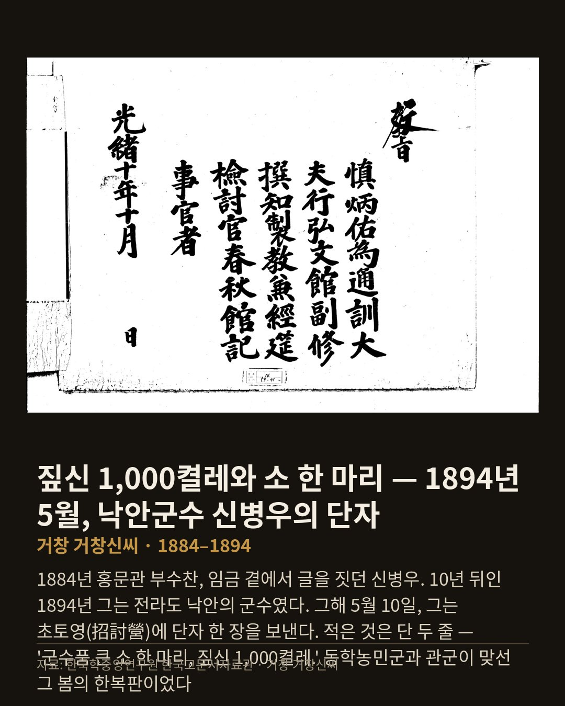
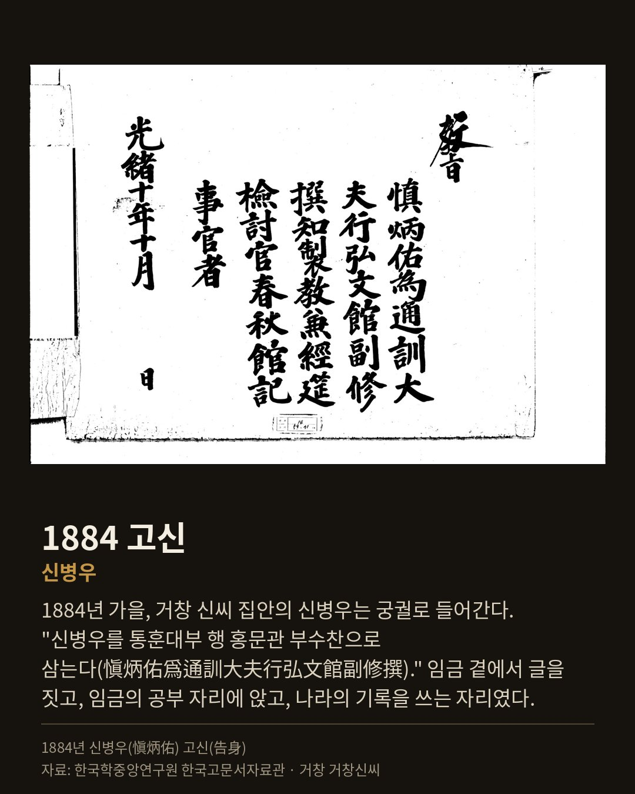
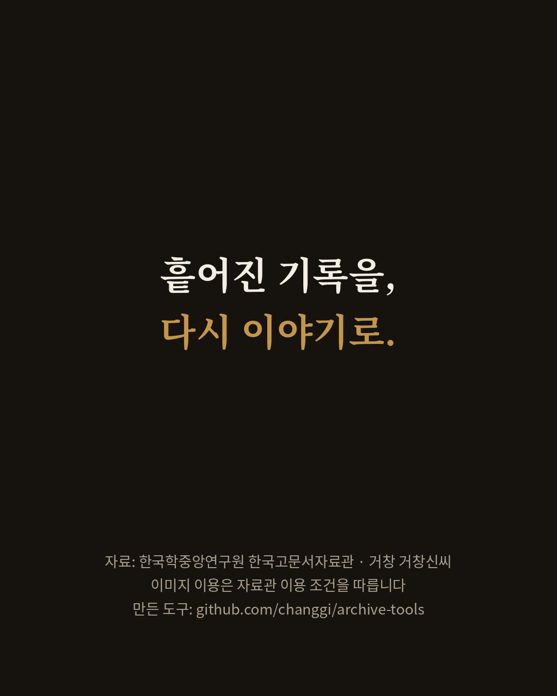

# EP.105 짚신 1,000켤레와 소 한 마리 — 1894년 5월, 낙안군수 신병우의 단자

거창 거창신씨 (문중) · 1884년 홍문관 부수찬, 임금 곁에서 글을 짓던 신병우. 10년 뒤인 1894년 그는 전라도 낙안의 군수였다. 그해 5월 10일, 그는 초토영(招討營)에 단자 한 장을 보낸다. 적은 것은 단 두 줄 — '군수품 큰 소 한 마리, 짚신 1,000켤레.' 동학농민군과 관군이 맞선 그 봄의 한복판이었다

- 🌐 [전시 웹페이지](https://changgi.github.io/archive-tools/examples/geochang-shin/exhibit.html) (한자 위 한글 독음 · 원문 해석) · [수업 활동지](https://changgi.github.io/archive-tools/examples/geochang-shin/handout.html)
- 🎬 영상: [릴스 9:16](https://changgi.github.io/archive-tools/examples/media/ep105-geochang-shin_reel.mp4) · [가로 16:9](https://changgi.github.io/archive-tools/examples/media/ep105-geochang-shin_wide.mp4) · 홍보 글: [`promo.md`](promo.md)
- 카드뉴스: [`cards/`](cards/) · SNS 글: [`sns.txt`](sns.txt) · 판독·해석 표: [`selection.csv`](selection.csv)

<!-- DELIVERY -->
## 전달 에디팅 — 이 기록을 이렇게 전합니다

- **핵심 정서** — 무거움
- **한 문장** — 큰 역사는 목록으로도 남는다 — 짚신의 숫자 뒤에는 그것을 엮은 고을 사람들이 있다.
- **열기** — 1894년 5월, 한 군수가 보낸 목록은 단 두 줄이었습니다.
- **펼치기** — 신병우 고신 → 낙안군수 신병우 단자 (1884–1894년) — 1884년 홍문관의 붓 → 1894년 낙안의 짚신 1,000켤레로, 같은 사람의 10년을 '글'에서 '군수품'으로 바꾸어 보이게 구성했습니다.
- **절정** — "군수품 큰 소 한 마리, 짚신 1,000켤레(軍需大牛壹隻 草鞋壹千部)" — 화면·공간에서 이 한 줄만 크게, 소리를 줄여 집중
- **여운** — 같은 봄, 짚신을 신고 반대편에 섰던 사람들의 기록은 어디에 남아 있을까요? — 질문으로 끝내고 답은 보는 사람에게
- **감각과 물질** — 짚신 더미와 소 한 마리, 군수의 붉은 도장 · 어보·관인 탁본 스탬프를 찍어 보는 체험
- **통로와 매개** — 온라인: 릴스(열기) → 카드뉴스(펼치기) → 전시 웹페이지(절정·원문) → 비하인드 카드(여운) / 오프라인: 원본 크기 복제·낭독·참여 벽 / 남기기: 활동지·질문 카드
- **여운 장치** — 1894년의 다른 쪽 기록 찾아보기
- **전달 에디팅 전** — 2건의 문서를 1884–1894년 연대순으로 놓고 문서명 · 유형 · 해설을 붙인다 — 정확하지만, 지나가면 잊힌다.
- **전달 에디팅 후** — 핵심 정서는 「무거움」. 「1894년 5월, 한 군수가 보낸 목록은 단 두 줄이었습니다.」로 열고, 문서를 대비와 순서로 펼친 뒤, "군수품 큰 소 한 마리, 짚신 1,000켤레(軍需大牛壹隻 草鞋壹千部)"에서 멈춘다. 짚신 더미와 소 한 마리, 군수의 붉은 도장. 마지막엔 「1894년의 다른 쪽 기록 찾아보기」로 보는 사람이 자기 이야기를 남기고 떠나게 한다.

전문: [`delivery.md`](delivery.md)
<!-- /DELIVERY -->

<!-- CURATOR -->
## 비하인드 — 큐레이터 노트

- **왜 이 문서들인가** — 1894년의 문서는 많지만, 군수 한 사람이 자기 이름으로 '소 한 마리, 짚신 1,000켤레'를 적어 보낸 종이는 그 봄을 가장 작은 단위로 보여 주었습니다.
- **전하고 싶은 것** — 큰 역사는 목록으로도 남는다 — 짚신의 숫자 뒤에는 그것을 엮은 고을 사람들이 있다.
- **이렇게 보이길 바랐다** — 1884년 홍문관의 붓 → 1894년 낙안의 짚신 1,000켤레로, 같은 사람의 10년을 '글'에서 '군수품'으로 바꾸어 보이게 구성했습니다.
- **이렇게 써 주세요** — 동학농민운동(1894), 지방 수령의 역할, 전쟁과 물자를 다루는 수업에 쓰세요. 한쪽(관군)의 문서라는 점을 함께 이야기해 주세요.
- **만들며 있었던 일** — 초토영을 양호초토사의 군영으로 본 것은 날짜와 명칭에 따른 추정입니다. 같은 해 전령 여러 장은 흘림이라 이번에 읽지 않았습니다.
- **남겨 둔 질문** — 같은 봄, 짚신을 신고 반대편에 섰던 사람들의 기록은 어디에 남아 있을까요?
- **제작 기록** — 문서 2건 · 1884–1894년 · 원본 사진 2면(문서 전체) · 원문 판독 2건 · 번역 2건

전문: [`curator.md`](curator.md) · 비하인드 카드: [`behind/`](behind/) · 채널별 홍보안: [`channels.md`](channels.md)
<!-- /CURATOR -->

## 이야기 — 사료가 말하는 대로

1894년 5월, 한 군수가 보낸 목록은 단 두 줄이었습니다.

> **1884 고신** — 1884년 가을, 거창 신씨 집안의 신병우는 궁궐로 들어간다. "신병우를 통훈대부 행 홍문관 부수찬으로 삼는다(愼炳佑爲通訓大夫行弘文館副修撰)." 임금 곁에서 글을 짓고, 임금의 공부 자리에 앉고, 나라의 기록을 쓰는 자리였다.
> **1894 단자** — 10년 뒤, 그는 전라도 낙안의 군수가 되어 있었다. 1894년 5월, 남쪽이 불타던 봄. 그가 초토영에 보낸 종이에는 단 두 줄이 적혀 있다. "군수품 큰 소 한 마리, 짚신 1,000켤레(軍需大牛壹隻 草鞋壹千部)." 붓을 들던 손으로, 이번에는 싸움터에 나갈 신발을 셌다.

| 표지 | 1번 카드 | 마무리 |
|---|---|---|
|  |  |  |

## 선별 문서 (2점)

| # | 연도 | 유형 | 문서명 | 원본 |
|---|---|---|---|---|
| 1 | 1884 | 고신 | 1884년 신병우(愼炳佑) 고신(告身) | [원본 보기](https://archive.aks.ac.kr/viewer/viewer.do#imgnode.do?itemId=book&gubun=booktree&depth=6&upPath=01%5E0150%5EL015025%5EL015025F02%5EL015025F0201&dataId=G002%2BAKS%2BKSM-XA.1884.1111-20101008.B054a_078_00017_XXX&itemType=) |
| 2 | 1894 | 단자 | 1894년 낙안군수(樂安郡守) 신병우(愼炳佑) 단자(單子) | [원본 보기](https://archive.aks.ac.kr/viewer/viewer.do#imgnode.do?itemId=book&gubun=booktree&depth=6&upPath=01%5E0150%5EL015025%5EL015025F02%5EL015025F0202&dataId=G002%2BAKS%2BKSM-XB.1894.0000-20101008.B054a_078_00049_XXX&itemType=) |

## 원문 판독과 해석

### 1. 1884년 신병우(愼炳佑) 고신(告身)

**원문 판독**

```
敎旨
愼炳佑爲通訓大
夫行弘文館副修
撰知製敎兼經筵
檢討官春秋館記
事官者
光緖十年十月　日 (도장)
```

**원문 해석** 교지. 신병우를 통훈대부 행 홍문관 부수찬 지제교 겸 경연 검토관 춘추관 기사관으로 삼는다. 광서 10년(1884) 10월 일.

**해제** 1884년(고종 21, 光緖 10) 10월, 신병우(愼炳佑)를 홍문관 부수찬(副修撰, 종6품)에 임명한 교지입니다. 홍문관은 궁중의 책을 관리하고 임금의 자문에 응하던 관청으로, 겸직인 지제교(왕의 교서 짓기) · 경연 검토관(임금의 공부 자리) · 춘추관 기사관(실록 기록)까지 모두 문장과 학문을 맡는 자리입니다. 품계는 정3품 당하관인 통훈대부인데 자리가 낮아 '行'을 붙였습니다.

### 2. 1894년 낙안군수(樂安郡守) 신병우(愼炳佑) 단자(單子)

**원문 판독**

```
單子
招討營　節下
軍需大牛壹隻
草鞋壹千部
甲午五月初十日 樂安郡守愼炳佑 (도장)
```

**원문 해석** 단자. 초토영 절하(장수 앞)에. 군수품 큰 소 한 마리, 짚신 1,000켤레. 갑오년(1894) 5월 초10일 낙안군수 신병우.

**해제** 1894년(고종 31, 甲午) 5월 10일, 전라도 낙안군수 신병우가 초토영(招討營)에 군수품을 보내며 그 목록을 적은 단자(單子)입니다. 초토영은 그해 봄 동학농민군을 진압하려고 조정이 보낸 양호초토사(兩湖招討使)의 군영으로 보입니다. '節下'는 군대를 거느린 장수를 높여 부르는 말이고, 보낸 물건은 큰 소 한 마리와 짚신 1,000켤레뿐입니다. 고을마다 군수품을 거두어 보내던 상황을 군수 자신의 이름과 도장으로 보여 주는 문서입니다. 이 집안에는 같은 해 낙안군수의 전령 여러 장도 함께 전합니다(흘림이라 이번에 읽지 않음).

판독·해석·이야기는 이미지에 근거한 초안이며(검토 전 "초안" 표시), 정확한 판독은 원문 확인이 필요합니다. □는 읽지 못한 글자, (?)는 불확실한 글자입니다.
이미지: 한국학중앙연구원 한국고문서자료관 소장·제공. "원본" 링크를 누르면 자료관 뷰어에서 그 문서가 열립니다. 재사용은 자료관에 문의하세요(소장처 동의 필요).
