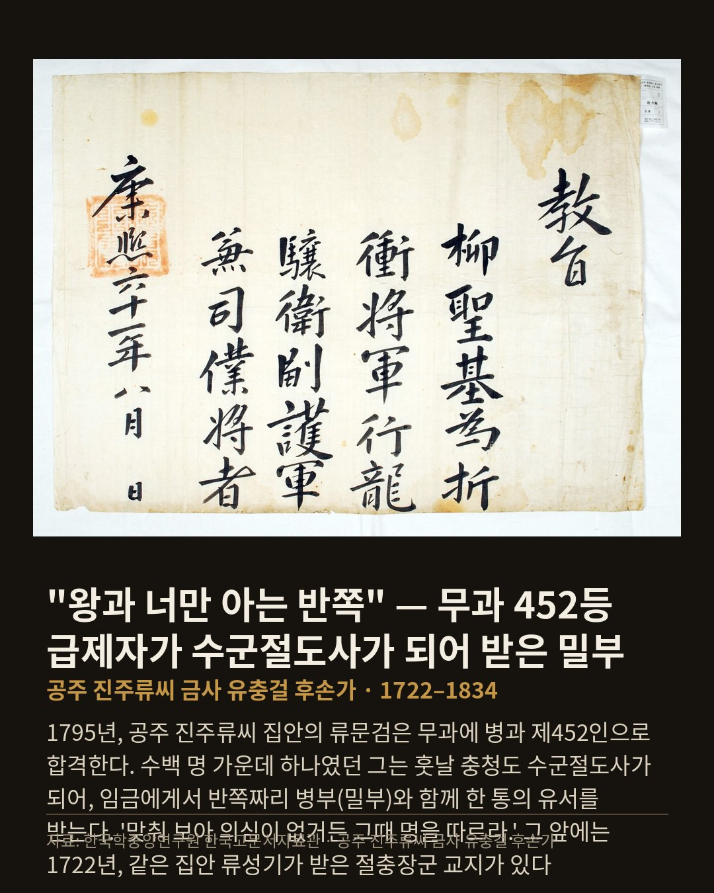
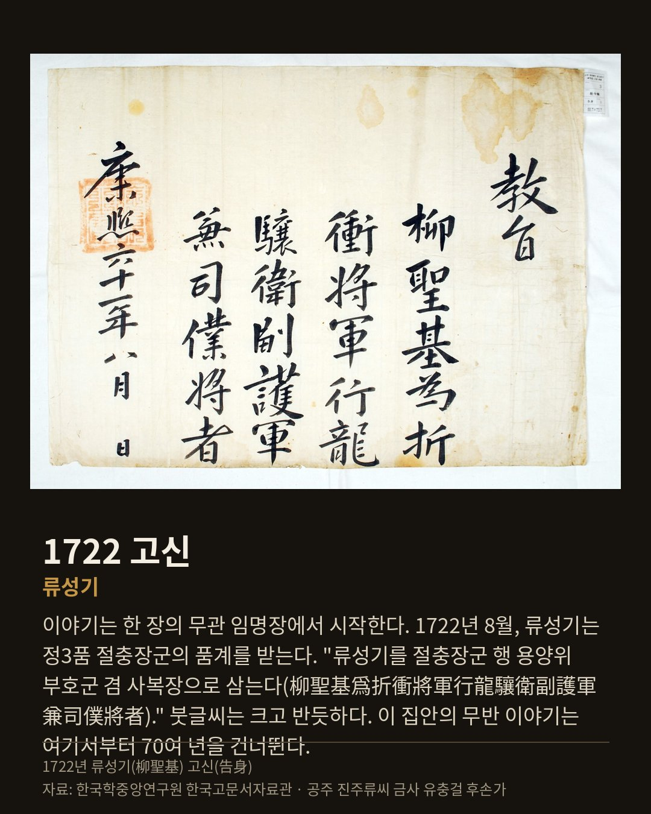
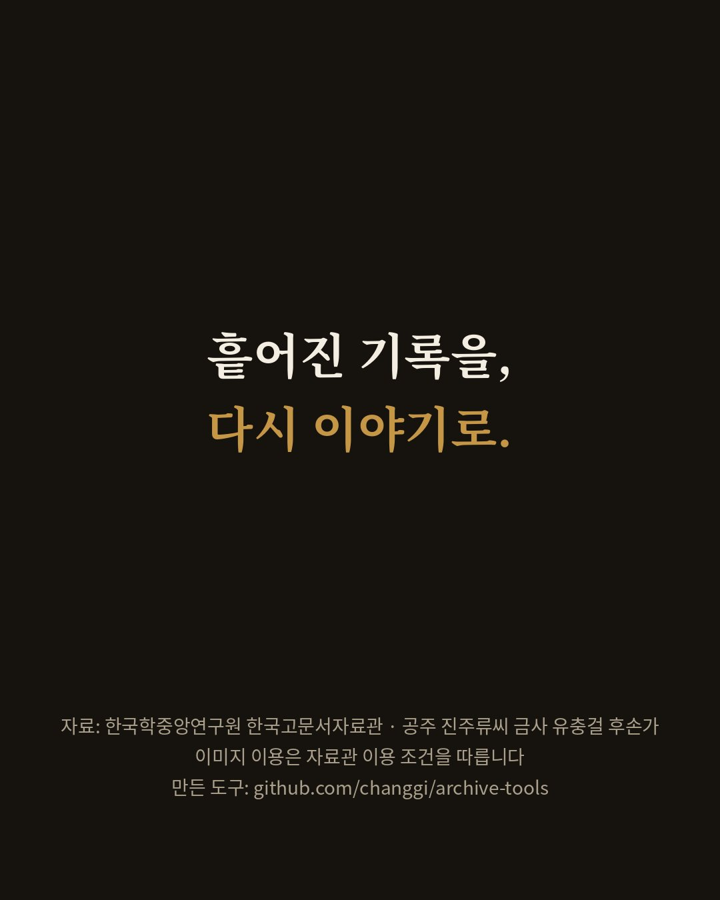

# EP.109 "왕과 너만 아는 반쪽" — 무과 452등 급제자가 수군절도사가 되어 받은 밀부 유서

공주 진주류씨 금사 유충걸 후손가 (문중) · 1795년, 공주 진주류씨 집안의 류문검은 무과에 병과 제452인으로 합격한다. 수백 명 가운데 하나였던 그는 훗날 충청도 수군절도사가 되어, 임금에게서 반쪽짜리 병부(밀부)와 함께 한 통의 유서를 받는다. '맞춰 보아 의심이 없거든 그때 명을 따르라.' 그 앞에는 1722년, 같은 집안 류성기가 받은 절충장군 교지가 있다

- 🌐 [전시 웹페이지](https://changgi.github.io/archive-tools/examples/geumsa/exhibit.html) (한자 위 한글 독음 · 원문 해석) · [수업 활동지](https://changgi.github.io/archive-tools/examples/geumsa/handout.html)
- 🎬 영상: [릴스 9:16](https://changgi.github.io/archive-tools/examples/media/ep109-geumsa_reel.mp4) · [가로 16:9](https://changgi.github.io/archive-tools/examples/media/ep109-geumsa_wide.mp4) · 홍보 글: [`promo.md`](promo.md)
- 카드뉴스: [`cards/`](cards/) · SNS 글: [`sns.txt`](sns.txt) · 판독·해석 표: [`selection.csv`](selection.csv)

<!-- DELIVERY -->
## 전달 에디팅 — 이 기록을 이렇게 전합니다

- **핵심 정서** — 뭉클함
- **한 문장** — 한 사람의 경력은 숫자에서 신뢰로 옮겨 간다 — 452등이라는 등수가 '왕과 너만 아는 반쪽'으로 바뀌기까지.
- **열기** — 수백 명 중 452등으로 붙은 무관이, 왕과 단둘이 아는 반쪽 병부를 받기까지.
- **펼치기** — 류성기 고신 → 유문검 무과 홍패 → 류문검 유서 (1722–1834년) — 1722년 집안 선대의 절충장군 교지 → 1795년 452등 홍패 → 수군절도사 밀부 유서 순으로, 이름 없는 합격자가 신뢰받는 장수가 되는 흐름으로 구성했습니다.
- **절정** — "비상한 명이 있거든 부신을 맞춰 보아 의심이 없은 뒤에 따르라(如有非常之命 合符無疑 然後當就命)" — 화면·공간에서 이 한 줄만 크게, 소리를 줄여 집중
- **여운** — 그 반쪽 병부가 실제로 맞춰진 날은 있었을까요? — 질문으로 끝내고 답은 보는 사람에게
- **감각과 물질** — 붉은 홍패의 숫자 452와 반쪽으로 쪼갠 병부 · 어보·관인 탁본 스탬프를 찍어 보는 체험 · 붉은 종이를 실물 크기로 복제해 벽에 거는 연출 · 역마 방울·말발굽 소리와 함께 펼치는 두루마리
- **통로와 매개** — 온라인: 릴스(열기) → 카드뉴스(펼치기) → 전시 웹페이지(절정·원문) → 비하인드 카드(여운) / 오프라인: 원본 크기 복제·낭독·참여 벽 / 남기기: 활동지·질문 카드
- **여운 장치** — 누군가 나를 믿고 맡긴 '반쪽'을 떠올리기
- **전달 에디팅 전** — 3건의 문서를 1722–1834년 연대순으로 놓고 문서명 · 유형 · 해설을 붙인다 — 정확하지만, 지나가면 잊힌다.
- **전달 에디팅 후** — 핵심 정서는 「뭉클함」. 「수백 명 중 452등으로 붙은 무관이, 왕과 단둘이 아는 반쪽 병부를 받기까지.」로 열고, 문서를 대비와 순서로 펼친 뒤, "비상한 명이 있거든 부신을 맞춰 보아 의심이 없은 뒤에 따르라(如有非常之命 合符無疑 然後當就命)"에서 멈춘다. 붉은 홍패의 숫자 452와 반쪽으로 쪼갠 병부. 마지막엔 「누군가 나를 믿고 맡긴 '반쪽'을 떠올리기」로 보는 사람이 자기 이야기를 남기고 떠나게 한다.

전문: [`delivery.md`](delivery.md)
<!-- /DELIVERY -->

<!-- CURATOR -->
## 비하인드 — 큐레이터 노트

- **왜 이 문서들인가** — 무과 홍패의 '제452인'이라는 숫자와, 같은 사람에게 내린 밀부 유서를 나란히 놓으니 한 무관의 40년이 보였습니다.
- **전하고 싶은 것** — 한 사람의 경력은 숫자에서 신뢰로 옮겨 간다 — 452등이라는 등수가 '왕과 너만 아는 반쪽'으로 바뀌기까지.
- **이렇게 보이길 바랐다** — 1722년 집안 선대의 절충장군 교지 → 1795년 452등 홍패 → 수군절도사 밀부 유서 순으로, 이름 없는 합격자가 신뢰받는 장수가 되는 흐름으로 구성했습니다.
- **이렇게 써 주세요** — 조선의 무과와 관직 체계, 병부 · 밀부 같은 인증 제도(오늘의 이중 인증과 비교), 진로와 경력 이야기에 쓰세요.
- **만들며 있었던 일** — 세 문서는 선명해 판독이 비교적 확실합니다. 유서의 날짜 부분은 이 면에 없어 연도는 자료관 목록(1834)을 따랐습니다. 류성기와 류문검의 가계상 관계는 확인하지 않았고, 류문검의 중간 경력도 다루지 않았습니다.
- **남겨 둔 질문** — 그 반쪽 병부가 실제로 맞춰진 날은 있었을까요?
- **제작 기록** — 문서 3건 · 1722–1834년 · 원본 사진 3면(문서 전체) · 원문 판독 3건 · 번역 3건 · 해제에 "확인 필요"를 단 문서 1건

전문: [`curator.md`](curator.md) · 비하인드 카드: [`behind/`](behind/) · 채널별 홍보안: [`channels.md`](channels.md)
<!-- /CURATOR -->

## 이야기 — 사료가 말하는 대로

수백 명 중 452등으로 붙은 무관이, 왕과 단둘이 아는 반쪽 병부를 받기까지.

> **1722 고신** — 이야기는 한 장의 무관 임명장에서 시작한다. 1722년 8월, 류성기는 정3품 절충장군의 품계를 받는다. "류성기를 절충장군 행 용양위 부호군 겸 사복장으로 삼는다(柳聖基爲折衝將軍行龍驤衛副護軍兼司僕將者)." 붓글씨는 크고 반듯하다. 이 집안의 무반 이야기는 여기서부터 70여 년을 건너뛴다.
> **1795 홍패** — 1795년 9월, 붉은 종이 한 장. "장사랑 류문검은 무과 병과 제452인으로 급제하였다(將仕郞柳文儉武科丙科第四百五十二人及第出身者)." 452등. 수백 명이 함께 합격한 시험이었다. 종9품의 이름 없는 합격자 하나. 그가 어디까지 갈지, 이 종이는 아직 모른다.
> **1834 유서** — 그로부터 마흔 해 가까이 지나, 452등의 합격자는 충청도 바다를 지키는 수군절도사가 되어 있었다. 임금은 그에게 반쪽짜리 병부와 함께 이렇게 적어 보낸다. "나와 그대만이 홀로 판단해 처리할 일은, 밀부가 아니면 할 수 없다(或有予與爾獨斷處置事 非密符莫可施爲)." 그리고 단단히 이른다. "비상한 명이 있거든 부신을 맞춰 보아 의심이 없은 뒤에 따르라(如有非常之命 合符無疑 然後當就命)." 왕과 한 사람만 아는 반쪽. 452등에서 시작한 길은 거기까지 닿았다.

| 표지 | 1번 카드 | 마무리 |
|---|---|---|
|  |  |  |

## 선별 문서 (3점)

| # | 연도 | 유형 | 문서명 | 원본 |
|---|---|---|---|---|
| 1 | 1722 | 고신 | 1722년 류성기(柳聖基) 고신(告身) | [원본 보기](https://archive.aks.ac.kr/viewer/viewer.do#imgnode.do?itemId=book&gubun=booktree&depth=6&upPath=01%5E0144%5EL014422%5EL014422F02%5EL014422F0201&dataId=G002%2BKHD%2BKSM-XA.1722.0000-20170505.C0401_002_00003_XXX&itemType=) |
| 2 | 1795 | 홍패 | 1795년 유문검(柳文儉) 무과 홍패(武科紅牌) | [원본 보기](https://archive.aks.ac.kr/viewer/viewer.do#imgnode.do?itemId=book&gubun=booktree&depth=6&upPath=01%5E0144%5EL014422%5EL014422F02%5EL014422F0201&dataId=G002%2BKHD%2BKSM-XA.1795.0000-20170505.C0401_002_00001_XXX&itemType=) |
| 3 | 1834 | 유서 | 1834년 류문검(柳文儉) 유서(諭書) | [원본 보기](https://archive.aks.ac.kr/viewer/viewer.do#imgnode.do?itemId=book&gubun=booktree&depth=6&upPath=01%5E0144%5EL014422%5EL014422F02%5EL014422F0201&dataId=G002%2BKHD%2BKSM-XA.0000.0000-20170505.C0401_002_00045_XXX&itemType=) |

## 원문 판독과 해석

### 1. 1722년 류성기(柳聖基) 고신(告身)

**원문 판독**

```
敎旨
柳聖基爲折
衝將軍行龍
驤衛副護軍
兼司僕將者
康熙六十一年八月 日
```

**원문 해석** 교지. 류성기를 절충장군 행 용양위 부호군 겸 사복장으로 삼는다. 강희 61년(1722) 8월 일.

**해제** 1722년(경종 2, 康熙 61) 류성기(柳聖基)에게 내린 무반 고신(임명장)입니다. 절충장군(折衝將軍)은 정3품 당상 무관의 품계이고, '행(行)'은 품계보다 낮은 벼슬을 맡을 때 붙이는 말로, 실직은 오위의 하나인 용양위의 부호군(종4품)입니다. 여기에 사복시의 장(사복장)을 겸했습니다. 연호 아래에 어보(임금의 도장)가 찍혀 있습니다. 이 집안이 대대로 무반의 길을 걸었음을 보여 주는 앞선 문서입니다.

### 2. 1795년 유문검(柳文儉) 무과 홍패(武科紅牌)

**원문 판독**

```
敎旨
將仕郞柳文儉武科丙科
第四百五十二人及第出身者
乾隆六十年九月 日
```

**원문 해석** 교지. 장사랑 류문검은 무과 병과 제452인으로 급제하여 출신한 자이다. 건륭 60년(1795) 9월 일.

**해제** 1795년(정조 19, 乾隆 60) 류문검(柳文儉)이 무과에 합격하고 받은 홍패(紅牌)입니다. 붉은 종이에 써서 홍패라 부릅니다. 무과는 갑과 · 을과 · 병과로 등급을 나누는데, 그는 병과 '제452인'으로 합격했습니다. 조선 후기 무과는 한 번에 수백, 많게는 수천 명을 뽑는 일이 있었고, 452라는 숫자도 그런 대규모 시험을 보여 줍니다. 합격 당시 그의 품계는 가장 낮은 문산계의 하나인 장사랑(將仕郞, 종9품)이었습니다. 문서 위쪽 오른편은 일부 떨어져 나갔습니다.

### 3. 1834년 류문검(柳文儉) 유서(諭書)

**원문 판독**

```
諭折衝將軍公忠道水軍
節度使柳文儉
爾受委一方 體任非輕
凡發兵應機 安民制敵
一應常事 自有舊章 慮
或有予與爾獨斷處置
事 非密符莫可施爲 且
意外奸謀 不可不預防
如有非常之命 合符無
疑 然後當就命 故賜押
```

**원문 해석** 절충장군 공충도 수군절도사 류문검에게 이른다. 그대는 한 지방을 맡았으니 그 임무가 가볍지 않다. 군사를 내어 형편에 맞게 움직이고, 백성을 편안히 하고 적을 제압하는 모든 일상적인 일에는 본래 정해진 규정이 있다. 다만 혹 나와 그대만이 홀로 판단하여 처리해야 할 일이 있을까 염려되니, 그런 일은 밀부(密符)가 아니면 시행할 수 없다. 또 뜻밖의 간사한 꾀를 미리 막지 않을 수 없다. 만약 비상한 명령이 있거든, 부신을 맞추어 보아 의심이 없은 뒤에 명을 따르라. 그러므로 압(押)을 내린다.

**해제** 임금이 지방의 병권을 맡은 무관에게 밀부(密符)를 내리며 함께 준 유서(諭書)입니다. 밀부는 둘로 쪼갠 병부로, 한쪽은 임금이, 한쪽은 장수가 지니다가 비상시 명령이 오면 두 쪽을 맞춰 진짜임을 확인했습니다. 유서는 그 확인 절차를 문서로 못 박은 것입니다. 수신자 류문검은 1795년 무과 병과 제452인으로 급제한 그 사람으로, 이 문서에서는 절충장군 공충도(公忠道, 충청도의 다른 이름) 수군절도사입니다. 이 면은 '故賜押'에서 끝나며, 날짜가 적힌 부분은 보이지 않아 연도(1834)는 자료관 목록을 따랐습니다. 붉은 어보 자국이 희미하게 남아 있습니다.

판독·해석·이야기는 이미지에 근거한 초안이며(검토 전 "초안" 표시), 정확한 판독은 원문 확인이 필요합니다. □는 읽지 못한 글자, (?)는 불확실한 글자입니다.
이미지: 한국학중앙연구원 한국고문서자료관 소장·제공. "원본" 링크를 누르면 자료관 뷰어에서 그 문서가 열립니다. 재사용은 자료관에 문의하세요(소장처 동의 필요).
