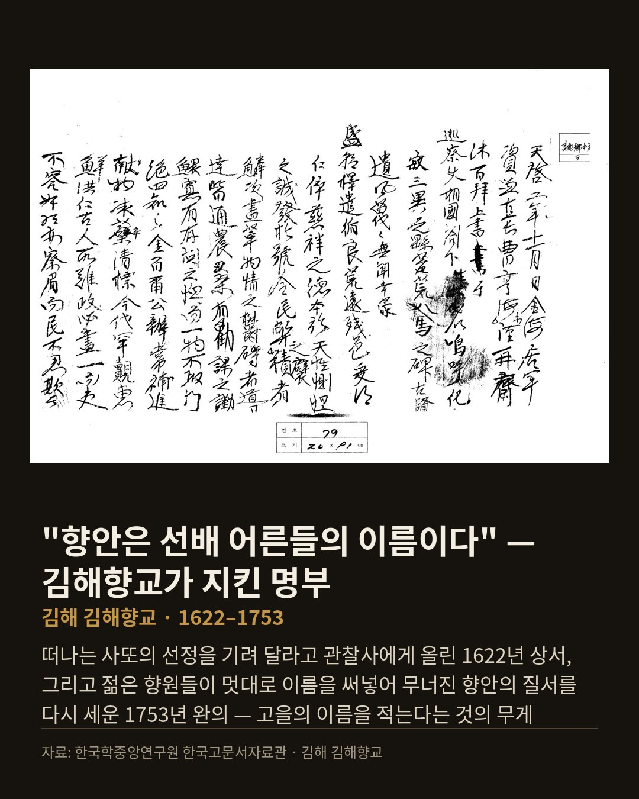
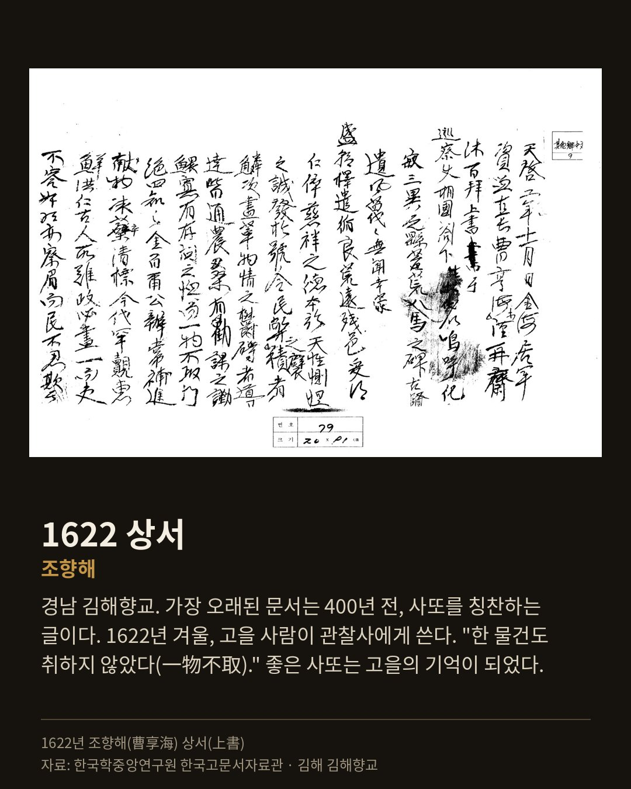
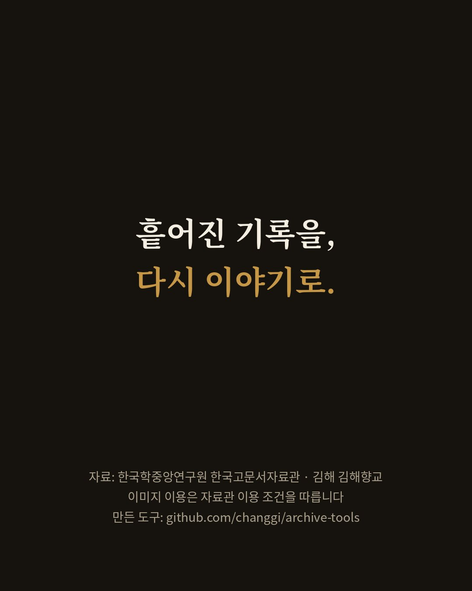

# EP.47 "향안은 선배 어른들의 이름이다" — 김해향교가 지킨 명부

김해 김해향교 (향교) · 떠나는 사또의 선정을 기려 달라고 관찰사에게 올린 1622년 상서, 그리고 젊은 향원들이 멋대로 이름을 써넣어 무너진 향안의 질서를 다시 세운 1753년 완의 — 고을의 이름을 적는다는 것의 무게

- 🌐 [전시 웹페이지](https://changgi.github.io/archive-tools/examples/gimhae-hyanggyo/exhibit.html) (한자 위 한글 독음 · 원문 해석) · [수업 활동지](https://changgi.github.io/archive-tools/examples/gimhae-hyanggyo/handout.html)
- 🎬 영상: [릴스 9:16](https://changgi.github.io/archive-tools/examples/media/ep47-gimhae-hyanggyo_reel.mp4) · [가로 16:9](https://changgi.github.io/archive-tools/examples/media/ep47-gimhae-hyanggyo_wide.mp4) · 홍보 글: [`promo.md`](promo.md)
- 카드뉴스: [`cards/`](cards/) · SNS 글: [`sns.txt`](sns.txt) · 판독·해석 표: [`selection.csv`](selection.csv)

## 이야기 — 사료가 말하는 대로

이름을 명부에 올리는 일이, 왜 이렇게 엄격했을까요?

> **1622 상서** — 경남 김해향교. 가장 오래된 문서는 400년 전, 사또를 칭찬하는 글이다. 1622년 겨울, 고을 사람이 관찰사에게 쓴다. "한 물건도 취하지 않았다(一物不取)." 좋은 사또는 고을의 기억이 되었다.
> **1753 완의** — 130년 뒤 1753년, 이번에는 고을 원로들이 모인다. 고을 양반의 명부인 향안이 흔들리고 있었다. "향안은 곧 선배 어른들의 이름을 적은 명부이니, 결코 마음대로 옮길 수 없다(鄕案乃是先父老名籍 … 決不可任自遷動)." 이름 하나를 적는 일에도, 고을의 질서가 걸려 있었다.

| 표지 | 1번 카드 | 마무리 |
|---|---|---|
|  |  |  |

## 선별 문서 (2점)

| # | 연도 | 유형 | 문서명 | 원본 |
|---|---|---|---|---|
| 1 | 1622 | 상서 | 1622년 조향해(曹享海) 상서(上書) | [원본 보기](https://archive.aks.ac.kr/viewer/viewer.do#imgnode.do?itemId=book&gubun=booktree&depth=6&upPath=02%5E0248%5EL024804%5EL024804F02%5EL024804F0202&dataId=G002%2BAKS%2BKSM-XB.1622.4825-20101008.B022a_034_00145_XXX&itemType=) |
| 2 | 1753 | 완의 | 1753년 향선생(鄕先生) 김덕화(金德和) 등 완의(完議) | [원본 보기](https://archive.aks.ac.kr/viewer/viewer.do#imgnode.do?itemId=book&gubun=booktree&depth=6&upPath=02%5E0248%5EL024804%5EL024804F02%5EL024804F0204&dataId=G002%2BAKS%2BKSM-XD.1753.4825-20101008.B022a_034_00125_XXX&itemType=) |

## 원문 판독과 해석

### 1. 1622년 조향해(曹享海) 상서(上書)

**원문 판독**

```
天啓二年十二月 日 金海居 前(?)□ 曹享海(?) 謹齋
沐百拜上書于
巡察使閤下 書(?)… 嗚呼 化
政三異之跡 縣(?)□□□人焉之碑 古蹟(?)
遺風餘代 □無聞焉
盛 於擇遣循良 荒遠殘邑 愛(?)以
仁偉慈祥之德 本於天性 惻怛
之誠 發於號令 民解(?)積之(?)
鮮於盡筆物情之 興(?)若道(?)
達 皆通 農桑 有勸課之勳(?)
民(?)窮 有存恤之惠 一物不取 門(?)
絶回(?)請 □金(?)□□ 公辨(?)常補(?)進
獻物 未(?)著(?) 淸操 今代罕覯 未(?)
知其古人所難 政必盡一 心哉
不容於 □察 眉(?)向民不忍欺(?)
(이하 왼쪽 — 이미지 범위 밖 · 흘림, 판독 불확실 다수)
```

**원문 해석** 천계 2년(1622) 12월 일, 김해에 사는 조향해(?)가 삼가 목욕재계하고 백 번 절하며 관찰사 합하께 글을 올립니다. … 아아, 교화와 정사가 세 가지로 남다른 자취(三異 — 선정의 상징)와 사람들이 세우는 [송덕]비는 옛 자취로만 남고 [근래에는] 들리지 않았습니다. [조정이] 어진 관리를 골라 멀고 쇠잔한 고을에 보내 주시니, [사또는] 어질고 너그럽고 자상한 덕이 천성에서 나오고, 측은히 여기는 정성이 명령에 드러났습니다. … 농사와 누에치기를 권장한 공이 있고, 궁한 백성을 돌본 은혜가 있으며, 한 물건도 취하지 않고 청탁을 끊었으며, … 진상할 물건도 … 맑은 지조는 요즘 세상에 보기 드문 것이니, 옛사람도 어렵게 여긴 일입니다. … 백성이 차마 속이지 못하였습니다. … (판독 불확실 다수)

**해제** 1622년(광해군 14, 天啓 2) 12월, 김해 사람 조향해(曹享海)가 경상도 관찰사에게 올린 상서입니다. 김해부사(이름 판독 필요)의 선정을 늘어놓으며 — 어질고 자상하며, 농사를 권하고, 가난한 백성을 돌보고, 한 물건도 받지 않았다 — 그 공을 조정에 알려(褒啓) 달라는 취지로 보입니다. 흘림이 섞인 행초서이고 마이크로필름 복사본이라 판독 불확실한 글자가 많습니다.

### 2. 1753년 향선생(鄕先生) 김덕화(金德和) 등 완의(完議)

**원문 판독**

```
完文
右文爲完議事 鄕案乃是 先父老名籍 則其在(…)
決不可任自遷動 故古時鄕規 名在 陵享後(?) 衆會參(…)
鄕案 因爲執可(?)不名錄 則其義太重 其禮且嚴 夫何(…)
鄕風不肅 雖年少鄕員 稱以鄕先生 阿其所好 任(…)
名案 擅斷書錄 鄕風之太變 綱紀之頹弛 莫此甚也 何(…)
老齊會 更定完議 日後若有如前無時任自遷動 書(?)錄(…)
鄕座首鄕先生 自鄕中論罰 削名 斷不撓貸 難(?)顧(…)
此完定之辭 揭(?)令(?)施旃 而自今爲始 名在 陵享後奉(…)
敢有任自書錄之事 則掌吏稟告 官前發(?)定羅(?)[罪](…)
而完議一件 留上鄕案櫃中 一件 傳掌于掌吏 無墜此(…)
令無違此議 豈非一鄕之幸哉 勉哉勉哉
癸酉十二月初四日 鄕先生 金德和(수결)
宋道直(수결) 盧振爀(수결) 李有(?)徵(수결) …
```

**원문 해석** 완문. 이 글은 [향중이] 합의하여 정하는 일이다. 향안(鄕案)은 곧 선배 어른들의 이름을 적은 명부이니 … 결코 마음대로 옮기거나 바꿀 수 없다. 그러므로 옛 향규에는 이름이 … 뒤에 있으면 여럿이 모여 참여해야 향안에 [올렸고], … 이름을 올리는 일은 그 뜻이 매우 무겁고 그 예가 또한 엄하였다. 그런데 어찌하여 … 향풍이 엄숙하지 못하여, 나이 어린 향원조차 향선생이라 일컬으며 자기가 좋아하는 이에게 아첨하여 마음대로 … 명부에 멋대로 써넣으니, 향풍이 크게 변하고 기강이 무너진 것이 이보다 심할 수 없다. … 어른들이 함께 모여 다시 완의를 정하노니, 앞으로 만약 전처럼 아무 때나 마음대로 옮기고 써넣는 일이 있으면 향좌수와 향선생이 향중에서 벌을 논하여 이름을 깎아 내고 결코 너그럽게 봐주지 않을 것이다. … 이 완정한 말을 걸어 두고 시행하여, 지금부터 시작하여 … 감히 마음대로 써넣는 일이 있으면 장리(掌吏)가 관에 아뢰어 죄를 정하게 하고, 완의 한 건은 향안 궤짝 안에 넣어 두고 한 건은 장리에게 전해 맡겨 이것을 떨어뜨리지 않게 하여 … 이 의논을 어기지 않게 하면 어찌 한 고을의 다행이 아니겠는가. 힘쓸지어다, 힘쓸지어다. 계유년(1753) 12월 4일. 향선생 김덕화, 송도직, 노진혁, 이유징 …

**해제** 1753년(영조 29, 癸酉) 12월, 김해의 향선생(鄕先生, 고을 원로) 김덕화 등이 향안(鄕案, 고을 사족의 명부)에 관해 정한 완의(完議)입니다. 나이 어린 향원들이 '향선생'을 자칭하며 마음대로 이름을 써넣거나 빼는 폐단을 막으려고, 앞으로 그런 자는 이름을 삭제하고 관에 알려 처벌하며, 완의를 향안 궤짝에 함께 보관하기로 했습니다. 향안에 이름이 오르는 것이 곧 고을 양반의 자격이었기 때문에 엄격히 관리했습니다. 문서 오른쪽 끝 글자 일부는 이미지 밖이라 (…)로 표시했습니다.

판독·해석·이야기는 이미지에 근거한 초안이며(검토 전 "초안" 표시), 정확한 판독은 원문 확인이 필요합니다. □는 읽지 못한 글자, (?)는 불확실한 글자입니다.
이미지: 한국학중앙연구원 한국고문서자료관 소장·제공. "원본" 링크를 누르면 자료관 뷰어에서 그 문서가 열립니다. 재사용은 자료관에 문의하세요(소장처 동의 필요).
