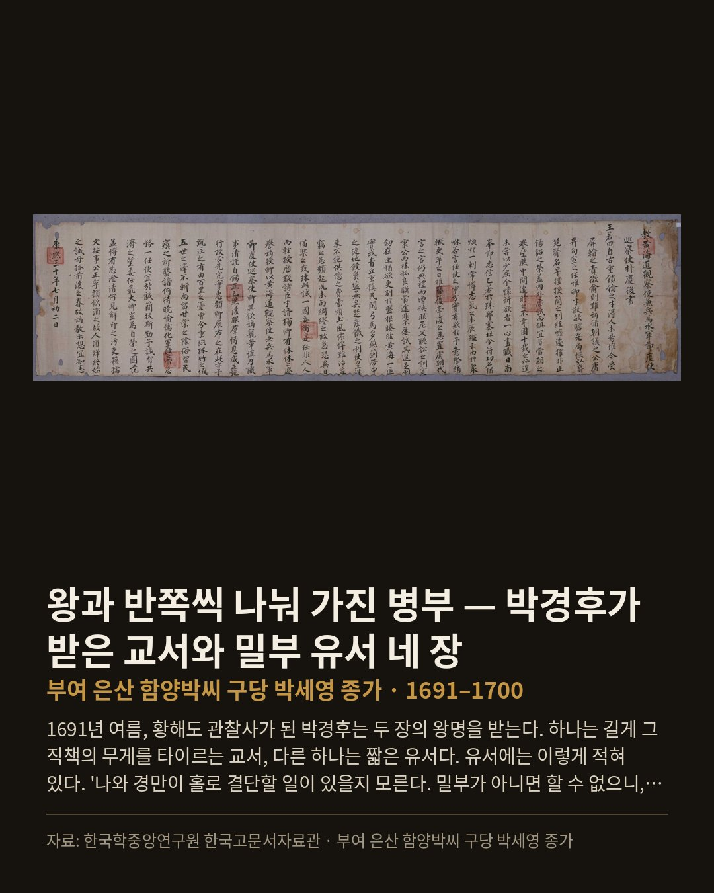
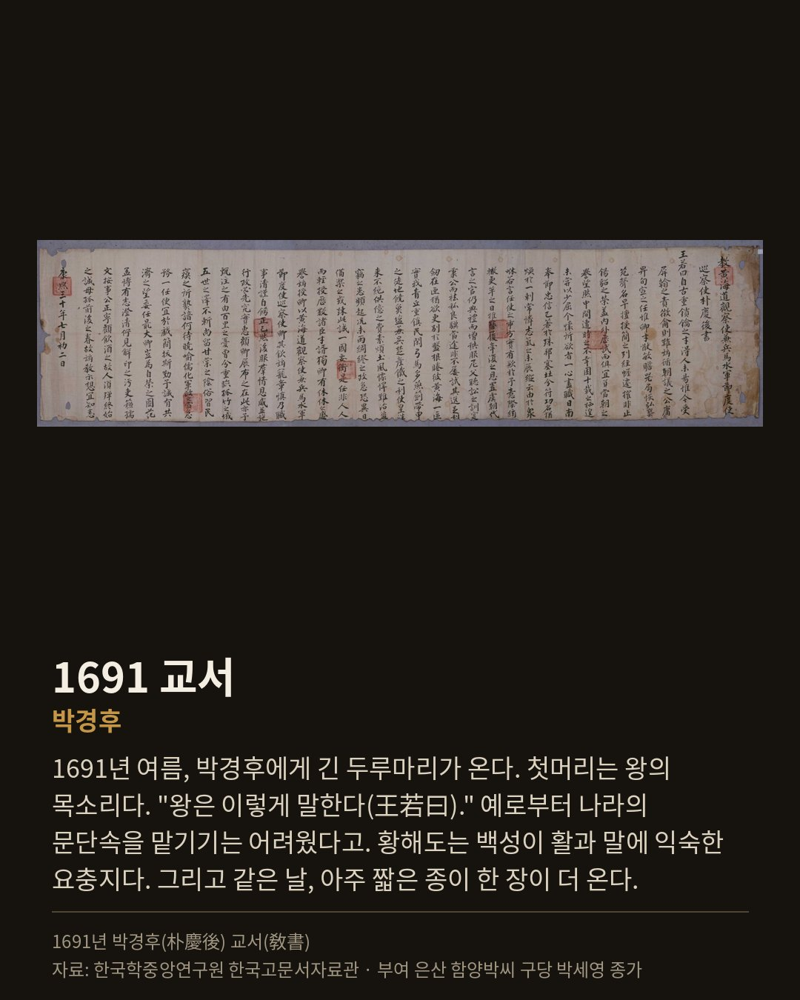
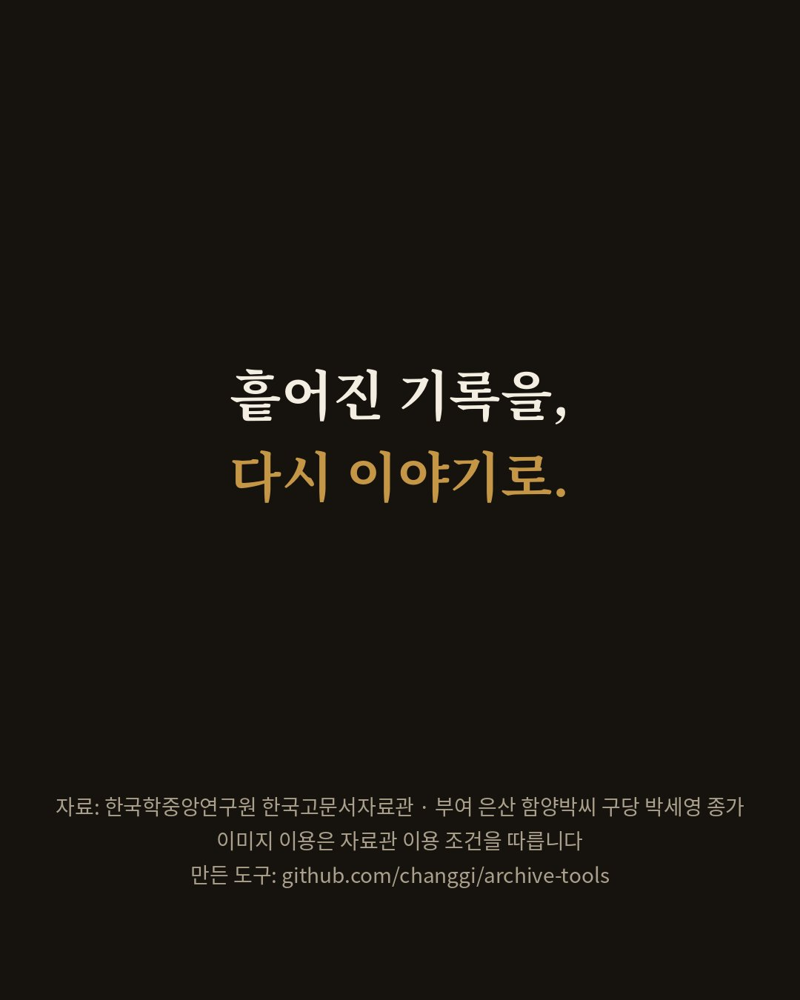

# EP.163 왕과 반쪽씩 나눠 가진 병부 — 박경후가 받은 교서와 밀부 유서 네 장

부여 은산 함양박씨 구당 박세영 종가 (문중) · 1691년 여름, 황해도 관찰사가 된 박경후는 두 장의 왕명을 받는다. 하나는 길게 그 직책의 무게를 타이르는 교서, 다른 하나는 짧은 유서다. 유서에는 이렇게 적혀 있다. '나와 경만이 홀로 결단할 일이 있을지 모른다. 밀부가 아니면 할 수 없으니, 압(押)을 찍은 제3부를 준다.' 2년 뒤 전라도에서는 제17부, 9년 뒤 경기 장단에서는 제24부. 번호는 바뀌어도 문장은 같았다

- 🌐 [전시 웹페이지](https://changgi.github.io/archive-tools/examples/gudang-yuseo/exhibit.html) (한자 위 한글 독음 · 원문 해석) · [수업 활동지](https://changgi.github.io/archive-tools/examples/gudang-yuseo/handout.html)
- 🎬 영상: [릴스 9:16](https://changgi.github.io/archive-tools-next/media/ep163-gudang-yuseo_reel.mp4) · [가로 16:9](https://changgi.github.io/archive-tools-next/media/ep163-gudang-yuseo_wide.mp4) · 홍보 글: [`promo.md`](promo.md)
- 카드뉴스: [`cards/`](cards/) · SNS 글: [`sns.txt`](sns.txt) · 판독·해석 표: [`selection.csv`](selection.csv)

<!-- DELIVERY -->
## 전달 에디팅 — 이 기록을 이렇게 전합니다

- **핵심 정서** — 긴장
- **한 문장** — 관찰사 · 방어사는 반란 같은 비상시에 군사를 움직여야 했다 — 왕은 '밀부(密符)'의 반쪽을 주고, 나머지 반쪽과 맞춰 보아야만 군사를 낼 수 있게 했다. 유서는 그 반쪽에 붙은 설명서다.
- **열기** — 왕은 지방관에게 병부 반쪽을 주며, '나와 경만이 아는 일'이라고 적었습니다.
- **펼치기** — 박경후 교서 → 박경후 유서 (1691–1700년) — 1691 황해도 관찰사 교서(직책의 무게) → 같은 날 유서(제3부) → 1693 전라도 관찰사 유서(제17부) → 1700 경기 우방어사 · 장단부사 유서(제24부)로, 같은 문장에 번호와 고을만 바뀌는 모습을 보이게 했습니다.
- **절정** — "혹 나와 경만이 홀로 결단할 일이 있을까 염려되니, 밀부가 아니면 시행할 수 없다(予與卿獨斷處置事 非密符莫可施爲)" — 화면·공간에서 이 한 줄만 크게, 소리를 줄여 집중
- **여운** — 한 번도 쓰이지 않았을지 모를 반쪽짜리 병부는, 무엇을 지키고 있었을까요? — 질문으로 끝내고 답은 보는 사람에게
- **감각과 물질** — 같은 문장 '予與卿獨斷處置事 非密符莫可施爲' — 번호만 第三 · 第十七 · 第二十四로 바뀐다 · 두루마리를 실제 길이로 펼친 복제 · 역마 방울·말발굽 소리와 함께 펼치는 두루마리
- **통로와 매개** — 온라인: 릴스(열기) → 카드뉴스(펼치기) → 전시 웹페이지(절정·원문) → 비하인드 카드(여운) / 오프라인: 원본 크기 복제·낭독·참여 벽 / 남기기: 활동지·질문 카드
- **여운 장치** — 가족 · 친구와 나눠 가진 '확인용 증표' 하나 떠올리기
- **전달 에디팅 전** — 4건의 문서를 1691–1700년 연대순으로 놓고 문서명 · 유형 · 해설을 붙인다 — 정확하지만, 지나가면 잊힌다.
- **전달 에디팅 후** — 핵심 정서는 「긴장」. 「왕은 지방관에게 병부 반쪽을 주며, '나와 경만이 아는 일'이라고 적었습니다.」로 열고, 문서를 대비와 순서로 펼친 뒤, "혹 나와 경만이 홀로 결단할 일이 있을까 염려되니, 밀부가 아니면 시행할 수 없다(予與卿獨斷處置事 非密符莫可施爲)"에서 멈춘다. 같은 문장 '予與卿獨斷處置事 非密符莫可施爲' — 번호만 第三 · 第十七 · 第二十四로 바뀐다. 마지막엔 「가족 · 친구와 나눠 가진 '확인용 증표' 하나 떠올리기」로 보는 사람이 자기 이야기를 남기고 떠나게 한다.

전문: [`delivery.md`](delivery.md)
<!-- /DELIVERY -->

<!-- CURATOR -->
## 비하인드 — 큐레이터 노트

- **왜 이 문서들인가** — EP.116에서 이 집안의 합격증(백패 · 홍패)을 읽었습니다. 같은 집안에 박경후가 받은 교서 · 유서가 남아 있어, 문과 급제 뒤 그가 지방의 군사권을 맡는 장면을 이어 보기로 했습니다.
- **전하고 싶은 것** — 관찰사 · 방어사는 반란 같은 비상시에 군사를 움직여야 했다 — 왕은 '밀부(密符)'의 반쪽을 주고, 나머지 반쪽과 맞춰 보아야만 군사를 낼 수 있게 했다. 유서는 그 반쪽에 붙은 설명서다.
- **이렇게 보이길 바랐다** — 1691 황해도 관찰사 교서(직책의 무게) → 같은 날 유서(제3부) → 1693 전라도 관찰사 유서(제17부) → 1700 경기 우방어사 · 장단부사 유서(제24부)로, 같은 문장에 번호와 고을만 바뀌는 모습을 보이게 했습니다.
- **이렇게 써 주세요** — 조선의 지방 군사 체제(관찰사 겸 병마수군절도사 · 방어사), 밀부 · 병부 제도, 교서 · 유서의 형식과 어보, 왕권과 지방관의 신뢰 수업에 쓰세요.
- **만들며 있었던 일** — 네 장 모두 해서로 또렷합니다. 1691년 교서는 매우 길어 앞뒤 일부만 옮기고 가운데는 …로 줄였습니다. '押'은 밀부에 찍은 표식(서압)으로 보았습니다. 1700년 유서의 '押第二十四符'는 '茅'처럼 보이는 글자를 '第'로 읽었습니다. 박경후가 실제로 밀부를 쓴 일이 있는지는 이 문서들로 알 수 없습니다.
- **남겨 둔 질문** — 한 번도 쓰이지 않았을지 모를 반쪽짜리 병부는, 무엇을 지키고 있었을까요?
- **제작 기록** — 문서 4건 · 1691–1700년 · 원본 사진 4면(문서 전체) · 원문 판독 4건 · 번역 4건

전문: [`curator.md`](curator.md) · 비하인드 카드: [`behind/`](behind/) · 채널별 홍보안: [`channels.md`](channels.md)
<!-- /CURATOR -->

## 이야기 — 사료가 말하는 대로

왕은 지방관에게 병부 반쪽을 주며, '나와 경만이 아는 일'이라고 적었습니다.

> **1691 교서** — 1691년 여름, 박경후에게 긴 두루마리가 온다. 첫머리는 왕의 목소리다. "왕은 이렇게 말한다(王若曰)." 예로부터 나라의 문단속을 맡기기는 어려웠다고. 황해도는 백성이 활과 말에 익숙한 요충지다. 그리고 같은 날, 아주 짧은 종이 한 장이 더 온다.
> **1691 유서** — 짧은 종이 한 장. 그러나 무게는 이쪽이 더하다. 왕은 적는다. "혹 나와 경만이 홀로 결단할 일이 있을까 염려되니, 밀부가 아니면 시행할 수 없다(予與卿獨斷處置事 非密符莫可施爲)." 그리고 반쪽짜리 패를 준다. 제3부. 나머지 반쪽은 왕에게 있다.
> **1693 유서** — 2년 뒤, 이번에는 전라도. 같은 사람, 같은 문장. 바뀐 것은 고을 이름과 숫자 하나다. "압을 찍은 제17부를 내린다(賜押第十七符)." 반쪽 패를 돌려주고, 또 다른 반쪽을 받는다.
> **1700 유서** — 그리고 1700년, 도성 북쪽 장단. 세 번째 유서. 같은 문장이 같은 자리에 있다. 나와 경만이 홀로 결단할 일. 번호는 제24부. 세 개의 반쪽 패가 그를 거쳐 갔다. 그 패가 실제로 맞춰진 날이 있었는지, 종이는 말하지 않는다.

| 표지 | 1번 카드 | 마무리 |
|---|---|---|
|  |  |  |

## 선별 문서 (4점)

| # | 연도 | 유형 | 문서명 | 원본 |
|---|---|---|---|---|
| 1 | 1691 | 교서 | 1691년 박경후(朴慶後) 교서(敎書) | [원본 보기](https://archive.aks.ac.kr/viewer/viewer.do#imgnode.do?itemId=book&gubun=booktree&depth=6&upPath=01%5E0144%5EL014425%5EL014425F02%5EL014425F0201&dataId=G002%2BAKS%2BKSM-XA.1691.1111-20101008.B030a_045_00001_XXX&itemType=) |
| 2 | 1691 | 유서 | 1691년 박경후(朴慶後) 유서(諭書) | [원본 보기](https://archive.aks.ac.kr/viewer/viewer.do#imgnode.do?itemId=book&gubun=booktree&depth=6&upPath=01%5E0144%5EL014425%5EL014425F02%5EL014425F0201&dataId=G002%2BAKS%2BKSM-XA.1691.1111-20101008.B030a_045_00003_XXX&itemType=) |
| 3 | 1693 | 유서 | 1693년 박경후(朴慶後) 유서(諭書) | [원본 보기](https://archive.aks.ac.kr/viewer/viewer.do#imgnode.do?itemId=book&gubun=booktree&depth=6&upPath=01%5E0144%5EL014425%5EL014425F02%5EL014425F0201&dataId=G002%2BAKS%2BKSM-XA.1693.1111-20101008.B030a_045_00004_XXX&itemType=) |
| 4 | 1700 | 유서 | 1700년 박경후(朴慶後) 유서(諭書) | [원본 보기](https://archive.aks.ac.kr/viewer/viewer.do#imgnode.do?itemId=book&gubun=booktree&depth=6&upPath=01%5E0144%5EL014425%5EL014425F02%5EL014425F0201&dataId=G002%2BAKS%2BKSM-XA.1700.1111-20101008.B030a_045_00005_XXX&itemType=) |

## 원문 판독과 해석

### 1. 1691년 박경후(朴慶後) 교서(敎書)

**원문 판독**

```
敎黃海道觀察使兼兵馬水軍節度使巡察使朴慶後書
王若曰 自古重鎖鑰之寄 得人未易 惟今受
屛翰之責 徽喬則難 玆循朝議之公 庸
畀旬宣之任 惟卿 才猷敏贍 器局恢弘 …
… 實我青丘重鎭 民閑弓馬 …
… 故玆敎示 想宜知悉
康熙三十年七月初二日
```

**원문 해석** 황해도 관찰사 겸 병마수군절도사 순찰사 박경후에게 내리는 교서. 왕은 이렇게 말한다. 예로부터 나라의 문단속(鎖鑰)을 맡기는 일은 무거워 사람을 얻기가 쉽지 않았다. 이제 울타리가 되는 책임을 맡을 사람이 마땅치 않아 조정 논의의 공정함을 따라 한 도를 다스리는 임무를 맡긴다. 오직 경은 재주와 계책이 민첩하고 넉넉하며 그릇과 도량이 넓다. … (황해도는) 실로 우리 청구(조선)의 중요한 진으로 백성이 활쏘기와 말타기에 익숙하다. … 그러므로 이렇게 교시하니, 잘 알리라 생각한다. 강희 30년(1691) 7월 2일.

**해제** 1691년(숙종 17) 7월 2일, 박경후(朴慶後)를 황해도 관찰사 겸 병마수군절도사 순찰사로 보내며 내린 교서(敎書)입니다. 관찰사 교서는 '王若曰(왕은 이렇게 말한다)'로 시작하는 긴 변려문으로, 그 도의 형세와 맡길 일의 무게, 임명된 사람의 자질을 차례로 말하고 '故玆敎示 想宜知悉'로 끝맺습니다. 황해도를 '청구의 중요한 진(青丘重鎭)', 백성이 '활쏘기와 말타기에 익숙하다'고 적어 군사적 요충지임을 강조했습니다. 글이 매우 길어 앞뒤 일부만 옮겼습니다. 같은 날 짧은 유서가 함께 내려졌습니다.

### 2. 1691년 박경후(朴慶後) 유서(諭書)

**원문 판독**

```
諭守黃海道觀察使兼兵馬水軍節度使巡
察使朴慶後
卿受委一方 體任非輕 凡發兵應機 安民
制敵 一應常事 自有舊章 慮或有予與卿
獨斷處置事 非密符莫可施爲 且意外奸
謀 不可不預防 如有非常之命 合符無疑然後
當就命 故賜押第三符 卿其受之 故諭
康熙三十年七月初二日
```

**원문 해석** 황해도 관찰사 겸 병마수군절도사 순찰사 박경후에게 이른다. 경은 한 지방을 맡아 그 임무가 가볍지 않다. 무릇 군사를 내어 기회에 대응하고 백성을 편안히 하며 적을 제압하는 일 가운데 일상적인 일은 본디 옛 규정이 있다. 다만 혹 나와 경만이 홀로 결단하여 처리할 일이 있을까 염려되니, 밀부가 아니면 시행할 수 없다. 또 뜻밖의 간사한 꾀를 미리 막지 않을 수 없으니, 만약 비상한 명령이 있으면 부(符)를 맞추어 의심이 없게 된 뒤에 명을 따르라. 그러므로 압을 찍은 제3부를 내리니 경은 받으라. 그러므로 이른다. 강희 30년(1691) 7월 2일.

**해제** 교서와 같은 날 내린 유서(諭書)입니다. 관찰사 · 병사 · 수사 · 방어사 등 군사권을 가진 지방관에게 내리는 이 유서는 밀부(密符)와 함께 주어졌습니다. 밀부는 둥근 패를 반으로 갈라 한쪽은 왕이, 한쪽은 지방관이 가지는 것으로, 왕이 비상한 명령(예: 반란 진압을 위한 출병)을 내릴 때 사자가 가져온 반쪽과 맞추어 보아야만 따르게 했습니다. '나와 경만이 홀로 결단할 일(予與卿獨斷處置事)'과 '뜻밖의 간사한 꾀(意外奸謀)', 곧 거짓 왕명을 막기 위한 장치입니다. 이 유서에는 '제3부'가 주어졌습니다. 첫머리와 본문에 어보(왕의 도장)가 찍혔습니다.

### 3. 1693년 박경후(朴慶後) 유서(諭書)

**원문 판독**

```
諭全羅道觀察使兼兵馬水軍節度使
巡察使全州府尹朴慶後
卿受委一方 體任非輕 凡發兵應機
安民制敵 一應常事 自有舊章 慮或
有予與卿獨斷處置事 非密符莫可
施爲 且意外奸謀 不可不預防 如有
非常之命 合符無疑然後 當就命 故
賜押第十七符 卿其受之 故諭
康熙三十二年正月二十六日
```

**원문 해석** 전라도 관찰사 겸 병마수군절도사 순찰사 전주부윤 박경후에게 이른다. 경은 한 지방을 맡아 그 임무가 가볍지 않다. … 혹 나와 경만이 홀로 결단하여 처리할 일이 있을까 염려되니, 밀부가 아니면 시행할 수 없다. … 만약 비상한 명령이 있으면 부를 맞추어 의심이 없게 된 뒤에 명을 따르라. 그러므로 압을 찍은 제17부를 내리니 경은 받으라. 그러므로 이른다. 강희 32년(1693) 정월 26일.

**해제** 1693년(숙종 19) 정월 26일, 박경후가 전라도 관찰사 겸 전주부윤으로 옮겨 갈 때 받은 유서입니다. 본문은 1691년 황해도 유서와 글자 하나 다르지 않고, 받는 사람의 직함과 '제17부'라는 번호만 바뀌었습니다. 밀부는 도와 진마다 번호를 매겨 관리했으며, 지방관이 바뀌면 앞사람의 밀부를 반납하고 새 사람에게 새 유서와 함께 내렸습니다. 같은 내용을 같은 형식으로 반복하는 것 자체가 제도가 정착했음을 보여 줍니다.

### 4. 1700년 박경후(朴慶後) 유서(諭書)

**원문 판독**

```
諭京畿右防禦使長湍府使朴
慶後
卿受委一方 體任非輕 凡發
兵應機 安民制敵 一應常事
自有舊章 慮或有予與卿獨
斷處置事 非密符莫可施爲
且意外奸謀 不可不預防 如
有非常之命 合符無疑然後
當就命 故賜押第二十四符 卿
其受之 故諭
康熙三十九年六月初 日
```

**원문 해석** 경기 우방어사 장단부사 박경후에게 이른다. 경은 한 지방을 맡아 그 임무가 가볍지 않다. … 혹 나와 경만이 홀로 결단하여 처리할 일이 있을까 염려되니, 밀부가 아니면 시행할 수 없다. … 그러므로 압을 찍은 제24부를 내리니 경은 받으라. 그러므로 이른다. 강희 39년(1700) 6월 초 ○일.

**해제** 1700년(숙종 26) 6월, 박경후가 경기 우방어사 겸 장단부사가 되었을 때 받은 유서입니다. 장단은 도성 북쪽 임진강 가의 요충지로, 방어사는 그 지역의 군사를 맡았습니다. 관찰사(도 단위)에서 방어사(고을 단위)로 직임이 바뀌었으나 밀부 유서의 문장은 같고 번호만 '제24부'입니다. '第' 자는 '茅'처럼 쓰였으나 같은 형식의 앞 문서들에 따라 '第'로 읽었습니다. 날짜의 일(日)은 비워 두었습니다. 9년 사이 세 번의 유서로, 한 관료가 왕과 나눠 가진 반쪽 패가 세 번 바뀌었습니다.

판독·해석·이야기는 이미지에 근거한 초안이며(검토 전 "초안" 표시), 정확한 판독은 원문 확인이 필요합니다. □는 읽지 못한 글자, (?)는 불확실한 글자입니다.
이미지: 한국학중앙연구원 한국고문서자료관 소장·제공. "원본" 링크를 누르면 자료관 뷰어에서 그 문서가 열립니다. 재사용은 자료관에 문의하세요(소장처 동의 필요).
