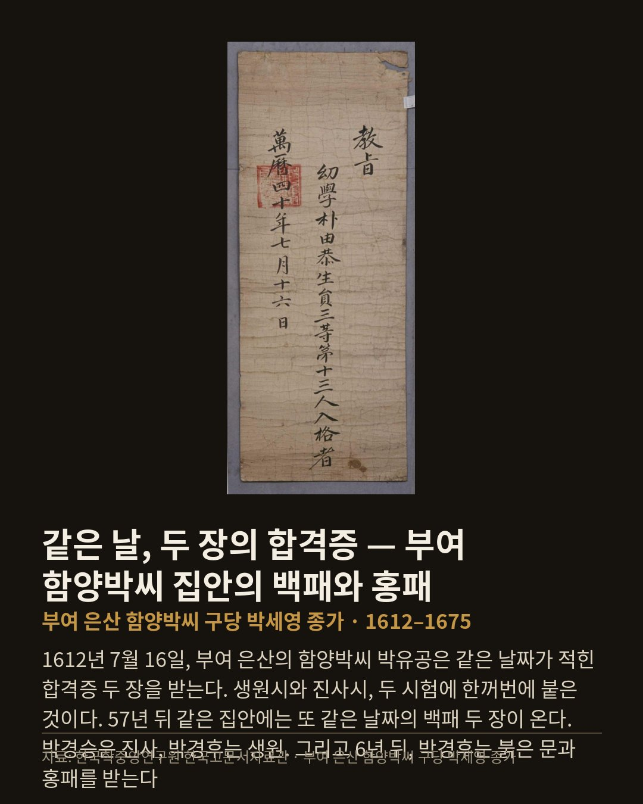
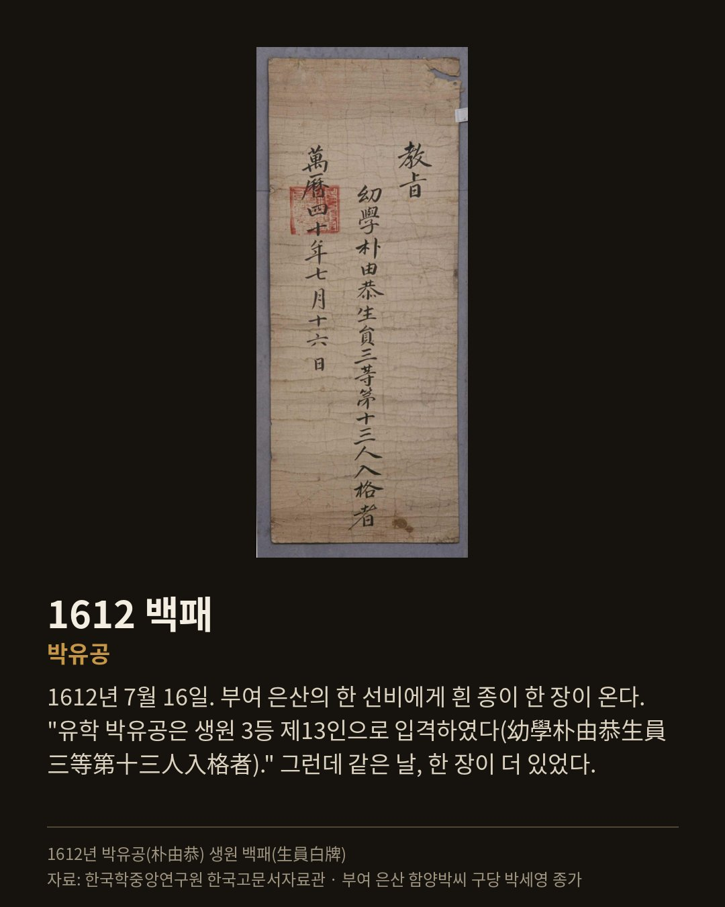
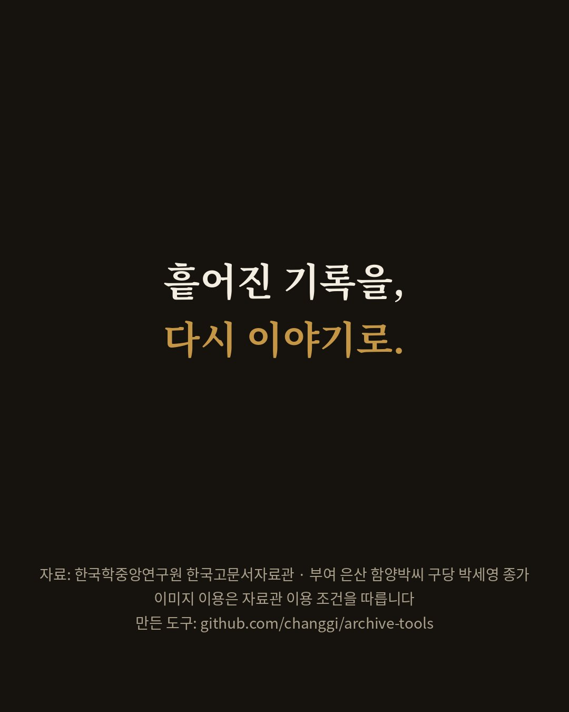

# EP.116 같은 날, 두 장의 합격증 — 부여 함양박씨 집안의 백패와 홍패

부여 은산 함양박씨 구당 박세영 종가 (문중) · 1612년 7월 16일, 부여 은산의 함양박씨 박유공은 같은 날짜가 적힌 합격증 두 장을 받는다. 생원시와 진사시, 두 시험에 한꺼번에 붙은 것이다. 57년 뒤 같은 집안에는 또 같은 날짜의 백패 두 장이 온다. 박경승은 진사, 박경후는 생원. 그리고 6년 뒤, 박경후는 붉은 문과 홍패를 받는다

- 🌐 [전시 웹페이지](https://changgi.github.io/archive-tools/examples/gudang/exhibit.html) (한자 위 한글 독음 · 원문 해석) · [수업 활동지](https://changgi.github.io/archive-tools/examples/gudang/handout.html)
- 🎬 영상: [릴스 9:16](https://changgi.github.io/archive-tools/examples/media/ep116-gudang_reel.mp4) · [가로 16:9](https://changgi.github.io/archive-tools/examples/media/ep116-gudang_wide.mp4) · 홍보 글: [`promo.md`](promo.md)
- 카드뉴스: [`cards/`](cards/) · SNS 글: [`sns.txt`](sns.txt) · 판독·해석 표: [`selection.csv`](selection.csv)

<!-- DELIVERY -->
## 전달 에디팅 — 이 기록을 이렇게 전합니다

- **핵심 정서** — 설렘
- **한 문장** — 같은 날은 두 번 온다 — 한 사람의 두 합격, 두 사람의 한 날, 그리고 그중 하나가 이어 간 붉은 종이.
- **열기** — 같은 날짜, 같은 도장. 한 사람이 합격증을 두 장 받았습니다.
- **펼치기** — 박유공 생원 백패 → 박유공 진사 백패 → 박경승 진사 백패 → 박경후 생원 백패 → 박경후 문과 홍패 (1612–1675년) — 1612년 한 사람의 생원 · 진사 백패 → 1669년 같은 날 두 사람의 백패 → 1675년 박경후의 문과 홍패 순으로, '같은 날'이 반복되다 한 갈래로 이어지게 구성했습니다.
- **절정** — "통덕랑 박경후는 문과 병과 제1인으로 급제하였다(通德郞朴慶後文科丙科第一人及第出身者)" — 화면·공간에서 이 한 줄만 크게, 소리를 줄여 집중
- **여운** — 같은 날 흰 종이를 받은 박경승은, 그 뒤 어떤 길을 걸었을까요? — 질문으로 끝내고 답은 보는 사람에게
- **감각과 물질** — 같은 날짜의 흰 종이 두 장과 바랜 붉은 종이 한 장 · 흰 종이 한 장에 조명 하나 · 붉은 종이를 실물 크기로 복제해 벽에 거는 연출
- **통로와 매개** — 온라인: 릴스(열기) → 카드뉴스(펼치기) → 전시 웹페이지(절정·원문) → 비하인드 카드(여운) / 오프라인: 원본 크기 복제·낭독·참여 벽 / 남기기: 활동지·질문 카드
- **여운 장치** — 누군가와 같은 날 시작한 일을 떠올리기
- **전달 에디팅 전** — 5건의 문서를 1612–1675년 연대순으로 놓고 문서명 · 유형 · 해설을 붙인다 — 정확하지만, 지나가면 잊힌다.
- **전달 에디팅 후** — 핵심 정서는 「설렘」. 「같은 날짜, 같은 도장. 한 사람이 합격증을 두 장 받았습니다.」로 열고, 문서를 대비와 순서로 펼친 뒤, "통덕랑 박경후는 문과 병과 제1인으로 급제하였다(通德郞朴慶後文科丙科第一人及第出身者)"에서 멈춘다. 같은 날짜의 흰 종이 두 장과 바랜 붉은 종이 한 장. 마지막엔 「누군가와 같은 날 시작한 일을 떠올리기」로 보는 사람이 자기 이야기를 남기고 떠나게 한다.

전문: [`delivery.md`](delivery.md)
<!-- /DELIVERY -->

<!-- CURATOR -->
## 비하인드 — 큐레이터 노트

- **왜 이 문서들인가** — 임명장 수백 장 사이에서, 날짜가 똑같은 백패가 두 쌍 있다는 것이 눈에 걸렸습니다.
- **전하고 싶은 것** — 같은 날은 두 번 온다 — 한 사람의 두 합격, 두 사람의 한 날, 그리고 그중 하나가 이어 간 붉은 종이.
- **이렇게 보이길 바랐다** — 1612년 한 사람의 생원 · 진사 백패 → 1669년 같은 날 두 사람의 백패 → 1675년 박경후의 문과 홍패 순으로, '같은 날'이 반복되다 한 갈래로 이어지게 구성했습니다.
- **이렇게 써 주세요** — 과거 제도(생원시 · 진사시 · 문과, 백패와 홍패), 가문 안의 학업 전통, 같은 출발과 다른 길에 대한 이야기에 쓰세요.
- **만들며 있었던 일** — 다섯 장 모두 정형 문서라 판독이 비교적 확실하나, 홍패의 달 글자는 불확실합니다. 박유공 · 박경승 · 박경후의 가계상 관계와 구당 박세영과의 관계는 확인하지 않았습니다.
- **남겨 둔 질문** — 같은 날 흰 종이를 받은 박경승은, 그 뒤 어떤 길을 걸었을까요?
- **제작 기록** — 문서 5건 · 1612–1675년 · 원본 사진 10면(문서 전체) · 원문 판독 5건 · 번역 5건 · 못 읽은 글자 □ 0 · 불확실 (?) 1 · 해제에 "확인 필요"를 단 문서 1건

전문: [`curator.md`](curator.md) · 비하인드 카드: [`behind/`](behind/) · 채널별 홍보안: [`channels.md`](channels.md)
<!-- /CURATOR -->

## 이야기 — 사료가 말하는 대로

같은 날짜, 같은 도장. 한 사람이 합격증을 두 장 받았습니다.

> **1612 백패** — 1612년 7월 16일. 부여 은산의 한 선비에게 흰 종이 한 장이 온다. "유학 박유공은 생원 3등 제13인으로 입격하였다(幼學朴由恭生員三等第十三人入格者)." 그런데 같은 날, 한 장이 더 있었다.
> **1612 백패** — "유학 박유공은 진사 3등 제59인으로 입격하였다(幼學朴由恭進士三等第五十九人入格者)." 날짜도, 도장도 같다. 경전을 묻는 시험과 글을 짓는 시험, 그는 두 시험에 함께 붙었다.
> **1669 백패** — 57년 뒤, 같은 집안에 다시 같은 날짜의 종이 두 장이 온다. 첫 장. "유학 박경승은 진사 2등 제2인으로 입격하였다(幼學朴慶承進士二等第二人入格者)."
> **1669 백패** — 둘째 장. "유학 박경후는 생원 3등 제58인으로 입격하였다(幼學朴慶後生員三等第五十八人入格者)." 한 사람은 진사, 한 사람은 생원. 같은 날, 같은 항렬의 두 이름이었다.
> **1675 홍패** — 그리고 6년 뒤, 그 가운데 한 사람에게 붉은 종이가 온다. "통덕랑 박경후는 문과 병과 제1인으로 급제하였다(通德郞朴慶後文科丙科第一人及第出身者)." 같은 날 함께 흰 종이를 받았던 두 이름 가운데, 하나가 붉은 종이로 이어졌다.

| 표지 | 1번 카드 | 마무리 |
|---|---|---|
|  |  |  |

## 선별 문서 (5점)

| # | 연도 | 유형 | 문서명 | 원본 |
|---|---|---|---|---|
| 1 | 1612 | 백패 | 1612년 박유공(朴由恭) 생원 백패(生員白牌) | [원본 보기](https://archive.aks.ac.kr/viewer/viewer.do#imgnode.do?itemId=book&gubun=booktree&depth=6&upPath=01%5E0144%5EL014425%5EL014425F02%5EL014425F0201&dataId=G002%2BAKS%2BKSM-XA.1612.1111-20101008.B030a_045_00007_XXX&itemType=) |
| 2 | 1612 | 백패 | 1612년 박유공(朴由恭) 진사 백패(進士白牌) | [원본 보기](https://archive.aks.ac.kr/viewer/viewer.do#imgnode.do?itemId=book&gubun=booktree&depth=6&upPath=01%5E0144%5EL014425%5EL014425F02%5EL014425F0201&dataId=G002%2BAKS%2BKSM-XA.1612.1111-20101008.B030a_045_00008_XXX&itemType=) |
| 3 | 1669 | 백패 | 1669년 박경승(朴慶承) 진사 백패(進士白牌) | [원본 보기](https://archive.aks.ac.kr/viewer/viewer.do#imgnode.do?itemId=book&gubun=booktree&depth=6&upPath=01%5E0144%5EL014425%5EL014425F02%5EL014425F0201&dataId=G002%2BAKS%2BKSM-XA.1669.1111-20101008.B030a_045_00011_XXX&itemType=) |
| 4 | 1669 | 백패 | 1669년 박경후(朴慶後) 생원 백패(生員白牌) | [원본 보기](https://archive.aks.ac.kr/viewer/viewer.do#imgnode.do?itemId=book&gubun=booktree&depth=6&upPath=01%5E0144%5EL014425%5EL014425F02%5EL014425F0201&dataId=G002%2BAKS%2BKSM-XA.1669.1111-20101008.B030a_045_00010_XXX&itemType=) |
| 5 | 1675 | 홍패 | 1675년 박경후(朴慶後) 문과 홍패(文科紅牌) | [원본 보기](https://archive.aks.ac.kr/viewer/viewer.do#imgnode.do?itemId=book&gubun=booktree&depth=6&upPath=01%5E0144%5EL014425%5EL014425F02%5EL014425F0201&dataId=G002%2BAKS%2BKSM-XA.1675.1111-20101008.B030a_045_00006_XXX&itemType=) |

## 원문 판독과 해석

### 1. 1612년 박유공(朴由恭) 생원 백패(生員白牌)

**원문 판독**

```
敎旨
幼學朴由恭生員三等第十三人入格者
萬曆四十年七月十六日
```

**원문 해석** 교지. 유학 박유공은 생원시에 3등 제13인으로 입격한 자이다. 만력 40년(1612) 7월 16일.

**해제** 1612년(광해군 4, 萬曆 40) 박유공(朴由恭)이 생원시에 3등 제13인으로 합격하고 받은 백패입니다. 생원시는 경전에 대한 이해를 시험하는 소과입니다. 같은 날짜의 진사 백패가 함께 전합니다. 연호 위에 어보가 찍혀 있습니다.

### 2. 1612년 박유공(朴由恭) 진사 백패(進士白牌)

**원문 판독**

```
敎旨
幼學朴由恭進士三等第五十九人入格者
萬曆四十年七月十六日
```

**원문 해석** 교지. 유학 박유공은 진사시에 3등 제59인으로 입격한 자이다. 만력 40년(1612) 7월 16일.

**해제** 같은 날 박유공이 진사시에 3등 제59인으로 합격하고 받은 백패입니다. 진사시는 시와 부 같은 글짓기를 시험합니다. 생원시와 진사시는 같은 시기에 치러져 한 사람이 둘 다 응시할 수 있었고, 두 시험에 모두 합격하는 것을 '양시(兩試)'라 부르기도 했습니다. 이 집안에 같은 날짜의 생원 · 진사 백패가 나란히 전합니다.

### 3. 1669년 박경승(朴慶承) 진사 백패(進士白牌)

**원문 판독**

```
敎旨
幼學朴慶承進士二等第二人
入格者
康熙八年五月十一日
```

**원문 해석** 교지. 유학 박경승은 진사시에 2등 제2인으로 입격한 자이다. 강희 8년(1669) 5월 11일.

**해제** 1669년(현종 10, 康熙 8) 박경승(朴慶承)이 진사시에 2등 제2인으로 합격하고 받은 백패입니다. 1612년의 두 장으로부터 57년 뒤입니다. 같은 날짜의 박경후 생원 백패가 함께 전합니다. 두 사람은 이름에 같은 '慶' 자를 써 같은 항렬로 보이나, 형제인지는 이번에 확인하지 않았습니다.

### 4. 1669년 박경후(朴慶後) 생원 백패(生員白牌)

**원문 판독**

```
敎旨
幼學朴慶後生員三等第五
十八人入格者
康熙八年五月十一日
```

**원문 해석** 교지. 유학 박경후는 생원시에 3등 제58인으로 입격한 자이다. 강희 8년(1669) 5월 11일.

**해제** 같은 날 박경후(朴慶後)가 생원시에 3등 제58인으로 합격하고 받은 백패입니다. 박경후는 6년 뒤인 1675년 문과에 급제합니다.

### 5. 1675년 박경후(朴慶後) 문과 홍패(文科紅牌)

**원문 판독**

```
敎旨
通德郞朴慶後文科丙科
第一人及第出身者
康熙十四年十二(?)月初九日
```

**원문 해석** 교지. 통덕랑 박경후는 문과 병과 제1인으로 급제하여 출신한 자이다. 강희 14년(1675) 12월(?) 9일.

**해제** 1675년(숙종 1, 康熙 14) 박경후가 문과(대과)에 병과 제1인으로 급제하고 받은 홍패(紅牌)입니다. 6년 전 백패에서 '유학'이던 그는 여기서 정5품 문산계인 '통덕랑(通德郞)'으로 적혀 있습니다. 붉은 종이는 많이 바랬고 가장자리가 떨어져 나갔습니다. 달을 적은 글자는 '十二'로 읽었으나 불확실합니다.

판독·해석·이야기는 이미지에 근거한 초안이며(검토 전 "초안" 표시), 정확한 판독은 원문 확인이 필요합니다. □는 읽지 못한 글자, (?)는 불확실한 글자입니다.
이미지: 한국학중앙연구원 한국고문서자료관 소장·제공. "원본" 링크를 누르면 자료관 뷰어에서 그 문서가 열립니다. 재사용은 자료관에 문의하세요(소장처 동의 필요).
