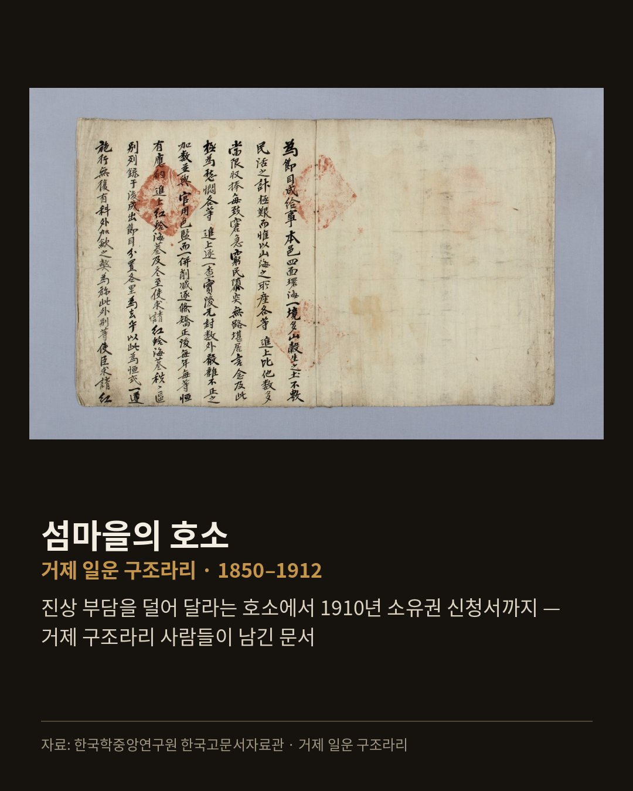
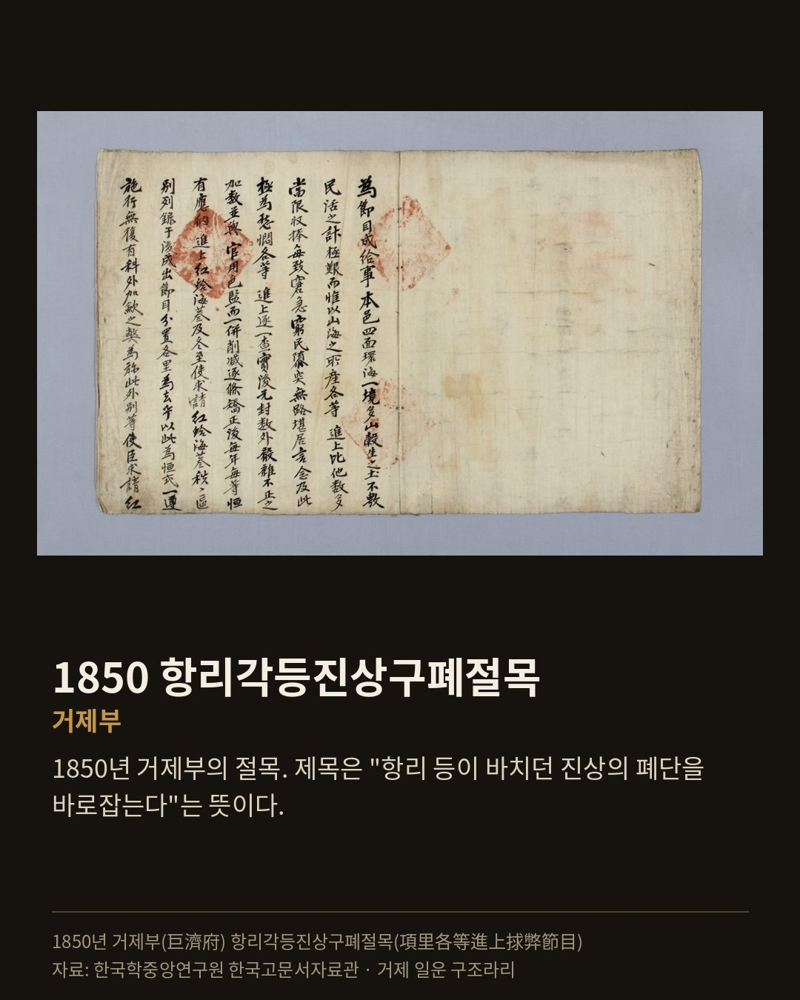
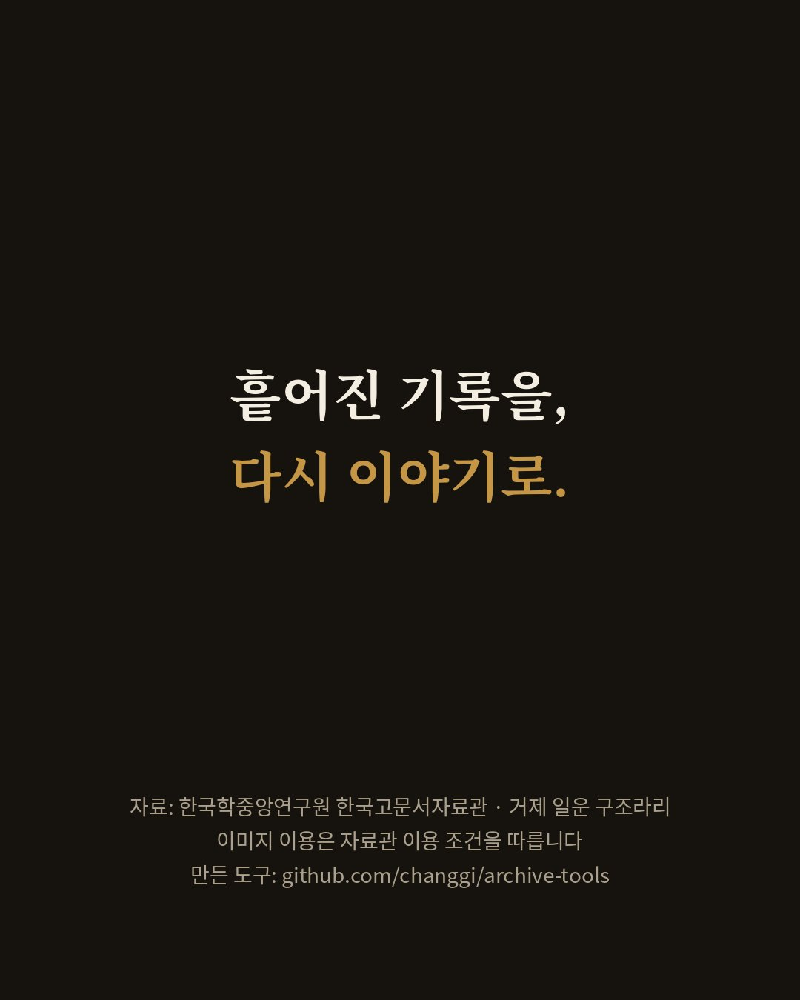

# EP.10 섬마을의 호소

거제 일운 구조라리 (마을) · 진상 부담을 덜어 달라는 호소에서 1910년 소유권 신청서까지 — 거제 구조라리 사람들이 남긴 문서

- 🌐 [전시 웹페이지](https://changgi.github.io/archive-tools/examples/gujora/exhibit.html) · [수업 활동지](https://changgi.github.io/archive-tools/examples/gujora/handout.html)
- 🎬 영상: [릴스 9:16](https://changgi.github.io/archive-tools/examples/media/ep10-gujora_reel.mp4) · [가로 16:9](https://changgi.github.io/archive-tools/examples/media/ep10-gujora_wide.mp4) · 홍보 글: [`promo.md`](promo.md)
- 카드뉴스: [`cards/`](cards/) · SNS 글: [`sns.txt`](sns.txt) · 에디팅 결과: [`selection.csv`](selection.csv)

## 이야기 (영상 내레이션)

> 섬마을 사람들은 무엇을 호소했을까요?
> 마을 사람들은 이름을 나란히 적은 등장으로 관에 호소했습니다.
> 1850년, 거제부는 진상의 폐단을 바로잡는 절목을 내리고,
> 1888년엔 구조라·양화·망치 세 마을의 폐단을 막는 절목이 나옵니다.
> 그리고 1910년, 주민은 산의 소유권을 신청서로 증명해야 했습니다.
> 1912년, 토지 소유권 보존 증명 신청까지.
> 청원에서 소유권 신청서까지, 한 마을의 문서에 시대의 변화가 담겼습니다.

| 표지 | 1번 카드 | 마무리 |
|---|---|---|
|  |  |  |

## 선별 문서 (8점)

| # | 연도 | 유형 | 문서명 | 원본 |
|---|---|---|---|---|
| 1 | 1850 | 항리각등진상구폐절목 | 1850년 거제부(巨濟府) 항리각등진상구폐절목(項里各等進上捄弊節目) | [원본 보기](https://archive.aks.ac.kr/viewer/viewer.do#imgnode.do?itemId=book&gubun=booktree&depth=6&upPath=07%5E0748%5EL074801%5EL074801F02%5EL074801F0203&dataId=G002%2BAKS%2BKSM-XC.1850.4831-20101008.B023a_035_00007_YYY&itemType=) |
| 2 | 1854 | 절목 | 1854년 암행어사(暗行御史) 절목(節目) | [원본 보기](https://archive.aks.ac.kr/viewer/viewer.do#imgnode.do?itemId=book&gubun=booktree&depth=6&upPath=07%5E0748%5EL074801%5EL074801F02%5EL074801F0203&dataId=G002%2BAKS%2BKSM-XC.1854.4831-20101008.B023a_035_00008_YYY&itemType=) |
| 3 | 1888 | 삼동방폐절목 | 1888년 거제부(巨濟府) 구조라양화망치삼동방폐절목(舊助羅楊花望峙三洞防弊節目) | [원본 보기](https://archive.aks.ac.kr/viewer/viewer.do#imgnode.do?itemId=book&gubun=booktree&depth=6&upPath=07%5E0748%5EL074801%5EL074801F02%5EL074801F0203&dataId=G002%2BAKS%2BKSM-XC.1888.4831-20101008.B023a_035_00011_YYY&itemType=) |
| 4 | 1909 | 고시대소인민 | 1909년 거제군(巨濟郡) 고시대소인민(告示大小人民) | [원본 보기](https://archive.aks.ac.kr/viewer/viewer.do#imgnode.do?itemId=book&gubun=booktree&depth=6&upPath=07%5E0748%5EL074801%5EL074801F02%5EL074801F0203&dataId=G002%2BAKS%2BKSM-XC.1909.4831-20101008.B023a_035_00037_YYY&itemType=) |
| 5 | 1910 | 산판소유권신청서 | 1910년 노상헌(盧祥憲) 산판소유권신청서(山坂所有權申請書)－1 | [원본 보기](https://archive.aks.ac.kr/viewer/viewer.do#imgnode.do?itemId=book&gubun=booktree&depth=6&upPath=07%5E0748%5EL074801%5EL074801F02%5EL074801F0202&dataId=G002%2BAKS%2BKSM-XB.1910.4831-20101008.B023a_035_00031_YYY&itemType=) |
| 6 | 1912 | 토지소유권보존증명신청 | 1912년 김재진(金再鎭) 토지소유권보존증명신청(土地所有權保存證明申請) | [원본 보기](https://archive.aks.ac.kr/viewer/viewer.do#imgnode.do?itemId=book&gubun=booktree&depth=6&upPath=07%5E0748%5EL074801%5EL074801F02%5EL074801F0202&dataId=G002%2BAKS%2BKSM-XB.1912.4831-20101008.B023a_035_00036_YYY&itemType=) |
| 7 | — | 등장 | 무자년 항리거민(項里居民) 등장(等狀)－1 | [원본 보기](https://archive.aks.ac.kr/viewer/viewer.do#imgnode.do?itemId=book&gubun=booktree&depth=6&upPath=07%5E0748%5EL074801%5EL074801F02%5EL074801F0202&dataId=G002%2BAKS%2BKSM-XB.0000.4831-20101008.B023a_035_00118_XXX&itemType=) |
| 8 | — | 등장 | 임자년 조라동민(助羅洞民) 등장(等狀) | [원본 보기](https://archive.aks.ac.kr/viewer/viewer.do#imgnode.do?itemId=book&gubun=booktree&depth=6&upPath=07%5E0748%5EL074801%5EL074801F02%5EL074801F0202&dataId=G002%2BAKS%2BKSM-XB.0000.4831-20101008.B023a_035_00125_XXX&itemType=) |

이야기는 문서명과 이미지에서 보이는 것에 근거한 초안이며(검토 전 "초안" 표시), 판독·해석은 원문 확인이 필요합니다.
이미지: 한국학중앙연구원 한국고문서자료관 소장·제공. "원본" 링크를 누르면 자료관 뷰어에서 그 문서가 열립니다. 재사용은 자료관에 문의하세요(소장처 동의 필요).
