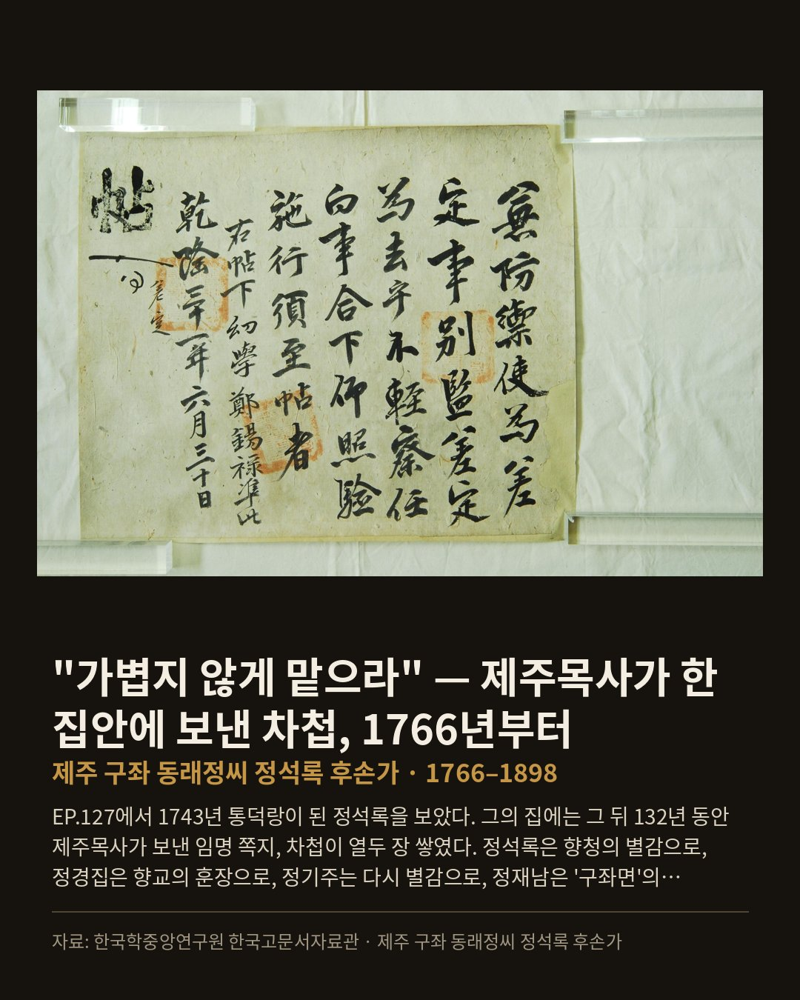
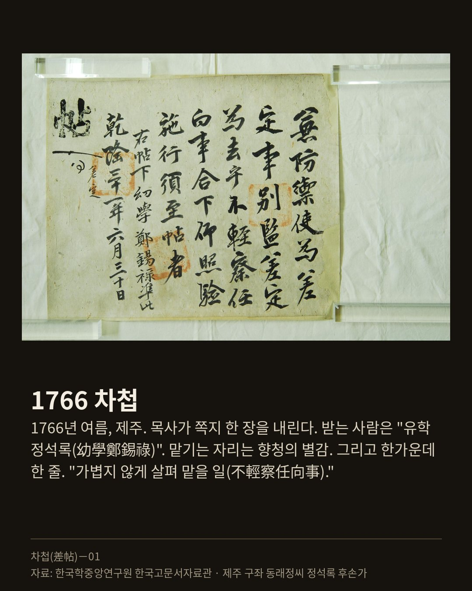
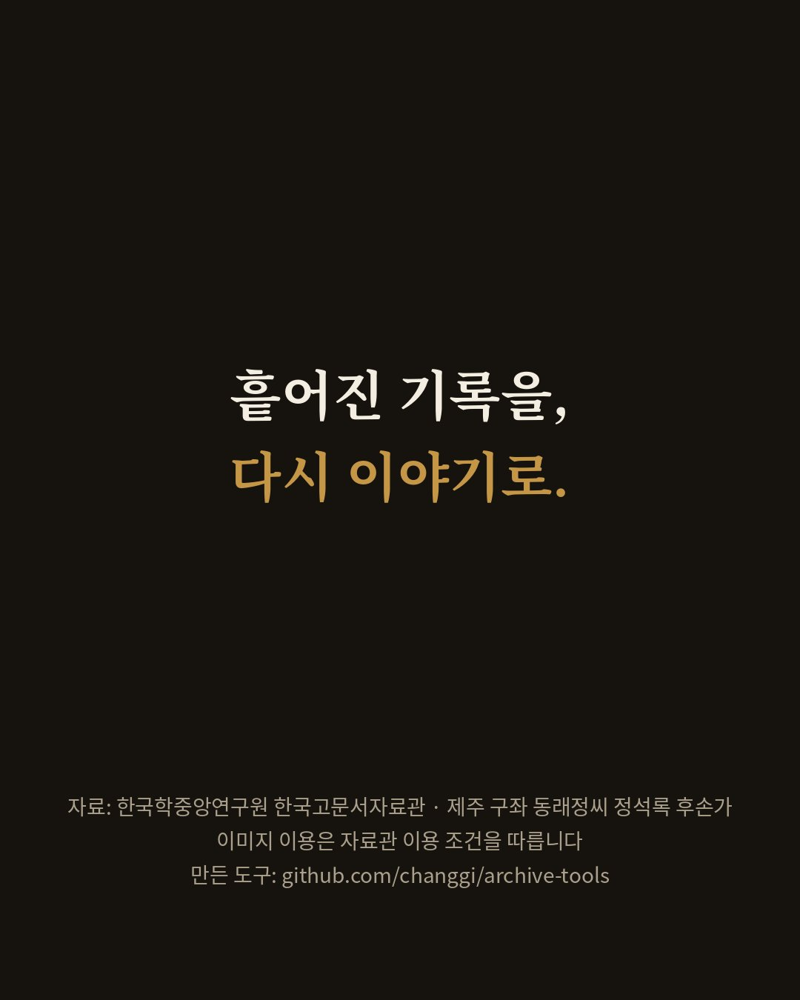

# EP.179 "가볍지 않게 맡으라" — 제주목사가 한 집안에 보낸 차첩, 1766년부터 1898년까지

제주 구좌 동래정씨 정석록 후손가 (문중) · EP.127에서 1743년 통덕랑이 된 정석록을 보았다. 그의 집에는 그 뒤 132년 동안 제주목사가 보낸 임명 쪽지, 차첩이 열두 장 쌓였다. 정석록은 향청의 별감으로, 정경집은 향교의 훈장으로, 정기주는 다시 별감으로, 정재남은 '구좌면'의 풍헌으로. 받는 이름은 대마다 바뀌었지만, 쪽지의 한가운데에는 늘 같은 말이 있었다. '가볍지 않게 살펴 맡으라'

- 🌐 [전시 웹페이지](https://changgi.github.io/archive-tools/examples/gujwa-jeong-chacheop/exhibit.html) (한자 위 한글 독음 · 원문 해석) · [수업 활동지](https://changgi.github.io/archive-tools/examples/gujwa-jeong-chacheop/handout.html)
- 🎬 영상: [릴스 9:16](https://changgi.github.io/archive-tools-next/media/ep179-gujwa-jeong-chacheop_reel.mp4) · [가로 16:9](https://changgi.github.io/archive-tools-next/media/ep179-gujwa-jeong-chacheop_wide.mp4) · 홍보 글: [`promo.md`](promo.md)
- 카드뉴스: [`cards/`](cards/) · SNS 글: [`sns.txt`](sns.txt) · 판독·해석 표: [`selection.csv`](selection.csv)

<!-- DELIVERY -->
## 전달 에디팅 — 이 기록을 이렇게 전합니다

- **핵심 정서** — 담담한 자부심
- **한 문장** — 향촌의 자리(별감 · 훈장 · 풍헌)는 수령이 쪽지 한 장으로 맡겼다 — 그 쪽지가 대를 이어 한 집에 쌓였다는 것은, 그 집안이 마을에서 맡은 몫이 그만큼 오래 이어졌다는 뜻이다.
- **열기** — 132년 동안, 한 집안에 같은 문장의 임명 쪽지가 왔습니다.
- **펼치기** — 차첩－01 → 차첩－06 → 차첩－09 → 차첩－12 (1766–1898년) — 1766 정석록 별감 → 1820 정경집 향교 훈장 → 1864 정기주 별감 → 1898 정재남 구좌면 풍헌으로, 연도와 대(代) 순서대로 놓았습니다.
- **절정** — "가볍지 않게 살펴 맡을 일(不輕察任向事)" — 화면·공간에서 이 한 줄만 크게, 소리를 줄여 집중
- **여운** — 132년 동안 같은 문장을 받은 집안에게, 그 '가볍지 않음'은 어떤 무게였을까요? — 질문으로 끝내고 답은 보는 사람에게
- **감각과 물질** — 네 장 모두 한가운데의 '不輕察任向事' — 그리고 1898년 장의 '舊左面' · 어보·관인 탁본 스탬프를 찍어 보는 체험 · 책장을 넘기는 소리, 확대 열람대
- **통로와 매개** — 온라인: 릴스(열기) → 카드뉴스(펼치기) → 전시 웹페이지(절정·원문) → 비하인드 카드(여운) / 오프라인: 원본 크기 복제·낭독·참여 벽 / 남기기: 활동지·질문 카드
- **여운 장치** — 집안 어른이 마을에서 맡았던 자리(이장 · 계장 · 조합장) 물어보기
- **전달 에디팅 전** — 4건의 문서를 1766–1898년 연대순으로 놓고 문서명 · 유형 · 해설을 붙인다 — 정확하지만, 지나가면 잊힌다.
- **전달 에디팅 후** — 핵심 정서는 「담담한 자부심」. 「132년 동안, 한 집안에 같은 문장의 임명 쪽지가 왔습니다.」로 열고, 문서를 대비와 순서로 펼친 뒤, "가볍지 않게 살펴 맡을 일(不輕察任向事)"에서 멈춘다. 네 장 모두 한가운데의 '不輕察任向事' — 그리고 1898년 장의 '舊左面'. 마지막엔 「집안 어른이 마을에서 맡았던 자리(이장 · 계장 · 조합장) 물어보기」로 보는 사람이 자기 이야기를 남기고 떠나게 한다.

전문: [`delivery.md`](delivery.md)
<!-- /DELIVERY -->

<!-- CURATOR -->
## 비하인드 — 큐레이터 노트

- **왜 이 문서들인가** — EP.127에서 이 집안의 1743년 정석록 고신과 1825년 정익환의 진사 시권 · 백패를 읽었습니다. 같은 집안에 제주목사가 보낸 차첩 열두 장이 1766년부터 1898년까지 이어져 있어, 대가 바뀔 때마다 한 장씩 네 장을 골랐습니다.
- **전하고 싶은 것** — 향촌의 자리(별감 · 훈장 · 풍헌)는 수령이 쪽지 한 장으로 맡겼다 — 그 쪽지가 대를 이어 한 집에 쌓였다는 것은, 그 집안이 마을에서 맡은 몫이 그만큼 오래 이어졌다는 뜻이다.
- **이렇게 보이길 바랐다** — 1766 정석록 별감 → 1820 정경집 향교 훈장 → 1864 정기주 별감 → 1898 정재남 구좌면 풍헌으로, 연도와 대(代) 순서대로 놓았습니다.
- **이렇게 써 주세요** — 조선 후기 차첩(差帖)과 향임 임명, 향청(별감)과 향교(훈장), 면의 풍헌, 제주목사 겸 방어사 · 찰리사, 한 집안이 지역 사회에서 이어 간 역할 수업에 쓰세요.
- **만들며 있었던 일** — 연도는 자료관 목록과 연호(乾隆 · 嘉慶 · 同治 · 光武)를 맞추었습니다. 네 사람의 관계(아버지 · 아들 · 손자)는 이 차첩들로 확인하지 않았고, 이름만 적었습니다. 발급자 아래의 서명(押)은 판독하지 않았습니다. 1898년의 '兼察理使'는 당시 제주목사가 겸한 직함으로 보았으나 확정하지 않았습니다.
- **남겨 둔 질문** — 132년 동안 같은 문장을 받은 집안에게, 그 '가볍지 않음'은 어떤 무게였을까요?
- **제작 기록** — 문서 4건 · 1766–1898년 · 원본 사진 4면(문서 전체) · 원문 판독 4건 · 번역 4건

전문: [`curator.md`](curator.md) · 비하인드 카드: [`behind/`](behind/) · 채널별 홍보안: [`channels.md`](channels.md)
<!-- /CURATOR -->

## 이야기 — 사료가 말하는 대로

132년 동안, 한 집안에 같은 문장의 임명 쪽지가 왔습니다.

> **1766 차첩** — 1766년 여름, 제주. 목사가 쪽지 한 장을 내린다. 받는 사람은 "유학 정석록(幼學鄭錫祿)". 맡기는 자리는 향청의 별감. 그리고 한가운데 한 줄. "가볍지 않게 살펴 맡을 일(不輕察任向事)."
> **1820 차첩** — 쉰네 해 뒤, 1820년 가을. 같은 집에 같은 모양의 쪽지가 온다. 이름이 바뀌었다. "유학 정경집(幼學鄭景集)." 자리도 바뀌었다. 이번에는 향교에서 아이들을 가르치는 훈장. 문장은 그대로다. "가볍지 않게 살펴 맡을 일."
> **1864 차첩** — 다시 마흔네 해, 1864년. 이번 이름은 "유학 정기주(幼學鄭基周)". 자리는 별감. 아흔여덟 해 전 정석록이 받았던 그 자리다. 글씨는 조금 흘려졌다. 그래도 그 한 줄은 남았다. "가볍지 않게 살펴 맡을 일."
> **1898 차첩** — 그리고 1898년 봄, 대한제국. 쪽지를 내리는 이의 직함이 바뀌었다. "겸찰리사(兼察理使)." 받는 이는 "전 풍헌 정재남(前風憲鄭在南)". 맡기는 곳은 "구좌면(舊左面)". 지금의 구좌읍이다. 백서른두 해, 이름도 나라도 바뀌었다. 한가운데 한 줄만 남았다. "가볍지 않게 살펴 맡을 일."

| 표지 | 1번 카드 | 마무리 |
|---|---|---|
|  |  |  |

## 선별 문서 (4점)

| # | 연도 | 유형 | 문서명 | 원본 |
|---|---|---|---|---|
| 1 | 1766 | 차첩 | 차첩(差帖)－01 | [원본 보기](https://archive.aks.ac.kr/viewer/viewer.do#imgnode.do?itemId=book&gubun=booktree&depth=6&upPath=01%5E0168%5EL016807%5EL016807F02%5EL016807F0201&dataId=G002%2BAKS%2BKSM-XC.1766.5011-20220125.B079a_110_00677_XXX&itemType=) |
| 2 | 1820 | 차첩 | 차첩(差帖)－06 | [원본 보기](https://archive.aks.ac.kr/viewer/viewer.do#imgnode.do?itemId=book&gubun=booktree&depth=6&upPath=01%5E0168%5EL016807%5EL016807F02%5EL016807F0201&dataId=G002%2BAKS%2BKSM-XC.1820.5011-20220125.B079a_110_00682_XXX&itemType=) |
| 3 | 1864 | 차첩 | 차첩(差帖)－09 | [원본 보기](https://archive.aks.ac.kr/viewer/viewer.do#imgnode.do?itemId=book&gubun=booktree&depth=6&upPath=01%5E0168%5EL016807%5EL016807F02%5EL016807F0201&dataId=G002%2BAKS%2BKSM-XC.1864.5011-20220125.B079a_110_00685_XXX&itemType=) |
| 4 | 1898 | 차첩 | 차첩(差帖)－12 | [원본 보기](https://archive.aks.ac.kr/viewer/viewer.do#imgnode.do?itemId=book&gubun=booktree&depth=6&upPath=01%5E0168%5EL016807%5EL016807F02%5EL016807F0201&dataId=G002%2BAKS%2BKSM-XC.1898.5011-20220125.B079a_110_00688_XXX&itemType=) |

## 원문 판독과 해석

### 1. 차첩(差帖)－01

**원문 판독**

```
兼防禦使爲差
定事別監差定
爲去乎不輕察任
向事合下仰照驗
施行須至帖者
右帖下幼學鄭錫祿準此
乾隆三十一年六月三十日
帖
(서명)
```

**원문 해석** 겸방어사가 차정하는 일. 별감으로 차정하니 가볍지 않게 살펴 맡을 일. 이에 내려보내니 살펴 시행하라. 첩에 이른 대로 하라. 위 첩을 유학 정석록에게 내리니 이대로 하라. 건륭 31년(1766) 6월 30일. 첩. (서명)

**해제** 1766년(영조 42) 6월, 제주목사가 유학 정석록(鄭錫祿)을 별감(別監)으로 임명하며 내린 차첩(差帖)입니다. 제주목사는 방어사(防禦使)를 겸했으므로 첫머리를 '겸방어사'로 썼습니다. 별감은 고을의 양반 자치 기구인 향청(鄕廳)에서 좌수를 도와 일을 맡는 자리입니다. 차첩은 수령이 향임 · 군임을 맡길 때 쓰는 짧은 임명장으로, '가볍지 않게 살펴 맡으라(不輕察任)'와 '첩에 이른 대로 하라(須至帖者)'가 정해진 문장입니다. 왼쪽에 큰 글자 '帖'과 수령의 서명이 있고, 관인이 세 군데 찍혔습니다. 정석록은 EP.127에서 1743년 통덕랑이 된 인물입니다.

### 2. 차첩(差帖)－06

**원문 판독**

```
兼防禦使爲差定事
鄕校訓長差定不輕察
任向事合下仰照驗施
行須至帖者
右帖下幼學鄭景集準此
嘉慶二十五年十月 日
帖
(서명)
```

**원문 해석** 겸방어사가 차정하는 일. 향교 훈장으로 차정하니 가볍지 않게 살펴 맡을 일. 이에 내려보내니 살펴 시행하라. 첩에 이른 대로 하라. 위 첩을 유학 정경집에게 내리니 이대로 하라. 가경 25년(1820) 10월 일. 첩. (서명)

**해제** 54년 뒤인 1820년(순조 20), 같은 집안의 정경집(鄭景集)을 향교 훈장(鄕校訓長)으로 임명한 차첩입니다. 향교는 고을의 공립 교육 · 제사 기관이고, 훈장은 그곳에서 유생을 가르치는 자리입니다. 향청의 별감이 고을 행정을 돕는 자리라면, 훈장은 교육을 맡는 자리입니다. 문장은 직임 이름만 바뀌었을 뿐 1766년과 같습니다. 이 집안에는 이 무렵 정경집 앞으로 온 차첩이 여러 장 더 남아 있습니다. 5년 뒤인 1825년, 같은 집안의 정익환이 진사시에 합격합니다(EP.127).

### 3. 차첩(差帖)－09

**원문 판독**

```
兼防禦使爲差定事別
監差定不輕察任向事
合下仰照驗施行須至帖
者
右帖下幼學鄭基周準此
同治三年六月 日
帖
(서명)
```

**원문 해석** 겸방어사가 차정하는 일. 별감으로 차정하니 가볍지 않게 살펴 맡을 일. 이에 내려보내니 살펴 시행하라. 첩에 이른 대로 하라. 위 첩을 유학 정기주에게 내리니 이대로 하라. 동치 3년(1864) 6월 일. 첩. (서명)

**해제** 1864년(고종 1) 6월, 정기주(鄭基周)를 향청 별감으로 임명한 차첩입니다. 98년 전 정석록이 받은 것과 같은 자리입니다. 세월이 지나면서 글씨는 굵은 해서에서 흘림이 섞인 행서로 바뀌었고, '別監差定爲去乎'의 이두 '爲去乎'가 빠져 더 짧아졌지만, 문장의 뼈대는 그대로입니다. 향임은 대체로 고을의 이름 있는 집안에서 돌아가며 맡았으므로, 같은 집안이 대를 이어 같은 자리를 받는 일은 그 집안의 지역 내 위치를 보여 줍니다.

### 4. 차첩(差帖)－12

**원문 판독**

```
兼察理使爲差定事
舊左面風憲差定不輕
察任向事合下仰照驗
施行須至帖者
右帖下前風憲鄭在南準此
光武二年閏三月 日
(서명)
```

**원문 해석** 겸찰리사가 차정하는 일. 구좌면 풍헌으로 차정하니 가볍지 않게 살펴 맡을 일. 이에 내려보내니 살펴 시행하라. 첩에 이른 대로 하라. 위 첩을 전 풍헌 정재남에게 내리니 이대로 하라. 광무 2년(1898) 윤3월 일. (서명)

**해제** 1898년(광무 2) 윤3월, 대한제국 시기에 정재남(鄭在南)을 구좌면(舊左面) 풍헌(風憲)으로 임명한 차첩입니다. 풍헌은 면 단위에서 풍속을 살피고 세금 · 호적 등의 일을 맡던 향임입니다. 받는 이를 '전 풍헌(前風憲)'이라 불러, 이전에도 이 자리를 맡았던 사람임을 알 수 있습니다. '舊左面'은 지금의 제주시 구좌읍으로 이어지는 이름입니다. 발급자는 '겸방어사'가 아니라 '겸찰리사(兼察理使)'로 바뀌었는데, 제도가 달라진 이 시기 제주목사가 겸한 직함으로 보입니다. 1766년부터 132년 동안 문장은 거의 그대로였습니다.

판독·해석·이야기는 이미지에 근거한 초안이며(검토 전 "초안" 표시), 정확한 판독은 원문 확인이 필요합니다. □는 읽지 못한 글자, (?)는 불확실한 글자입니다.
이미지: 한국학중앙연구원 한국고문서자료관 소장·제공. "원본" 링크를 누르면 자료관 뷰어에서 그 문서가 열립니다. 재사용은 자료관에 문의하세요(소장처 동의 필요).
