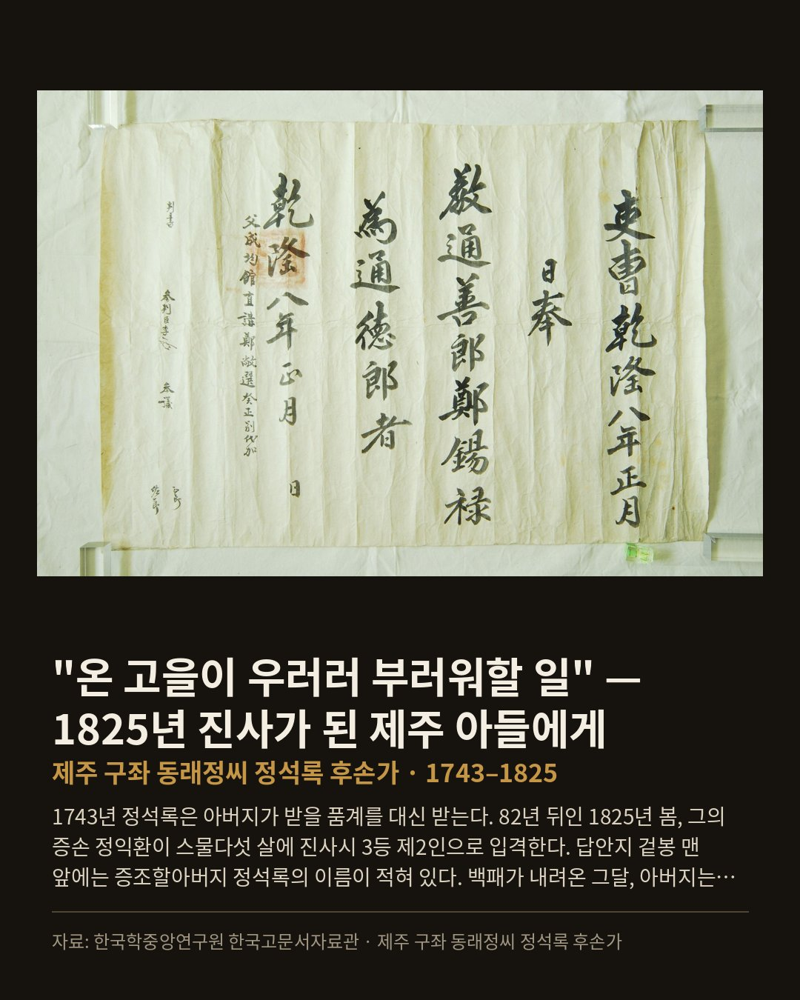
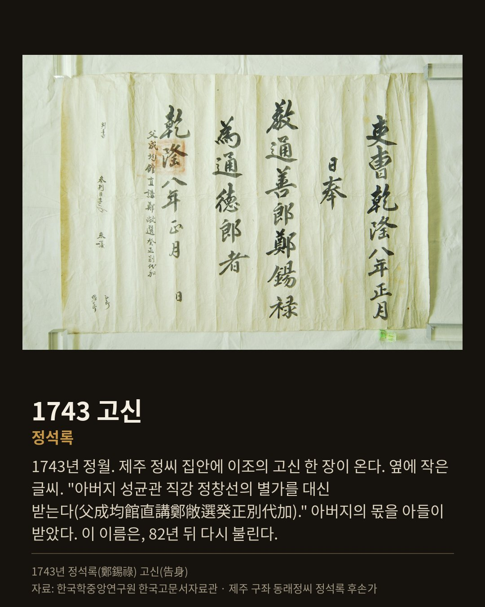
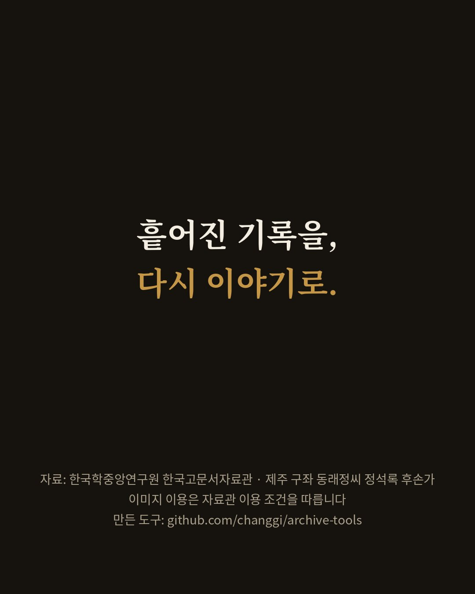

# EP.127 "온 고을이 우러러 부러워할 일" — 1825년 진사가 된 제주 아들에게 아버지가 준 밭 두 뙈기

제주 구좌 동래정씨 정석록 후손가 (문중) · 1743년 정석록은 아버지가 받을 품계를 대신 받는다. 82년 뒤인 1825년 봄, 그의 증손 정익환이 스물다섯 살에 진사시 3등 제2인으로 입격한다. 답안지 겉봉 맨 앞에는 증조할아버지 정석록의 이름이 적혀 있다. 백패가 내려온 그달, 아버지는 아들에게 밭 두 뙈기를 따로 떼어 주는 문서를 쓴다. 서울 집 자제도 어려운 일을 먼 고을의 우리 집에서 해냈으니, 한 집안의 경사일 뿐 아니라 온 고을이 우러러 부러워할 일이라고

- 🌐 [전시 웹페이지](https://changgi.github.io/archive-tools/examples/gujwa-jeong/exhibit.html) (한자 위 한글 독음 · 원문 해석) · [수업 활동지](https://changgi.github.io/archive-tools/examples/gujwa-jeong/handout.html)
- 🎬 영상: [릴스 9:16](https://changgi.github.io/archive-tools/examples/media/ep127-gujwa-jeong_reel.mp4) · [가로 16:9](https://changgi.github.io/archive-tools/examples/media/ep127-gujwa-jeong_wide.mp4) · 홍보 글: [`promo.md`](promo.md)
- 카드뉴스: [`cards/`](cards/) · SNS 글: [`sns.txt`](sns.txt) · 판독·해석 표: [`selection.csv`](selection.csv)

<!-- DELIVERY -->
## 전달 에디팅 — 이 기록을 이렇게 전합니다

- **핵심 정서** — 뿌듯함
- **한 문장** — 먼 섬에서 나온 진사 한 명은 한 집안의 경사를 넘어 고을의 자랑이었다 — 아버지는 그 기쁨을 밭 두 뙈기로 남겼다.
- **열기** — 아들이 진사가 되자, 아버지는 밭 두 뙈기를 떼어 주며 이렇게 썼습니다.
- **펼치기** — 정석록 고신 → 정익환 진사시 시권 → 정익환 진사 백패 → 정익환 별급문 (1743–1825년) — 1743년 증조 정석록의 고신 → 1825년 시권 겉봉의 '증조 통덕랑 석록' → 백패 → 아버지의 별급문 순으로, 82년을 건너 이어진 이름과 한 아버지의 기쁨이 보이게 구성했습니다.
- **절정** — "한 집안의 경사일 뿐 아니라, 온 고을이 우러러 부러워할 일이다(擧州之欽羨)" — 화면·공간에서 이 한 줄만 크게, 소리를 줄여 집중
- **여운** — 밭 두 뙈기를 받은 정익환은, 그 밭을 보며 무엇을 다짐했을까요? — 질문으로 끝내고 답은 보는 사람에게
- **감각과 물질** — 흰 백패 옆에 행서로 빽빽한 아버지의 별급문 한 장 · 어보·관인 탁본 스탬프를 찍어 보는 체험 · 시험장 책상과 답안지 체험 · 흰 종이 한 장에 조명 하나
- **통로와 매개** — 온라인: 릴스(열기) → 카드뉴스(펼치기) → 전시 웹페이지(절정·원문) → 비하인드 카드(여운) / 오프라인: 원본 크기 복제·낭독·참여 벽 / 남기기: 활동지·질문 카드
- **여운 장치** — 가장 기뻤던 날 받은 축하 한 줄 떠올리기
- **전달 에디팅 전** — 4건의 문서를 1743–1825년 연대순으로 놓고 문서명 · 유형 · 해설을 붙인다 — 정확하지만, 지나가면 잊힌다.
- **전달 에디팅 후** — 핵심 정서는 「뿌듯함」. 「아들이 진사가 되자, 아버지는 밭 두 뙈기를 떼어 주며 이렇게 썼습니다.」로 열고, 문서를 대비와 순서로 펼친 뒤, "한 집안의 경사일 뿐 아니라, 온 고을이 우러러 부러워할 일이다(擧州之欽羨)"에서 멈춘다. 흰 백패 옆에 행서로 빽빽한 아버지의 별급문 한 장. 마지막엔 「가장 기뻤던 날 받은 축하 한 줄 떠올리기」로 보는 사람이 자기 이야기를 남기고 떠나게 한다.

전문: [`delivery.md`](delivery.md)
<!-- /DELIVERY -->

<!-- CURATOR -->
## 비하인드 — 큐레이터 노트

- **왜 이 문서들인가** — 진사 백패와 같은 달에 쓴 별급문이 있었습니다. 축하의 말을 재산 문서에 적은 아버지의 문장이 마음에 남았습니다.
- **전하고 싶은 것** — 먼 섬에서 나온 진사 한 명은 한 집안의 경사를 넘어 고을의 자랑이었다 — 아버지는 그 기쁨을 밭 두 뙈기로 남겼다.
- **이렇게 보이길 바랐다** — 1743년 증조 정석록의 고신 → 1825년 시권 겉봉의 '증조 통덕랑 석록' → 백패 → 아버지의 별급문 순으로, 82년을 건너 이어진 이름과 한 아버지의 기쁨이 보이게 구성했습니다.
- **이렇게 써 주세요** — 조선의 과거와 진사 · 성균관, 별급과 분재 같은 재산 상속, 제주 사람의 과거 급제, 축하와 선물의 문화 수업에 쓰세요.
- **만들며 있었던 일** — 고신 · 백패는 정서라 확실하나 별급문은 행서 · 초서라 땅이름과 몇 글자를 (?)로 두었고 재주(아버지)의 이름을 읽지 못했습니다. 시권은 겉봉과 부전지 위주로만 판독했습니다. '金' 큰 글씨의 뜻, 정창선의 대가 사정, 밭의 정확한 위치는 확인하지 않았습니다.
- **남겨 둔 질문** — 밭 두 뙈기를 받은 정익환은, 그 밭을 보며 무엇을 다짐했을까요?
- **제작 기록** — 문서 4건 · 1743–1825년 · 원본 사진 5면(문서 전체) · 원문 판독 4건 · 번역 4건 · 못 읽은 글자 □ 6 · 불확실 (?) 26 · 해제에 "확인 필요"를 단 문서 1건

전문: [`curator.md`](curator.md) · 비하인드 카드: [`behind/`](behind/) · 채널별 홍보안: [`channels.md`](channels.md)
<!-- /CURATOR -->

## 이야기 — 사료가 말하는 대로

아들이 진사가 되자, 아버지는 밭 두 뙈기를 떼어 주며 이렇게 썼습니다.

> **1743 고신** — 1743년 정월. 제주 정씨 집안에 이조의 고신 한 장이 온다. 옆에 작은 글씨. "아버지 성균관 직강 정창선의 별가를 대신 받는다(父成均館直講鄭敞選癸正別代加)." 아버지의 몫을 아들이 받았다. 이 이름은, 82년 뒤 다시 불린다.
> **1825 시권** — 1825년 봄, 서울 회시장. 스물다섯 살 정익환의 답안지 겉봉에 집안의 이름이 줄지어 적힌다. 그 셋째 줄. "증조 통덕랑 석록(曾祖通德郞錫祿)." 그리고 노란 종이 한 장이 붙는다. "진사 3등 제2인(進士三等第二人)."
> **1825 백패** — 그달, 흰 종이가 온다. "유학 정익환은 진사 3등 제2인으로 입격하였다(幼學鄭益煥進士三等第二人入格者)." 바다 건너 제주, 구좌의 집으로.
> **1825 분재기** — 백패가 온 지 며칠 뒤, 아버지가 맏아들에게 밭 두 뙈기를 떼어 주는 문서를 쓴다. "한 집안의 경사일 뿐 아니라, 온 고을이 우러러 부러워할 일(擧州之欽羨)이다." 아버지의 기쁨은, 밭 두 뙈기만큼 무거웠다.

| 표지 | 1번 카드 | 마무리 |
|---|---|---|
|  |  |  |

## 선별 문서 (4점)

| # | 연도 | 유형 | 문서명 | 원본 |
|---|---|---|---|---|
| 1 | 1743 | 고신 | 1743년 정석록(鄭錫祿) 고신(告身) | [원본 보기](https://archive.aks.ac.kr/viewer/viewer.do#imgnode.do?itemId=book&gubun=booktree&depth=6&upPath=01%5E0168%5EL016807%5EL016807F02%5EL016807F0201&dataId=G002%2BAKS%2BKSM-XA.1743.5011-20220125.B079a_110_00676_XXX&itemType=) |
| 2 | 1825 | 시권 | 1825년 정익환(鄭益煥) 진사시 시권(試券) | [원본 보기](https://archive.aks.ac.kr/viewer/viewer.do#imgnode.do?itemId=book&gubun=booktree&depth=6&upPath=01%5E0168%5EL016807%5EL016807F02%5EL016807F0204&dataId=G002%2BAKS%2BKSM-XD.1825.5011-20220125.B079a_110_00693_XXX&itemType=) |
| 3 | 1825 | 백패 | 1825년 정익환(鄭益煥) 진사 백패(進士白牌) | [원본 보기](https://archive.aks.ac.kr/viewer/viewer.do#imgnode.do?itemId=book&gubun=booktree&depth=6&upPath=01%5E0168%5EL016807%5EL016807F02%5EL016807F0201&dataId=G002%2BAKS%2BKSM-XA.1825.5011-20220125.B079a_110_00675_XXX&itemType=) |
| 4 | 1825 | 분재기 | 1825년 정익환(鄭益煥) 별급문(別給文) | [원본 보기](https://archive.aks.ac.kr/viewer/viewer.do#imgnode.do?itemId=book&gubun=booktree&depth=6&upPath=01%5E0168%5EL016807%5EL016807F02%5EL016807F0205&dataId=G002%2BAKS%2BKSM-XE.1825.5011-20220125.B079a_110_00696_XXX&itemType=) |

## 원문 판독과 해석

### 1. 1743년 정석록(鄭錫祿) 고신(告身)

**원문 판독**

```
吏曹乾隆八年正月
日奉
敎通善郞鄭錫祿
爲通德郞者
乾隆八年正月　日
父成均館直講鄭敞選癸正別代加
判書
參判臣李(수결)
參議
正郞
佐郞
```

**원문 해석** 이조에서 건륭 8년(1743) 정월 일에 교지를 받들어, 통선랑 정석록을 통덕랑으로 삼는다. 건륭 8년 정월 일. (작은 글씨) 아버지 성균관 직강 정창선의 계해년 정월 별가를 대신 받음. 판서, 참판 신 이(수결), 참의, 정랑, 좌랑.

**해제** 1743년(영조 19, 乾隆 8, 癸亥) 정월 이조(吏曹)가 왕명을 받들어 정석록(鄭錫祿)의 품계를 통선랑(通善郞, 정5품 하계)에서 통덕랑(通德郞, 정5품 상계)으로 올린 고신입니다. 왼쪽의 작은 글씨 '父成均館直講鄭敞選 癸正別代加'는 이 품계가 아버지 성균관 직강 정창선(鄭敞選)에게 계해년 정월 특별히 내린 가자(加資)를 아들이 대신 받은 것(代加)임을 밝힙니다. 아버지가 이미 품계가 높아 더 올릴 수 없을 때 자식 등에게 돌려주는 방식이었습니다. 1825년 정익환의 시권에 증조 '통덕랑 석록'으로 적힌 바로 그 사람입니다.

### 2. 1825년 정익환(鄭益煥) 진사시 시권(試券)

**원문 판독**

```
幼學鄭益煥年二十五本東萊居濟州
父幼學　景集
祖學生　泰光(?)
曾祖通德郞　錫祿
外祖學生 □□□
進士三等第二人
恩門　乙酉三月二十日會試
李判書存秀 …
泮主人李東(?)思(?)祖(?)
```

**원문 해석** (겉봉) 유학 정익환, 25세, 본관 동래, 제주 거주. 아버지 유학 경집, 할아버지 학생 태광(?), 증조할아버지 통덕랑 석록, 외할아버지 학생 □□□. (붙인 종이) 진사 3등 제2인. (시관 명단) 은문 — 을유년(1825) 3월 20일 회시. 이조판서 이존수 … (끝) 반주인 이□□.

**해제** 1825년(순조 25, 乙酉) 정익환(鄭益煥)의 진사시 회시 시권(답안지) 겉면입니다. 오른쪽 겉봉에 자신과 아버지 · 할아버지 · 증조 · 외조를 적었는데, 증조가 '통덕랑 석록(通德郞 錫祿)' — 1743년 고신의 정석록입니다. 노란 부전지에 '進士三等第二人'이라 성적을 붙였고, 가운데에 '恩門 乙酉三月二十日 會試'와 함께 시험을 맡은 관원(은문)들의 이름을 줄지어 적었으며, 끝에 성균관 앞 숙소 주인인 '반주인(泮主人)'의 이름이 보입니다. 큰 먹 글씨 '金'은 겉면에 덧쓴 것으로 뜻은 확인하지 못했습니다. 다섯 장 가운데 첫 장의 겉봉 · 부전지 위주로 판독했고, 작은 글씨의 이름들은 대부분 옮기지 않았습니다.

### 3. 1825년 정익환(鄭益煥) 진사 백패(進士白牌)

**원문 판독**

```
敎旨
幼學鄭益煥進士三等
第二人入格者
道光五年三月 日
(부전지) 幼學鄭益煥進士三等第二人
```

**원문 해석** 교지. 유학 정익환은 진사 3등 제2인으로 입격한 자이다. 도광 5년(1825) 3월 일. (붙인 종이) 유학 정익환 진사 3등 제2인.

**해제** 1825년(순조 25, 道光 5, 乙酉) 3월 정익환이 진사시에 3등 제2인으로 입격하고 받은 백패(白牌)입니다. 연호 위에 어보가 찍혔고, 오른쪽에 같은 내용을 적은 노란 부전지가 붙어 있습니다. 3등 안에서 둘째 자리입니다. 같은 해 제주 애월의 김광세가 무과 회방 홍패를 받았습니다(EP.123).

### 4. 1825년 정익환(鄭益煥) 별급문(別給文)

**원문 판독**

```
道光五年乙酉三月二十三日長子益煥處別給文
右爲別給事惟我一門雖在遐(?)域世以簪纓之家門
衰替(?)薄(?)歎豈(?)免子孫矣何幸餘慶不泯
勝(?)見益煥承襲　先蔭(?)偉(?)家　聖恩君擢蓮榜
男登　國庠而時年廿有五實是京華子弟之
所難而寒門忽見不世之榮非直一家之慶
抑亦擧州之欽羨不可無別般激勸之意故
上兄(?)里內負(?)興(?)坐(?)六斗(?)高雲晉處買得來(?)四斗付
及給得(?)縣地(?)此(?)安植(?)洞負(?)畢(?)一斗五升付并
二庫田特以別給俾(?)壽(?)傳事
財主父 □□(?)
證筆仲父 □(수결)
```

**원문 해석** 도광 5년 을유(1825) 3월 23일, 맏아들 익환에게 따로 주는 문서. 따로 주는 일은 이렇다. 우리 한 집안은 비록 먼 변방(?)에 있으나 대대로 벼슬하던 집안인데, 기울어 가는 것을 한탄하며 자손이 어찌 면하랴 하였다. 다행히 조상의 남은 복이 다하지 않아, 익환이 조상의 음덕을 이어 임금의 은혜로 진사 명단(연방)에 뽑히고 나라의 학교(성균관)에 오르게 되었으니, 그때 나이 스물다섯이다. 이는 서울의 자제들도 어려워하는 일인데 한미한 집에서 세상에 드문 영광을 보았으니, 한 집안의 경사일 뿐 아니라 온 고을이 우러러 부러워할 일이다. 특별히 격려하는 뜻이 없을 수 없으므로, 상□리 안의 □□ 여섯 마지기(?) 땅 — 고운진에게서 사들인 4두지기 — 와 □□ 안식동(?)의 1두 5승지기, 아울러 밭 두 곳을 특별히 따로 주니 오래 전하도록 하라. 재주 아버지 □□. 증필 중부 □(수결).

**해제** 1825년(순조 25, 道光 5, 乙酉) 3월 23일, 아버지가 진사에 입격한 맏아들 정익환에게 밭 두 곳을 따로 떼어 준 별급문(別給文)입니다. 별급(別給)은 재산을 나누는 정식 분재와 달리 과거 급제 · 혼인 · 득남 같은 경사에 특별히 재산을 주는 일입니다. '임금의 은혜로 연방에 뽑히고 국상에 올랐다(君擢蓮榜 男登國庠)'는 진사 입격과 성균관 입학 자격을, '서울 자제들도 어려워하는 일(京華子弟之所難)'과 '온 고을이 우러러 부러워할 일(擧州之欽羨)'은 제주에서 진사가 나온 일의 무게를 말합니다. 땅의 크기는 두(斗) · 승(升)으로 씨앗 뿌리는 양을 기준으로 적었습니다. 행서 · 초서라 땅이름과 몇 글자는 (?)로 두었고, 재주(아버지)의 이름은 읽지 못했습니다. 시권의 아버지 '경집(景集)'과 같은 사람으로 보입니다.

판독·해석·이야기는 이미지에 근거한 초안이며(검토 전 "초안" 표시), 정확한 판독은 원문 확인이 필요합니다. □는 읽지 못한 글자, (?)는 불확실한 글자입니다.
이미지: 한국학중앙연구원 한국고문서자료관 소장·제공. "원본" 링크를 누르면 자료관 뷰어에서 그 문서가 열립니다. 재사용은 자료관에 문의하세요(소장처 동의 필요).
