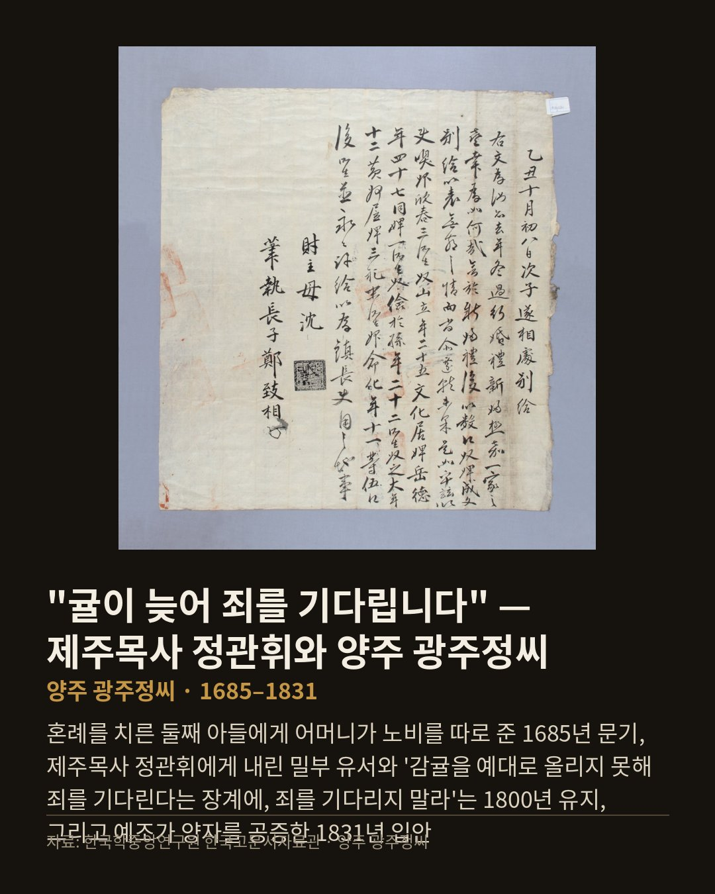
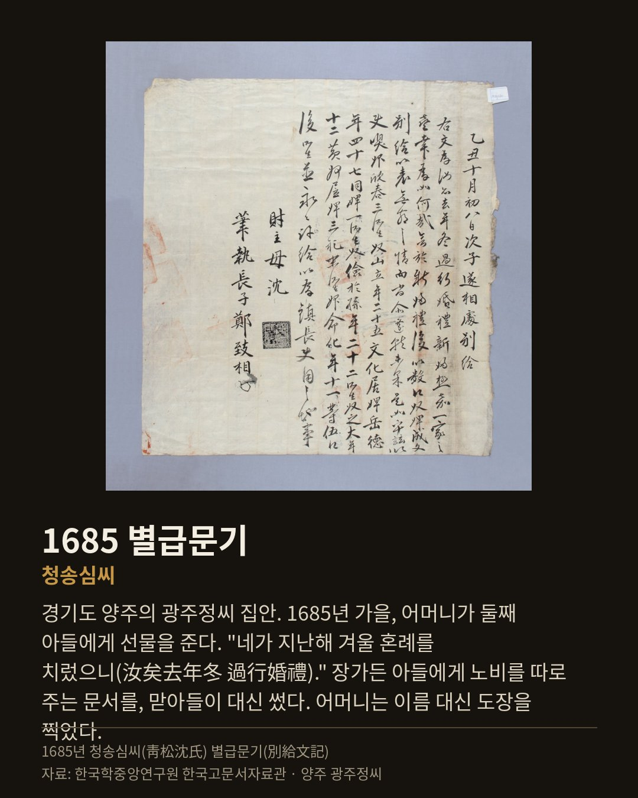
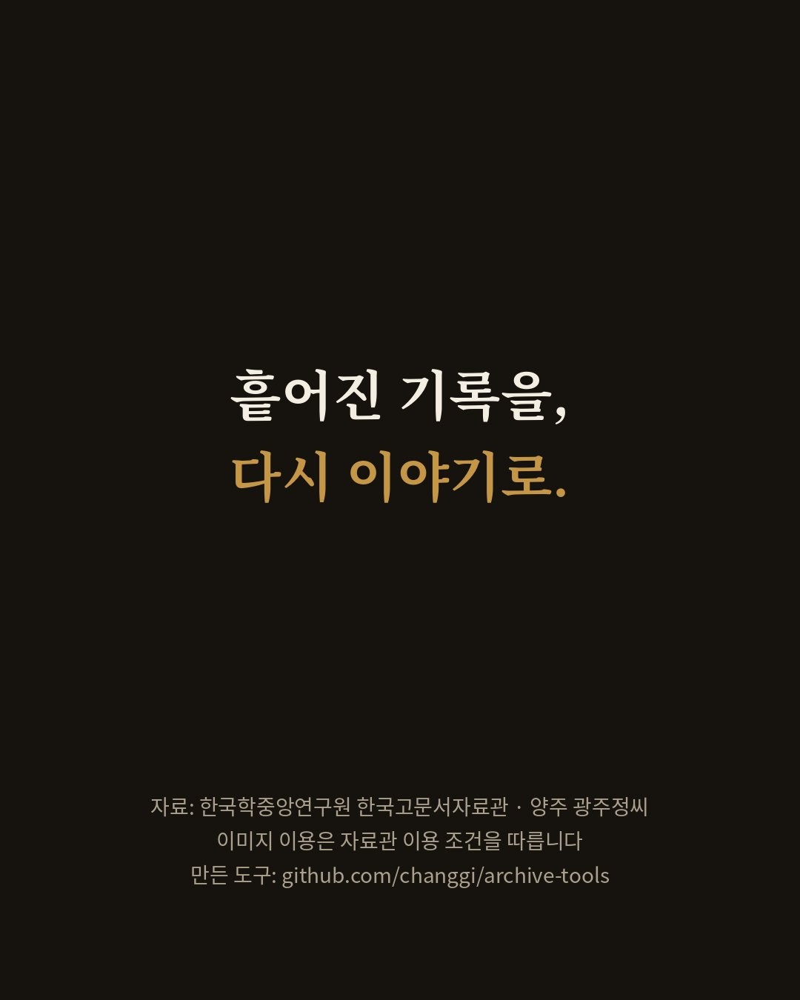

# EP.57 "귤이 늦어 죄를 기다립니다" — 제주목사 정관휘와 양주 광주정씨

양주 광주정씨 (문중) · 혼례를 치른 둘째 아들에게 어머니가 노비를 따로 준 1685년 문기, 제주목사 정관휘에게 내린 밀부 유서와 '감귤을 예대로 올리지 못해 죄를 기다린다는 장계에, 죄를 기다리지 말라'는 1800년 유지, 그리고 예조가 양자를 공증한 1831년 입안

- 🌐 [전시 웹페이지](https://changgi.github.io/archive-tools/examples/gwangju-jeong/exhibit.html) (한자 위 한글 독음 · 원문 해석) · [수업 활동지](https://changgi.github.io/archive-tools/examples/gwangju-jeong/handout.html)
- 🎬 영상: [릴스 9:16](https://changgi.github.io/archive-tools-next/media/ep57-gwangju-jeong_reel.mp4) · [가로 16:9](https://changgi.github.io/archive-tools-next/media/ep57-gwangju-jeong_wide.mp4) · 홍보 글: [`promo.md`](promo.md)
- 카드뉴스: [`cards/`](cards/) · SNS 글: [`sns.txt`](sns.txt) · 판독·해석 표: [`selection.csv`](selection.csv)


<!-- DELIVERY -->
## 전달 에디팅 — 이 기록을 이렇게 전합니다

- **핵심 정서** — 헤아림
- **한 문장** — 진상(進上) 뒤에는 날씨와 백성의 사정, 그리고 그것을 헤아린 응답이 있었다는 것.
- **열기** — 제주목사가 임금께 죄를 청했습니다. 이유는 귤이었습니다.
- **펼치기** — 청송심씨 별급문기 → 정관휘 유서 → 정관휘 유지 → 정씨 계후입안 (1685–1831년) — 혼례·밀부·감귤·양자 공증까지, 한 집안의 다른 순간을 네 장면으로 나눴습니다.
- **절정** — "두 집이 의논해 정했으나, 허가를 받기 전에 부부가 모두 죽어(未及禮斜 錫民夫妻俱爲作故)" — 화면·공간에서 이 한 줄만 크게, 소리를 줄여 집중
- **여운** — 귤이 늦은 그해, 제주 사람들은 어떤 겨울을 보냈을까요? — 질문으로 끝내고 답은 보는 사람에게
- **감각과 물질** — 귤 향, "죄를 기다리지 말라" 낭독 · 역마 방울·말발굽 소리와 함께 펼치는 두루마리
- **통로와 매개** — 온라인: 릴스(열기) → 카드뉴스(펼치기) → 전시 웹페이지(절정·원문) → 비하인드 카드(여운) / 오프라인: 원본 크기 복제·낭독·참여 벽 / 남기기: 활동지·질문 카드
- **여운 장치** — "늦어도 괜찮다고 말해 준 사람"
- **전달 에디팅 전** — 4건의 문서를 1685–1831년 연대순으로 놓고 문서명 · 유형 · 해설을 붙인다 — 정확하지만, 지나가면 잊힌다.
- **전달 에디팅 후** — 핵심 정서는 「헤아림」. 「제주목사가 임금께 죄를 청했습니다. 이유는 귤이었습니다.」로 열고, 문서를 대비와 순서로 펼친 뒤, "두 집이 의논해 정했으나, 허가를 받기 전에 부부가 모두 죽어(未及禮斜 錫民夫妻俱爲作故)"에서 멈춘다. 귤 향, "죄를 기다리지 말라" 낭독. 마지막엔 「"늦어도 괜찮다고 말해 준 사람"」로 보는 사람이 자기 이야기를 남기고 떠나게 한다.

전문: [`delivery.md`](delivery.md)
<!-- /DELIVERY -->

<!-- CURATOR -->
## 비하인드 — 큐레이터 노트

- **왜 이 문서들인가** — 제주목사가 '감귤을 예대로 올리지 못해 죄를 기다린다'고 했고, 임금이 '죄를 기다리지 말라'고 답한 문서가 있었습니다.
- **전하고 싶은 것** — 진상(進上) 뒤에는 날씨와 백성의 사정, 그리고 그것을 헤아린 응답이 있었다는 것.
- **이렇게 보이길 바랐다** — 혼례·밀부·감귤·양자 공증까지, 한 집안의 다른 순간을 네 장면으로 나눴습니다.
- **이렇게 써 주세요** — 제주 진상 제도, 왕과 지방관의 소통을 다루는 수업에 쓰세요.
- **만들며 있었던 일** — 음성 합성(TTS) 오류로 영상 제작이 한 번 멈춰 다시 만들었습니다.
- **남겨 둔 질문** — 귤이 늦은 그해, 제주 사람들은 어떤 겨울을 보냈을까요?
- **제작 기록** — 문서 4건 · 1685–1831년 · 원본 사진 6면(문서 전체) · 원문 판독 4건 · 번역 4건 · 못 읽은 글자 □ 0 · 불확실 (?) 18

전문: [`curator.md`](curator.md)
<!-- /CURATOR -->

## 이야기 — 사료가 말하는 대로

제주목사가 임금께 죄를 청했습니다. 이유는 귤이었습니다.

> **1685 별급문기** — 경기도 양주의 광주정씨 집안. 1685년 가을, 어머니가 둘째 아들에게 선물을 준다. "네가 지난해 겨울 혼례를 치렀으니(汝矣去年冬 過行婚禮)." 장가든 아들에게 노비를 따로 주는 문서를, 맏아들이 대신 썼다. 어머니는 이름 대신 도장을 찍었다.
> **1799 유서** — 1799년, 후손 정관휘는 바다 건너 제주목사가 된다. 임금은 비밀 병부를 맡긴다. "나와 경만이 홀로 결단할 일이 있으면, 밀부가 아니면 시행할 수 없다(非密符莫可施爲)."
> **1800 유지** — 이듬해 가을, 제주목사의 걱정은 귤이었다. 금귤을 예년처럼 올리지 못한 것이다. 그가 죄를 기다린다고 아뢰자 답이 온다. "금귤을 예처럼 봉해 올리지 못해 황공하여 죄를 기다린다 하니(金橘不得如例封進 惶恐待罪), 경은 죄를 기다리지 말라." 섬의 귤 한 상자가 임금께 올리는 글이 되었다.
> **1831 계후입안** — 그리고 1831년, 이 집안에 대가 끊길 일이 생긴다. 양자를 약속해 두었던 부부가 허가를 받기 전에 모두 세상을 떠났다. 예조의 입안이 그 사정을 적는다. "두 집이 의논해 정했으나, 허가를 받기 전에 부부가 모두 죽어(未及禮斜 錫民夫妻俱爲作故)." 임금의 한마디 '그리하라'로, 약속은 지켜졌다.

| 표지 | 1번 카드 | 마무리 |
|---|---|---|
|  |  |  |

## 선별 문서 (4점)

| # | 연도 | 유형 | 문서명 | 원본 |
|---|---|---|---|---|
| 1 | 1685 | 별급문기 | 1685년 청송심씨(靑松沈氏) 별급문기(別給文記) | [원본 보기](https://archive.aks.ac.kr/viewer/viewer.do#imgnode.do?itemId=book&gubun=booktree&depth=6&upPath=01%5E0141%5EL014161%5EL014161F02%5EL014161F0205&dataId=G002%2BAKS%2BKSM-XE.1685.0000-20101008.B048a_071_00064_XXX&itemType=) |
| 2 | 1799 | 유서 | 1799년 정관휘(鄭觀輝) 유서(諭書) | [원본 보기](https://archive.aks.ac.kr/viewer/viewer.do#imgnode.do?itemId=book&gubun=booktree&depth=6&upPath=01%5E0141%5EL014161%5EL014161F02%5EL014161F0201&dataId=G002%2BAKS%2BKSM-XA.1799.1111-20101008.B048a_071_00089_XXX&itemType=) |
| 3 | 1800 | 유지 | 1800년 정관휘(鄭觀輝) 유지(有旨) | [원본 보기](https://archive.aks.ac.kr/viewer/viewer.do#imgnode.do?itemId=book&gubun=booktree&depth=6&upPath=01%5E0141%5EL014161%5EL014161F02%5EL014161F0201&dataId=G002%2BAKS%2BKSM-XA.1800.1111-20101008.B048a_071_00093_XXX&itemType=) |
| 4 | 1831 | 계후입안 | 1831년 정씨(鄭氏) 계후입안(繼後立案) | [원본 보기](https://archive.aks.ac.kr/viewer/viewer.do#imgnode.do?itemId=book&gubun=booktree&depth=6&upPath=01%5E0141%5EL014161%5EL014161F02%5EL014161F0204&dataId=G002%2BAKS%2BKSM-XD.1831.1111-20101008.B048a_071_00171_XXX&itemType=) |

## 원문 판독과 해석

### 1. 1685년 청송심씨(靑松沈氏) 별급문기(別給文記)

**원문 판독**

```
乙丑十月初八日 次子遂相處別給(…)
右文爲 汝矣去年冬 過行婚禮 新婦(…)
喜幸(?)爲(?)以 何敢(?)忘(?)於新婦禮(?)後 以(…)
別給 以表(?)吾(?)一情 而(?)當(?)命(?)遂(?)(…)
史(?)奠(?)婢 欣春 三所生 奴 山立 年二十五 文化(…)
年四十七 同婢 一所生 奴 儉於孫 年二十二(…)
十二 黃(?)郊(?)居 婢 三禮 一所生 婢 命化 年(…)
後所生竝 永永許給 以爲鎭長(?)(…)
財主 母 沈 (도장)
筆執 長子 鄭致相
```

**원문 해석** 을축년(1685) 10월 8일, 둘째 아들 수상(遂相)에게 따로 주는 문서. 이 글은, 네가 지난해 겨울 혼례를 치러 새 며느리가 … 기쁘고 다행하여 … 따로 주어 내 한 가닥 정을 표한다. … 비 흔춘의 셋째 소생 노 산립(25세), … 같은 비의 첫째 소생 노 검어손(22세), … 황교에 사는 비 삼례의 첫째 소생 비 명화 … 뒤에 낳을 아이까지 함께 영영 허락하여 주니, 길이 … 재주(재산 주인) 어머니 심씨(도장). 필집(쓴 사람) 맏아들 정치상.

**해제** 1685년(숙종 11, 乙丑) 10월, 청송심씨(정씨 집안 어머니)가 지난겨울 혼례를 치른 둘째 아들 정수상(鄭遂相)에게 노비를 따로 준 별급문기입니다. 글은 맏아들 정치상(鄭致相)이 받아 썼고, 어머니는 서명 대신 네모난 도장을 찍었습니다. 혼인을 축하해 재산을 따로 주는 '혼인 별급'의 예입니다. 흘림이 섞여 노비 이름 몇 자가 불확실합니다.

### 2. 1799년 정관휘(鄭觀輝) 유서(諭書)

**원문 판독**

```
諭通政大夫全羅道兼
防禦使濟州牧使鄭
觀輝
卿受委一方 體任非
輕 凡發兵應機 安民
制敵 一應常事 自有
舊章 慮或有予與
卿獨斷處置事 非
密符莫可施爲 且意
(이하 다음 면 — 이미지 미수집)
```

**원문 해석** 통정대부 전라도 겸 방어사 제주목사 정관휘에게 이른다. 경은 한 지방을 맡았으니 그 소임이 가볍지 않다. 무릇 군사를 일으켜 기회에 대응하고 백성을 편안히 하며 적을 제압하는 모든 일상적인 일은 이미 옛 규정이 있다. 다만 혹시 나와 경만이 홀로 결단하여 처리할 일이 있으면 밀부가 아니면 시행할 수 없다. 또 생각건대 … (이하 다음 면)

**해제** 1799년(정조 23), 정관휘(鄭觀輝)를 제주목사 겸 방어사로 보내며 밀부와 함께 내린 유서입니다. EP.31 박의장, EP.41 임영의 유서와 같은 정해진 서식입니다. 마이크로필름 복사본입니다.

### 3. 1800년 정관휘(鄭觀輝) 유지(有旨)

**원문 판독**

```
左副承旨徐(押)
卿以
薦新與進上柑子處(?)
金橘不得如例封進
惶恐待罪事 馳(?)啓
矣 (작은 글씨: 卿其) 勿待罪事 有
旨
嘉慶五年十月初十日
```

**원문 해석** 좌부승지 서(徐)가 씀. 경이 '천신(종묘에 새로 나는 것을 올림)과 진상하는 감귤 가운데 금귤을 예년처럼 봉하여 올리지 못하여 황공하여 죄를 기다린다'는 일로 급히 장계를 올렸는데, 경은 죄를 기다리지 말라는 유지. 가경 5년(1800) 10월 10일.

**해제** 1800년(순조 즉위년) 10월, 제주목사 정관휘가 종묘에 천신(薦新)하고 임금께 진상하는 감귤 가운데 금귤(金橘)을 예년처럼 올리지 못해 '죄를 기다린다'는 장계를 올리자, 죄를 기다리지 말라고 답한 유지입니다. 제주의 감귤은 해마다 정해진 수량을 바쳐야 하는 중요한 진상품이었습니다. 흘림이 섞여 있고, '卿其'는 줄 옆에 작게 덧붙여 쓴 글자입니다.

### 4. 1831년 정씨(鄭氏) 계후입안(繼後立案)

**원문 판독**

```
道光十一年十二月 日 禮曹立案
右立案爲繼後事節 啓下敎曹 啓辭節 接楊州幼學鄭文輝所志
則以爲族孫錫民 嫡妾俱無子 以其同姓十六寸兄錫祚第二子虞明 欲
爲繼後 兩家相議完定 未及禮斜 錫民夫妻俱爲作故 拘於常規 不
得循例禮斜 依定式草記 稟處事 呈狀矣 凡係繼宗立後 兩邊與受
明有可據 而不得登 聞者 許令該曹論理草記 事曾有 筵奏
定式 而門長鄭文輝所訴 旣如此 依定式 鄭錫祚第二子虞明 立爲
鄭錫民之後何如 傳曰允事 批下是去有等 以合行立案者
行判書 (수결) 參判 參議 正郞 佐郞 正郞 佐郞
```

**원문 해석** 도광 11년(1831) 12월 일 예조 입안. 이 입안은 대를 잇는 일[계후]에 관한 것이다. [임금께] 아뢰어 내려온 예조의 계사에 이르기를, 양주 유학 정문휘의 소지를 받아 보니, '족손 석민(錫民)이 정실과 첩 모두에게서 아들이 없어 같은 성씨 16촌 형 석조(錫祚)의 둘째 아들 우명(虞明)을 후사로 삼으려고 두 집이 의논해 정했으나, 예조의 허가(禮斜)를 받기 전에 석민 부부가 모두 죽어 통상 규정에 걸려 예대로 허가를 받을 수 없으니, 정해진 규식에 따라 초기(草記)로 여쭈어 처리해 달라'고 하였다. 무릇 종통을 잇고 후사를 세우는 일에서 양쪽이 주고받은 것이 분명하여 근거가 있는데도 [임금께] 아뢰지 못한 경우는 해당 관청이 이치를 따져 초기하도록 허락한다는 것이 일찍이 경연에서 아뢰어 정한 규식이 있다. 문장(門長) 정문휘가 호소한 것이 이와 같으니, 규식에 따라 정석조의 둘째 아들 우명을 정석민의 후사로 세우는 것이 어떻겠습니까 하니, '그리하라' 하셨다. 이에 마땅히 입안을 행한다. 행 판서 (수결), 참판, 참의, 정랑, 좌랑.

**해제** 1831년(순조 31) 12월, 예조가 발급한 계후(繼後) 입안입니다. 정석민 부부가 모두 죽은 뒤라 정식 절차를 밟을 수 없었으나, 문장(문중의 어른) 정문휘가 호소하여 16촌 형의 둘째 아들 정우명을 양자로 세우도록 임금의 허락을 받았습니다. EP.39 동래정씨(1756)와 같은 '사후 입양' 사례입니다. 해서로 또렷해 전문을 판독했습니다.

판독·해석·이야기는 이미지에 근거한 초안이며(검토 전 "초안" 표시), 정확한 판독은 원문 확인이 필요합니다. □는 읽지 못한 글자, (?)는 불확실한 글자입니다.
이미지: 한국학중앙연구원 한국고문서자료관 소장·제공. "원본" 링크를 누르면 자료관 뷰어에서 그 문서가 열립니다. 재사용은 자료관에 문의하세요(소장처 동의 필요).
