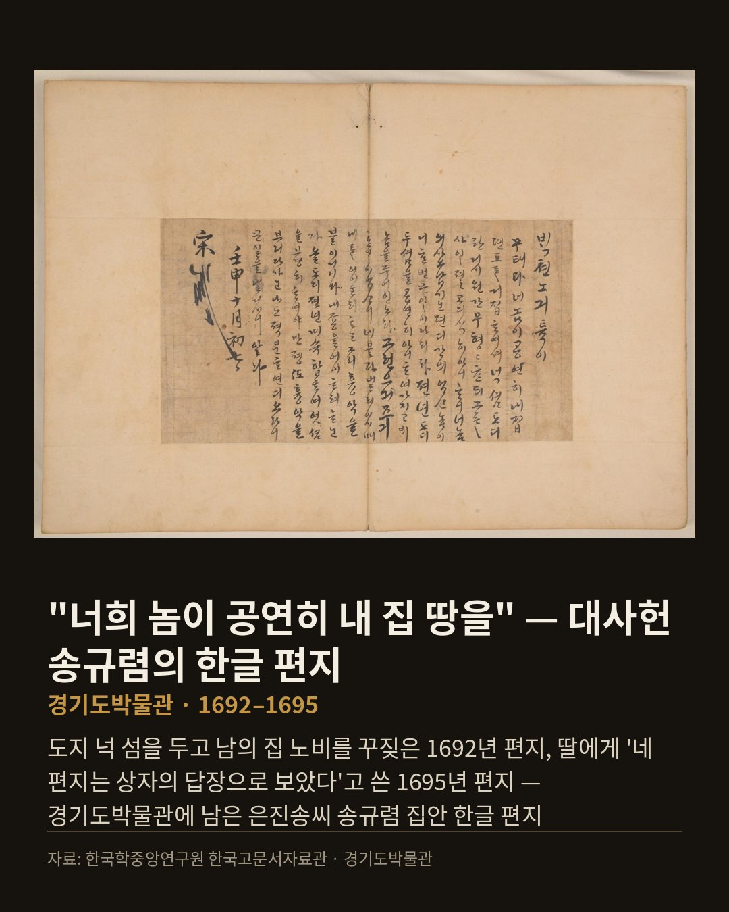
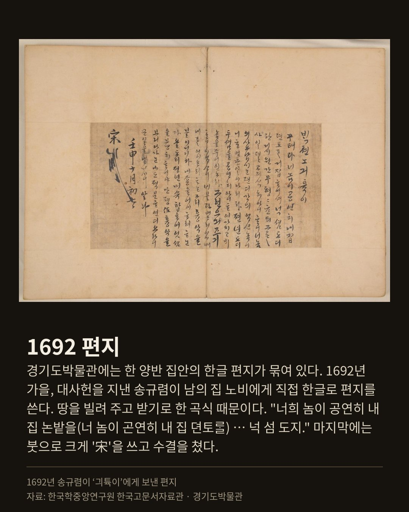
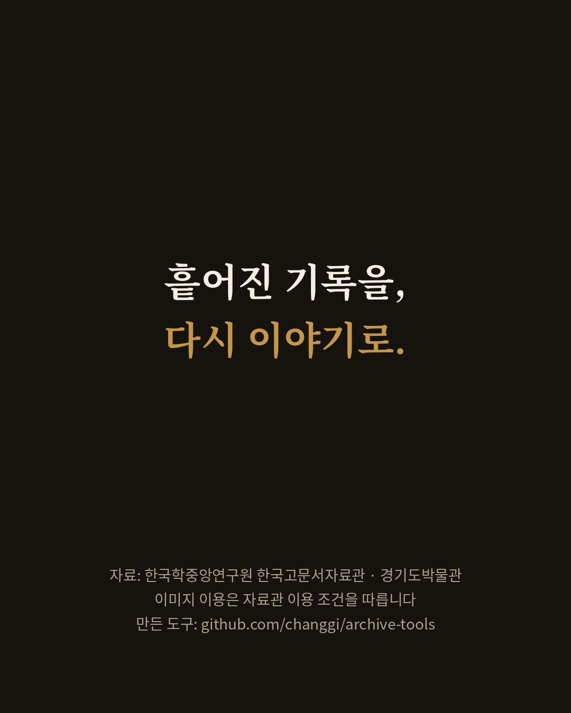

# EP.50 "너희 놈이 공연히 내 집 땅을" — 대사헌 송규렴의 한글 편지

경기도박물관 (박물관) · 도지 넉 섬을 두고 남의 집 노비를 꾸짖은 1692년 편지, 딸에게 '네 편지는 상자의 답장으로 보았다'고 쓴 1695년 편지 — 경기도박물관에 남은 은진송씨 송규렴 집안 한글 편지

- 🌐 [전시 웹페이지](https://changgi.github.io/archive-tools/examples/gyeonggi-museum/exhibit.html) (한자 위 한글 독음 · 원문 해석) · [수업 활동지](https://changgi.github.io/archive-tools/examples/gyeonggi-museum/handout.html)
- 🎬 영상: [릴스 9:16](https://changgi.github.io/archive-tools-next/media/ep50-gyeonggi-museum_reel.mp4) · [가로 16:9](https://changgi.github.io/archive-tools-next/media/ep50-gyeonggi-museum_wide.mp4) · 홍보 글: [`promo.md`](promo.md)
- 카드뉴스: [`cards/`](cards/) · SNS 글: [`sns.txt`](sns.txt) · 판독·해석 표: [`selection.csv`](selection.csv)


<!-- DELIVERY -->
## 전달 에디팅 — 이 기록을 이렇게 전합니다

- **핵심 정서** — 두 얼굴
- **한 문장** — 한글 편지는 신분을 넘어 실제 생활의 다툼에도 쓰였다는 것.
- **열기** — 양반이 남의 집 노비에게 직접 한글 편지를 썼습니다. 무슨 일이었을까요?
- **펼치기** — 송규렴이 ‘긔튝이’에게 보낸 편지 → 송규렴이 딸 은진송씨에게 보낸 편 (1692–1695년) — 꾸짖는 편지(1692)와 딸에게 쓴 다정한 편지(1695)를 대비해, 같은 사람의 두 목소리를 보여 주었습니다.
- **절정** — "네 편지는 … 답하노라(네 편지ᄂᆞᆫ … 답ᄒᆞ노라)" — 화면·공간에서 이 한 줄만 크게, 소리를 줄여 집중
- **여운** — 편지를 받은 기축이는 글을 읽을 수 있었을까요? — 질문으로 끝내고 답은 보는 사람에게
- **감각과 물질** — 꾸짖는 편지와 다정한 편지를 같은 목소리 배우가 다른 톤으로 낭독 · 손바닥 크기 복제를 직접 들고 읽기, 낭독 음성
- **통로와 매개** — 온라인: 릴스(열기) → 카드뉴스(펼치기) → 전시 웹페이지(절정·원문) → 비하인드 카드(여운) / 오프라인: 원본 크기 복제·낭독·참여 벽 / 남기기: 활동지·질문 카드
- **여운 장치** — "같은 사람의 두 목소리" 질문
- **전달 에디팅 전** — 2건의 문서를 1692–1695년 연대순으로 놓고 문서명 · 유형 · 해설을 붙인다 — 정확하지만, 지나가면 잊힌다.
- **전달 에디팅 후** — 핵심 정서는 「두 얼굴」. 「양반이 남의 집 노비에게 직접 한글 편지를 썼습니다. 무슨 일이었을까요?」로 열고, 문서를 대비와 순서로 펼친 뒤, "네 편지는 … 답하노라(네 편지ᄂᆞᆫ … 답ᄒᆞ노라)"에서 멈춘다. 꾸짖는 편지와 다정한 편지를 같은 목소리 배우가 다른 톤으로 낭독. 마지막엔 「"같은 사람의 두 목소리" 질문」로 보는 사람이 자기 이야기를 남기고 떠나게 한다.

전문: [`delivery.md`](delivery.md)
<!-- /DELIVERY -->

<!-- CURATOR -->
## 비하인드 — 큐레이터 노트

- **왜 이 문서들인가** — 양반 송규렴이 남의 집 노비에게 직접 한글 편지를 써 꾸짖은 문서가 있었습니다.
- **전하고 싶은 것** — 한글 편지는 신분을 넘어 실제 생활의 다툼에도 쓰였다는 것.
- **이렇게 보이길 바랐다** — 꾸짖는 편지(1692)와 딸에게 쓴 다정한 편지(1695)를 대비해, 같은 사람의 두 목소리를 보여 주었습니다.
- **이렇게 써 주세요** — 한글의 사회적 쓰임, 언간 읽기 수업에 쓰세요.
- **만들며 있었던 일** — '원문으로 읽는 이야기 24편 더(EP.27–50)'의 마지막 편입니다.
- **남겨 둔 질문** — 편지를 받은 기축이는 글을 읽을 수 있었을까요?
- **제작 기록** — 문서 2건 · 1692–1695년 · 원본 사진 2면(문서 전체) · 원문 판독 2건 · 번역 2건 · 못 읽은 글자 □ 0 · 불확실 (?) 39

전문: [`curator.md`](curator.md)
<!-- /CURATOR -->

## 이야기 — 사료가 말하는 대로

양반이 남의 집 노비에게 직접 한글 편지를 썼습니다. 무슨 일이었을까요?

> **1692 편지** — 경기도박물관에는 한 양반 집안의 한글 편지가 묶여 있다. 1692년 가을, 대사헌을 지낸 송규렴이 남의 집 노비에게 직접 한글로 편지를 쓴다. 땅을 빌려 주고 받기로 한 곡식 때문이다. "너희 놈이 공연히 내 집 논밭을(너 놈이 곤연히 내 집 뎐토ᄅᆞᆯ) … 넉 섬 도지." 마지막에는 붓으로 크게 '宋'을 쓰고 수결을 쳤다.
> **1695 편지** — 3년 뒤, 같은 손이 이번에는 출가한 딸에게 편지를 쓴다. 노비를 꾸짖던 거친 붓이 딸에게는 작고 가늘어진다. "네 편지는 … 답하노라(네 편지ᄂᆞᆫ … 답ᄒᆞ노라)." 같은 사람, 같은 한글이었다. 받는 사람에 따라 글씨가 달라졌다.

| 표지 | 1번 카드 | 마무리 |
|---|---|---|
|  |  |  |

## 선별 문서 (2점)

| # | 연도 | 유형 | 문서명 | 원본 |
|---|---|---|---|---|
| 1 | 1692 | 편지 | 1692년 송규렴이 ‘긔튝이’에게 보낸 편지 | [원본 보기](https://archive.aks.ac.kr/viewer/viewer.do#imgnode.do?itemId=book&gubun=booktree&depth=6&upPath=03%5E0377%5EL037702%5EL037702F02%5EL037702F0206&dataId=G002%2BLET%2BKSM-XF.1692.0000-20140430.B0016_9-010&itemType=) |
| 2 | 1695 | 편지 | 1695년 송규렴이 딸 은진송씨에게 보낸 편지 | [원본 보기](https://archive.aks.ac.kr/viewer/viewer.do#imgnode.do?itemId=book&gubun=booktree&depth=6&upPath=03%5E0377%5EL037702%5EL037702F02%5EL037702F0206&dataId=G002%2BLET%2BKSM-XF.1695.0000-20140430.B0016_9-020&itemType=) |

## 원문 판독과 해석

### 1. 1692년 송규렴이 ‘긔튝이’에게 보낸 편지

**원문 판독**

```
ᄉᆞ쳔(?) 노 긔튝이
무ᄐᆡ(?)타 너 놈이 곤연히 내 집
뎐토ᄅᆞᆯ 니집(?)ᄒᆞ여셔 넉 셤 도디
ᄒᆞᆫ ᄃᆡ셔 원간 무형ᄒᆞᆫ ᄃᆡ 그ᄂᆞᆯ(?)
ᄉᆞ이 쟐(?) 근(?)리셔(?) ᄒᆞ야ᄂᆞᆯ 후 너 놈
의 샹젼(?) 보뎐(?) ᄃᆡ감의 엇던 놈이
(?)ᄒᆞᆫ 번 근(?) 아니ᄒᆞ다 ᄒᆞ고 젼년 도디
ᄒᆞ여 ᄆᆞᆯ을 곰연히(?) 아니ᄒᆞ여 가지고 ᄇᆡ(?)
흉(?)을 ᄒᆞ여 인ᄂᆞ되 그 뎐(?)ᄒᆞ과 ᄌᆞ기(?)
(?)이 … 네 블(?) … 빈ᄃᆞᆺ(?) … ᄆᆡ(?)
ᄒᆞᆫ 어이 ᄒᆞ리 ᄒᆞᆫ 그리 흉악을
로 이러니와 네 죠(죄)ᄅᆞᆯ 어이 ᄒᆞ리 ᄒᆞᄂᆞᆫ
을 ᄂᆞ되 젼년 ᄯᅥ(?) ᄒᆞᆸ(?)ᄒᆞ며 연(?) 셤
로 블령히 ᄒᆞ여야 만 졍 ᄯᅩ 흉악을
ᄀᆞ리 다 사(?) 그 나도 젹(?)블(?) ᄒᆞᆫ 연ᄃᆡ ᄉᆞᆫᄒᆞ(?)
(?)이ᄅᆞᆯ 길(?)너ᄂᆞᆫ(?) … 알라
壬申十月初七
宋(수결)
```

**원문 해석** 사천(?)의 노비 기축이에게. … 너희 놈이 공연히 내 집 논밭을 … 해서 [도지] 넉 섬을 [바치기로] 한 데서, 원래 [아무 일] 없던 데를 … 그 뒤 너희 상전 … 댁에서 어떤 놈이 … 한 번 [바친 적이] 없다 하고, 지난해 도지를 … 공연히 [내지] 않고 가지고 … 흉[한 짓]을 하고 있는데 … 네 죄를 어찌하겠느냐 … 지난해 … 섬 … 고분고분하지 않게(不令히) 해야만 … 또 흉악을 … 알아라. 임신년(1692) 10월 7일 송(宋, 수결). (흘림이 많아 여러 곳 판독 불확실)

**해제** 1692년(숙종 18, 壬申) 10월 7일, 은진송씨 송규렴(宋奎濂, 1630~1709)이 남의 집 노비 '긔튝이(기축이)'에게 보낸 한글 편지입니다. 송규렴 집안의 논밭을 부치면서 도지(賭地, 땅을 빌린 값으로 내는 곡식) 넉 섬을 내기로 해 놓고, 지난해 도지를 내지 않고 흉악하게 군다며 꾸짖는 내용으로 읽힙니다. 양반이 남의 노비에게 직접 한글로 편지를 쓴 드문 예입니다. 끝에 한자로 날짜와 성 '宋', 큰 수결이 있습니다. 흘림이라 여러 글자가 판독 불확실합니다.

### 2. 1695년 송규렴이 딸 은진송씨에게 보낸 편지

**원문 판독**

```
날이 ᄇᆞᆯ(?) 셔ᄎᆔ(?) 되니 … (판독 불확실)
이ᄂᆞ다(?) 아ᄒᆡ들(?) … (판독 불확실)
네 편지ᄂᆞᆫ 샹자의 답장 …
어려(?) 보나 ᄒᆞ후(?) … (판독 불확실)
답ᄒᆞ노라 도(?) … (판독 불확실)
… (가운데 여러 줄 흘림 — 판독 필요)
… 편지 …
셥(?)이 …
(끝) … 아비(?)
```

**원문 해석** … 네 편지는 상자(?)의 답장 [편에] … 답한다. … (흘림이라 대부분 판독이 필요합니다)

**해제** 1695년(숙종 21), 송규렴이 출가한 딸 은진송씨에게 보낸 한글 편지입니다. '네 편지는 상자의 답장…', '답하노라' 같은 구절이 읽히고, 나머지 흘림은 판독이 필요합니다. 같은 첩에 송규렴이 며느리·손녀에게 보낸 편지, 부인 안동김씨가 아들 송상기에게 보낸 편지가 함께 있어, 한 집안 3대가 한글로 안부를 주고받은 모습을 보여 줍니다.

판독·해석·이야기는 이미지에 근거한 초안이며(검토 전 "초안" 표시), 정확한 판독은 원문 확인이 필요합니다. □는 읽지 못한 글자, (?)는 불확실한 글자입니다.
이미지: 한국학중앙연구원 한국고문서자료관 소장·제공. "원본" 링크를 누르면 자료관 뷰어에서 그 문서가 열립니다. 재사용은 자료관에 문의하세요(소장처 동의 필요).
