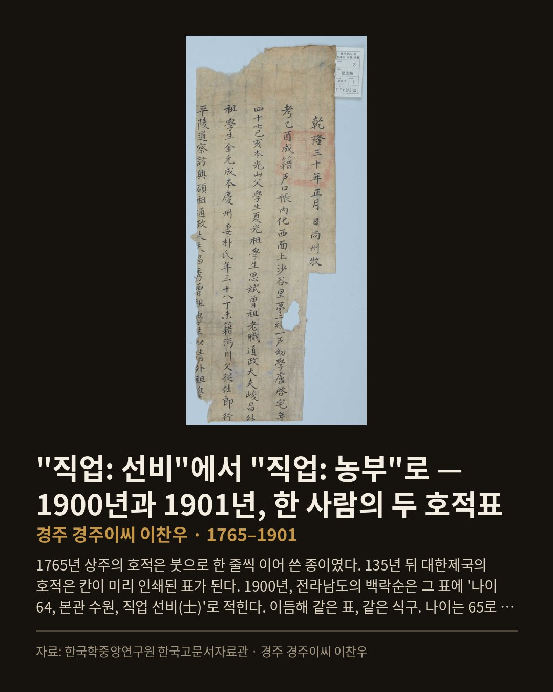
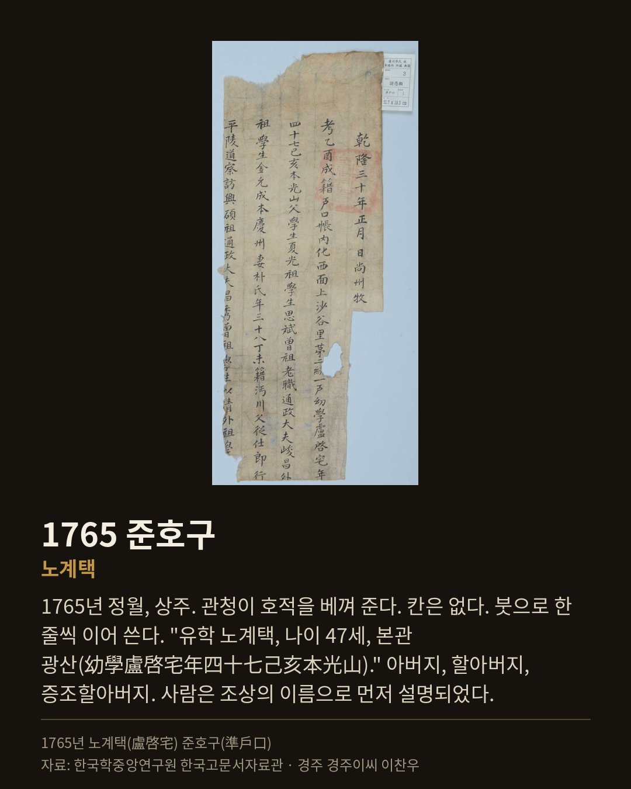
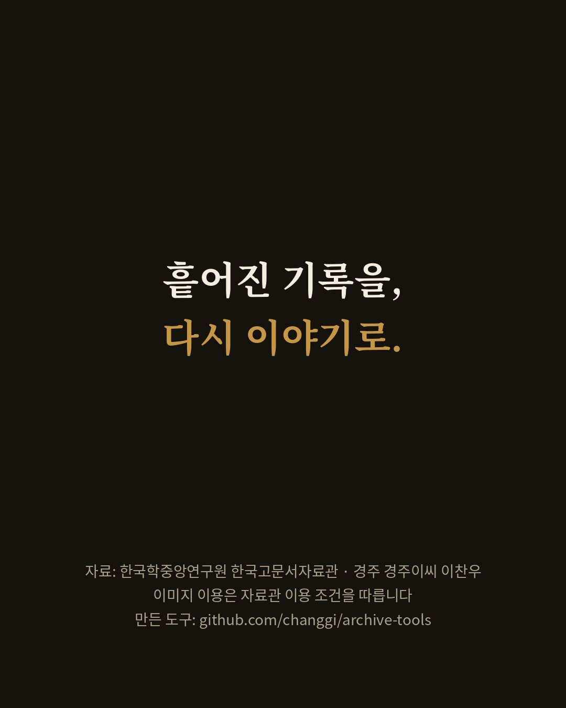

# EP.136 "직업: 선비"에서 "직업: 농부"로 — 1900년과 1901년, 한 사람의 두 호적표

경주 경주이씨 이찬우 (문중) · 1765년 상주의 호적은 붓으로 한 줄씩 이어 쓴 종이였다. 135년 뒤 대한제국의 호적은 칸이 미리 인쇄된 표가 된다. 1900년, 전라남도의 백락순은 그 표에 '나이 64, 본관 수원, 직업 선비(士)'로 적힌다. 이듬해 같은 표, 같은 식구. 나이는 65로 한 살 늘었고, 직업 칸의 글자가 바뀌었다. '농(農)'

- 🌐 [전시 웹페이지](https://changgi.github.io/archive-tools/examples/gyeongju-hojeok/exhibit.html) (한자 위 한글 독음 · 원문 해석) · [수업 활동지](https://changgi.github.io/archive-tools/examples/gyeongju-hojeok/handout.html)
- 🎬 영상: [릴스 9:16](https://changgi.github.io/archive-tools-next/media/ep136-gyeongju-hojeok_reel.mp4) · [가로 16:9](https://changgi.github.io/archive-tools-next/media/ep136-gyeongju-hojeok_wide.mp4) · 홍보 글: [`promo.md`](promo.md)
- 카드뉴스: [`cards/`](cards/) · SNS 글: [`sns.txt`](sns.txt) · 판독·해석 표: [`selection.csv`](selection.csv)

<!-- DELIVERY -->
## 전달 에디팅 — 이 기록을 이렇게 전합니다

- **핵심 정서** — 담담한 놀라움
- **한 문장** — 나라가 사람을 적는 방식이 바뀌면, 사람을 설명하는 말도 바뀐다 — 조상의 이름에서 '직업' 칸으로.
- **열기** — 1년 사이, 호적의 '직업' 칸이 선비에서 농부로 바뀐 사람이 있습니다.
- **펼치기** — 노계택 준호구 → 백락순 호적표 (1765–1901년) — 1765년 붓글씨 준호구(사조로 설명되는 사람) → 1900년 인쇄 호적표(직업 '士') → 1901년 같은 표(직업 '農') 순으로, 종이의 모양 변화와 한 칸의 변화를 함께 보이게 구성했습니다.
- **절정** — "호주 백락순, 나이 64, 본관 수원, 직업 사(白樂順 年六十四 本水原 職業士)" — 화면·공간에서 이 한 줄만 크게, 소리를 줄여 집중
- **여운** — '선비'에서 '농'으로 적힌 해, 백락순 본인은 그 글자를 보았을까요? — 질문으로 끝내고 답은 보는 사람에게
- **감각과 물질** — 인쇄된 칸 두 장을 겹쳐 놓고 '士'와 '農' 한 칸에만 불빛 · 나의 신분증 만들기 체험 카드
- **통로와 매개** — 온라인: 릴스(열기) → 카드뉴스(펼치기) → 전시 웹페이지(절정·원문) → 비하인드 카드(여운) / 오프라인: 원본 크기 복제·낭독·참여 벽 / 남기기: 활동지·질문 카드
- **여운 장치** — 내 직업 칸에 쓰고 싶은 말 적기
- **전달 에디팅 전** — 3건의 문서를 1765–1901년 연대순으로 놓고 문서명 · 유형 · 해설을 붙인다 — 정확하지만, 지나가면 잊힌다.
- **전달 에디팅 후** — 핵심 정서는 「담담한 놀라움」. 「1년 사이, 호적의 '직업' 칸이 선비에서 농부로 바뀐 사람이 있습니다.」로 열고, 문서를 대비와 순서로 펼친 뒤, "호주 백락순, 나이 64, 본관 수원, 직업 사(白樂順 年六十四 本水原 職業士)"에서 멈춘다. 인쇄된 칸 두 장을 겹쳐 놓고 '士'와 '農' 한 칸에만 불빛. 마지막엔 「내 직업 칸에 쓰고 싶은 말 적기」로 보는 사람이 자기 이야기를 남기고 떠나게 한다.

전문: [`delivery.md`](delivery.md)
<!-- /DELIVERY -->

<!-- CURATOR -->
## 비하인드 — 큐레이터 노트

- **왜 이 문서들인가** — 같은 사람의 호적표가 두 해 연달아 남아 있었고, 나란히 놓자 직업 칸 한 글자만 달랐습니다. 135년 전의 붓으로 쓴 준호구와 함께 보면 호적이라는 종이 자체가 바뀐 모습도 보입니다.
- **전하고 싶은 것** — 나라가 사람을 적는 방식이 바뀌면, 사람을 설명하는 말도 바뀐다 — 조상의 이름에서 '직업' 칸으로.
- **이렇게 보이길 바랐다** — 1765년 붓글씨 준호구(사조로 설명되는 사람) → 1900년 인쇄 호적표(직업 '士') → 1901년 같은 표(직업 '農') 순으로, 종이의 모양 변화와 한 칸의 변화를 함께 보이게 구성했습니다.
- **이렇게 써 주세요** — 조선과 대한제국의 호적 제도, 1896년 호구조사규칙, 신분에서 직업으로의 변화, 근대 행정 문서의 서식 수업에 쓰세요.
- **만들며 있었던 일** — 준호구는 해서, 호적표는 손글씨가 또렷하나 인쇄 글씨가 흐려 군 이름 · 통 · 호 · 1900년 표의 달 · 관원 직함은 읽지 못했습니다. 준호구 아내의 나이와 간지가 한 살 어긋나며, 아래가 떨어져 나갔습니다. 직업이 바뀌어 적힌 까닭, 노계택 · 백락순과 소장 집안의 관계는 확인하지 않았습니다.
- **남겨 둔 질문** — '선비'에서 '농'으로 적힌 해, 백락순 본인은 그 글자를 보았을까요?
- **제작 기록** — 문서 3건 · 1765–1901년 · 원본 사진 3면(문서 전체) · 원문 판독 3건 · 번역 3건 · 못 읽은 글자 □ 5 · 불확실 (?) 1 · 해제에 "확인 필요"를 단 문서 2건

전문: [`curator.md`](curator.md) · 비하인드 카드: [`behind/`](behind/) · 채널별 홍보안: [`channels.md`](channels.md)
<!-- /CURATOR -->

## 이야기 — 사료가 말하는 대로

1년 사이, 호적의 '직업' 칸이 선비에서 농부로 바뀐 사람이 있습니다.

> **1765 준호구** — 1765년 정월, 상주. 관청이 호적을 베껴 준다. 칸은 없다. 붓으로 한 줄씩 이어 쓴다. "유학 노계택, 나이 47세, 본관 광산(幼學盧啓宅年四十七己亥本光山)." 아버지, 할아버지, 증조할아버지. 사람은 조상의 이름으로 먼저 설명되었다.
> **1900 호적표** — 135년 뒤, 호적은 표가 된다. 칸이 미리 찍혀 있고, 빈칸을 채우면 된다. 1900년 전라남도. "호주 백락순, 나이 64, 본관 수원, 직업 사(白樂順 年六十四 本水原 職業士)." 이제 사람은 '직업' 칸으로도 설명된다. 그는 선비였다.
> **1901 호적표** — 이듬해 정월, 같은 표가 또 온다. 같은 식구 다섯, 같은 초가 다섯 칸. 나이는 65로 한 살 늘었다. 그리고 한 칸만 달라졌다. "직업 농(職業農)." 1년 사이, 선비는 서류 위에서 농부가 되었다.

| 표지 | 1번 카드 | 마무리 |
|---|---|---|
|  |  |  |

## 선별 문서 (3점)

| # | 연도 | 유형 | 문서명 | 원본 |
|---|---|---|---|---|
| 1 | 1765 | 준호구 | 1765년 노계택(盧啓宅) 준호구(準戶口) | [원본 보기](https://archive.aks.ac.kr/viewer/viewer.do#imgnode.do?itemId=book&gubun=booktree&depth=6&upPath=06%5E0612%5EL061201%5EL061201F02%5EL061201F0204&dataId=G002%2BKHD%2BKSM-XD.1765.0000-20151117.C0703_002_00003_XXX&itemType=) |
| 2 | 1900 | 호적표 | 1900년 백락순(白樂順) 호적표(戶籍表) | [원본 보기](https://archive.aks.ac.kr/viewer/viewer.do#imgnode.do?itemId=book&gubun=booktree&depth=6&upPath=06%5E0612%5EL061201%5EL061201F02%5EL061201F0204&dataId=G002%2BKHD%2BKSM-XD.1900.0000-20151117.C0703_002_00009_XXX&itemType=) |
| 3 | 1901 | 호적표 | 1901년 백락순(白樂順) 호적표(戶籍表) | [원본 보기](https://archive.aks.ac.kr/viewer/viewer.do#imgnode.do?itemId=book&gubun=booktree&depth=6&upPath=06%5E0612%5EL061201%5EL061201F02%5EL061201F0204&dataId=G002%2BKHD%2BKSM-XD.1901.0000-20151117.C0703_002_00010_XXX&itemType=) |

## 원문 판독과 해석

### 1. 1765년 노계택(盧啓宅) 준호구(準戶口)

**원문 판독**

```
乾隆三十年正月　日尙州牧
考乙酉成籍戶口帳內化西面上沙谷里第二統一戶幼學盧啓宅年
四十七己亥本光山父學生夏光祖學生思斌曾祖老職通政大夫峻昌外
祖學生金允成本慶州妻朴氏年三十八丁未籍泗川父從仕郞行
平陵道察訪興碩祖通政大夫昌秀曾祖學生以淸外祖學 …
```

**원문 해석** 건륭 30년(1765) 정월 일, 상주목. 을유년 호적 장부를 살펴보니, 화서면 상사곡리 제2통 제1호. 유학 노계택, 나이 47세 기해생, 본관 광산. 아버지 학생 하광, 할아버지 학생 사빈, 증조할아버지 노직 통정대부 준창, 외할아버지 학생 김윤성(본관 경주). 아내 박씨, 나이 38세 정미생, 본관 사천. 아내의 아버지 종사랑 행 평릉도 찰방 흥석, 할아버지 통정대부 창수, 증조할아버지 학생 이청, 외할아버지 학생 … (뒤 떨어져 나감)

**해제** 1765년(영조 41, 乾隆 30, 乙酉) 상주목이 노계택(盧啓宅) 집의 호적을 베껴 확인해 준 준호구(準戶口)입니다. 조선의 호적은 3년마다 다시 만들었고, 준호구는 그 장부의 내용을 관청이 베껴 준 증명서입니다. 칸이 따로 없이 붓으로 한 줄씩 이어 썼으며, 호주와 아내 각각의 아버지 · 할아버지 · 증조할아버지 · 외할아버지(사조)를 적은 것이 특징입니다. 노계택은 '유학(幼學)'으로, 벼슬하지 않은 양반을 뜻합니다. 47세 기해생(1719)은 맞지만, 아내의 '38세 정미생'은 정미년(1727)이면 1765년에 39세가 되어 한 살 어긋납니다(원문대로 적음). 아래쪽이 떨어져 나가 자녀 · 노비 부분은 남아 있지 않습니다. 이 집안(경주이씨 이찬우 소장)과 노계택의 관계는 확인하지 않았습니다.

### 2. 1900년 백락순(白樂順) 호적표(戶籍表)

**원문 판독**

```
戶籍表
道化面新基□
戶主　白樂順　年六十四　本水原　職業士
父　雲洙
祖　瑞浩
曾祖　圭華
外祖　柳煥龜(?)
同居親屬　妻金氏　子敬魯　婦朴氏　子敬達
現存　男三　女二　合五
光武四年　□月
閔述鎬
```

**원문 해석** 호적표. 도화면 신기□ □통 □호. 호주 백락순, 나이 64세, 본관 수원, 직업 사(士, 선비). 아버지 운수, 할아버지 서호, 증조할아버지 규화, 외할아버지 유환구(?). 함께 사는 친족: 아내 김씨, 아들 경로, 며느리 박씨, 아들 경달. 현재 남자 3명, 여자 2명, 모두 5명. 광무 4년(1900) □월. 민술호(인).

**해제** 1900년(광무 4) 대한제국의 호적표(戶籍表)입니다. 1896년 「호구조사규칙」에 따라 호적은 칸이 미리 인쇄된 한 장짜리 표로 바뀌었고, 이름 · 나이 · 본관 · 직업 · 사조 · 동거 친족 · 남녀 수 · 집의 칸 수를 칸마다 채웠습니다. 백락순(白樂順)은 64세, 본관 수원, 직업 칸에 '사(士)', 곧 선비로 적혔습니다. 식구는 아내 김씨, 아들 경로와 며느리 박씨, 아들 경달로 모두 다섯 명입니다. 아래쪽 집 칸에는 초가 다섯 칸으로 보이는 숫자가 있습니다. 인쇄 글씨가 흐려 군 이름 · 통 · 호와 달은 읽지 못했고, 다음 해 표에 '전라남도'가 보여 같은 고을로 보았습니다. 끝의 민술호(閔述鎬)는 확인한 관원(군수 등)으로 보이나 직함은 읽지 못했습니다. 외할아버지 이름 끝 글자는 (?)로 두었습니다.

### 3. 1901년 백락순(白樂順) 호적표(戶籍表)

**원문 판독**

```
全羅南道　□□郡
戶籍表
道化面新基□
戶主　白樂順　年六十五　本水原　職業農
父　雲洙
祖　瑞浩
曾祖　圭華
外祖　柳煥龜
同居親屬　妻金氏　子敬魯　婦朴氏　子敬達
現存　男三　女二　合五
家　已有　草五間
光武五年一月
閔述鎬
```

**원문 해석** 전라남도 □□군 호적표. 도화면 신기□ □통 □호. 호주 백락순, 나이 65세, 본관 수원, 직업 농(農, 농업). 아버지 운수, 할아버지 서호, 증조할아버지 규화, 외할아버지 유환구. 함께 사는 친족: 아내 김씨, 아들 경로, 며느리 박씨, 아들 경달. 현재 남자 3명, 여자 2명, 모두 5명. 집: 자기 집, 초가 5칸. 광무 5년(1901) 1월. 민술호(인).

**해제** 이듬해 1901년(광무 5) 1월에 만든 같은 집의 호적표입니다. 대한제국은 해마다 호적표를 새로 만들었습니다. 식구 · 사조 · 집은 그대로이고 나이는 65세로 한 살 늘었는데, 직업 칸만 '사(士)'에서 '농(農)'으로 바뀌었습니다. 한 해 사이에 정말로 하는 일이 바뀐 것인지, 적는 사람이나 기준이 달라진 것인지는 이 두 장만으로는 알 수 없습니다. 다만 같은 사람이 '선비'에서 '농부'로 적히는 일은, 신분 대신 직업을 묻기 시작한 새 호적의 모습을 잘 보여 줍니다. 위쪽 인쇄 글씨에 '全羅南道'가 보이나 군 이름은 흐립니다. '家 已有 草五間'은 자기 집(已有)이 있고 초가 다섯 칸이라는 뜻으로 읽었습니다.

판독·해석·이야기는 이미지에 근거한 초안이며(검토 전 "초안" 표시), 정확한 판독은 원문 확인이 필요합니다. □는 읽지 못한 글자, (?)는 불확실한 글자입니다.
이미지: 한국학중앙연구원 한국고문서자료관 소장·제공. "원본" 링크를 누르면 자료관 뷰어에서 그 문서가 열립니다. 재사용은 자료관에 문의하세요(소장처 동의 필요).
