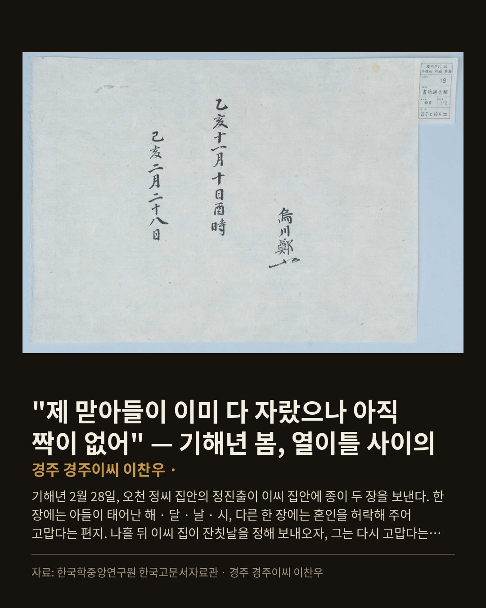
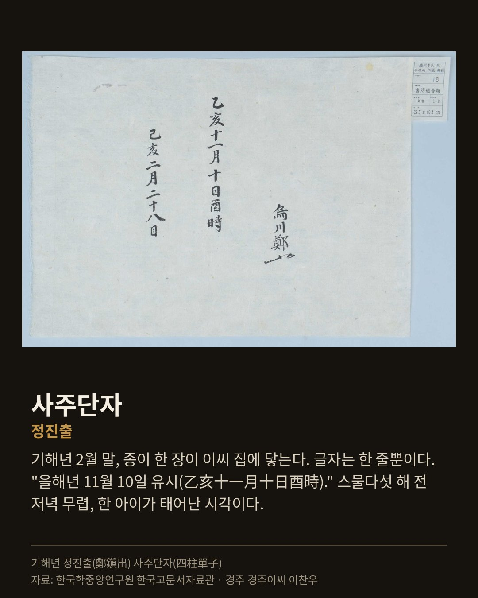
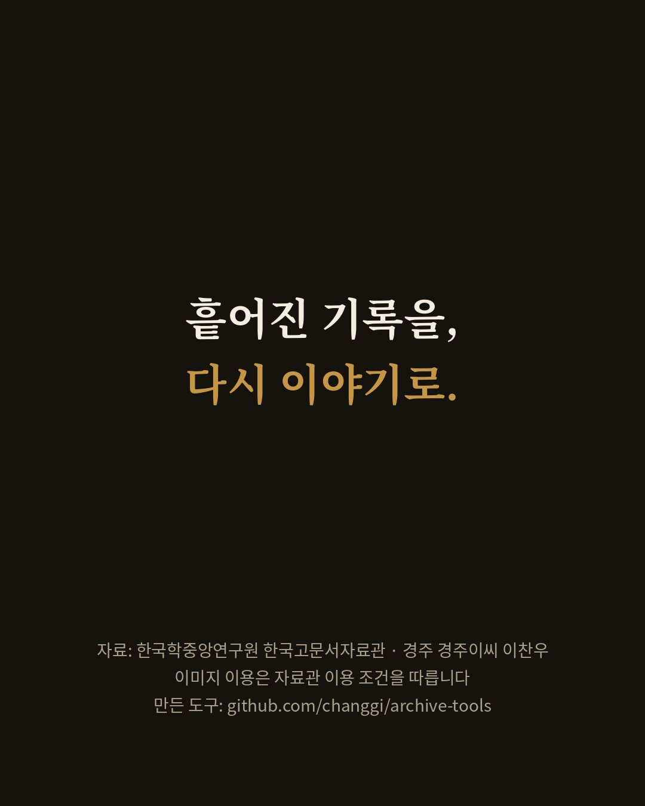

# EP.134 "제 맏아들이 이미 다 자랐으나 아직 짝이 없어" — 기해년 봄, 열이틀 사이의 혼인 편지

경주 경주이씨 이찬우 (문중) · 기해년 2월 28일, 오천 정씨 집안의 정진출이 이씨 집안에 종이 두 장을 보낸다. 한 장에는 아들이 태어난 해 · 달 · 날 · 시, 다른 한 장에는 혼인을 허락해 주어 고맙다는 편지. 나흘 뒤 이씨 집이 잔칫날을 정해 보내오자, 그는 다시 고맙다는 답장을 쓴다. 그리고 3월 11일, 예물과 함께 혼서를 보낸다. '제 맏아들이 이미 다 자랐으나 아직 짝이 없어'

- 🌐 [전시 웹페이지](https://changgi.github.io/archive-tools/examples/gyeongju-honseo/exhibit.html) (한자 위 한글 독음 · 원문 해석) · [수업 활동지](https://changgi.github.io/archive-tools/examples/gyeongju-honseo/handout.html)
- 🎬 영상: [릴스 9:16](https://changgi.github.io/archive-tools-next/media/ep134-gyeongju-honseo_reel.mp4) · [가로 16:9](https://changgi.github.io/archive-tools-next/media/ep134-gyeongju-honseo_wide.mp4) · 홍보 글: [`promo.md`](promo.md)
- 카드뉴스: [`cards/`](cards/) · SNS 글: [`sns.txt`](sns.txt) · 판독·해석 표: [`selection.csv`](selection.csv)

<!-- DELIVERY -->
## 전달 에디팅 — 이 기록을 이렇게 전합니다

- **핵심 정서** — 설렘
- **한 문장** — 혼인은 두 집안이 종이를 주고받으며 천천히 맺는 약속이었다 — 한 아이가 태어난 시각에서 시작해 '아직 짝이 없다'는 아버지의 문장으로 끝난다.
- **열기** — 혼인을 약속하는 데, 종이 네 장과 열이틀이 걸렸습니다.
- **펼치기** — 기해년 정진출 사주단자 → 기해년 2월 정진출 사주 보내는  → 기해년 3월 정진출 연길 받고 보 → 기해년 3월 정진출 혼서 — 납폐 (연대 미상) — 2월 28일 사주단자 → 같은 날의 편지 → 3월 2일 연길에 대한 답장 → 3월 11일 납폐 혼서 순으로, 날짜를 앞세워 혼례 절차(납채 · 연길 · 납폐)를 따라가게 구성했습니다.
- **절정** — "제 맏아들이 이미 다 자랐으나 아직 짝이 없어(僕之長子…年旣長成 未有伉儷)" — 화면·공간에서 이 한 줄만 크게, 소리를 줄여 집중
- **여운** — 신부 집은 이 혼서를 어디에, 몇 해 동안 간직했을까요? — 질문으로 끝내고 답은 보는 사람에게
- **감각과 물질** — 날짜가 적힌 종이 네 장을 달력처럼 — 2/28 · 2/28 · 3/2 · 3/11
- **통로와 매개** — 온라인: 릴스(열기) → 카드뉴스(펼치기) → 전시 웹페이지(절정·원문) → 비하인드 카드(여운) / 오프라인: 원본 크기 복제·낭독·참여 벽 / 남기기: 활동지·질문 카드
- **여운 장치** — 집안에 전하는 결혼의 물건 하나 찾아보기
- **전달 에디팅 전** — 4건의 문서를 연대 미상 연대순으로 놓고 문서명 · 유형 · 해설을 붙인다 — 정확하지만, 지나가면 잊힌다.
- **전달 에디팅 후** — 핵심 정서는 「설렘」. 「130년쯤 전, 혼인을 약속하는 데 종이 네 장과 열이틀이 걸렸습니다.」로 열고, 문서를 대비와 순서로 펼친 뒤, "제 맏아들이 이미 다 자랐으나 아직 짝이 없어(僕之長子…年旣長成 未有伉儷)"에서 멈춘다. 날짜가 적힌 종이 네 장을 달력처럼 — 2/28 · 2/28 · 3/2 · 3/11. 마지막엔 「집안에 전하는 결혼의 물건 하나 찾아보기」로 보는 사람이 자기 이야기를 남기고 떠나게 한다.

전문: [`delivery.md`](delivery.md)
<!-- /DELIVERY -->

<!-- CURATOR -->
## 비하인드 — 큐레이터 노트

- **왜 이 문서들인가** — 한 집안의 혼서 묶음에 같은 사람이 쓴 종이가 날짜별로 남아 있었습니다. 사주 · 편지 · 답장 · 혼서를 날짜순으로 놓으니 열이틀의 혼인 준비가 그대로 보였습니다.
- **전하고 싶은 것** — 혼인은 두 집안이 종이를 주고받으며 천천히 맺는 약속이었다 — 한 아이가 태어난 시각에서 시작해 '아직 짝이 없다'는 아버지의 문장으로 끝난다.
- **이렇게 보이길 바랐다** — 2월 28일 사주단자 → 같은 날의 편지 → 3월 2일 연길에 대한 답장 → 3월 11일 납폐 혼서 순으로, 날짜를 앞세워 혼례 절차(납채 · 연길 · 납폐)를 따라가게 구성했습니다.
- **이렇게 써 주세요** — 전통 혼례의 절차(사주 · 연길 · 납폐 · 혼서), 집안 사이의 편지 예절, 혼서를 간직하는 풍습, 가족사 수업에 쓰세요.
- **만들며 있었던 일** — 사주단자와 납폐 혼서는 해서라 확실하나, 가운데 두 편지는 초서라 여러 글자를 문맥으로 짐작해 (?)로 두었습니다. 날짜의 첫 글자(己/乙)는 흘림이라 구별이 어려워 문맥으로 '己亥'로 읽었고, 연호가 없어 기해년이 서기로 몇 년인지, 신부와 신랑의 이름(맏아들 이름 두 글자), 정한 혼례 날은 확인하지 못했습니다. 두 번째 편지는 자료관 목록의 '연길'과 달리 사주에 곁들인 편지로 보았습니다.
- **남겨 둔 질문** — 신부 집은 이 혼서를 어디에, 몇 해 동안 간직했을까요?
- **제작 기록** — 문서 4건 · 원본 사진 4면(문서 전체) · 원문 판독 4건 · 번역 4건 · 못 읽은 글자 □ 0 · 불확실 (?) 29 · 해제에 "확인 필요"를 단 문서 2건

전문: [`curator.md`](curator.md) · 비하인드 카드: [`behind/`](behind/) · 채널별 홍보안: [`channels.md`](channels.md)
<!-- /CURATOR -->

## 이야기 — 사료가 말하는 대로

130년쯤 전, 혼인을 약속하는 데 종이 네 장과 열이틀이 걸렸습니다.

> ** 사주단자** — 기해년 2월 말, 종이 한 장이 이씨 집에 닿는다. 글자는 한 줄뿐이다. "을해년 11월 10일 유시(乙亥十一月十日酉時)." 스물다섯 해 전 저녁 무렵, 한 아이가 태어난 시각이다.
> ** 연길** — 같은 날, 정진출의 편지가 곁들여진다. 첫 인사 뒤의 한 줄. "혼사를 이미 허락해 주셨으니(親事旣蒙頷許)." 두 집 사이에 오가던 이야기가, 이제 종이 위의 약속이 되었다. 날은 신부 집이 정한다.
> ** 혼서** — 나흘 뒤, 신부 집의 답이 온다. 날이 정해졌다. 정진출은 곧바로 붓을 든다. "혼사에 이미 좋은 날을 가려 주셨으니(親事旣蒙涓吉)." 그리고 한마디를 덧붙인다. "다행히 걸리는 일이 없다(幸無拘碍)."
> ** 납폐** — 그리고 3월 11일, 예물과 함께 마지막 종이가 간다. 이번엔 반듯한 해서다. "제 맏아들이 이미 다 자랐으나 아직 짝이 없어(僕之長子…年旣長成 未有伉儷)." 열이틀 사이 종이 네 장. 한 아이가 태어난 시각에서 시작해, 한 가정의 약속으로 끝났다.

| 표지 | 1번 카드 | 마무리 |
|---|---|---|
|  |  |  |

## 선별 문서 (4점)

| # | 연도 | 유형 | 문서명 | 원본 |
|---|---|---|---|---|
| 1 | — | 사주단자 | 기해년 정진출(鄭鎭出) 사주단자(四柱單子) | [원본 보기](https://archive.aks.ac.kr/viewer/viewer.do#imgnode.do?itemId=book&gubun=booktree&depth=6&upPath=06%5E0612%5EL061201%5EL061201F02%5EL061201F0206&dataId=G002%2BKHD%2BKSM-XF.0000.0000-20151117.C0703_002_00018_XXX&itemType=) |
| 2 | — | 연길 | 기해년 2월 정진출(鄭鎭出) 사주 보내는 편지 | [원본 보기](https://archive.aks.ac.kr/viewer/viewer.do#imgnode.do?itemId=book&gubun=booktree&depth=6&upPath=06%5E0612%5EL061201%5EL061201F02%5EL061201F0206&dataId=G002%2BKHD%2BKSM-XF.0000.0000-20151117.C0703_002_00016_XXX&itemType=) |
| 3 | — | 혼서 | 기해년 3월 정진출(鄭鎭出) 연길 받고 보낸 편지 | [원본 보기](https://archive.aks.ac.kr/viewer/viewer.do#imgnode.do?itemId=book&gubun=booktree&depth=6&upPath=06%5E0612%5EL061201%5EL061201F02%5EL061201F0206&dataId=G002%2BKHD%2BKSM-XF.0000.0000-20151117.C0703_002_00021_XXX&itemType=) |
| 4 | — | 납폐 | 기해년 3월 정진출(鄭鎭出) 혼서(婚書) — 납폐(納幣) | [원본 보기](https://archive.aks.ac.kr/viewer/viewer.do#imgnode.do?itemId=book&gubun=booktree&depth=6&upPath=06%5E0612%5EL061201%5EL061201F02%5EL061201F0206&dataId=G002%2BKHD%2BKSM-XF.0000.0000-20151117.C0703_002_00027_XXX&itemType=) |

## 원문 판독과 해석

### 1. 기해년 정진출(鄭鎭出) 사주단자(四柱單子)

**원문 판독**

```
乙亥十一月十日酉時
己亥二月二十八日
烏川鄭 (수결)
```

**원문 해석** 을해년 11월 10일 유시(오후 5~7시). 기해년 2월 28일. 오천 정(수결).

**해제** 신랑 집에서 신부 집에 보내는 사주단자(四柱單子)입니다. 사주는 신랑이 태어난 해 · 달 · 날 · 시로, 여기서는 '을해년 11월 10일 유시'라고 적었습니다. 이것을 받은 신부 집은 두 사람의 사주를 맞춰 보고 혼례 날을 정합니다. 보낸 날은 '기해년 2월 28일'이고, 보낸 사람은 '오천 정(烏川鄭)' — 오천(지금의 포항 오천)을 본관으로 하는 정씨 집안입니다. 을해년에 태어나 기해년에 혼인하니 신랑은 스물다섯(만 스물셋) 무렵입니다. 문서에는 연호가 없어 서기로 몇 년인지는 알 수 없습니다(1875년생 · 1899년 혼인, 또는 60년 뒤). 함께 전하는 봉투에는 '庚帖(경첩)'이라 적혀 있는데, 경첩은 사주단자를 높여 부르는 말입니다. 주의: 날짜 줄과 다른 편지 · 혼서의 날짜 첫 글자는 흘려 써서 '乙'처럼도 보입니다. 그렇게 읽으면 신랑이 태어난 해(乙亥)와 혼인한 해가 같은 을해년이 되어 맞지 않으므로, 여기서는 '己亥'로 읽었습니다(원문 확인 필요).

### 2. 기해년 2월 정진출(鄭鎭出) 사주 보내는 편지

**원문 판독**

```
烏川后人鄭鎭出再拜
伏惟仲春
尊體萬(?)重仰溯(?)區(?)區(?)
親事旣蒙　頷許感荷(?)深(?)
茲(?)以(?)星(?)柱(?)呈(?)上(?)
涓吉示以何(?)如(?)統(?)冀(?)伏惟
尊照　謹拜上狀
己亥二月二十八日
```

**원문 해석** 오천 후인 정진출이 두 번 절합니다. 엎드려 생각건대 한봄에 어른의 몸이 두루 평안하신지 우러러 그립습니다. 혼사를 이미 허락해 주셨으니 고마움이 깊습니다. 이에 사주를 올리오니(?), 좋은 날을 가려 알려 주시면 어떨지(?) 바랍니다. 살펴 주소서. 삼가 절하며 글을 올립니다. 기해년(?) 2월 28일.

**해제** 사주단자와 같은 날(2월 28일) 정진출(鄭鎭出)이 신부 집에 보낸 편지입니다. 자료관 목록에는 '연길(涓吉)'로 되어 있으나, 내용은 '혼사를 이미 허락해 주셨다(親事旣蒙頷許)'고 고마워하며 사주를 올리고 좋은 날을 가려 달라고 청하는 것이어서, 사주를 보낼 때 곁들인 편지로 보았습니다. 행서 · 초서라 가운데 여러 글자를 (?)로 두었고, 특히 '茲以星柱呈上 涓吉示以何如'는 문맥으로 짐작한 판독입니다. 날짜 첫 글자는 사주단자와 같은 날이라 '己'로 읽었습니다.

### 3. 기해년 3월 정진출(鄭鎭出) 연길 받고 보낸 편지

**원문 판독**

```
烏川后人鄭鎭出再拜
伏承
華翰伏惟仲春
尊體萬重仰慰區區
親事旣蒙　涓吉感荷(?)云(?)深
幸無拘碍華(?)度(?)依(?)
敎(?)何(?)至(?)事(?)統(?)冀(?)伏惟
尊照　謹拜上狀
己亥三月初二日
```

**원문 해석** 오천 후인 정진출이 두 번 절합니다. 보내 주신 글을 엎드려 받았습니다. 한봄에 어른의 몸이 두루 평안하시다니 우러러 위안이 됩니다. 혼사에 이미 좋은 날을 가려 주셨으니 고마움이 깊습니다. 다행히 걸리는 일이 없으니 말씀하신 대로(?) 따르겠습니다. 살펴 주소서. 삼가 절하며 글을 올립니다. 기해년 3월 2일.

**해제** 나흘 뒤인 3월 2일, 신부 집이 혼례 날을 정해(涓吉) 보내오자 정진출이 답한 편지입니다. '보내 주신 글을 받았다(伏承華翰)'로 시작해 '혼사에 이미 좋은 날을 가려 주셨으니(親事旣蒙涓吉)' 고맙고 '다행히 걸리는 일이 없다(幸無拘碍)'고 했습니다. 신부 집이 보낸 연길 단자 자체는 이 묶음에 따로 남아 있지 않은 것으로 보이며, 정한 날이 언제였는지도 이 편지에는 적혀 있지 않습니다. 초서라 가운데 몇 글자는 (?)로 두었습니다.

### 4. 기해년 3월 정진출(鄭鎭出) 혼서(婚書) — 납폐(納幣)

**원문 판독**

```
烏川后人鄭鎭出再拜
時維暮春
尊體百福僕之長子潤(?)閭(?)年旣長成未有伉儷伏蒙
尊慈許以
令愛貺室玆有先人之禮謹行納幣之儀不備伏惟
尊照　謹拜上狀
己亥三月十一日
```

**원문 해석** 오천 후인 정진출이 두 번 절합니다. 때는 늦봄, 어른의 몸에 온갖 복이 깃드시기를 빕니다. 제 맏아들 윤려(?)가 나이는 이미 다 자랐으나 아직 짝이 없었는데, 어른께서 자애로이 따님을 아내로 주기를 허락해 주셨습니다. 이에 조상이 남긴 예가 있어 삼가 납폐의 의식을 행합니다. 다 갖추지 못합니다. 살펴 주소서. 삼가 절하며 글을 올립니다. 기해년 3월 11일.

**해제** 기해년 3월 11일, 혼례에 앞서 신랑 집이 예물(폐백)과 함께 신부 집에 보낸 혼서(婚書)입니다. '납폐(納幣)'라고 하며, 신부 집은 이 혼서를 받아 평생 간직하는 것이 관례였습니다. 문장은 조선 혼서의 정해진 틀을 그대로 따릅니다. '제 맏아들 … 이미 다 자랐으나 아직 짝이 없어(僕之長子…年旣長成 未有伉儷)', '따님을 아내로 주기를 허락하셨다(許以令愛貺室)', '삼가 납폐의 의식을 행한다(謹行納幣之儀)'. 해서로 반듯하게 썼고, 앞의 두 편지와 달리 정식 예서(禮書)의 격식을 갖췄습니다. 맏아들 이름 두 글자는 획이 겹쳐 (?)로 두었습니다. 사주단자에서 열이틀, 신부 집의 연길에서 아흐레 뒤입니다. 날짜 첫 글자는 흘림이 '乙'에 가깝게 보이나, 사주단자의 해설과 같은 까닭으로 '己'로 읽었습니다(원문 확인 필요).

판독·해석·이야기는 이미지에 근거한 초안이며(검토 전 "초안" 표시), 정확한 판독은 원문 확인이 필요합니다. □는 읽지 못한 글자, (?)는 불확실한 글자입니다.
이미지: 한국학중앙연구원 한국고문서자료관 소장·제공. "원본" 링크를 누르면 자료관 뷰어에서 그 문서가 열립니다. 재사용은 자료관에 문의하세요(소장처 동의 필요).
