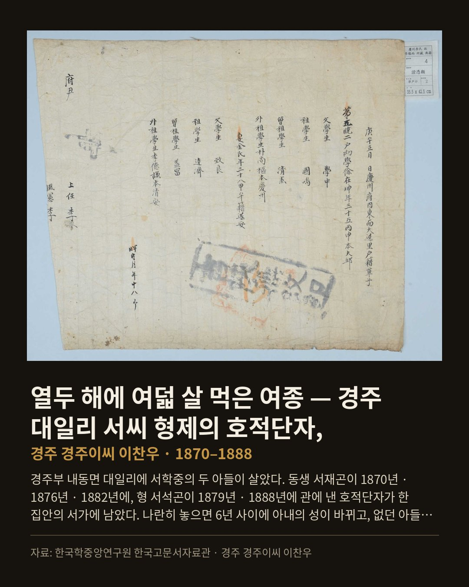
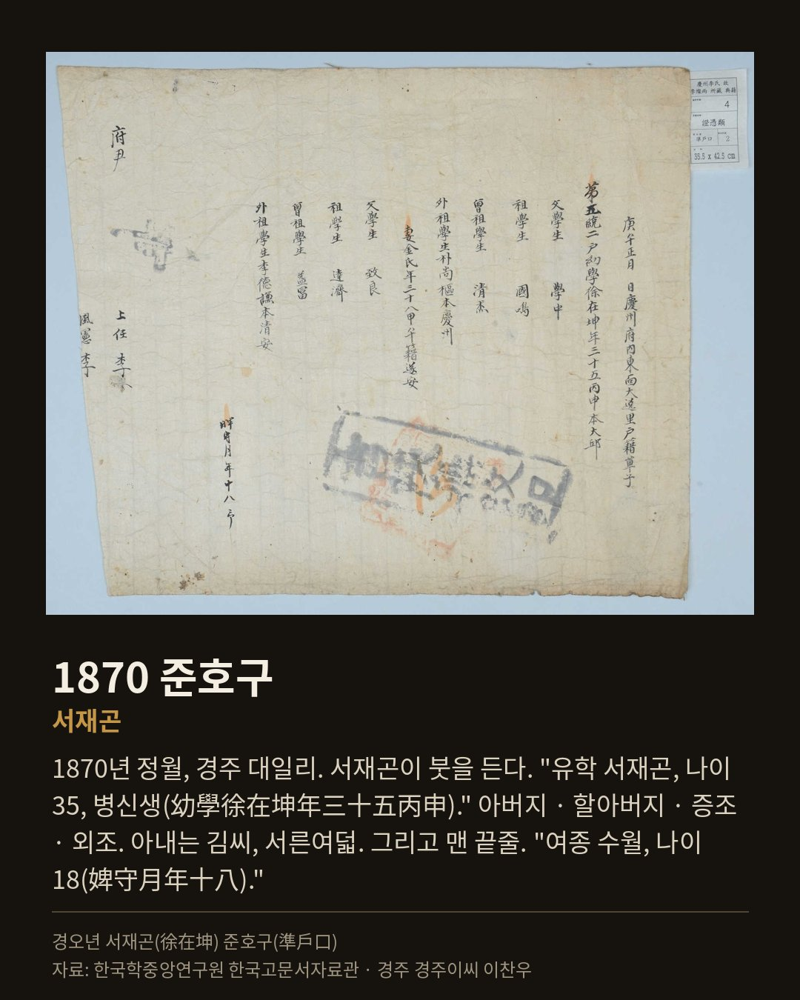
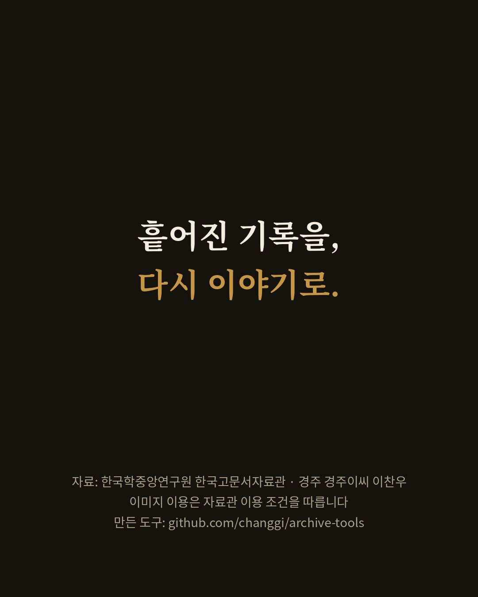

# EP.177 열두 해에 여덟 살 먹은 여종 — 경주 대일리 서씨 형제의 호적단자, 1870–1888

경주 경주이씨 이찬우 (문중) · 경주부 내동면 대일리에 서학중의 두 아들이 살았다. 동생 서재곤이 1870년 · 1876년 · 1882년에, 형 서석곤이 1879년 · 1888년에 관에 낸 호적단자가 한 집안의 서가에 남았다. 나란히 놓으면 6년 사이에 아내의 성이 바뀌고, 없던 아들이 스물한 살로 나타나고, 여종 수월은 열두 해 동안 여덟 살만 먹는다. 호적은 그해 써낸 대로 남는다

- 🌐 [전시 웹페이지](https://changgi.github.io/archive-tools/examples/gyeongju-lee-cw-hojeok/exhibit.html) (한자 위 한글 독음 · 원문 해석) · [수업 활동지](https://changgi.github.io/archive-tools/examples/gyeongju-lee-cw-hojeok/handout.html)
- 🎬 영상: [릴스 9:16](https://changgi.github.io/archive-tools-next/media/ep177-gyeongju-lee-cw-hojeok_reel.mp4) · [가로 16:9](https://changgi.github.io/archive-tools-next/media/ep177-gyeongju-lee-cw-hojeok_wide.mp4) · 홍보 글: [`promo.md`](promo.md)
- 카드뉴스: [`cards/`](cards/) · SNS 글: [`sns.txt`](sns.txt) · 판독·해석 표: [`selection.csv`](selection.csv)

<!-- DELIVERY -->
## 전달 에디팅 — 이 기록을 이렇게 전합니다

- **핵심 정서** — 고요한 의문
- **한 문장** — 호적단자는 집주인이 스스로 써서 내는 신고서다 — 그래서 주인 나이는 간지와 맞게 꼬박꼬박 늘지만, 아내가 바뀌고 자식이 들고 나는 사정은 종이 밖에 있고, 여종의 나이는 해마다 대충 적혔다.
- **열기** — 열두 해가 지나는 동안, 이 집 여종은 여덟 살만 먹었습니다.
- **펼치기** — 경오년 서재곤 준호구 → 병자년 서재곤 준호구 → 임오년 서재곤 준호구 → 무자년 서석곤 준호구 (1870–1888년) — 1870 서재곤(아내 김씨, 여종 수월 18) → 1876 서재곤(아내 한씨, 수월 21) → 1882 서재곤(아내 없이 아들 복룡, 수월 26) → 1888 형 서석곤(아들 선오 · 며느리 김씨, 여종 수금 46)으로 놓았습니다. 1879년 서석곤 단자는 해제에서 함께 비교합니다.
- **절정** — "여종 수월, 나이 18(婢守月年十八)" — 화면·공간에서 이 한 줄만 크게, 소리를 줄여 집중
- **여운** — 종이마다 다르게 적힌 나이 가운데, 수월의 진짜 나이는 몇 살이었을까요? — 질문으로 끝내고 답은 보는 사람에게
- **감각과 물질** — 세 장 모두 끝줄에 놓인 '婢守月' 그리고 나이 — 十八 · 二十一 · 二十六 · 나의 신분증 만들기 체험 카드
- **통로와 매개** — 온라인: 릴스(열기) → 카드뉴스(펼치기) → 전시 웹페이지(절정·원문) → 비하인드 카드(여운) / 오프라인: 원본 크기 복제·낭독·참여 벽 / 남기기: 활동지·질문 카드
- **여운 장치** — 가족관계증명서 · 주민등록등본에서 바뀐 칸 찾아보기
- **전달 에디팅 전** — 4건의 문서를 1870–1888년 연대순으로 놓고 문서명 · 유형 · 해설을 붙인다 — 정확하지만, 지나가면 잊힌다.
- **전달 에디팅 후** — 핵심 정서는 「고요한 의문」. 「열두 해가 지나는 동안, 이 집 여종은 여덟 살만 먹었습니다.」로 열고, 문서를 대비와 순서로 펼친 뒤, "여종 수월, 나이 18(婢守月年十八)"에서 멈춘다. 세 장 모두 끝줄에 놓인 '婢守月' 그리고 나이 — 十八 · 二十一 · 二十六. 마지막엔 「가족관계증명서 · 주민등록등본에서 바뀐 칸 찾아보기」로 보는 사람이 자기 이야기를 남기고 떠나게 한다.

전문: [`delivery.md`](delivery.md)
<!-- /DELIVERY -->

<!-- CURATOR -->
## 비하인드 — 큐레이터 노트

- **왜 이 문서들인가** — EP.140에서 제주 강세건 집안의 준호구를 읽으며 아들의 나이가 호적마다 다르다는 것을 보았습니다. 경주 이찬우 소장 전적에도 한 마을 형제의 호적단자 다섯 장이 3년 간격(식년)으로 남아 있어, 네 장을 골라 같은 사람들의 나이를 맞춰 보았습니다.
- **전하고 싶은 것** — 호적단자는 집주인이 스스로 써서 내는 신고서다 — 그래서 주인 나이는 간지와 맞게 꼬박꼬박 늘지만, 아내가 바뀌고 자식이 들고 나는 사정은 종이 밖에 있고, 여종의 나이는 해마다 대충 적혔다.
- **이렇게 보이길 바랐다** — 1870 서재곤(아내 김씨, 여종 수월 18) → 1876 서재곤(아내 한씨, 수월 21) → 1882 서재곤(아내 없이 아들 복룡, 수월 26) → 1888 형 서석곤(아들 선오 · 며느리 김씨, 여종 수금 46)으로 놓았습니다. 1879년 서석곤 단자는 해제에서 함께 비교합니다.
- **이렇게 써 주세요** — 조선 후기 호적 제도와 식년(3년마다 작성), 호적단자 · 준호구의 차이, 4조(四祖) 기재, 노비 기록의 부정확성, 재혼과 입양이 호적에 드러나는 방식, '기록은 신고의 결과'라는 기록학 수업에 쓰세요.
- **만들며 있었던 일** — 간지 연도(庚午 · 丙子 · 壬午 · 戊子)는 집주인의 나이와 출생 간지(丙申 · 戊子)로 맞추어 1870 · 1876 · 1882 · 1888년으로 보았습니다. 김씨에서 한씨로 바뀐 까닭(사별 · 재혼), 복룡이 1870 · 1876년 단자에 없는 까닭은 이 문서들로 알 수 없습니다. 아래쪽 큰 도장과 '府尹' 서명, '上任 · 風憲'의 이름은 판독하지 않거나 성만 적었습니다. 이 단자들이 왜 경주이씨 집안에 전하는지도 확인하지 않았습니다.
- **남겨 둔 질문** — 종이마다 다르게 적힌 나이 가운데, 수월의 진짜 나이는 몇 살이었을까요?
- **제작 기록** — 문서 4건 · 1870–1888년 · 원본 사진 4면(문서 전체) · 원문 판독 4건 · 번역 4건 · 해제에 "확인 필요"를 단 문서 1건

전문: [`curator.md`](curator.md) · 비하인드 카드: [`behind/`](behind/) · 채널별 홍보안: [`channels.md`](channels.md)
<!-- /CURATOR -->

## 이야기 — 사료가 말하는 대로

열두 해가 지나는 동안, 이 집 여종은 여덟 살만 먹었습니다.

> **1870 준호구** — 1870년 정월, 경주 대일리. 서재곤이 붓을 든다. "유학 서재곤, 나이 35, 병신생(幼學徐在坤年三十五丙申)." 아버지 · 할아버지 · 증조 · 외조. 아내는 김씨, 서른여덟. 그리고 맨 끝줄. "여종 수월, 나이 18(婢守月年十八)."
> **1876 준호구** — 여섯 해 뒤, 1876년. 같은 주소, 같은 통과 호. 주인 나이는 정확히 여섯 살 늘었다. "나이 41(年四十一)." 그런데 아내 칸의 성이 다르다. "아내 한씨, 나이 33(妻韓氏年三十三)." 그리고 끝줄. 여종 수월은 스물한 살. 여섯 해 동안 세 살만 먹었다.
> **1882 준호구** — 또 여섯 해, 1882년. 이번에는 아내 칸이 없다. 대신 처음 보는 이름. "함께 사는 아들 동몽 복룡, 나이 21(率子童蒙福龍年二十一)." 스물한 살이면 앞의 두 장에도 있어야 했다. 끝줄은 그대로다. "여종 수월, 나이 26(婢守月年二十六)." 열두 해 동안, 그녀는 여덟 살 먹었다.
> **1888 준호구** — 같은 마을, 형의 집. 1888년, 서석곤이 쓴다. 아버지 학중, 할아버지 국명. 동생과 똑같은 네 줄이다. 아들은 "선오, 나이 33(先五年三十三)". 아홉 해 전에는 '선조'라고 썼다. 그리고 끝줄. "여종 수금, 나이 46(婢守金年四十六)." 아홉 해 전에는 마흔하나. 이 마을의 종이에서, 여종의 해는 조금씩 짧았다.

| 표지 | 1번 카드 | 마무리 |
|---|---|---|
|  |  |  |

## 선별 문서 (4점)

| # | 연도 | 유형 | 문서명 | 원본 |
|---|---|---|---|---|
| 1 | 1870 | 준호구 | 경오년 서재곤(徐在坤) 준호구(準戶口) | [원본 보기](https://archive.aks.ac.kr/viewer/viewer.do#imgnode.do?itemId=book&gubun=booktree&depth=6&upPath=06%5E0612%5EL061201%5EL061201F02%5EL061201F0204&dataId=G002%2BKHD%2BKSM-XD.0000.0000-20151117.C0703_002_00004_XXX&itemType=) |
| 2 | 1876 | 준호구 | 병자년 서재곤(徐在坤) 준호구(準戶口) | [원본 보기](https://archive.aks.ac.kr/viewer/viewer.do#imgnode.do?itemId=book&gubun=booktree&depth=6&upPath=06%5E0612%5EL061201%5EL061201F02%5EL061201F0204&dataId=G002%2BKHD%2BKSM-XD.0000.0000-20151117.C0703_002_00005_XXX&itemType=) |
| 3 | 1882 | 준호구 | 임오년 서재곤(徐在坤) 준호구(準戶口) | [원본 보기](https://archive.aks.ac.kr/viewer/viewer.do#imgnode.do?itemId=book&gubun=booktree&depth=6&upPath=06%5E0612%5EL061201%5EL061201F02%5EL061201F0204&dataId=G002%2BKHD%2BKSM-XD.0000.0000-20151117.C0703_002_00006_XXX&itemType=) |
| 4 | 1888 | 준호구 | 무자년 서석곤(徐錫坤) 준호구(準戶口) | [원본 보기](https://archive.aks.ac.kr/viewer/viewer.do#imgnode.do?itemId=book&gubun=booktree&depth=6&upPath=06%5E0612%5EL061201%5EL061201F02%5EL061201F0204&dataId=G002%2BKHD%2BKSM-XD.0000.0000-20151117.C0703_002_00008_XXX&itemType=) |

## 원문 판독과 해석

### 1. 경오년 서재곤(徐在坤) 준호구(準戶口)

**원문 판독**

```
庚午正月 日慶州府內東面大逸里戶籍單子
第五統二戶幼學徐在坤年三十五丙申本大邱
父學生 學中
祖學生 國鳴
曾祖學生 淸杰
外祖學生朴尙樞本慶州
妻金氏年三十八甲午籍遂安
父學生 致良
祖學生 達濟
曾祖學生 益昌
外祖學生李德謙本淸安
婢守月年十八
府尹(서명)
上任李 風憲李
```

**원문 해석** 경오년(1870) 정월 일, 경주부 내동면 대일리 호적단자. 제5통 2호 유학 서재곤, 나이 35, 병신생, 본관 대구. 아버지 학생 학중, 할아버지 학생 국명, 증조 학생 청걸, 외조 학생 박상추(본관 경주). 아내 김씨, 나이 38, 갑오생, 본관 수안. 아버지 학생 치량, 할아버지 학생 달제, 증조 학생 익창, 외조 학생 이덕겸(본관 청안). 여종 수월, 나이 18. 부윤(서명). 상임 이, 풍헌 이.

**해제** 1870년(고종 7) 정월, 경주부 내동면 대일리 제5통 2호의 서재곤(徐在坤)이 낸 호적단자(戶籍單子)입니다. 호적단자는 3년마다 호적을 새로 만들 때(식년) 집주인이 식구를 적어 관에 내는 신고서로, 관은 이것을 대조해 호적대장을 만들고 아래쪽에 도장을 찍어 돌려주었습니다. 집주인과 아내의 4조(아버지 · 할아버지 · 증조 · 외조)를 적는 것이 형식입니다. 서재곤은 병신생(1836)으로 35세, 아내 김씨는 갑오생(1834)으로 남편보다 두 살 위입니다. 식구로는 여종 수월(守月) 18세 한 사람만 적혔습니다. 끝에 마을 일을 맡은 상임(上任) · 풍헌(風憲)이 확인했습니다.

### 2. 병자년 서재곤(徐在坤) 준호구(準戶口)

**원문 판독**

```
丙子正月 日慶州府內東面大逸里戶籍單子
第五統二戶幼學徐在坤年四十一丙申本大邱
父學生 學中
祖學生 國鳴
曾祖學生 淸杰
外祖學生朴尙樞本慶州
妻韓氏年三十三甲辰籍淸州
父幼學 榮琪
祖學生 宅根
曾祖學生 聖采
外祖幼學禹載洪本丹陽
婢守月年二十一
府尹(서명)
上任李 風憲崔
```

**원문 해석** 병자년(1876) 정월 일, 경주부 내동면 대일리 호적단자. 제5통 2호 유학 서재곤, 나이 41, 병신생, 본관 대구. 아버지 학생 학중, 할아버지 학생 국명, 증조 학생 청걸, 외조 학생 박상추(본관 경주). 아내 한씨, 나이 33, 갑진생, 본관 청주. 아버지 유학 영기, 할아버지 학생 택근, 증조 학생 성채, 외조 유학 우재홍(본관 단양). 여종 수월, 나이 21. 부윤(서명). 상임 이, 풍헌 최.

**해제** 두 식년 뒤인 1876년(고종 13)의 단자입니다. 주소와 통 · 호, 서재곤의 4조는 그대로이고 나이도 41세로 간지와 정확히 맞습니다. 달라진 것은 아내입니다. 1870년의 김씨(38세) 대신 한씨(33세, 갑진생 1844, 본관 청주)가 적혔고, 그 4조도 새로 적었습니다. 김씨가 세상을 떠났거나 다른 사정으로 다시 장가든 것으로 보이나 이 문서로는 알 수 없습니다. 여종 수월은 21세로 적혔습니다. 1870년에 18세였다면 이 해에는 24세여야 합니다.

### 3. 임오년 서재곤(徐在坤) 준호구(準戶口)

**원문 판독**

```
壬午正月 日慶州府內東面大逸里戶籍單子
第七統二戶幼學徐在坤年四十七丙申本大邱
父學生 學中
祖學生 國鳴
曾祖學生 淸杰
外祖學生朴尙樞本慶州
率子童蒙福龍年二十一壬戌
婢守月年二十六
府尹(서명)
上有司崔 風憲池
```

**원문 해석** 임오년(1882) 정월 일, 경주부 내동면 대일리 호적단자. 제7통 2호 유학 서재곤, 나이 47, 병신생, 본관 대구. 아버지 학생 학중, 할아버지 학생 국명, 증조 학생 청걸, 외조 학생 박상추(본관 경주). 함께 사는 아들 동몽 복룡, 나이 21, 임술생. 여종 수월, 나이 26. 부윤(서명). 상유사 최, 풍헌 지.

**해제** 다시 두 식년 뒤인 1882년(고종 19)의 단자입니다. 통 번호가 제5통에서 제7통으로 바뀌었는데, 식년마다 통 · 호를 새로 짜는 일이 흔했습니다. 서재곤은 47세로 역시 간지와 맞습니다. 이번에는 아내 칸이 없고, 대신 '함께 사는 아들(率子) 동몽 복룡(福龍) 21세, 임술생(1862)'이 처음 나옵니다. 1862년생이면 1870 · 1876년 단자에도 있었어야 하지만 두 장 모두에 보이지 않습니다. 따로 살았는지, 양자로 들였는지는 알 수 없습니다. 장가들지 않은 남자를 부르는 '동몽(童蒙)'이 스물한 살에게 쓰였습니다. 여종 수월은 26세입니다. 1870년부터 열두 해 동안 여덟 살 늘었습니다.

### 4. 무자년 서석곤(徐錫坤) 준호구(準戶口)

**원문 판독**

```
戊子正月 日慶州府內東面大逸里戶籍單子
第四統三戶幼學徐錫坤年六十一戊子本大邱
父學生 學中
祖學生 國鳴
曾祖學生 淸杰
外祖學生朴尙樞本慶州
妻安氏年六十八辛巳籍廣州
父學生 聖相
祖學生 景天
曾祖學生 處墊
外祖學生金潤興本慶州
率子先五年三十三丙辰
婦金氏年三十四乙卯籍慶州
婢守金年四十六
府尹(서명)
上有司李 風憲崔
```

**원문 해석** 무자년(1888) 정월 일, 경주부 내동면 대일리 호적단자. 제4통 3호 유학 서석곤, 나이 61, 무자생, 본관 대구. 아버지 학생 학중, 할아버지 학생 국명, 증조 학생 청걸, 외조 학생 박상추(본관 경주). 아내 안씨, 나이 68, 신사생, 본관 광주. 아버지 학생 성상, 할아버지 학생 경천, 증조 학생 처점, 외조 학생 김윤흥(본관 경주). 함께 사는 아들 선오, 나이 33, 병진생. 며느리 김씨, 나이 34, 을묘생, 본관 경주. 여종 수금, 나이 46. 부윤(서명). 상유사 이, 풍헌 최.

**해제** 같은 마을 제4통 3호, 서재곤의 형 서석곤(徐錫坤)이 1888년(고종 25)에 낸 단자입니다. 아버지 학중부터 외조 박상추까지 4조가 서재곤과 똑같아 친형제임을 알 수 있고, 무자생(1828)으로 동생보다 여덟 살 위입니다. 아내 안씨는 신사생(1821)으로 남편보다 일곱 살 위입니다. 같은 집안에 남은 1879년(기묘) 단자와 비교하면, 아들은 그때 '선조(先祖) 24세'였는데 이번에는 '선오(先五) 33세'로 이름 글자가 바뀌었고, 며느리 김씨의 본관은 '월성(月城)'에서 '경주(慶州)'로 바뀌었습니다. 월성은 경주의 옛 이름이라 같은 곳입니다. 여종 수금(守金)은 1879년 41세에서 아홉 해 뒤 46세로, 다섯 살 늘었습니다. 주인 가족의 나이는 정확하고, 여종의 나이만 어긋나는 것이 동생 집과 같습니다.

판독·해석·이야기는 이미지에 근거한 초안이며(검토 전 "초안" 표시), 정확한 판독은 원문 확인이 필요합니다. □는 읽지 못한 글자, (?)는 불확실한 글자입니다.
이미지: 한국학중앙연구원 한국고문서자료관 소장·제공. "원본" 링크를 누르면 자료관 뷰어에서 그 문서가 열립니다. 재사용은 자료관에 문의하세요(소장처 동의 필요).
