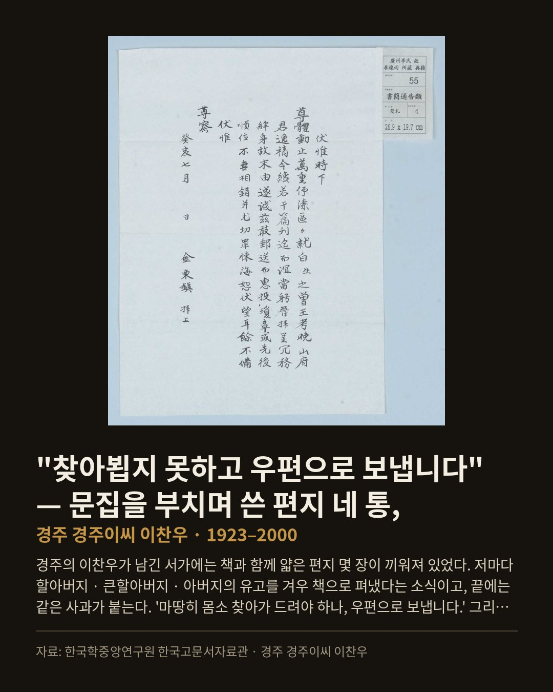
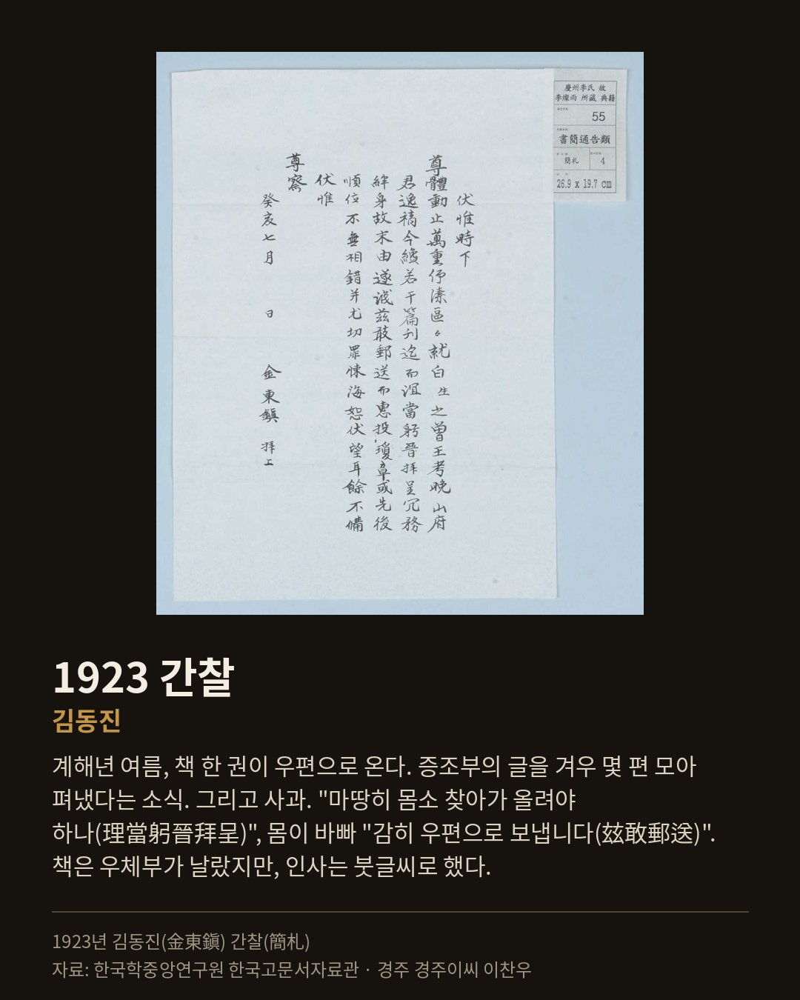
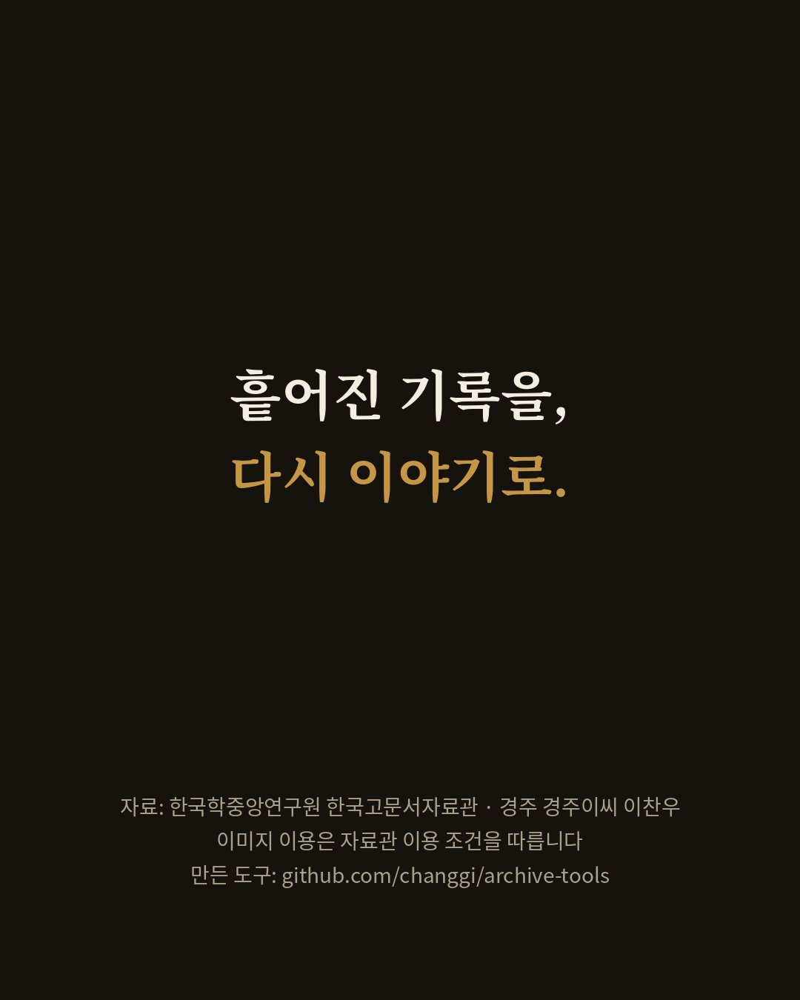

# EP.176 "찾아뵙지 못하고 우편으로 보냅니다" — 문집을 부치며 쓴 편지 네 통, 2000년까지

경주 경주이씨 이찬우 (문중) · 경주의 이찬우가 남긴 서가에는 책과 함께 얇은 편지 몇 장이 끼워져 있었다. 저마다 할아버지 · 큰할아버지 · 아버지의 유고를 겨우 책으로 펴냈다는 소식이고, 끝에는 같은 사과가 붙는다. '마땅히 몸소 찾아가 드려야 하나, 우편으로 보냅니다.' 그리고 '글자가 틀린 곳이 많을 것이니 너그러이 보아 달라.' 마지막 편지는 2000년 여름에 왔다. 한문 사이에 '하십니까'가 섞여 있었다

- 🌐 [전시 웹페이지](https://changgi.github.io/archive-tools/examples/gyeongju-lee-cw-munjip/exhibit.html) (한자 위 한글 독음 · 원문 해석) · [수업 활동지](https://changgi.github.io/archive-tools/examples/gyeongju-lee-cw-munjip/handout.html)
- 🎬 영상: [릴스 9:16](https://changgi.github.io/archive-tools-next/media/ep176-gyeongju-lee-cw-munjip_reel.mp4) · [가로 16:9](https://changgi.github.io/archive-tools-next/media/ep176-gyeongju-lee-cw-munjip_wide.mp4) · 홍보 글: [`promo.md`](promo.md)
- 카드뉴스: [`cards/`](cards/) · SNS 글: [`sns.txt`](sns.txt) · 판독·해석 표: [`selection.csv`](selection.csv)

<!-- DELIVERY -->
## 전달 에디팅 — 이 기록을 이렇게 전합니다

- **핵심 정서** — 정중함과 미안함
- **한 문장** — 문집을 펴내 나누는 일은 20세기 후반까지 이어진 양반가의 예법이었다 — 책은 우편으로 가도, 편지는 여전히 한문 서식(伏惟 · 尊體萬安 · 餘不備)을 지켰고, 2000년에 이르러서야 한글 토씨가 그 틈에 들어왔다.
- **열기** — 2000년에도, 할아버지 문집을 보낼 때는 한문 편지를 함께 넣었습니다.
- **펼치기** — 김동진 간찰 → 신동석 간찰 → 박정곤 간찰 → 최호영 간찰 (1923–2000년) — 계해년 김동진(증조부 만산 유고) → 1986 신동석(조부 연수 유고) → 1990 박정곤(큰할아버지 상봉 유집과 아버지 청계 유고) → 2000 최호영(아버지 야은공 추모집)으로, 연도 순서대로 놓았습니다.
- **절정** — "감히 우편으로 보냅니다(玆敢郵送)" — 화면·공간에서 이 한 줄만 크게, 소리를 줄여 집중
- **여운** — 책 한 권과 편지 한 장을 우편으로 받은 사람은, 무엇으로 답했을까요? — 질문으로 끝내고 답은 보는 사람에게
- **감각과 물질** — 네 통에 되풀이되는 '躬晉拜呈 … 郵送' 그리고 2000년 편지의 '하십니까' · 손바닥 크기 복제를 직접 들고 읽기, 낭독 음성
- **통로와 매개** — 온라인: 릴스(열기) → 카드뉴스(펼치기) → 전시 웹페이지(절정·원문) → 비하인드 카드(여운) / 오프라인: 원본 크기 복제·낭독·참여 벽 / 남기기: 활동지·질문 카드
- **여운 장치** — 집에 있는 '보내 드립니다' 인사 쪽지 · 증정본 서명 찾아보기
- **전달 에디팅 전** — 4건의 문서를 1923–2000년 연대순으로 놓고 문서명 · 유형 · 해설을 붙인다 — 정확하지만, 지나가면 잊힌다.
- **전달 에디팅 후** — 핵심 정서는 「정중함과 미안함」. 「2000년에도, 할아버지 문집을 보낼 때는 한문 편지를 함께 넣었습니다.」로 열고, 문서를 대비와 순서로 펼친 뒤, "감히 우편으로 보냅니다(玆敢郵送)"에서 멈춘다. 네 통에 되풀이되는 '躬晉拜呈 … 郵送' 그리고 2000년 편지의 '하십니까'. 마지막엔 「집에 있는 '보내 드립니다' 인사 쪽지 · 증정본 서명 찾아보기」로 보는 사람이 자기 이야기를 남기고 떠나게 한다.

전문: [`delivery.md`](delivery.md)
<!-- /DELIVERY -->

<!-- CURATOR -->
## 비하인드 — 큐레이터 노트

- **왜 이 문서들인가** — 경주 경주이씨 이찬우가 남긴 전적 1,791건 가운데 서간통고류에서, 여러 집안이 조상의 유고를 펴내 보내며 붙인 편지 네 통을 골랐습니다. 네 통 모두 손글씨를 인쇄하거나 복사해 여러 집에 돌린 '인쇄 편지'입니다.
- **전하고 싶은 것** — 문집을 펴내 나누는 일은 20세기 후반까지 이어진 양반가의 예법이었다 — 책은 우편으로 가도, 편지는 여전히 한문 서식(伏惟 · 尊體萬安 · 餘不備)을 지켰고, 2000년에 이르러서야 한글 토씨가 그 틈에 들어왔다.
- **이렇게 보이길 바랐다** — 계해년 김동진(증조부 만산 유고) → 1986 신동석(조부 연수 유고) → 1990 박정곤(큰할아버지 상봉 유집과 아버지 청계 유고) → 2000 최호영(아버지 야은공 추모집)으로, 연도 순서대로 놓았습니다.
- **이렇게 써 주세요** — 한문 간찰의 서식과 상투어, 20세기 문집 간행과 배포 문화, 우편 제도와 예법의 만남, 한문에서 국한문으로 바뀌는 문체, 기록물 속 '끼워진 종이'의 맥락 수업에 쓰세요.
- **만들며 있었던 일** — 첫 편지의 계해년은 자료관 목록을 따라 1923년으로 적었으나, 인쇄된 서체와 종이로 보아 1983년일 가능성도 있어 이야기에서는 간지로만 불렀습니다. 둘째 편지의 일부 흘림 글자는 …로 두었고, 넷째 편지의 '愚□'의 한 글자는 확정하지 못했습니다. 만산 · 연수 · 상봉 · 청계 · 야은공이 누구인지, 받는 사람이 이찬우였는지는 이 편지들로 확인하지 않았습니다.
- **남겨 둔 질문** — 책 한 권과 편지 한 장을 우편으로 받은 사람은, 무엇으로 답했을까요?
- **제작 기록** — 문서 4건 · 1923–2000년 · 원본 사진 4면(문서 전체) · 원문 판독 4건 · 번역 4건 · 못 읽은 글자 □ 1 · 불확실 (?) 0

전문: [`curator.md`](curator.md) · 비하인드 카드: [`behind/`](behind/) · 채널별 홍보안: [`channels.md`](channels.md)
<!-- /CURATOR -->

## 이야기 — 사료가 말하는 대로

2000년에도, 할아버지 문집을 보낼 때는 한문 편지를 함께 넣었습니다.

> **1923 간찰** — 계해년 여름, 책 한 권이 우편으로 온다. 증조부의 글을 겨우 몇 편 모아 펴냈다는 소식. 그리고 사과. "마땅히 몸소 찾아가 올려야 하나(理當躬晉拜呈)", 몸이 바빠 "감히 우편으로 보냅니다(玆敢郵送)". 책은 우체부가 날랐지만, 인사는 붓글씨로 했다.
> **1986 간찰** — 그리고 1986년 가을. 이번에는 할아버지의 글이다. 다른 집안들이 보내 준 글을 모아 "한 권으로 엮어(輯爲一卷)", 이제야 인쇄를 마쳤다. 그리고 걱정. "글자와 구절에 틀린 곳이 반드시 많을까 두렵습니다(窃恐文字語句必多錯誤處矣)." 그리고 또 한 번, 우편으로 대신한다는 사과.
> **1990 간찰** — 1990년 겨울 문턱. 큰할아버지와 아버지, 두 대의 글이 한 번에 온다. 편지는 짧다. 그래도 그 문장은 빠지지 않는다. "마땅히 몸소 찾아가 올려야 하나(事當躬晉仰呈)", "이에 우편으로 보냅니다(玆以郵送)".
> **2000 간찰** — 그리고 2000년 여름. 같은 일, 같은 서식인데 글자가 조금 다르다. "존체 만안하시고 댁내 두루 평안하십니까(尊體 萬安하시고 宅節이 均吉하십니까)." 한문 사이로 한글이 들어왔다. 걱정도 그대로다. 틀린 글자가 많아 "정오표를 덧붙였으니(更添正誤篇하니)". 책을 보내는 마음은, 서식과 함께 그대로 건너왔다.

| 표지 | 1번 카드 | 마무리 |
|---|---|---|
|  |  |  |

## 선별 문서 (4점)

| # | 연도 | 유형 | 문서명 | 원본 |
|---|---|---|---|---|
| 1 | 1923 | 간찰 | 1923년 김동진(金東鎭) 간찰(簡札) | [원본 보기](https://archive.aks.ac.kr/viewer/viewer.do#imgnode.do?itemId=book&gubun=booktree&depth=6&upPath=06%5E0612%5EL061201%5EL061201F02%5EL061201F0206&dataId=G002%2BKHD%2BKSM-XF.1923.0000-20151117.C0703_002_00055_XXX&itemType=) |
| 2 | 1986 | 간찰 | 1986년 신동석(辛東錫) 간찰(簡札) | [원본 보기](https://archive.aks.ac.kr/viewer/viewer.do#imgnode.do?itemId=book&gubun=booktree&depth=6&upPath=06%5E0612%5EL061201%5EL061201F02%5EL061201F0206&dataId=G002%2BKHD%2BKSM-XF.1986.0000-20151117.C0703_002_00056_XXX&itemType=) |
| 3 | 1990 | 간찰 | 1990년 박정곤(朴定坤) 간찰(簡札) | [원본 보기](https://archive.aks.ac.kr/viewer/viewer.do#imgnode.do?itemId=book&gubun=booktree&depth=6&upPath=06%5E0612%5EL061201%5EL061201F02%5EL061201F0206&dataId=G002%2BKHD%2BKSM-XF.1990.0000-20151117.C0703_002_00057_XXX&itemType=) |
| 4 | 2000 | 간찰 | 2000년 최호영(崔鎬泳) 간찰(簡札) | [원본 보기](https://archive.aks.ac.kr/viewer/viewer.do#imgnode.do?itemId=book&gubun=booktree&depth=6&upPath=06%5E0612%5EL061201%5EL061201F02%5EL061201F0206&dataId=G002%2BKHD%2BKSM-XF.2000.0000-20151117.C0703_002_00058_XXX&itemType=) |

## 원문 판독과 해석

### 1. 1923년 김동진(金東鎭) 간찰(簡札)

**원문 판독**

```
伏惟時下
尊體動止萬重仰溯區區就白生之曾王考晩山府
君遺稿今纔若干篇刊迄而理當躬晉拜呈冗務
絆身故末由遂誠玆敢郵送而惠投瓊章或先後
順位不無相錯并尤切罪悚海恕伏望耳餘不備
伏惟
尊察
癸亥七月 日
金東鎭 拜上
```

**원문 해석** 삼가 요즘 존체 기거가 만중하신지, 우러러 그리운 마음 간절합니다. 아뢰옵니다. 저의 증조부 만산부군의 유고를 이제 겨우 몇 편 간행하였습니다. 마땅히 몸소 찾아가 올려야 하나 바쁜 일에 몸이 묶여 정성을 이루지 못하고, 감히 우편으로 보냅니다. 보내 주신 아름다운 글은 혹 앞뒤 순서가 어긋난 곳이 없지 않을 것이니 더욱 송구합니다. 너그러이 용서해 주시기 바랍니다. 나머지는 다 갖추지 못합니다. 삼가 살펴 주십시오. 계해년 7월 일. 김동진 올림.

**해제** 김동진(金東鎭)이 증조부 만산부군(晩山府君)의 유고를 펴내 보내며 붙인 편지입니다. 손글씨를 인쇄한 것으로, 같은 편지를 여러 집에 함께 보냈음을 보여 줍니다. '마땅히 몸소 찾아가 올려야 하나(理當躬晉拜呈) … 감히 우편으로 보냅니다(玆敢郵送)'라는 사과와, 받는 이가 보내 준 글(瓊章, 만사 · 서문 등)의 순서가 어긋났을까 걱정하는 말이 들어 있습니다. 유고를 펴낼 때 여러 집안에서 글을 받아 함께 싣던 관행이 보입니다. 계해년은 자료관 목록에 따라 1923년으로 적었으나, 인쇄된 서체로 보아 1983년일 가능성도 있습니다.

### 2. 1986년 신동석(辛東錫) 간찰(簡札)

**원문 판독**

```
伏惟際玆霜寒
尊體萬安仰頌就白鄙祖考然叟府君遺
稿并賴僉尊之瓊章輯爲一卷而今纔
畢印以伸殘家之宿願 … 窃恐文
字語句必多錯誤處矣恕覽伏望固
當躬晉拜呈而未克遂誠替此郵送尤切
罪悚伏惟 尊察
丙寅十月 日
下生 辛東錫 拜上
```

**원문 해석** 삼가 서리 내리는 추위에 존체 만안하시기를 우러러 빕니다. 아뢰옵니다. 저의 조부 연수부군의 유고를 여러분께서 주신 아름다운 글과 함께 엮어 한 권으로 만들었는데, 이제 겨우 인쇄를 마쳐 쇠잔한 집안의 오랜 소원을 펴게 되었습니다. … 글자와 구절에 틀린 곳이 반드시 많을까 두려우니 너그러이 보아 주시기 바랍니다. 마땅히 몸소 찾아가 올려야 하나 정성을 이루지 못하고 이렇게 우편으로 대신하니 더욱 송구합니다. 삼가 살펴 주십시오. 병인년(1986) 10월 일. 하생 신동석 올림.

**해제** 1986년(병인) 10월, 신동석(辛東錫)이 조부 연수부군(然叟府君)의 유고를 펴내 보내며 쓴 편지로, 행서 손글씨를 인쇄했습니다. '여러분께서 주신 글과 함께 엮어 한 권으로(并賴僉尊之瓊章輯爲一卷)'라는 말에서, 앞의 편지처럼 다른 집안의 글을 받아 함께 실었음을 알 수 있습니다. '쇠잔한 집안의 오랜 소원(殘家之宿願)'을 이루었다는 표현과, '글자가 틀린 곳이 많을까 두렵다', '우편으로 대신하니 송구하다'는 말이 네 편지에 공통으로 나옵니다. 흘림이 심한 몇 글자는 …로 두었습니다. 자신을 '하생(下生)'이라 낮췄습니다.

### 3. 1990년 박정곤(朴定坤) 간찰(簡札)

**원문 판독**

```
伏惟至寒
尊體候大安仰祝耳就鄙伯祖考翔峰遺集及先考淸溪遺稿
今纔刊行事當躬晉仰呈而緣擾未遂玆以郵送下領之千萬
仰望餘不備伏惟
尊察
庚午十月 日
朴定坤 再拜
```

**원문 해석** 삼가 몹시 추운 때에 존체 대안하시기를 우러러 빕니다. 아뢰옵니다. 저의 큰할아버지 상봉의 유집과 돌아가신 아버지 청계의 유고를 이제 겨우 간행하였습니다. 마땅히 몸소 찾아가 올려야 하나 바쁜 일로 이루지 못하고 이에 우편으로 보내니, 받아 주시기를 천만 우러러 바랍니다. 나머지는 다 갖추지 못합니다. 삼가 살펴 주십시오. 경오년(1990) 10월 일. 박정곤 두 번 절함.

**해제** 1990년(경오) 10월, 박정곤(朴定坤)이 큰할아버지 상봉(翔峰)의 유집과 아버지 청계(淸溪)의 유고를 함께 펴내 보내며 쓴 편지입니다. 두 대의 글을 한꺼번에 묶어 낸 것입니다. 네 통 가운데 가장 짧지만, '마땅히 몸소 찾아가 올려야 하나(事當躬晉仰呈) … 우편으로 보낸다(玆以郵送)'는 뼈대는 그대로입니다. '下領(받아 주십시오)'처럼 책을 보낼 때 쓰는 말과 '再拜'로 마무리했습니다.

### 4. 2000년 최호영(崔鎬泳) 간찰(簡札)

**원문 판독**

```
謹伏審 薰炎에
尊體 萬安하시고 宅節이 均吉
하십니까 愚□은 弟兄이 依昨
하니 是庸爲幸耳 更何煩溷哉
아 先考契帖은(野隱公追慕集)今
纔出刊後 謹呈一冊하니 烏可免譴
責哉아 錄梓中多有誤字落書故
로 更添正誤篇하니 或加恕諒否아
餘不備上狀합니다
庚辰年 八月 日
崔鎬泳 再拜
```

**원문 해석** 삼가 여쭙니다. 찌는 더위에 존체 만안하시고 댁내 두루 평안하십니까. 저희는 형제가 그럭저럭 지내니 다행일 뿐, 더 무엇을 번거롭게 말씀드리겠습니까. 돌아가신 아버지의 계첩(야은공 추모집)을 이제 겨우 펴낸 뒤 삼가 한 권을 드리니, 어찌 꾸지람을 면하겠습니까. 판에 새기는 가운데 틀린 글자와 빠진 글자가 많아 정오표를 덧붙였으니, 너그러이 헤아려 주시겠습니까. 나머지는 다 갖추지 못하고 글월 올립니다. 경진년(2000) 8월 일. 최호영 두 번 절함.

**해제** 2000년(경진) 8월, 최호영(崔鎬泳)이 아버지를 기리는 『야은공 추모집(野隱公追慕集)』을 펴내 보내며 쓴 편지입니다. 앞의 세 통과 달리 한문 구절 사이에 '에', '하시고', '하십니까', '합니다' 같은 한글 토씨와 어미가 들어간 국한문 편지입니다. 그래도 '謹伏審 … 尊體萬安', '餘不備上狀' 같은 간찰의 서식은 그대로 지켰습니다. 틀린 글자와 빠진 글자가 많아 '정오표(正誤篇)'를 덧붙였다는 말은, 첫 편지부터 이어진 '오자 걱정'이 실제 정오표로 나타난 것입니다. '愚□'의 한 글자는 확정하지 못했습니다.

판독·해석·이야기는 이미지에 근거한 초안이며(검토 전 "초안" 표시), 정확한 판독은 원문 확인이 필요합니다. □는 읽지 못한 글자, (?)는 불확실한 글자입니다.
이미지: 한국학중앙연구원 한국고문서자료관 소장·제공. "원본" 링크를 누르면 자료관 뷰어에서 그 문서가 열립니다. 재사용은 자료관에 문의하세요(소장처 동의 필요).
