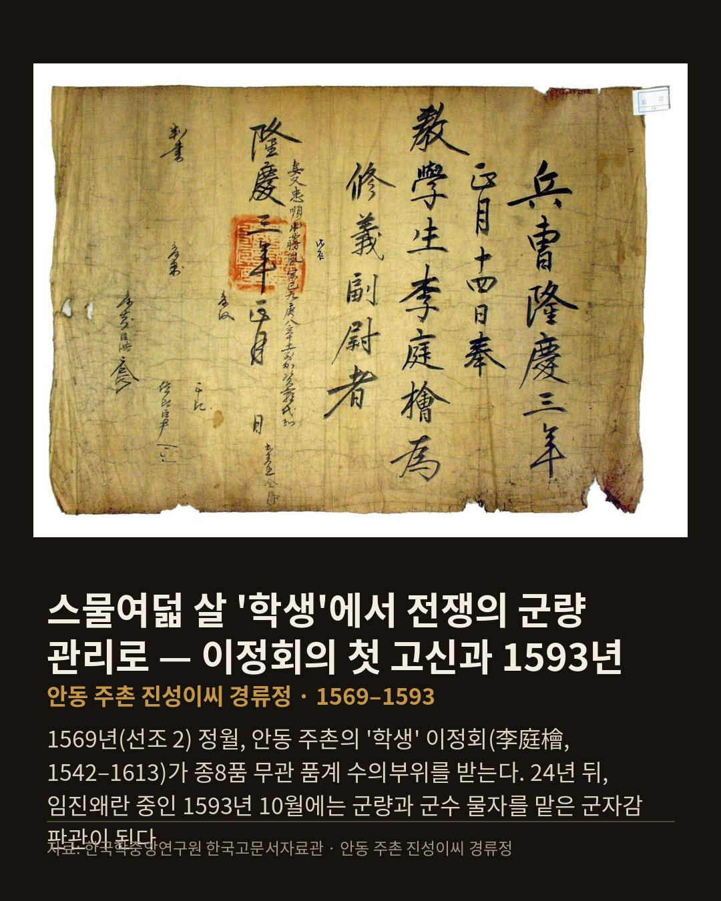
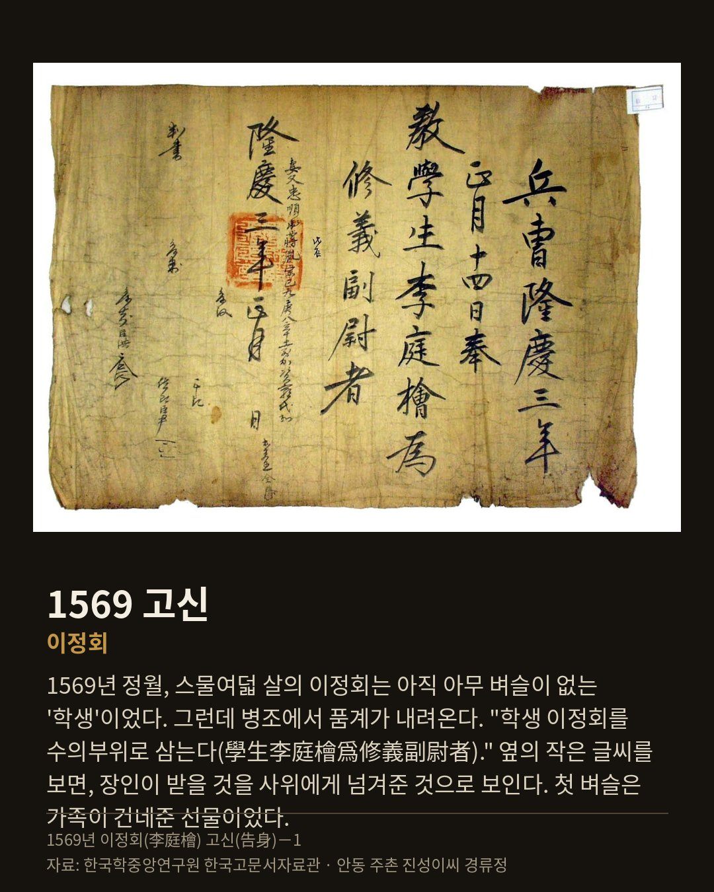
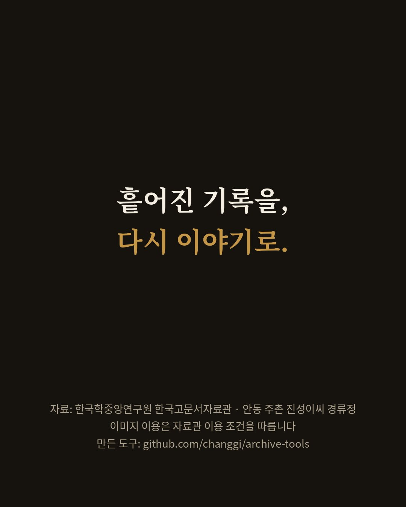

# EP.95 스물여덟 살 '학생'에서 전쟁의 군량 관리로 — 이정회의 첫 고신과 1593년 교지

안동 주촌 진성이씨 경류정 (문중) · 1569년(선조 2) 정월, 안동 주촌의 '학생' 이정회(李庭檜, 1542–1613)가 종8품 무관 품계 수의부위를 받는다. 24년 뒤, 임진왜란 중인 1593년 10월에는 군량과 군수 물자를 맡은 군자감 판관이 된다

- 🌐 [전시 웹페이지](https://changgi.github.io/archive-tools/examples/gyeongryujeong/exhibit.html) (한자 위 한글 독음 · 원문 해석) · [수업 활동지](https://changgi.github.io/archive-tools/examples/gyeongryujeong/handout.html)
- 🎬 영상: [릴스 9:16](https://changgi.github.io/archive-tools/examples/media/ep95-gyeongryujeong_reel.mp4) · [가로 16:9](https://changgi.github.io/archive-tools/examples/media/ep95-gyeongryujeong_wide.mp4) · 홍보 글: [`promo.md`](promo.md)
- 카드뉴스: [`cards/`](cards/) · SNS 글: [`sns.txt`](sns.txt) · 판독·해석 표: [`selection.csv`](selection.csv)


<!-- CURATOR -->
## 비하인드 — 큐레이터 노트

- **왜 이 문서들인가** — 장인의 품계를 사위가 대신 받은(대가) 첫 고신과, 임진왜란 중 군량 관청의 판관 교지가 한 사람의 출발과 전쟁을 보여 주었습니다.
- **전하고 싶은 것** — 첫 벼슬은 가족이 건넨 선물이었고, 전쟁 중에는 칼 대신 곡식으로 싸우는 사람도 있었다는 것.
- **이렇게 보이길 바랐다** — '학생'이라는 신분으로 시작해 군자감 판관으로 끝나는 두 장면으로 구성했습니다.
- **이렇게 써 주세요** — 대가 제도, 임진왜란의 군수 보급을 다루는 수업에 쓰세요.
- **만들며 있었던 일** — 1569년 고신의 작은 글씨 '대가' 판독은 불확실합니다. 1593년 교지의 겸직 고을 이름 첫 글자도 불확실합니다.
- **남겨 둔 질문** — 군량 창고를 지키던 그는 굶주린 군사들 앞에서 어떤 결정을 내렸을까요?
- **제작 기록** — 문서 2건 · 1569–1593년 · 원본 사진 2면(문서 전체) · 원문 판독 2건 · 번역 2건 · 해제에 "확인 필요"를 단 문서 1건

전문: [`curator.md`](curator.md)
<!-- /CURATOR -->

## 이야기 — 사료가 말하는 대로

그의 첫 벼슬은, 장인이 건네준 선물이었습니다.

> **1569 고신** — 1569년 정월, 스물여덟 살의 이정회는 아직 아무 벼슬이 없는 '학생'이었다. 그런데 병조에서 품계가 내려온다. "학생 이정회를 수의부위로 삼는다(學生李庭檜爲修義副尉者)." 옆의 작은 글씨를 보면, 장인이 받을 것을 사위에게 넘겨준 것으로 보인다. 첫 벼슬은 가족이 건네준 선물이었다.
> **1593 고신** — 스물네 해 뒤, 나라는 전쟁 중이었다. 한양을 되찾았지만 군사들은 굶주렸다. 그때 이정회에게 맡겨진 자리. "통훈대부 행 군자감 판관(通訓大夫行軍資監判官)." 군량 창고를 지키는 일이다. 칼 대신 곡식으로 싸우는 전쟁이 그의 몫이었다.

| 표지 | 1번 카드 | 마무리 |
|---|---|---|
|  |  |  |

## 선별 문서 (2점)

| # | 연도 | 유형 | 문서명 | 원본 |
|---|---|---|---|---|
| 1 | 1569 | 고신 | 1569년 이정회(李庭檜) 고신(告身)－1 | [원본 보기](https://archive.aks.ac.kr/viewer/viewer.do#imgnode.do?itemId=book&gubun=booktree&depth=6&upPath=01%5E0167%5EL016717%5EL016717F02%5EL016717F0201&dataId=G002%2BAKS%2BKSM-XA.1569.1111-20101008.B027a_041_00016_XXX&itemType=) |
| 2 | 1593 | 고신 | 1593년 이정회(李庭檜) 고신(告身) | [원본 보기](https://archive.aks.ac.kr/viewer/viewer.do#imgnode.do?itemId=book&gubun=booktree&depth=6&upPath=01%5E0167%5EL016717%5EL016717F02%5EL016717F0201&dataId=G002%2BAKS%2BKSM-XA.1593.1111-20101008.B027a_041_00036_XXX&itemType=) |

## 원문 판독과 해석

### 1. 1569년 이정회(李庭檜) 고신(告身)－1

**원문 판독**

```
兵曹隆慶三年
正月十四日奉
敎 學生李庭檜爲
修義副尉者
隆慶三年正月　日
(소자) 妻父忠順衛 … 己巳 … 代加 (판독 불확실)
判書　參判　參議
參知臣 [수결]
正郞　佐郞臣尹 [수결]
(병조 인)
```

**원문 해석** 병조에서 융경 3년(1569) 정월 14일 왕명을 받들어, 학생 이정회를 수의부위(종8품 무산계)로 삼는다. 융경 3년 정월 일. (작은 글씨) 장인 충순위 … 기사년 … 대가(代加). 판서, 참판, 참의, 참지 신 [서명], 정랑, 좌랑 신 윤[서명].

**해제** 1569년 병조가 아직 벼슬 없는 '학생' 이정회에게 종8품 무산계 수의부위를 준 고신입니다. 왼쪽 작은 글씨가 흐려 확실하지 않으나 '妻父…代加'로 읽힌다면, 장인이 받을 품계를 사위에게 대신 올려 준 '대가(代加)' 제도를 보여 주는 것입니다. 대가는 본인이 이미 최고 품계에 이르렀거나 노직(老職) 등으로 받은 가자를 아들·사위·동생 등에게 대신 줄 수 있게 한 제도였습니다. 이정회는 퇴계 학맥과 이어진 안동의 진성이씨로, 경류정 종가의 인물입니다. 소자 판독은 확인이 필요합니다.

### 2. 1593년 이정회(李庭檜) 고신(告身)

**원문 판독**

```
[敎旨 李庭檜爲]
通訓大夫行
軍資監判官
兼○城縣監者
萬曆二十一年十月十一日
(소자) 癸巳
(시명지보 1과 · 좌측 소자 '陞敍事' 등)
```

**원문 해석** [교지. 이정회를] 통훈대부(정3품 당하) 행 군자감 판관 겸 ○성현감으로 삼는다. 만력 21년(1593) 10월 11일. (작은 글씨) 계사.

**해제** 임진왜란 2년째인 1593년 10월, 이정회를 통훈대부의 품계로 군자감(軍資監) 판관에 임명하고 한 고을의 현감을 겸하게 한 교지입니다. 군자감은 군량과 군수 물자를 관리하는 관청으로, 전쟁 중 가장 바쁜 곳 가운데 하나였습니다. 오른쪽이 떨어져 나가 '敎旨'와 이름 부분이 사라졌고, 겸직 고을 이름의 첫 글자는 판독이 불확실합니다. 1593년은 명군과 함께 평양·서울을 되찾았으나 군량 부족이 극심했던 해입니다.

판독·해석·이야기는 이미지에 근거한 초안이며(검토 전 "초안" 표시), 정확한 판독은 원문 확인이 필요합니다. □는 읽지 못한 글자, (?)는 불확실한 글자입니다.
이미지: 한국학중앙연구원 한국고문서자료관 소장·제공. "원본" 링크를 누르면 자료관 뷰어에서 그 문서가 열립니다. 재사용은 자료관에 문의하세요(소장처 동의 필요).
