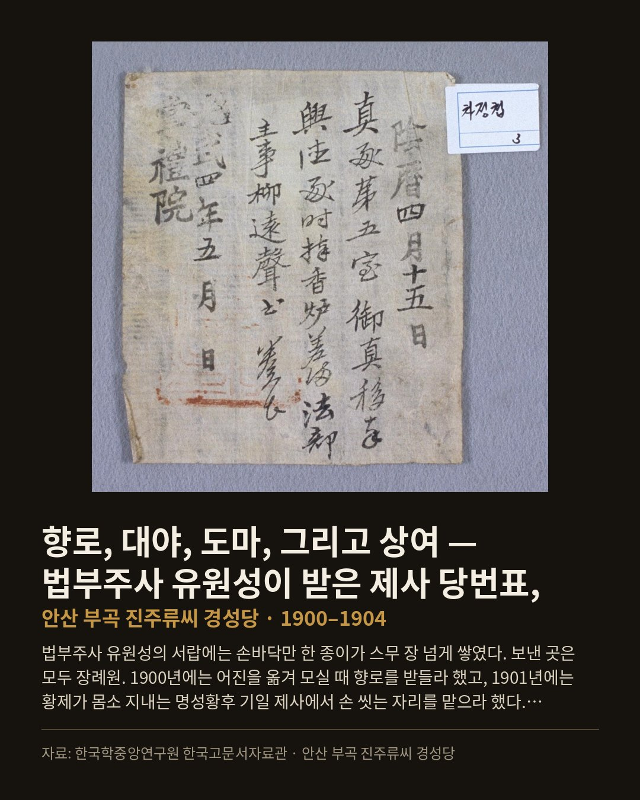
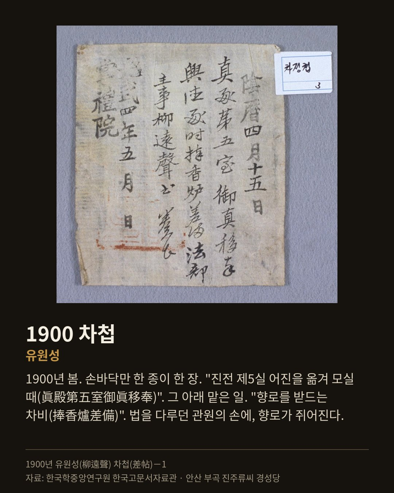
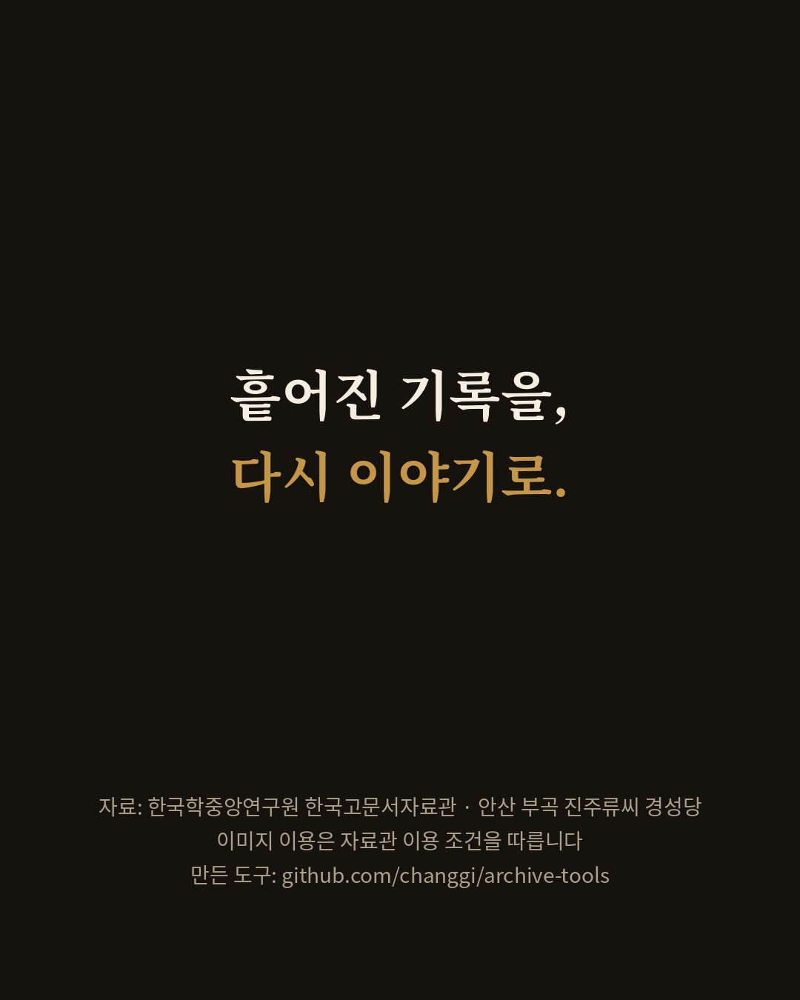

# EP.2 향로, 대야, 도마, 그리고 상여 — 법부주사 유원성이 받은 제사 당번표, 1900–1904

안산 부곡 진주류씨 경성당 (문중) · 법부주사 유원성의 서랍에는 손바닥만 한 종이가 스무 장 넘게 쌓였다. 보낸 곳은 모두 장례원. 1900년에는 어진을 옮겨 모실 때 향로를 받들라 했고, 1901년에는 황제가 몸소 지내는 명성황후 기일 제사에서 손 씻는 자리를 맡으라 했다. 1902년에는 사직대제에서 제물 담은 도마를 받들라 했고, 1904년에는 세상을 떠난 황태자비의 상여가 나갈 때 따르라 했다. 법을 다루던 관원이, 나라의 제사에 차례로 불려 나갔다

- 🌐 [전시 웹페이지](https://changgi.github.io/archive-tools/examples/gyeongseongdang-chajeong/exhibit.html) (한자 위 한글 독음 · 원문 해석) · [수업 활동지](https://changgi.github.io/archive-tools/examples/gyeongseongdang-chajeong/handout.html)
- 🎬 영상: [릴스 9:16](https://changgi.github.io/archive-tools-next/media/ep2-gyeongseongdang-chajeong_reel.mp4) · [가로 16:9](https://changgi.github.io/archive-tools-next/media/ep2-gyeongseongdang-chajeong_wide.mp4) · 홍보 글: [`promo.md`](promo.md)
- 카드뉴스: [`cards/`](cards/) · SNS 글: [`sns.txt`](sns.txt) · 판독·해석 표: [`selection.csv`](selection.csv)

<!-- DELIVERY -->
## 전달 에디팅 — 이 기록을 이렇게 전합니다

- **핵심 정서** — 조용한 의례
- **한 문장** — 나라의 제사는 제사를 맡은 관청만으로 치러지지 않았다 — 장례원은 법부 같은 다른 관청의 관원을 날마다 불러 향로 · 대야 · 제물을 맡겼고, 그 차첩 한 장 한 장이 한 관원의 '또 하나의 이력서'가 된다.
- **열기** — 법을 다루던 관원에게, 제사 당번표가 날아왔습니다.
- **펼치기** — 유원성 차첩－1 → 유원성 차첩－5 → 유원성 차첩－2 (1900–1904년) — 1900 진전 제5실 어진 이봉 때 봉향로 차비 → 1901 경효전 기신제 친행 때 관세위 → 1902 사직대제 봉조관(서계 · 습의 날짜 포함) → 1904 순명비 발인 때 차비관으로 놓았습니다.
- **절정** — "순명비 발인 때 차비관(純明妃發引時差備官)" — 화면·공간에서 이 한 줄만 크게, 소리를 줄여 집중
- **여운** — 향로와 대야와 도마를 들었던 그 손이, 몇 해 뒤 한 고을의 도장을 쥐게 됩니다(EP.200) — 여러분의 '본업 아닌 일'은 무엇이었나요? — 질문으로 끝내고 답은 보는 사람에게
- **감각과 물질** — 네 장 모두 첫 줄 '陰曆'과 왼쪽 '掌禮院', 그리고 맡은 일 捧香爐 · 盥洗位 · 捧俎官 · 差備官 · 어보·관인 탁본 스탬프를 찍어 보는 체험 · 책장을 넘기는 소리, 확대 열람대
- **통로와 매개** — 온라인: 릴스(열기) → 카드뉴스(펼치기) → 전시 웹페이지(절정·원문) → 비하인드 카드(여운) / 오프라인: 원본 크기 복제·낭독·참여 벽 / 남기기: 활동지·질문 카드
- **여운 장치** — 우리 동네 제사 · 행사에서 내가 맡았던 '당번' 떠올려 보기
- **전달 에디팅 전** — 4건의 문서를 1900–1904년 연대순으로 놓고 문서명 · 유형 · 해설을 붙인다 — 정확하지만, 지나가면 잊힌다.
- **전달 에디팅 후** — 핵심 정서는 「조용한 의례」. 「법을 다루던 관원에게, 제사 당번표가 날아왔습니다.」로 열고, 문서를 대비와 순서로 펼친 뒤, "순명비 발인 때 차비관(純明妃發引時差備官)"에서 멈춘다. 네 장 모두 첫 줄 '陰曆'과 왼쪽 '掌禮院', 그리고 맡은 일 捧香爐 · 盥洗位 · 捧俎官 · 差備官. 마지막엔 「우리 동네 제사 · 행사에서 내가 맡았던 '당번' 떠올려 보기」로 보는 사람이 자기 이야기를 남기고 떠나게 한다.

전문: [`delivery.md`](delivery.md)
<!-- /DELIVERY -->

<!-- CURATOR -->
## 비하인드 — 큐레이터 노트

- **왜 이 문서들인가** — EP.1에서 읽은 법부주사 유원성(柳遠聲)의 관고 옆에, 1899–1906년 장례원(掌禮院)이 보낸 차첩(差帖)이 스무 장 넘게 함께 남아 있습니다. 맡은 일이 서로 다른 네 장 — 향로 · 대야 · 도마 · 상여 — 을 골랐습니다.
- **전하고 싶은 것** — 나라의 제사는 제사를 맡은 관청만으로 치러지지 않았다 — 장례원은 법부 같은 다른 관청의 관원을 날마다 불러 향로 · 대야 · 제물을 맡겼고, 그 차첩 한 장 한 장이 한 관원의 '또 하나의 이력서'가 된다.
- **이렇게 보이길 바랐다** — 1900 진전 제5실 어진 이봉 때 봉향로 차비 → 1901 경효전 기신제 친행 때 관세위 → 1902 사직대제 봉조관(서계 · 습의 날짜 포함) → 1904 순명비 발인 때 차비관으로 놓았습니다.
- **이렇게 써 주세요** — 대한제국의 장례원과 국가 제사(사직 · 진전 · 혼전), 제관 차정과 서계(誓戒) · 습의(肄儀), 차첩 서식(음력 날짜 · 직함 · 이름 · 差定), 명성황후의 혼전 경효전과 순명비의 국장 수업에 쓰세요.
- **만들며 있었던 일** — 1901년 차첩의 날짜는 먹 얼룩에 가려 '二十□'으로 읽었으며, 명성황후의 기일(음력 8월 20일)과 맞는 것으로 보았습니다. 1900년 차첩의 '輿(?)陞殿'과 1904년 차첩의 '都預(?)差', 왼쪽 아래 작은 글씨는 확정하지 못했습니다. 각 차첩을 받고 실제로 그 자리에 섰는지는 이 종이로 알 수 없습니다.
- **남겨 둔 질문** — 향로와 대야와 도마를 들었던 그 손이, 몇 해 뒤 한 고을의 도장을 쥐게 됩니다(EP.200) — 여러분의 '본업 아닌 일'은 무엇이었나요?
- **제작 기록** — 문서 4건 · 1900–1904년 · 원본 사진 4면(문서 전체) · 원문 판독 4건 · 번역 4건 · 못 읽은 글자 □ 1 · 불확실 (?) 3

전문: [`curator.md`](curator.md) · 비하인드 카드: [`behind/`](behind/) · 채널별 홍보안: [`channels.md`](channels.md)
<!-- /CURATOR -->

## 이야기 — 사료가 말하는 대로

법을 다루던 관원에게, 제사 당번표가 날아왔습니다.

> **1900 차첩** — 1900년 봄. 손바닥만 한 종이 한 장. "진전 제5실 어진을 옮겨 모실 때(眞殿第五室御眞移奉)". 그 아래 맡은 일. "향로를 받드는 차비(捧香爐差備)". 법을 다루던 관원의 손에, 향로가 쥐어진다.
> **1901 차첩** — 이듬해 가을. 명성황후의 기일이다. "경효전 기신제를 황제가 몸소 지낼 때(景孝殿忌辰祭親行時)". 그가 맡은 자리는 "관세위(盥洗位)". 손 씻는 물을 받드는 자리다. 황제가 그 물에 손을 담근다.
> **1902 차첩** — 1902년 여름. 이번에는 나라의 큰 제사다. "사직대제 봉조관(社稷大祭捧俎官)". 제물 담은 도마를 받드는 일. 작은 글씨로 일정도 왔다. "28일 이른 아침 예행연습(同月二十八日早朝肄儀)".
> **1904 차첩** — 그리고 1904년 겨울. 황태자비가 세상을 떠났다. "순명비 발인 때 차비관(純明妃發引時差備官)". 연습은 세 번. 향로, 대야, 도마를 들던 손이, 이번에는 상여 행렬을 따른다.

| 표지 | 1번 카드 | 마무리 |
|---|---|---|
|  |  |  |

## 선별 문서 (4점)

| # | 연도 | 유형 | 문서명 | 원본 |
|---|---|---|---|---|
| 1 | 1900 | 차첩 | 1900년 유원성(柳遠聲) 차첩(差帖)－1 | [원본 보기](https://archive.aks.ac.kr/viewer/viewer.do#imgnode.do?itemId=book&gubun=booktree&depth=6&upPath=01%5E0141%5EL014132%5EL014132F02%5EL014132F0201&dataId=G002%2BAKS%2BKSM-XA.1900.1111-20101008.B038a_058_00025_XXX&itemType=) |
| 2 | 1901 | 차첩 | 1901년 유원성(柳遠聲) 차첩(差帖)－1 | [원본 보기](https://archive.aks.ac.kr/viewer/viewer.do#imgnode.do?itemId=book&gubun=booktree&depth=6&upPath=01%5E0141%5EL014132%5EL014132F02%5EL014132F0201&dataId=G002%2BAKS%2BKSM-XA.1901.1111-20101008.B038a_058_00027_XXX&itemType=) |
| 3 | 1902 | 차첩 | 1902년 유원성(柳遠聲) 차첩(差帖)－5 | [원본 보기](https://archive.aks.ac.kr/viewer/viewer.do#imgnode.do?itemId=book&gubun=booktree&depth=6&upPath=01%5E0141%5EL014132%5EL014132F02%5EL014132F0201&dataId=G002%2BAKS%2BKSM-XA.1902.1111-20101008.B038a_058_00039_XXX&itemType=) |
| 4 | 1904 | 차첩 | 1904년 유원성(柳遠聲) 차첩(差帖)－2 | [원본 보기](https://archive.aks.ac.kr/viewer/viewer.do#imgnode.do?itemId=book&gubun=booktree&depth=6&upPath=01%5E0141%5EL014132%5EL014132F02%5EL014132F0201&dataId=G002%2BAKS%2BKSM-XA.1904.1111-20101008.B038a_058_00043_XXX&itemType=) |

## 원문 판독과 해석

### 1. 1900년 유원성(柳遠聲) 차첩(差帖)－1

**원문 판독**

```
陰曆四月十五日
眞殿第五室御眞移奉
輿(?)陞殿時捧香爐差備法部
主事柳遠聲差定者
光武四年五月 日
掌禮院
```

**원문 해석** 음력 4월 15일, 진전 제5실 어진을 옮겨 모셔 전각에 올릴 때 향로를 받드는 차비로 법부주사 유원성을 차정한다. 광무 4년(1900) 5월 일. 장례원.

**해제** 1900년(광무 4) 음력 4월 15일, 진전(眞殿, 임금의 초상을 모신 전각) 제5실의 어진(御眞)을 옮겨 모실 때 향로를 받드는 일을 법부주사 유원성에게 맡긴 장례원(掌禮院)의 차첩입니다. 장례원은 대한제국에서 궁중 의례와 제사를 맡은 관청으로, 의례 때마다 다른 관청의 관원을 불러 자리를 맡겼습니다. 손바닥만 한 종이에 음력 날짜 · 행사 · 맡은 일 · 직함과 이름을 적고 '차정한다(差定者)'로 끝맺었습니다. 둘째 줄 첫 글자는 '輿'로 보았으나 확정하지 못했습니다.

### 2. 1901년 유원성(柳遠聲) 차첩(差帖)－1

**원문 판독**

```
陰曆八月二十□行
景孝殿 忌辰祭 親行時盥洗位
法部主事柳遠聲差定者
光武五年九月 日
掌禮院
```

**원문 해석** 음력 8월 20(?)일에 지내는 경효전 기신제를 황제가 몸소 지낼 때 관세위로 법부주사 유원성을 차정한다. 광무 5년(1901) 9월 일. 장례원.

**해제** 1901년(광무 5) 음력 8월, 경효전(景孝殿)의 기신제(忌辰祭, 기일 제사)를 황제가 몸소 지낼(親行) 때 관세위(盥洗位)를 맡긴 차첩입니다. 경효전은 1895년 세상을 떠난 명성황후의 신위를 모신 혼전이고, 날짜 '二十' 다음 글자는 먹 얼룩에 가렸으나 명성황후의 기일인 음력 8월 20일로 보입니다. 관세위는 제사에 앞서 손을 씻는 대야와 물을 맡는 자리입니다. 왼쪽 아래에 장례원의 붉은 관인이 찍혔습니다.

### 3. 1902년 유원성(柳遠聲) 차첩(差帖)－5

**원문 판독**

```
陰曆八月初一日行
社稷大祭捧俎官法部主事
柳遠聲差定者
(작은 글씨) 七月二十六日夕誓戒
同月二十八日早朝肄儀
光武六年八月 日
掌禮院
```

**원문 해석** 음력 8월 1일에 지내는 사직대제의 봉조관으로 법부주사 유원성을 차정한다. (작은 글씨) 7월 26일 저녁 서계, 같은 달 28일 이른 아침 습의. 광무 6년(1902) 8월 일. 장례원.

**해제** 1902년(광무 6) 음력 8월 1일 사직대제(社稷大祭)에서 봉조관(捧俎官)을 맡긴 차첩입니다. 사직은 땅과 곡식의 신에게 지내는 나라의 가장 큰 제사 가운데 하나이고, 봉조관은 희생 제물을 담은 도마(俎)를 받드는 제관입니다. 왼쪽 작은 글씨에 제사 닷새 전 저녁의 서계(誓戒, 몸가짐을 삼가겠다는 맹세)와 사흘 전 이른 아침의 습의(肄儀, 예행연습) 날짜까지 적어, 제관이 미리 챙겨야 할 일정을 알렸습니다.

### 4. 1904년 유원성(柳遠聲) 차첩(差帖)－2

**원문 판독**

```
陰曆十一月二十九日
(작은 글씨) 十七日初再度兼行 二十一日三度
純明妃發引時差備官都預(?)差
法部主事柳遠聲
差定者
光武八年十一月 日
掌禮院
(작은 글씨) 服色同于國葬都監(?)
```

**원문 해석** 음력 11월 29일 순명비 발인 때 차비관으로 법부주사 유원성을 차정한다. (작은 글씨) 17일 첫째 · 둘째 번(습의)을 함께 하고, 21일 셋째 번. 광무 8년(1904) 11월 일. 장례원. (작은 글씨) 복색은 국장도감과 같게 한다(?).

**해제** 1904년(광무 8) 세상을 떠난 황태자비 순명비(純明妃, 순종의 첫 비 민씨)의 발인(發引, 상여가 궁을 떠나는 일) 때 차비관(差備官)을 맡긴 차첩입니다. 오른쪽 작은 글씨는 발인에 앞선 연습을 17일에 첫째 · 둘째 번을 함께, 21일에 셋째 번을 한다는 일정으로 읽었습니다. '都' 다음 글자는 '預'로 보았으나 확정하지 못했고, 왼쪽 아래 작은 글씨도 일부만 읽었습니다. 향로 · 대야 · 도마에 이어, 이번에는 나라의 장례 행렬이었습니다. 2년 뒤 그는 개천군수가 됩니다(EP.1 · EP.200).

판독·해석·이야기는 이미지에 근거한 초안이며(검토 전 "초안" 표시), 정확한 판독은 원문 확인이 필요합니다. □는 읽지 못한 글자, (?)는 불확실한 글자입니다.
이미지: 한국학중앙연구원 한국고문서자료관 소장·제공. "원본" 링크를 누르면 자료관 뷰어에서 그 문서가 열립니다. 재사용은 자료관에 문의하세요(소장처 동의 필요).
