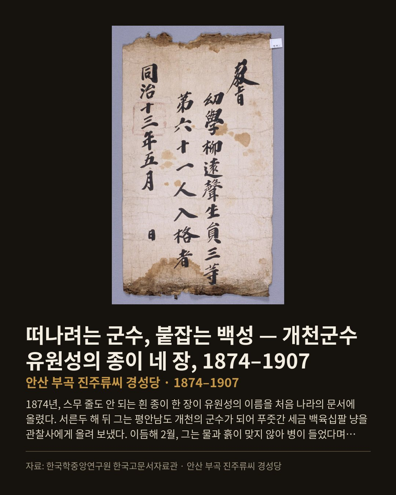
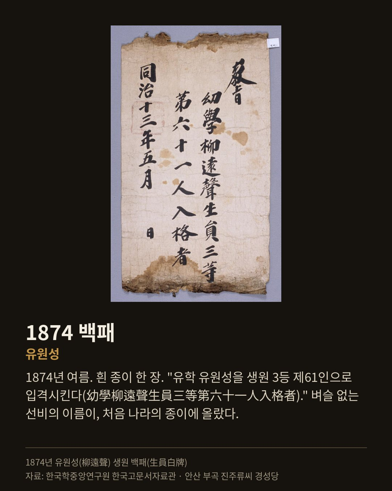
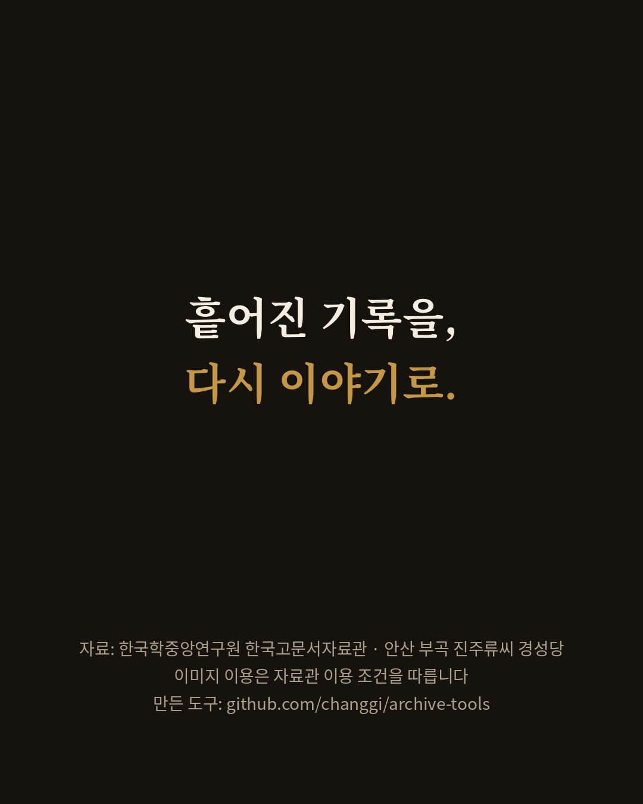

# EP.200 떠나려는 군수, 붙잡는 백성 — 개천군수 유원성의 종이 네 장, 1874–1907

안산 부곡 진주류씨 경성당 (문중) · 1874년, 스무 줄도 안 되는 흰 종이 한 장이 유원성의 이름을 처음 나라의 문서에 올렸다. 서른두 해 뒤 그는 평안남도 개천의 군수가 되어 푸줏간 세금 백육십팔 냥을 관찰사에게 올려 보냈다. 이듬해 2월, 그는 물과 흙이 맞지 않아 병이 들었다며 내부대신에게 물러나게 해 달라고 썼다. 그리고 4월, 개천 사람들이 내부대신에게 다시 글을 올렸다. '자식이 부모를 잃었으니 하늘을 부르짖는다.' 「고문서 한 장」의 이백 번째 이야기는, 한 고을이 떠난 군수를 붙잡으려 쓴 종이에서 마무리된다

- 🌐 [전시 웹페이지](https://changgi.github.io/archive-tools/examples/gyeongseongdang-gaecheon/exhibit.html) (한자 위 한글 독음 · 원문 해석) · [수업 활동지](https://changgi.github.io/archive-tools/examples/gyeongseongdang-gaecheon/handout.html)
- 🎬 영상: [릴스 9:16](https://changgi.github.io/archive-tools-next/media/ep200-gyeongseongdang-gaecheon_reel.mp4) · [가로 16:9](https://changgi.github.io/archive-tools-next/media/ep200-gyeongseongdang-gaecheon_wide.mp4) · 홍보 글: [`promo.md`](promo.md)
- 카드뉴스: [`cards/`](cards/) · SNS 글: [`sns.txt`](sns.txt) · 판독·해석 표: [`selection.csv`](selection.csv)

<!-- DELIVERY -->
## 전달 에디팅 — 이 기록을 이렇게 전합니다

- **핵심 정서** — 잔잔하지만 뜨거운 마무리
- **한 문장** — 한 사람의 관직 이력은 그가 받은 종이(백패 · 관고)로 남지만, 그가 어떤 수령이었는지는 그가 쓴 종이(보고서 · 청원서)와 그를 두고 남이 쓴 종이(원류소)를 나란히 놓아야 보인다.
- **열기** — 떠난 군수를 돌려 달라고, 고을 사람들이 붓을 들었습니다.
- **펼치기** — 유원성 생원 백패 → 군수 유원성 보고서 → 개천군수 유원성 청원서 → 개천군민 고소장 (1874–1907년) — 1874 유학 유원성 생원 백패 → 1906 개천군수 보고서 제14호(푸줏간 세금) → 1907 개천군수 유원성 사직 청원서 → 1907 개천 군민 원류소(내부 제사)로 놓았습니다.
- **절정** — "한 번 불러 얻지 못하면 두 번 부른다(一籲不得則至於再籲)" — 화면·공간에서 이 한 줄만 크게, 소리를 줄여 집중
- **여운** — 이백 장의 옛 종이 끝에서 — 누군가를 붙잡으려 쓴 글은, 어느 서랍에 남아 있을까요? — 질문으로 끝내고 답은 보는 사람에게
- **감각과 물질** — 원류소 첫 줄 '赤子之失父母'와 끝의 열네 사람 이름, 왼쪽 위 붉은 관인과 큰 초서 제사 · 흰 종이 한 장에 조명 하나 · 연명한 이름을 벽에 길게 나열하고 관아 마당처럼 서서 읽는 동선
- **통로와 매개** — 온라인: 릴스(열기) → 카드뉴스(펼치기) → 전시 웹페이지(절정·원문) → 비하인드 카드(여운) / 오프라인: 원본 크기 복제·낭독·참여 벽 / 남기기: 활동지·질문 카드
- **여운 장치** — 우리 동네 사람들이 함께 이름을 적어 올린 글 찾아보기
- **전달 에디팅 전** — 4건의 문서를 1874–1907년 연대순으로 놓고 문서명 · 유형 · 해설을 붙인다 — 정확하지만, 지나가면 잊힌다.
- **전달 에디팅 후** — 핵심 정서는 「잔잔하지만 뜨거운 마무리」. 「떠난 군수를 돌려 달라고, 고을 사람들이 붓을 들었습니다.」로 열고, 문서를 대비와 순서로 펼친 뒤, "한 번 불러 얻지 못하면 두 번 부른다(一籲不得則至於再籲)"에서 멈춘다. 원류소 첫 줄 '赤子之失父母'와 끝의 열네 사람 이름, 왼쪽 위 붉은 관인과 큰 초서 제사. 마지막엔 「우리 동네 사람들이 함께 이름을 적어 올린 글 찾아보기」로 보는 사람이 자기 이야기를 남기고 떠나게 한다.

전문: [`delivery.md`](delivery.md)
<!-- /DELIVERY -->

<!-- CURATOR -->
## 비하인드 — 큐레이터 노트

- **왜 이 문서들인가** — EP.1 · EP.2에서 법부주사 유원성(柳遠聲)이 받은 임명장과 제사 차첩을 읽었습니다. 같은 경성당 문서 가운데 그의 1874년 생원 백패와 1906–1907년 평안남도 개천군수 시절의 보고서 · 청원서, 그리고 개천 군민이 내부대신에게 올린 원류소가 함께 남아 있어 네 장을 골랐습니다. 시리즈의 첫 두 편과 같은 사람으로 마지막 편을 맺습니다.
- **전하고 싶은 것** — 한 사람의 관직 이력은 그가 받은 종이(백패 · 관고)로 남지만, 그가 어떤 수령이었는지는 그가 쓴 종이(보고서 · 청원서)와 그를 두고 남이 쓴 종이(원류소)를 나란히 놓아야 보인다.
- **이렇게 보이길 바랐다** — 1874 유학 유원성 생원 백패 → 1906 개천군수 보고서 제14호(푸줏간 세금) → 1907 개천군수 유원성 사직 청원서 → 1907 개천 군민 원류소(내부 제사)로 놓았습니다.
- **이렇게 써 주세요** — 생원시와 백패, 대한제국의 군수 · 관찰사 · 내부의 문서 체계(보고서 · 청원서 · 소장과 제사), 포사세(庖肆稅), 국한문 혼용 공문, '송유(送劉)' · '차구(借寇)' 같은 고사가 담긴 원류소, 지역 사회와 수령의 관계를 다루는 수업에 쓰세요.
- **만들며 있었던 일** — 원류소 첫 줄의 대표자 이름 두 번째 글자와, 왼쪽 위 내부 제사(題辭)의 초서는 다 읽지 못해 판독에 표시했습니다. 원류소는 군수가 '부임한 지 넉 달(四朔)'이라 했으나, 개천군수 임명 칙명은 1906년 8월 22일(EP.1)이어서 실제 고을에 머문 기간과 맞는지는 확인하지 않았습니다. 원류소가 받아들여져 그가 돌아왔는지는 이 네 장으로 알 수 없습니다.
- **남겨 둔 질문** — 이백 장의 옛 종이 끝에서 — 누군가를 붙잡으려 쓴 글은, 어느 서랍에 남아 있을까요?
- **제작 기록** — 문서 4건 · 1874–1907년 · 원본 사진 13면(문서 전체) · 원문 판독 4건 · 번역 4건 · 못 읽은 글자 □ 0 · 불확실 (?) 2

전문: [`curator.md`](curator.md) · 비하인드 카드: [`behind/`](behind/) · 채널별 홍보안: [`channels.md`](channels.md)
<!-- /CURATOR -->

## 이야기 — 사료가 말하는 대로

떠난 군수를 돌려 달라고, 고을 사람들이 붓을 들었습니다.

> **1874 백패** — 1874년 여름. 흰 종이 한 장. "유학 유원성을 생원 3등 제61인으로 입격시킨다(幼學柳遠聲生員三等第六十一人入格者)." 벼슬 없는 선비의 이름이, 처음 나라의 종이에 올랐다.
> **1906 보고서** — 서른두 해 뒤, 1906년 가을. 평안남도 개천. 그 이름이 이번에는 종이 끝에 서명으로 있다. "개천군수 유원성(价川郡守 柳遠聲)". 관찰사는 세금을 안 낸 푸줏간 주인을 잡아 올리라 했다. 군수는 돈 백육십팔 냥만 올려 보냈다. "그 사람을 잡아 올리는 일은 다시 처분을 기다리겠습니다(該民押上一款은更待處分)."
> **1907 청원서** — 이듬해 2월. 이번에는 그가 먼저 붓을 들었다. "물과 흙이 맞지 않아 갑자기 병이 들었습니다(水土不服에忽嬰疾病)." 그리고 한 줄. "맡은 개천군수의 자리를 서둘러 면해 주시기를(所帶价川郡守之任을亟行奏免)." 안산에서 온 군수는, 그렇게 떠날 채비를 했다.
> **1907 고소장** — 그리고 1907년 4월. 이번에는 개천 사람들이 붓을 들었다. "갓난아이가 부모를 잃으면 하늘을 부르짖는다(赤子之失父母에籲天而求之)." 한 번 호소했고, 기다리라는 답을 받았다. 그래도 다시 썼다. "한 번 불러 얻지 못하면 두 번 부른다(一籲不得則至於再籲)." 열네 사람의 이름이 그 아래 줄지어 있다. 떠나려던 사람과 붙잡으려던 사람의 종이가, 한 집안의 상자에 함께 남았다. 그리고 우리는, 이백 번째 종이를 읽었다.

| 표지 | 1번 카드 | 마무리 |
|---|---|---|
|  |  |  |

## 선별 문서 (4점)

| # | 연도 | 유형 | 문서명 | 원본 |
|---|---|---|---|---|
| 1 | 1874 | 백패 | 1874년 유원성(柳遠聲) 생원 백패(生員白牌) | [원본 보기](https://archive.aks.ac.kr/viewer/viewer.do#imgnode.do?itemId=book&gubun=booktree&depth=6&upPath=01%5E0141%5EL014132%5EL014132F02%5EL014132F0201&dataId=G002%2BAKS%2BKSM-XA.1874.1111-20101008.B038a_058_00023_XXX&itemType=) |
| 2 | 1906 | 보고서 | 1906년 군수(郡守) 유원성(柳遠聲) 보고서(報告書) | [원본 보기](https://archive.aks.ac.kr/viewer/viewer.do#imgnode.do?itemId=book&gubun=booktree&depth=6&upPath=01%5E0141%5EL014132%5EL014132F02%5EL014132F0203&dataId=G002%2BAKS%2BKSM-XC.1906.0000-20101008.B038a_058_00136_XXX&itemType=) |
| 3 | 1907 | 청원서 | 1907년 개천군수(价川郡守) 유원성(柳遠聲) 청원서(請願書) | [원본 보기](https://archive.aks.ac.kr/viewer/viewer.do#imgnode.do?itemId=book&gubun=booktree&depth=6&upPath=01%5E0141%5EL014132%5EL014132F02%5EL014132F0202&dataId=G002%2BAKS%2BKSM-XB.1907.0000-20101008.B038a_058_00082_XXX&itemType=) |
| 4 | 1907 | 고소장 | 1907년 개천군민(价川郡民) 고소장(告訴狀) | [원본 보기](https://archive.aks.ac.kr/viewer/viewer.do#imgnode.do?itemId=book&gubun=booktree&depth=6&upPath=01%5E0141%5EL014132%5EL014132F02%5EL014132F0202&dataId=G002%2BAKS%2BKSM-XB.1907.0000-20101008.B038a_058_00062_XXX&itemType=) |

## 원문 판독과 해석

### 1. 1874년 유원성(柳遠聲) 생원 백패(生員白牌)

**원문 판독**

```
敎旨
幼學柳遠聲生員三等
第六十一人入格者
同治十三年五月 日
```

**원문 해석** 교지. 유학 유원성을 생원 3등 제61인으로 입격시킨다. 동치 13년(1874) 5월 일.

**해제** 1874년(고종 11) 5월, 유원성(柳遠聲)이 생원시에 3등 제61인으로 입격하고 받은 백패입니다. 이름 앞의 '유학(幼學)'은 아직 벼슬이 없는 선비라는 뜻입니다. 연호 위에 과거 관인이 희미하게 찍혔고, 위아래 가장자리가 물에 젖은 듯 갈색으로 번지고 헤졌습니다. 이 집안에는 이 뒤로 1895–1901년 그가 받은 관고 · 차첩이 이어지고, 그 끝에 개천군수 시절의 문서가 남았습니다.

### 2. 1906년 군수(郡守) 유원성(柳遠聲) 보고서(報告書)

**원문 판독**

```
報告書第十四號
第一號訓令을奉准ㅎ온즉本郡丙午度庖肆主人吉敬國
은前已差定發訓이거날庖稅金을拖至屢月에尙何不
納이니究厥所習에誠極駭然이더러現今上納이萬分時
急이기同稅金을玆庸左開發訓ㅎ니到卽該庖民處에
照數推捧ㅎ고定巡校押上事等因이온바捉入吉敬國ㅎ야
督納稅錢이온즉供以爲今年春秋兩等庖稅合三百六十
兩內에一百九十二兩은已納于平壤元庖主金祐錫處이옵고
在錢이爲一百六十八兩이다卽爲現納이온바同錢一百六十八兩
을依數上送而該民押上一款은更待處分ㅎ오며玆에
報告ㅎ오니
查照ㅎ시믈伏望
光武十年九月十八日
价川郡守 柳遠聲
觀察使 閣下
```

**원문 해석** 보고서 제14호. 제1호 훈령을 받들어 보니, '이 군의 병오년(1906) 포사(푸줏간) 주인 길경국은 이미 앞서 정해 훈령을 내렸는데도 포세(푸줏간 세금)를 여러 달 끌며 아직도 내지 않으니, 그 버릇을 따져 보면 참으로 놀랍다. 지금 상납이 몹시 급하므로 그 세금을 아래에 적어 훈령을 내리니, 받는 즉시 그 푸줏간 사람에게 수량대로 거두고 순교를 정해 잡아 올려 보내라'는 내용이었습니다. 길경국을 잡아들여 세금을 독촉하니, 그가 진술하기를 올해 봄 · 가을 두 차례 포세 합계 360냥 가운데 192냥은 이미 평양의 원포주(元庖主) 김우석에게 냈고, 남은 돈은 168냥이라 하여 곧 그 자리에서 냈습니다. 그 돈 168냥을 수량대로 올려 보내며, 그 사람을 잡아 올려 보내는 일은 다시 처분을 기다리겠기에 이렇게 보고하오니 살펴 주시기를 엎드려 바랍니다. 광무 10년(1906) 9월 18일. 개천군수 유원성. 관찰사 각하.

**해제** 1906년(광무 10) 9월, 평안남도 개천군수 유원성이 관찰사에게 올린 보고서 제14호입니다. 관찰사가 푸줏간(포사) 세금을 내지 않은 길경국을 잡아 세금을 받고 압송하라고 훈령하자, 군수는 그를 불러 세금 168냥을 받아 올려 보내면서도 압송만은 '다시 처분을 기다리겠다'고 미뤘습니다. 360냥 가운데 192냥은 이미 평양의 원포주에게 냈다는 진술을 그대로 적어, 밀린 돈이 생각보다 적다는 사정을 함께 올린 셈입니다. 국한문 혼용의 대한제국 공문이며, 오른쪽 아래와 날짜 아래에 개천군의 관인이 찍혔습니다. 같은 보고서에는 세금 명세를 적은 장들이 이어집니다.

### 3. 1907년 개천군수(价川郡守) 유원성(柳遠聲) 청원서(請願書)

**원문 판독**

```
請願書
本郡守素以疲劣之姿로不稱當於任職之末이온디
已於昨年에猥蒙地方官之任ㅎ와揆以身分에徒切兢
懼ㅎ와卽欲奉辭自退이오나冒據蹲仍ㅎ야荏苒至
此者은妄擬竭力盡職ㅎ야圖報萬一이옵더니但水土
不服에忽嬰疾病ㅎ고才識淺短에末由堪當이옵기
玆敢請願ㅎ오니
特念情勢ㅎ오셔所帶价川郡守之任을亟行
奏免ㅎ시와俾安私分之地을伏望
光武十一年二月 日
平安南道价川郡守 柳遠聲
內部大臣 閣下
```

**원문 해석** 청원서. 이 군수는 본디 지치고 모자란 자질로 관직의 끝자리에도 걸맞지 않은데, 지난해 외람되이 지방관의 자리를 받아 제 분수를 헤아리니 두렵기만 하여 곧 사직하고 물러나려 하였습니다. 그래도 무릅쓰고 머물러 지금에 이른 것은 힘을 다해 직무를 다함으로써 만분의 일이라도 갚으려 한 것이었습니다. 다만 물과 흙이 맞지 않아 갑자기 병이 들었고, 재주와 식견이 얕고 짧아 감당할 길이 없기에 감히 청원하오니, 사정을 특별히 헤아리시어 맡고 있는 개천군수의 자리를 서둘러 상주하여 면해 주시고, 제 분수에 편히 머물게 해 주시기를 엎드려 바랍니다. 광무 11년(1907) 2월 일. 평안남도 개천군수 유원성. 내부대신 각하.

**해제** 1907년(광무 11) 2월, 개천군수 유원성이 내부대신에게 군수 자리에서 물러나게 해 달라고 올린 청원서입니다. 사직의 이유로 '물과 흙이 맞지 않아(水土不服) 병이 들었다'는 것과 '재주가 모자라 감당할 수 없다'는 것을 들었는데, 뒤의 것은 사직 글에 흔히 쓰는 겸사입니다. 인쇄된 '內部' 괘지에 썼고 이름 아래 사인(私印)이 찍혔으며, 같은 내용의 장이 두 장 남아 있어 그 가운데 한 장을 실었습니다. 경기도 안산 사람이 평안도 산골 고을에서 병을 얻었다는 사정이 읽힙니다.

### 4. 1907년 개천군민(价川郡民) 고소장(告訴狀)

**원문 판독**

```
平安南道价川郡民人等李瑄(?)願留訴狀
伏以赤子之失父母에籲天而求之는至情至哀者也라本官은卽
矣等之父母也오上部는乃矣等之二天也라本官이莅任四朔에
許多善蹟은難可一一枚達이온且甲午之戰塵이未霽ㅎ고甲辰
之兵火가未熄에民之流離者를撫而安堵ㅎ고民之濱死者를救而復
蘇이옵고바百家活佛이오萬口頌碑라民有來暮之歎이옵고官
有杜召之稱이옵더니不意月前에居然(?)遽作賦歸之行이다挽
車遮道이다가竟作送劉之日에民情이怳若有失而如無所歸故
로前此泣血齊籲于上部이옵더니旨令內에已有前題ㅎ니宜
俟部辦ㅎ지라殿最所重이니不必煩訴ㅎ을事이온바非不知
旨令之確當이오나盖赤子之思父母也에一籲不得則至於再籲는
至慕至切之情이옵기玆敢更訴ㅎ오니特察輿情ㅎ시와俾
蒙借寇之地千萬伏祝
光武十一年四月 日 玄基贊 金基鶴 李能彦 李正熙 李廷國 玄命赫
玄應九 申丙幹 李子實 李鶴洙 尹廷璉 崔達成 崔秉勳 玄宗洙 等
內部大臣 閣下
(제사 · 초서) 又此呈訴 … 前題 …
```

**원문 해석** 평안남도 개천군 백성 이선(?) 등의 원류소장(머물러 주기를 바라는 소장). 엎드려 아뢰건대, 갓난아이가 부모를 잃으면 하늘을 부르짖으며 찾는 것은 지극한 정이요 지극한 슬픔입니다. 본관(군수)은 곧 저희의 부모요, 상부(내부)는 저희의 두 번째 하늘입니다. 본관이 부임한 지 넉 달 동안의 많은 선정은 하나하나 다 아뢰기 어렵습니다. 갑오년(1894) 전쟁의 먼지가 아직 걷히지 않고 갑진년(1904) 전쟁의 불길이 아직 꺼지지 않은 때에, 떠도는 백성을 어루만져 자리 잡게 하고 죽어 가는 백성을 구해 되살렸으니, 백 집의 살아 있는 부처요 만 사람의 입이 송덕비였습니다. 백성은 '왜 이제야 오셨나' 하는 탄식이 있었고, 관에는 두시 · 소신(杜召) 같은 명관이라는 칭송이 있었습니다. 그런데 뜻밖에 지난달 갑자기 돌아가는 길에 오르셨습니다. 수레를 붙잡고 길을 막다가 끝내 유총(劉寵)을 보내던 날처럼 보내고 나니, 백성의 마음이 무엇을 잃은 듯 돌아갈 곳이 없는 듯합니다. 그래서 앞서 피눈물로 함께 상부에 호소하였는데, 지령에 '이미 앞서 제사를 내렸으니 마땅히 부의 처리를 기다려야 하고, 수령의 고과는 중대한 일이니 번거롭게 호소할 것 없다'고 하셨습니다. 지령이 옳다는 것을 모르는 것은 아니나, 갓난아이가 부모를 그리워함에 한 번 불러 얻지 못하면 두 번 부르는 것은 지극히 사모하고 간절한 정이기에 감히 다시 호소하오니, 여론을 특별히 살피시어 구순(寇恂)을 빌리듯 그를 다시 빌려 주시기를 천만 엎드려 빕니다. 광무 11년(1907) 4월 일. 현기찬 · 김기학 · 이능언 · 이정희 · 이정국 · 현명혁 · 현응구 · 신병간 · 이자실 · 이학수 · 윤정련 · 최달성 · 최병훈 · 현종수 등. 내부대신 각하.

**해제** 1907년(광무 11) 4월, 평안남도 개천군 백성들이 떠난 군수(유원성)를 다시 보내 달라고 내부대신에게 올린 원류소(願留訴)입니다. 군수가 갑오(1894 청일전쟁) · 갑진(1904 러일전쟁)의 전란 뒤 흩어진 백성을 안정시켰다고 칭송하고, 한나라의 유총이 떠날 때 백성이 배웅한 고사(送劉), 백성이 구순을 '빌려 달라'고 청한 고사(借寇)를 들었습니다. 이미 한 번 호소했다가 '부의 처리를 기다리라'는 지령을 받은 뒤의 두 번째 호소이며, 열네 사람이 이름을 적었습니다. 2월에 군수 스스로 병을 이유로 사직을 청한 청원서(3번 문서)와 이어 읽으면, 떠나려는 군수와 붙잡는 고을이 한 상자에 함께 남은 셈입니다. 왼쪽 위의 큰 초서는 내부가 써 준 제사(題辭)로 붉은 관인이 겹쳐 찍혔는데, 앞서 제사를 내렸다는 취지만 읽었습니다. 첫 줄 대표자 이름의 둘째 글자와 '居然'은 확정하지 못했습니다. 그가 돌아왔는지는 이 문서로 알 수 없습니다.

판독·해석·이야기는 이미지에 근거한 초안이며(검토 전 "초안" 표시), 정확한 판독은 원문 확인이 필요합니다. □는 읽지 못한 글자, (?)는 불확실한 글자입니다.
이미지: 한국학중앙연구원 한국고문서자료관 소장·제공. "원본" 링크를 누르면 자료관 뷰어에서 그 문서가 열립니다. 재사용은 자료관에 문의하세요(소장처 동의 필요).
