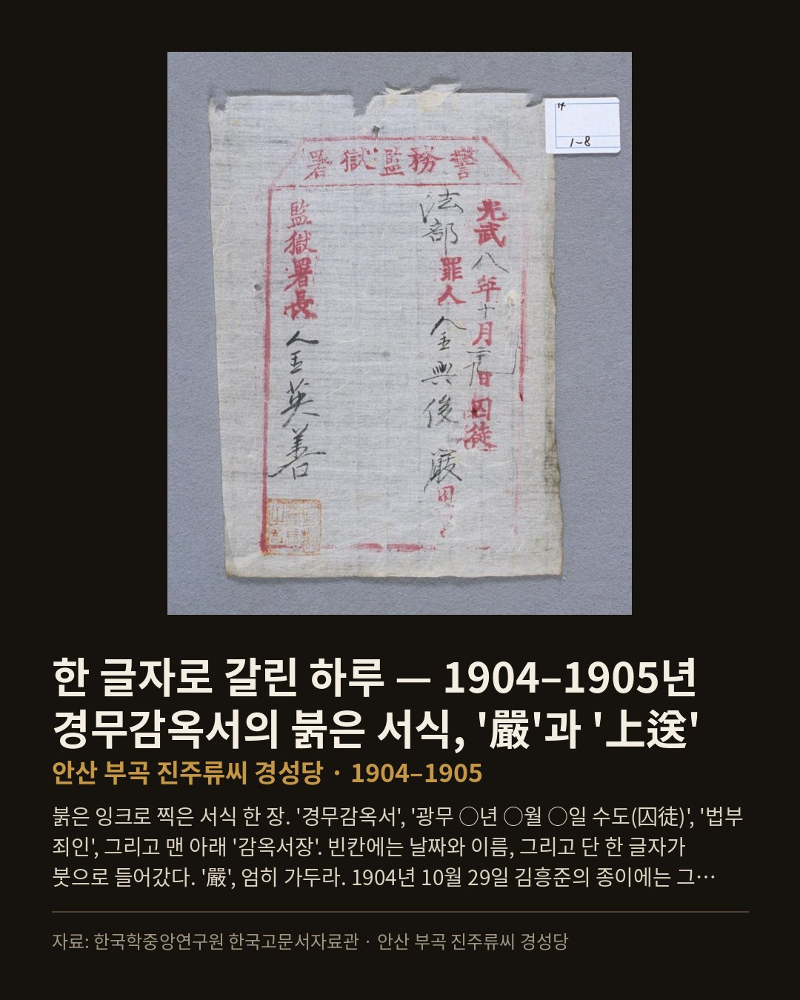
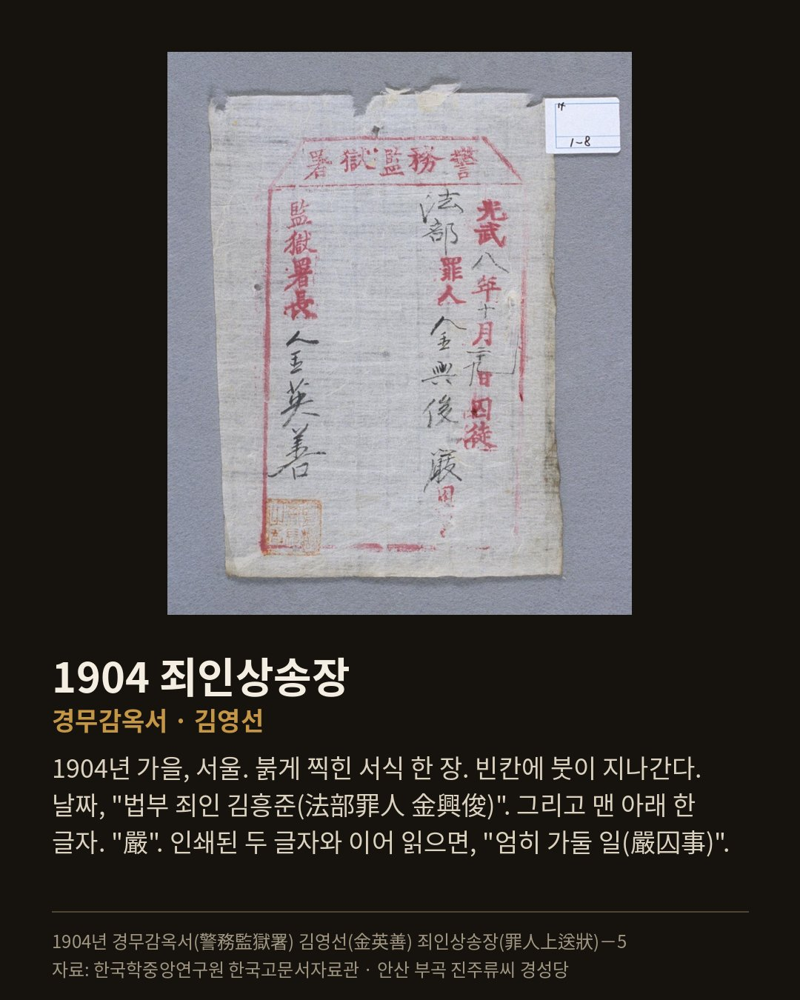
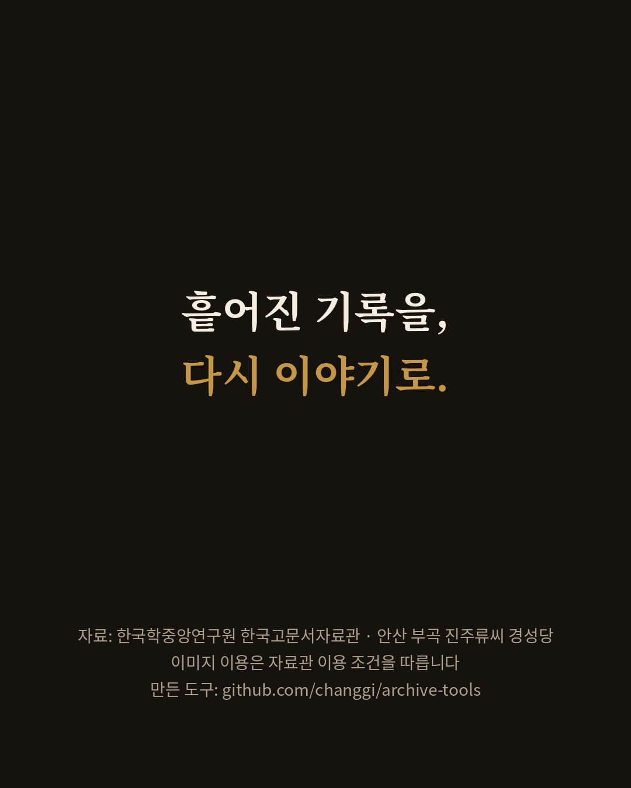

# EP.182 한 글자로 갈린 하루 — 1904–1905년 경무감옥서의 붉은 서식, '嚴'과 '上送'

안산 부곡 진주류씨 경성당 (문중) · 붉은 잉크로 찍은 서식 한 장. '경무감옥서', '광무 ○년 ○월 ○일 수도(囚徒)', '법부 죄인', 그리고 맨 아래 '감옥서장'. 빈칸에는 날짜와 이름, 그리고 단 한 글자가 붓으로 들어갔다. '嚴', 엄히 가두라. 1904년 10월 29일 김흥준의 종이에는 그 글자가, 이튿날 같은 이름의 종이에는 '上送', 올려 보내라가 적혔다. 넉 달 뒤 최동식에게도 같은 두 장이 왔다

- 🌐 [전시 웹페이지](https://changgi.github.io/archive-tools/examples/gyeongseongdang-gamok/exhibit.html) (한자 위 한글 독음 · 원문 해석) · [수업 활동지](https://changgi.github.io/archive-tools/examples/gyeongseongdang-gamok/handout.html)
- 🎬 영상: [릴스 9:16](https://changgi.github.io/archive-tools-next/media/ep182-gyeongseongdang-gamok_reel.mp4) · [가로 16:9](https://changgi.github.io/archive-tools-next/media/ep182-gyeongseongdang-gamok_wide.mp4) · 홍보 글: [`promo.md`](promo.md)
- 카드뉴스: [`cards/`](cards/) · SNS 글: [`sns.txt`](sns.txt) · 판독·해석 표: [`selection.csv`](selection.csv)

<!-- DELIVERY -->
## 전달 에디팅 — 이 기록을 이렇게 전합니다

- **핵심 정서** — 서늘함
- **한 문장** — 대한제국의 감옥 행정은 미리 찍어 둔 서식의 빈칸으로 움직였다 — 날짜 · 이름 · 처분 한 글자만 붓으로 채우면 되는 종이가, 한 사람을 '엄히 가두기도(嚴囚)' 하고 '올려 보내기도(上送)' 했다.
- **열기** — 붉은 서식의 빈칸에 들어간 글자는 단 하나였습니다. '嚴', 엄히 가두라.
- **펼치기** — 경무감옥서 김영선 죄인상송장－5 → 경무감옥서 김영선 죄인상송장－4 → 경무감옥서 김영선 죄인상송장－3 → 경무감옥서 김영선 죄인상송장－1 (1904–1905년) — 1904년 10월 29일 김흥준 엄수 → 10월 30일 김흥준 상송 → 1905년 2월 11일 최동식 엄수 → 2월 □1일 최동식 상송으로, 같은 이름이 두 번 나오는 순서대로 놓았습니다.
- **절정** — "올려 보냄(上送)" — 화면·공간에서 이 한 줄만 크게, 소리를 줄여 집중
- **여운** — 이름 두 글자와 처분 한 글자 — 이 종이를 받은 사람의 그다음 날은 어땠을까요? — 질문으로 끝내고 답은 보는 사람에게
- **감각과 물질** — 붉게 인쇄된 '法部罪人'과 '囚事' 사이, 붓으로 쓴 이름과 한 글자
- **통로와 매개** — 온라인: 릴스(열기) → 카드뉴스(펼치기) → 전시 웹페이지(절정·원문) → 비하인드 카드(여운) / 오프라인: 원본 크기 복제·낭독·참여 벽 / 남기기: 활동지·질문 카드
- **여운 장치** — 우리가 매일 채우는 '빈칸 서식'(신청서 · 동의서) 떠올리기
- **전달 에디팅 전** — 4건의 문서를 1904–1905년 연대순으로 놓고 문서명 · 유형 · 해설을 붙인다 — 정확하지만, 지나가면 잊힌다.
- **전달 에디팅 후** — 핵심 정서는 「서늘함」. 「붉은 서식의 빈칸에 들어간 글자는 단 하나였습니다. '嚴', 엄히 가두라.」로 열고, 문서를 대비와 순서로 펼친 뒤, "올려 보냄(上送)"에서 멈춘다. 붉게 인쇄된 '法部罪人'과 '囚事' 사이, 붓으로 쓴 이름과 한 글자. 마지막엔 「우리가 매일 채우는 '빈칸 서식'(신청서 · 동의서) 떠올리기」로 보는 사람이 자기 이야기를 남기고 떠나게 한다.

전문: [`delivery.md`](delivery.md)
<!-- /DELIVERY -->

<!-- CURATOR -->
## 비하인드 — 큐레이터 노트

- **왜 이 문서들인가** — 안산 부곡 진주류씨 경성당 문서 1,333건 가운데, 1904–1905년 경무감옥서장 김영선 명의의 같은 서식 열한 장이 한 묶음으로 남아 있습니다. 같은 죄인의 이름이 두 번 나오는 두 쌍, 네 장을 골랐습니다.
- **전하고 싶은 것** — 대한제국의 감옥 행정은 미리 찍어 둔 서식의 빈칸으로 움직였다 — 날짜 · 이름 · 처분 한 글자만 붓으로 채우면 되는 종이가, 한 사람을 '엄히 가두기도(嚴囚)' 하고 '올려 보내기도(上送)' 했다.
- **이렇게 보이길 바랐다** — 1904년 10월 29일 김흥준 엄수 → 10월 30일 김흥준 상송 → 1905년 2월 11일 최동식 엄수 → 2월 □1일 최동식 상송으로, 같은 이름이 두 번 나오는 순서대로 놓았습니다.
- **이렇게 써 주세요** — 대한제국의 경무청과 감옥서, 법부의 재판과 죄수 이송, 인쇄 서식(양식)의 등장, 근대 행정 문서가 '빈칸 채우기'로 바뀌는 과정, 기록 속 개인정보와 처분의 무게 수업에 쓰세요.
- **만들며 있었던 일** — 처분 칸의 흘림 글자는 '嚴(엄)'과 '上送(상송)'으로 읽었으나, 둘째 · 넷째 장의 '上送'은 붓이 짧아 다른 글자일 가능성을 남겨 둡니다. 최동식 상송 장의 날짜 십 단위는 붉은 인주에 가려 '□一日'로 두었습니다. 김흥준 · 최동식이 무슨 죄로 갇혔는지, 어디로 보내졌는지, 이 서식들이 왜 안산 진주류씨 집안에 전하는지는 이 문서들로 확인하지 않았습니다. 같은 집안의 유원성(柳遠聲)이 이 무렵 관직에 있었으나 관련은 확인하지 않았습니다.
- **남겨 둔 질문** — 이름 두 글자와 처분 한 글자 — 이 종이를 받은 사람의 그다음 날은 어땠을까요?
- **제작 기록** — 문서 4건 · 1904–1905년 · 원본 사진 4면(문서 전체) · 원문 판독 4건 · 번역 4건 · 못 읽은 글자 □ 1 · 불확실 (?) 0

전문: [`curator.md`](curator.md) · 비하인드 카드: [`behind/`](behind/) · 채널별 홍보안: [`channels.md`](channels.md)
<!-- /CURATOR -->

## 이야기 — 사료가 말하는 대로

붉은 서식의 빈칸에 들어간 글자는 단 하나였습니다. '嚴', 엄히 가두라.

> **1904 죄인상송장** — 1904년 가을, 서울. 붉게 찍힌 서식 한 장. 빈칸에 붓이 지나간다. 날짜, "법부 죄인 김흥준(法部罪人 金興俊)". 그리고 맨 아래 한 글자. "嚴". 인쇄된 두 글자와 이어 읽으면, "엄히 가둘 일(嚴囚事)".
> **1904 죄인상송장** — 그리고 이튿날. 같은 서식, 같은 이름. "법부 죄인 김흥준." 그런데 아래 칸이 다르다. 인쇄된 '가둘 일'을 줄로 긋고, 그 옆에 쓴다. "올려 보냄(上送)." 하루 만에, 그는 감옥을 떠나 어디론가 보내졌다.
> **1905 죄인상송장** — 넉 달 뒤, 1905년 2월. 같은 붉은 서식에 새 이름이 들어간다. "법부 죄인 최동식(法部罪人 崔東植)." 그리고 같은 한 글자. "嚴." 이 종이 묶음에는 이런 이름이 열한 장 있다.
> **1905 죄인상송장** — 그리고 같은 달, 최동식의 두 번째 종이. 인쇄된 글자는 붉게 덧칠해 지워졌고, 그 자리에 붓이 쓴다. "올려 보냄(上送)." 날짜의 한 글자는 붉은 인주에 묻혔다. 그날이 언제였는지, 그가 어디로 갔는지, 종이는 말하지 않는다.

| 표지 | 1번 카드 | 마무리 |
|---|---|---|
|  |  |  |

## 선별 문서 (4점)

| # | 연도 | 유형 | 문서명 | 원본 |
|---|---|---|---|---|
| 1 | 1904 | 죄인상송장 | 1904년 경무감옥서(警務監獄署) 김영선(金英善) 죄인상송장(罪人上送狀)－5 | [원본 보기](https://archive.aks.ac.kr/viewer/viewer.do#imgnode.do?itemId=book&gubun=booktree&depth=6&upPath=01%5E0141%5EL014132%5EL014132F02%5EL014132F0203&dataId=G002%2BAKS%2BKSM-XC.1904.0000-20101008.B038a_058_00176_XXX&itemType=) |
| 2 | 1904 | 죄인상송장 | 1904년 경무감옥서(警務監獄署) 김영선(金英善) 죄인상송장(罪人上送狀)－4 | [원본 보기](https://archive.aks.ac.kr/viewer/viewer.do#imgnode.do?itemId=book&gubun=booktree&depth=6&upPath=01%5E0141%5EL014132%5EL014132F02%5EL014132F0203&dataId=G002%2BAKS%2BKSM-XC.1904.0000-20101008.B038a_058_00175_XXX&itemType=) |
| 3 | 1905 | 죄인상송장 | 1905년 경무감옥서(警務監獄署) 김영선(金英善) 죄인상송장(罪人上送狀)－3 | [원본 보기](https://archive.aks.ac.kr/viewer/viewer.do#imgnode.do?itemId=book&gubun=booktree&depth=6&upPath=01%5E0141%5EL014132%5EL014132F02%5EL014132F0203&dataId=G002%2BAKS%2BKSM-XC.1905.0000-20101008.B038a_058_00181_XXX&itemType=) |
| 4 | 1905 | 죄인상송장 | 1905년 경무감옥서(警務監獄署) 김영선(金英善) 죄인상송장(罪人上送狀)－1 | [원본 보기](https://archive.aks.ac.kr/viewer/viewer.do#imgnode.do?itemId=book&gubun=booktree&depth=6&upPath=01%5E0141%5EL014132%5EL014132F02%5EL014132F0203&dataId=G002%2BAKS%2BKSM-XC.1905.0000-20101008.B038a_058_00179_XXX&itemType=) |

## 원문 판독과 해석

### 1. 1904년 경무감옥서(警務監獄署) 김영선(金英善) 죄인상송장(罪人上送狀)－5

**원문 판독**

```
警務監獄署
光武八年十月二十九日 囚徒
法部罪人 金興俊
嚴囚事
監獄署長 金英善
(인)
```

**원문 해석** 경무감옥서. 광무 8년(1904) 10월 29일. 수도(囚徒). 법부 죄인 김흥준. 엄히 가둘 일. 감옥서장 김영선 (도장).

**해제** 1904년(광무 8) 10월 29일, 경무감옥서(警務監獄署)의 감옥서장 김영선(金英善) 명의로 쓴 서식입니다. 경무감옥서는 대한제국 경무청 아래에서 서울의 감옥을 맡은 관서입니다. 붉은 잉크로 테두리와 '경무감옥서', '광무 년 월 일 수도(囚徒)', '죄인', '囚事', '감옥서장'을 미리 찍어 두고, 빈칸에 붓으로 '법부(法部)', 날짜, 죄인 이름, 그리고 처분 한 글자를 채웠습니다. 이 장의 처분은 '嚴', 인쇄된 '囚事'와 이어 '嚴囚事(엄히 가둘 일)'가 됩니다. 법부는 사법을 맡은 중앙 관청이므로, 법부에서 다루는 죄인을 감옥서가 엄히 가둔다는 기록입니다. 아래에 감옥서장의 네모난 도장이 찍혔습니다.

### 2. 1904년 경무감옥서(警務監獄署) 김영선(金英善) 죄인상송장(罪人上送狀)－4

**원문 판독**

```
警務監獄署
光武八年十月三十日 囚徒
法部罪人 金興俊
上送
監獄署長 金英善
(인)
```

**원문 해석** 경무감옥서. 광무 8년(1904) 10월 30일. 수도. 법부 죄인 김흥준. 올려 보냄. 감옥서장 김영선 (도장).

**해제** 이튿날인 10월 30일, 같은 서식에 같은 이름 김흥준이 다시 적혔습니다. 이번 처분 칸에는 '嚴' 대신 '上送(상송)'이 쓰였고, 인쇄된 '囚事' 위로 붓을 내리그어 지웠습니다. 상송은 윗관청으로 올려 보낸다는 뜻으로, 법부의 재판이나 심문을 위해 죄인을 보낸 것으로 보입니다. 자료관이 이 묶음을 '죄인상송장(罪人上送狀)'이라 이름 붙인 까닭입니다. 날짜의 '三十'은 한 글자처럼 이어 썼습니다. '上送'은 흘림이라 다른 글자일 가능성을 남겨 둡니다.

### 3. 1905년 경무감옥서(警務監獄署) 김영선(金英善) 죄인상송장(罪人上送狀)－3

**원문 판독**

```
警務監獄署
光武九年二月十一日 囚徒
法部罪人 崔東植
嚴囚事
監獄署長 金英善
(인)
```

**원문 해석** 경무감옥서. 광무 9년(1905) 2월 11일. 수도. 법부 죄인 최동식. 엄히 가둘 일. 감옥서장 김영선 (도장).

**해제** 넉 달 뒤인 1905년(광무 9) 2월 11일, 같은 서식에 법부 죄인 최동식(崔東植)을 엄히 가두라고 쓴 장입니다. 1904년 서식과 붉은 인쇄 글자 · 감옥서장 이름 · 도장이 모두 같아, 같은 판으로 찍은 서식을 한동안 계속 썼음을 보여 줍니다. 이 묶음에는 1904년 8월부터 1905년 3월까지 김치원 · 배오식 등 여러 사람의 이름이 같은 서식에 '嚴'과 함께 적혀 있습니다.

### 4. 1905년 경무감옥서(警務監獄署) 김영선(金英善) 죄인상송장(罪人上送狀)－1

**원문 판독**

```
警務監獄署
光武九年二月□一日 囚徒
法部罪人 崔東植
上送
監獄署長 金英善
(인)
```

**원문 해석** 경무감옥서. 광무 9년(1905) 2월 □1일. 수도. 법부 죄인 최동식. 올려 보냄. 감옥서장 김영선 (도장).

**해제** 같은 2월, 최동식의 이름이 다시 적힌 상송장입니다. 김흥준의 경우처럼 처분 칸에 '上送'을 쓰고 인쇄된 '囚事'를 붉게 덧칠해 지웠습니다. 날짜의 십 단위 글자는 붉은 인주에 가려 '□一日'로 두었으며, 11일이라면 엄수와 같은 날 바로 올려 보낸 것이고, 21일이라면 열흘 뒤입니다. 엄수와 상송이 짝을 이루는 이 두 쌍은, 감옥서가 죄인을 받아 가두고 다시 법부로 보내는 과정을 서식 두 장으로 남긴 것입니다. 이 서식들이 어떻게 안산 진주류씨 집안에 들어왔는지는 알 수 없습니다.

판독·해석·이야기는 이미지에 근거한 초안이며(검토 전 "초안" 표시), 정확한 판독은 원문 확인이 필요합니다. □는 읽지 못한 글자, (?)는 불확실한 글자입니다.
이미지: 한국학중앙연구원 한국고문서자료관 소장·제공. "원본" 링크를 누르면 자료관 뷰어에서 그 문서가 열립니다. 재사용은 자료관에 문의하세요(소장처 동의 필요).
