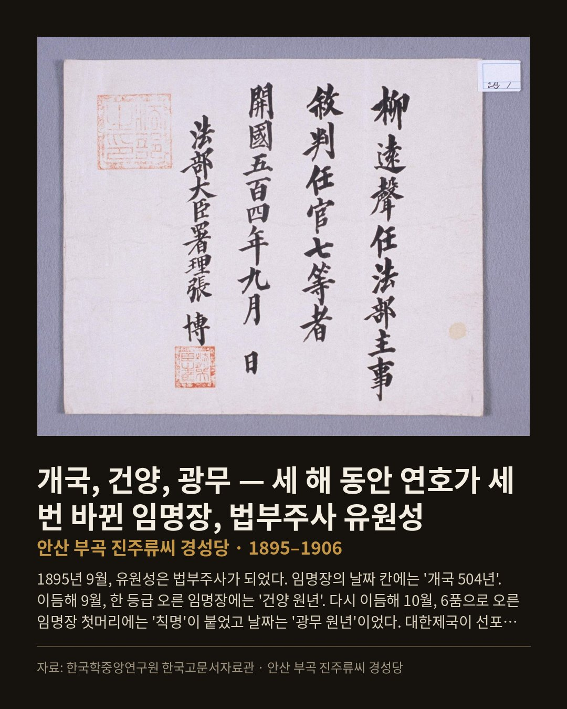
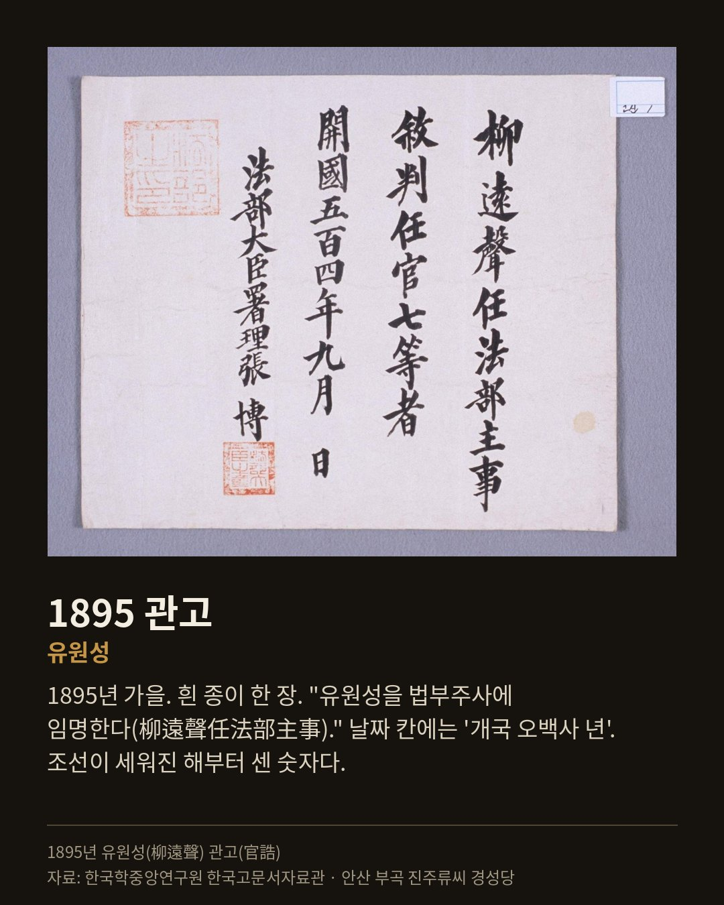
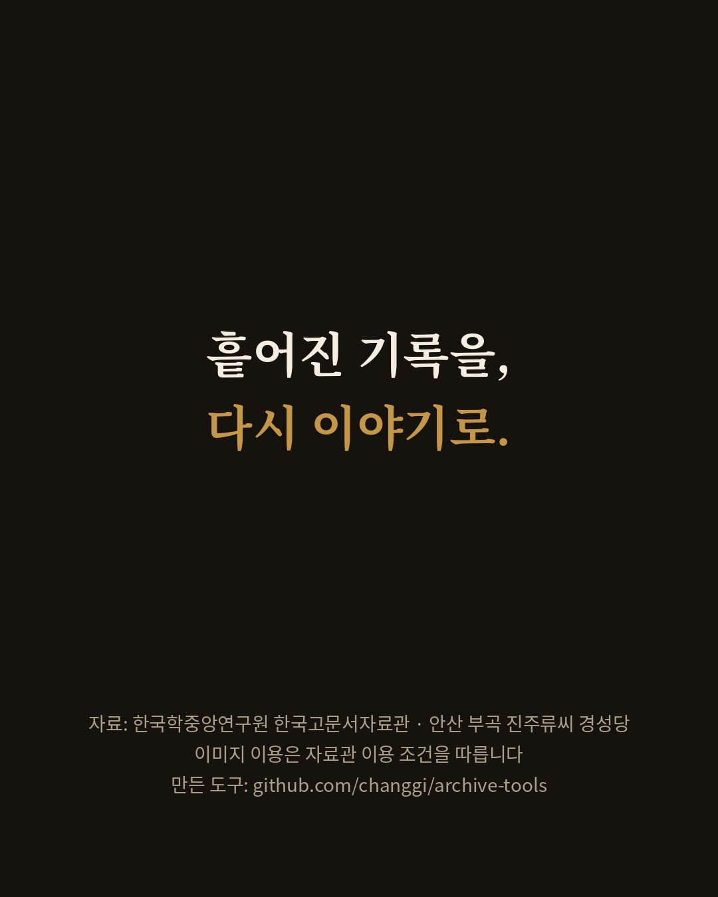

# EP.1 개국, 건양, 광무 — 세 해 동안 연호가 세 번 바뀐 임명장, 법부주사 유원성 1895–1906

안산 부곡 진주류씨 경성당 (문중) · 1895년 9월, 유원성은 법부주사가 되었다. 임명장의 날짜 칸에는 '개국 504년'. 이듬해 9월, 한 등급 오른 임명장에는 '건양 원년'. 다시 이듬해 10월, 6품으로 오른 임명장 첫머리에는 '칙명'이 붙었고 날짜는 '광무 원년'이었다. 대한제국이 선포된 지 이틀 뒤였다. 같은 사람, 같은 관청, 세 해 동안 세 개의 연호. 그리고 아홉 해 뒤, 그는 평안남도 개천의 군수가 되었다. 「고문서 한 장」은 이 한 장에서 시작한다

- 🌐 [전시 웹페이지](https://changgi.github.io/archive-tools/examples/gyeongseongdang-gwango/exhibit.html) (한자 위 한글 독음 · 원문 해석) · [수업 활동지](https://changgi.github.io/archive-tools/examples/gyeongseongdang-gwango/handout.html)
- 🎬 영상: [릴스 9:16](https://changgi.github.io/archive-tools-next/media/ep1-gyeongseongdang-gwango_reel.mp4) · [가로 16:9](https://changgi.github.io/archive-tools-next/media/ep1-gyeongseongdang-gwango_wide.mp4) · 홍보 글: [`promo.md`](promo.md)
- 카드뉴스: [`cards/`](cards/) · SNS 글: [`sns.txt`](sns.txt) · 판독·해석 표: [`selection.csv`](selection.csv)

<!-- DELIVERY -->
## 전달 에디팅 — 이 기록을 이렇게 전합니다

- **핵심 정서** — 또렷한 시작
- **한 문장** — 임명장은 한 사람의 이력서인 동시에 나라의 달력이다 — 같은 사람이 같은 관청에서 받은 종이를 해마다 나란히 놓으면, 날짜 칸의 연호와 첫머리의 한 글자에서 나라의 이름과 격이 바뀐 순간이 보인다.
- **열기** — 세 해 동안 받은 임명장 세 장, 날짜 칸의 연호가 세 번 바뀌었습니다.
- **펼치기** — 유원성 관고 → 유원성 관고－1 (1895–1906년) — 1895 개국 504년 법부주사 임명 → 1896 건양 원년 판임관 6등 → 1897 광무 원년 칙명 6품 승훈랑 → 1906 광무 10년 칙명 개천군수로 놓았습니다.
- **절정** — "유원성을 법부주사에 임명한다(柳遠聲任法部主事)" — 화면·공간에서 이 한 줄만 크게, 소리를 줄여 집중
- **여운** — 날짜 칸의 몇 글자가 바뀌는 사이, 그 종이를 받은 사람의 하루는 어땠을까요? — 질문으로 끝내고 답은 보는 사람에게
- **감각과 물질** — 세 장의 날짜 칸 開國五百四年 · 建陽元年 · 光武元年, 그리고 1897년 첫머리의 '勅命' · 어보·관인 탁본 스탬프를 찍어 보는 체험
- **통로와 매개** — 온라인: 릴스(열기) → 카드뉴스(펼치기) → 전시 웹페이지(절정·원문) → 비하인드 카드(여운) / 오프라인: 원본 크기 복제·낭독·참여 벽 / 남기기: 활동지·질문 카드
- **여운 장치** — 우리 집 서류 속 날짜 표기(단기 · 서기 · 연호) 찾아보기
- **전달 에디팅 전** — 4건의 문서를 1895–1906년 연대순으로 놓고 문서명 · 유형 · 해설을 붙인다 — 정확하지만, 지나가면 잊힌다.
- **전달 에디팅 후** — 핵심 정서는 「또렷한 시작」. 「세 해 동안 받은 임명장 세 장, 날짜 칸의 연호가 세 번 바뀌었습니다.」로 열고, 문서를 대비와 순서로 펼친 뒤, "유원성을 법부주사에 임명한다(柳遠聲任法部主事)"에서 멈춘다. 세 장의 날짜 칸 開國五百四年 · 建陽元年 · 光武元年, 그리고 1897년 첫머리의 '勅命'. 마지막엔 「우리 집 서류 속 날짜 표기(단기 · 서기 · 연호) 찾아보기」로 보는 사람이 자기 이야기를 남기고 떠나게 한다.

전문: [`delivery.md`](delivery.md)
<!-- /DELIVERY -->

<!-- CURATOR -->
## 비하인드 — 큐레이터 노트

- **왜 이 문서들인가** — 안산 부곡 진주류씨 경성당 문서 1,333건 가운데, 유원성(柳遠聲)이 1895년부터 1906년까지 받은 관고(官誥) · 차첩이 쉰 장 넘게 남아 있습니다. 그 가운데 날짜 칸의 연호가 해마다 바뀐 첫 세 장과, 그를 개천군수로 삼은 칙명 한 장을 골랐습니다. 시리즈의 첫 편입니다.
- **전하고 싶은 것** — 임명장은 한 사람의 이력서인 동시에 나라의 달력이다 — 같은 사람이 같은 관청에서 받은 종이를 해마다 나란히 놓으면, 날짜 칸의 연호와 첫머리의 한 글자에서 나라의 이름과 격이 바뀐 순간이 보인다.
- **이렇게 보이길 바랐다** — 1895 개국 504년 법부주사 임명 → 1896 건양 원년 판임관 6등 → 1897 광무 원년 칙명 6품 승훈랑 → 1906 광무 10년 칙명 개천군수로 놓았습니다.
- **이렇게 써 주세요** — 갑오개혁과 관제 개편, 판임관 · 주임관, 개국기년 · 건양 · 광무 연호, 대한제국 선포(1897)와 '칙명' 서식, 관고에 찍힌 관인 읽기 수업에 쓰세요.
- **만들며 있었던 일** — 1895년 관고의 날짜는 '九月 日'로 날이 비어 있습니다. 1897년 칙명이 대한제국 선포 이틀 뒤의 것이라는 점은 날짜로만 맞춘 것이며, 그 서식이 언제부터 '칙명'으로 바뀌었는지는 이 네 장으로 확인하지 않았습니다. 1906년 칙명의 서명은 '의정부참정대신 훈일등 박제순'으로 읽었습니다. 개천에서의 일은 EP.200에서 이어집니다.
- **남겨 둔 질문** — 날짜 칸의 몇 글자가 바뀌는 사이, 그 종이를 받은 사람의 하루는 어땠을까요?
- **제작 기록** — 문서 4건 · 1895–1906년 · 원본 사진 10면(문서 전체) · 원문 판독 4건 · 번역 4건

전문: [`curator.md`](curator.md) · 비하인드 카드: [`behind/`](behind/) · 채널별 홍보안: [`channels.md`](channels.md)
<!-- /CURATOR -->

## 이야기 — 사료가 말하는 대로

세 해 동안 받은 임명장 세 장, 날짜 칸의 연호가 세 번 바뀌었습니다.

> **1895 관고** — 1895년 가을. 흰 종이 한 장. "유원성을 법부주사에 임명한다(柳遠聲任法部主事)." 날짜 칸에는 '개국 오백사 년'. 조선이 세워진 해부터 센 숫자다.
> **1896 관고** — 한 해 뒤, 1896년 9월 1일. 같은 관청, 같은 이름. "판임관 6등으로 올린다(陞敍判任官六等者)." 그런데 날짜 칸이 달라졌다. '건양 원년'. 나라가 처음 스스로 세운 연호다.
> **1897 관고** — 또 한 해 뒤, 1897년 10월 14일. 이번에는 첫머리에 두 글자가 붙었다. "칙명(勅命)". 황제의 명령이다. 날짜 칸은 '광무 원년'. 대한제국이 선포된 지 이틀 뒤였다. 세 해, 세 장, 세 개의 연호.
> **1906 관고** — 그리고 아홉 해 뒤, 1906년 늦여름. "법부주사 유원성을 개천군수에 임명한다(法部主事柳遠聲任价川郡守)." 평안남도의 산골 고을이다. 법부 서류를 다루던 사람이, 이제 한 고을을 맡으러 길을 떠난다.

| 표지 | 1번 카드 | 마무리 |
|---|---|---|
|  |  |  |

## 선별 문서 (4점)

| # | 연도 | 유형 | 문서명 | 원본 |
|---|---|---|---|---|
| 1 | 1895 | 관고 | 1895년 유원성(柳遠聲) 관고(官誥) | [원본 보기](https://archive.aks.ac.kr/viewer/viewer.do#imgnode.do?itemId=book&gubun=booktree&depth=6&upPath=01%5E0141%5EL014132%5EL014132F02%5EL014132F0201&dataId=G002%2BAKS%2BKSM-XA.1895.1111-20101008.B038a_058_00001_XXX&itemType=) |
| 2 | 1896 | 관고 | 1896년 유원성(柳遠聲) 관고(官誥) | [원본 보기](https://archive.aks.ac.kr/viewer/viewer.do#imgnode.do?itemId=book&gubun=booktree&depth=6&upPath=01%5E0141%5EL014132%5EL014132F02%5EL014132F0201&dataId=G002%2BAKS%2BKSM-XA.1896.1111-20101008.B038a_058_00002_XXX&itemType=) |
| 3 | 1897 | 관고 | 1897년 유원성(柳遠聲) 관고(官誥)－1 | [원본 보기](https://archive.aks.ac.kr/viewer/viewer.do#imgnode.do?itemId=book&gubun=booktree&depth=6&upPath=01%5E0141%5EL014132%5EL014132F02%5EL014132F0201&dataId=G002%2BAKS%2BKSM-XA.1897.1111-20101008.B038a_058_00003_XXX&itemType=) |
| 4 | 1906 | 관고 | 1906년 유원성(柳遠聲) 관고(官誥)－1 | [원본 보기](https://archive.aks.ac.kr/viewer/viewer.do#imgnode.do?itemId=book&gubun=booktree&depth=6&upPath=01%5E0141%5EL014132%5EL014132F02%5EL014132F0201&dataId=G002%2BAKS%2BKSM-XA.1906.1111-20101008.B038a_058_00019_XXX&itemType=) |

## 원문 판독과 해석

### 1. 1895년 유원성(柳遠聲) 관고(官誥)

**원문 판독**

```
柳遠聲任法部主事
敍判任官七等者
開國五百四年九月 日
法部大臣署理 張博
```

**원문 해석** 유원성을 법부주사에 임명하고 판임관 7등에 서임한다. 개국 504년(1895) 9월 일. 법부대신 서리 장박.

**해제** 1895년(고종 32) 9월, 유원성(柳遠聲)을 법부주사(法部主事)에 임명하고 판임관(判任官) 7등에 서임한 관고입니다. 갑오개혁으로 형조 대신 법부가 생기고, 관원은 칙임관 · 주임관 · 판임관으로 나뉘었습니다. 판임관은 소속 대신이 임명하는 하급 관원으로, 그래서 이 종이에는 왕의 명령을 뜻하는 머리글 없이 법부대신 서리 장박(張博)의 이름과 관인만 있습니다. 날짜는 조선 건국을 기준으로 센 '개국 504년'으로, 1894–1895년에 공문서에 쓰인 기년입니다.

### 2. 1896년 유원성(柳遠聲) 관고(官誥)

**원문 판독**

```
法部主事柳遠聲陞敍
判任官六等者
建陽元年九月一日
法部大臣 韓圭卨
```

**원문 해석** 법부주사 유원성을 판임관 6등으로 올려 서임한다. 건양 원년(1896) 9월 1일. 법부대신 한규설.

**해제** 1년 뒤인 1896년 9월, 법부주사 유원성을 판임관 6등으로 한 등급 올린 관고입니다. 서식은 1895년 것과 거의 같지만 날짜 칸이 '건양 원년(建陽元年)'으로 바뀌었습니다. 조선은 1896년 1월 1일부터 양력을 쓰면서 처음으로 독자 연호 '건양'을 세웠습니다. 서명한 법부대신은 한규설(韓圭卨)입니다. 오른쪽 위와 이름 아래에 법부의 관인이 찍혔습니다.

### 3. 1897년 유원성(柳遠聲) 관고(官誥)－1

**원문 판독**

```
勅命
法部主事九品從仕
郞柳遠聲陞六品
承訓郞者
光武元年
十月十四日
```

**원문 해석** 칙명. 법부주사 9품 종사랑 유원성을 6품 승훈랑으로 올린다. 광무 원년(1897) 10월 14일.

**해제** 다시 1년 뒤인 1897년 10월 14일, 법부주사 유원성의 품계를 9품 종사랑(從仕郞)에서 6품 승훈랑(承訓郞)으로 올린 관고입니다. 첫머리에 황제의 명령을 뜻하는 '칙명(勅命)'이 붙었고, 날짜는 '광무 원년(光武元年)'입니다. 1897년 8월 연호를 광무로 바꾸고, 10월 12일 고종이 황제로 즉위하며 국호를 대한제국으로 선포했으니, 이 종이는 그 이틀 뒤의 것입니다. 관인은 연호 위에 크게 찍혔습니다.

### 4. 1906년 유원성(柳遠聲) 관고(官誥)－1

**원문 판독**

```
勅命
法部主事
柳遠聲任
价川郡守
叙奏任官
四等者
光武十年八月二十二日
議政府參政大臣勳一等朴齊純 宣
```

**원문 해석** 칙명. 법부주사 유원성을 개천군수에 임명하고 주임관 4등에 서임한다. 광무 10년(1906) 8월 22일. 의정부참정대신 훈일등 박제순이 받들어 알림.

**해제** 9년 뒤인 1906년 8월 22일, 법부주사 유원성을 평안남도 개천군수(价川郡守)에 임명하고 주임관(奏任官) 4등에 서임한 칙명 관고입니다. 1895년부터 열한 해 동안 '법부주사'였던 그가 판임관에서 주임관이 되어 한 고을의 수령으로 나간 것입니다. 왼쪽에 의정부참정대신 박제순(朴齊純)이 칙명을 받들어 알린다는 '宣' 자가 있고, 날짜 위에 커다란 관인이 찍혔습니다. 같은 해 10월에는 개천군수로서 정3품 통정대부에 오른 칙명도 남아 있습니다. 그가 개천에서 남긴 종이는 EP.200에서 읽습니다.

판독·해석·이야기는 이미지에 근거한 초안이며(검토 전 "초안" 표시), 정확한 판독은 원문 확인이 필요합니다. □는 읽지 못한 글자, (?)는 불확실한 글자입니다.
이미지: 한국학중앙연구원 한국고문서자료관 소장·제공. "원본" 링크를 누르면 자료관 뷰어에서 그 문서가 열립니다. 재사용은 자료관에 문의하세요(소장처 동의 필요).
