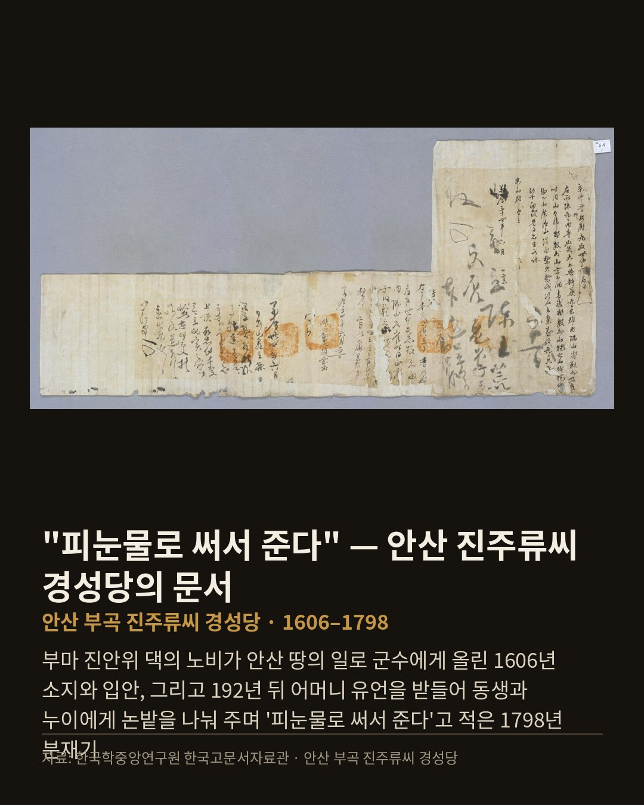
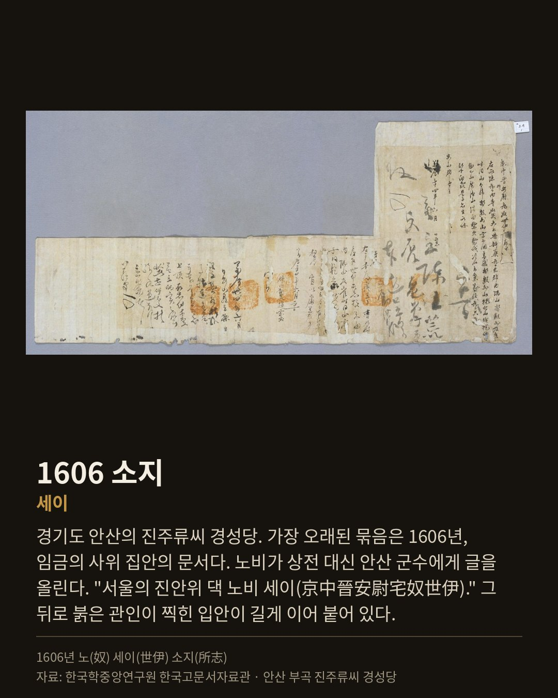
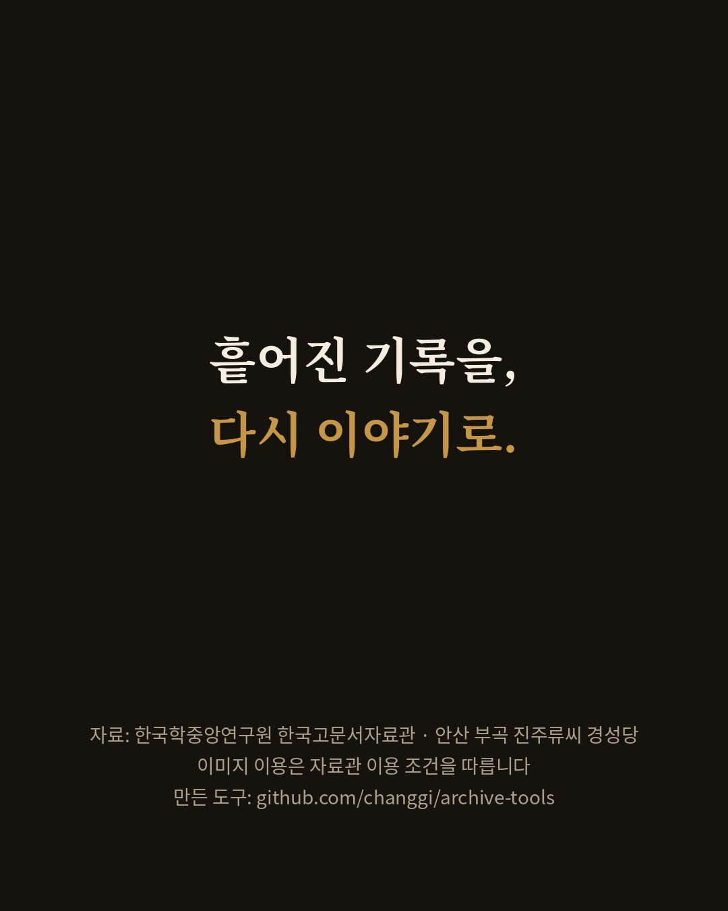

# EP.54 "피눈물로 써서 준다" — 안산 진주류씨 경성당의 문서

안산 부곡 진주류씨 경성당 (문중) · 부마 진안위 댁의 노비가 안산 땅의 일로 군수에게 올린 1606년 소지와 입안, 그리고 192년 뒤 어머니 유언을 받들어 동생과 누이에게 논밭을 나눠 주며 '피눈물로 써서 준다'고 적은 1798년 분재기

- 🌐 [전시 웹페이지](https://changgi.github.io/archive-tools/examples/gyeongseongdang/exhibit.html) (한자 위 한글 독음 · 원문 해석) · [수업 활동지](https://changgi.github.io/archive-tools/examples/gyeongseongdang/handout.html)
- 🎬 영상: [릴스 9:16](https://changgi.github.io/archive-tools-next/media/ep54-gyeongseongdang_reel.mp4) · [가로 16:9](https://changgi.github.io/archive-tools-next/media/ep54-gyeongseongdang_wide.mp4) · 홍보 글: [`promo.md`](promo.md)
- 카드뉴스: [`cards/`](cards/) · SNS 글: [`sns.txt`](sns.txt) · 판독·해석 표: [`selection.csv`](selection.csv)


<!-- DELIVERY -->
## 전달 에디팅 — 이 기록을 이렇게 전합니다

- **핵심 정서** — 슬픔
- **한 문장** — 재산 문서에도 슬픔이 적혀 있다는 것 — 상속은 숫자가 아니라 이별의 기록이었다는 것.
- **열기** — 재산을 나누는 문서가 '하늘이여, 하늘이여'로 시작합니다.
- **펼치기** — 노 세이 소지 → 유중서 외 분재기 (1606–1798년) — 관청에 올린 건조한 소지로 시작해, 어머니 유언을 받든 분재기의 '피눈물' 한 구절로 끝나게 했습니다.
- **절정** — "감히 남기신 가르침으로, 피눈물을 흘리며 써서 준다(敢以遺敎 血泣書贈)" — 화면·공간에서 이 한 줄만 크게, 소리를 줄여 집중
- **여운** — '피눈물'이라고 쓴 사람은 동생과 누이에게 무엇을 더 말하고 싶었을까요? — 질문으로 끝내고 답은 보는 사람에게
- **감각과 물질** — "피눈물로 써서 준다"를 붉은 먹빛 한 줄로 · 연명한 이름을 벽에 길게 나열하고 관아 마당처럼 서서 읽는 동선 · 값(무명·냥·원)을 오늘의 물건으로 바꿔 옆에 놓기, 수결 따라 그리기
- **통로와 매개** — 온라인: 릴스(열기) → 카드뉴스(펼치기) → 전시 웹페이지(절정·원문) → 비하인드 카드(여운) / 오프라인: 원본 크기 복제·낭독·참여 벽 / 남기기: 활동지·질문 카드
- **여운 장치** — 떠난 이에게 한 줄
- **전달 에디팅 전** — 2건의 문서를 1606–1798년 연대순으로 놓고 문서명 · 유형 · 해설을 붙인다 — 정확하지만, 지나가면 잊힌다.
- **전달 에디팅 후** — 핵심 정서는 「슬픔」. 「재산을 나누는 문서가 '하늘이여, 하늘이여'로 시작합니다.」로 열고, 문서를 대비와 순서로 펼친 뒤, "감히 남기신 가르침으로, 피눈물을 흘리며 써서 준다(敢以遺敎 血泣書贈)"에서 멈춘다. "피눈물로 써서 준다"를 붉은 먹빛 한 줄로. 마지막엔 「떠난 이에게 한 줄」로 보는 사람이 자기 이야기를 남기고 떠나게 한다.

전문: [`delivery.md`](delivery.md)
<!-- /DELIVERY -->

<!-- CURATOR -->
## 비하인드 — 큐레이터 노트

- **왜 이 문서들인가** — 1606년 노비의 소지와 192년 뒤 '피눈물로 써서 준다'는 분재기가 한 집안에 함께 남아 있었습니다.
- **전하고 싶은 것** — 재산 문서에도 슬픔이 적혀 있다는 것 — 상속은 숫자가 아니라 이별의 기록이었다는 것.
- **이렇게 보이길 바랐다** — 관청에 올린 건조한 소지로 시작해, 어머니 유언을 받든 분재기의 '피눈물' 한 구절로 끝나게 했습니다.
- **이렇게 써 주세요** — 가족사·상속 제도 수업, 감정이 담긴 공문서 읽기 활동에 쓰세요.
- **남겨 둔 질문** — '피눈물'이라고 쓴 사람은 동생과 누이에게 무엇을 더 말하고 싶었을까요?
- **제작 기록** — 문서 2건 · 1606–1798년 · 원본 사진 8면(문서 전체) · 원문 판독 2건 · 번역 2건 · 못 읽은 글자 □ 3 · 불확실 (?) 28 · 해제에 "확인 필요"를 단 문서 1건

전문: [`curator.md`](curator.md)
<!-- /CURATOR -->

## 이야기 — 사료가 말하는 대로

재산을 나누는 문서가 '하늘이여, 하늘이여'로 시작합니다.

> **1606 소지** — 경기도 안산의 진주류씨 경성당. 가장 오래된 묶음은 1606년, 임금의 사위 집안의 문서다. 노비가 상전 대신 안산 군수에게 글을 올린다. "서울의 진안위 댁 노비 세이(京中晉安尉宅奴世伊)." 그 뒤로 붉은 관인이 찍힌 입안이 길게 이어 붙어 있다.
> **1798 분재기** — 192년 뒤, 같은 집안의 맏아들이 상복을 입고 붓을 든다. 부모의 유언대로 동생과 누이에게 재산을 나눠야 했다. 첫 줄은 울음이다. "하늘이여 하늘이여, 무슨 말을 하겠는가(天乎天乎 尙何言)." 그리고 끝에 적는다. "감히 남기신 가르침으로, 피눈물을 흘리며 써서 준다(敢以遺敎 血泣書贈)."

| 표지 | 1번 카드 | 마무리 |
|---|---|---|
|  |  |  |

## 선별 문서 (2점)

| # | 연도 | 유형 | 문서명 | 원본 |
|---|---|---|---|---|
| 1 | 1606 | 소지 | 1606년 노(奴) 세이(世伊) 소지(所志) | [원본 보기](https://archive.aks.ac.kr/viewer/viewer.do#imgnode.do?itemId=book&gubun=booktree&depth=6&upPath=01%5E0141%5EL014132%5EL014132F02%5EL014132F0202&dataId=G002%2BAKS%2BKSM-XB.1606.1100-20101008.B038a_058_00085_001&itemType=) |
| 2 | 1798 | 분재기 | 1798년 유중서(柳重序) 외 분재기(分財記) | [원본 보기](https://archive.aks.ac.kr/viewer/viewer.do#imgnode.do?itemId=book&gubun=booktree&depth=6&upPath=01%5E0141%5EL014132%5EL014132F02%5EL014132F0205&dataId=G002%2BAKS%2BKSM-XE.1798.4127-20101008.B038a_058_00207_XXX&itemType=) |

## 원문 판독과 해석

### 1. 1606년 노(奴) 세이(世伊) 소지(所志)

**원문 판독**

```
京中晉安尉宅奴世伊 (…)
右所陳爲白內等 矣宅(?)上典 (…)
時(?)同山 多(?)歸(?) 都(?)敎 安山 宅(?)(…)
馬乙山 (…) 波面 (…)
(…)下向敎是事 爲白只爲 (…)
安山郡守主
萬曆三十四年六月 日所志
(왼쪽 큰 흘림 — 관의 처분(題辭), 판독 필요)
(이어 붙인 문서 — 안산군·진안위방 입안, 붉은 관인 여럿, 판독 필요)
```

**원문 해석** 서울에 사는 진안위 댁의 노비 세이. 삼가 아뢰옵는 일은, 저희 댁 상전께서 … 안산 … 마을산(?) … 면의 … 처분해 주시기를 바랍니다. 안산 군수께서 [처분하실 일]. 만력 34년(1606) 6월 일 소지. (흘림이 심해 본문 대부분 판독 필요)

**해제** 1606년(선조 39) 6월, 서울의 진안위(晉安尉) 댁 노비 세이(世伊)가 상전을 대신해 안산 군수에게 올린 소지입니다. '尉'는 왕의 사위(부마)에게 주는 칭호로, 진안위는 선조의 부마 류적(柳頔)으로 알려져 있습니다(확인 필요). 같은 묶음에 안산군과 진안위방(晉安尉房)의 입안이 이어 붙어 있어, 안산의 땅이나 산을 두고 소지를 올리고 관의 공증(입안)을 받은 과정으로 보입니다. 흘림이 심해 첫머리와 끝만 읽었습니다.

### 2. 1798년 유중서(柳重序) 외 분재기(分財記)

**원문 판독**

```
不肖孤哀子 罪逆深重 竟遭窮天之痛 天乎天乎 尙何言(?) 臨終之時
奉承 遺命 而叢(?)蕢(?)因(?)循(?) 未暇執筆 不肖之罪尤無所贖 而終(?)之過(?)祀(?)後(?)
如常 此何人哉(?) 下妹之物 亦(?)當(?)家(?) 敢以 遺敎 血泣書贈
弟重序
始興畓 都合一石十九斗落 田都合 (…)
槐山北面(?)叩(?)
馬洞(?)畓 都合一石十斗落 田都合 (…)
諸處(?)奴婢 十月(?) … 母(?)三 (…)
母一生婢 … (작은 글씨 — 노비 이름, 판독 필요)
(테두리 안) 村果(?)家舍 …間 舍後東園一 …
始興 …山 伏在 … 田 … 字 五負 … 二十八(?)負 … (작은 글씨, 판독 필요)
妹丁書房宅
安山釜谷 林內 剋字畓 三斗落 … 釜谷 … 坪 伏在 列字田 一日耕
嘉慶三年戊午十一月十一日
不肖孤哀子 重□(?) / 三寸叔 □□ / 證筆 (…)
```

**원문 해석** 못난 고애자(부모를 모두 여읜 아들)는 죄가 깊고 무거워 끝내 하늘이 무너지는 슬픔을 당하였으니, 하늘이여 하늘이여, 무슨 말을 하겠는가. 임종하실 때 유언을 받들었으나 … 미루다가 붓을 잡을 겨를이 없었으니 못난 자식의 죄를 더욱 갚을 길이 없다. … 아래 누이의 몫도 … 감히 남기신 가르침으로 피눈물을 흘리며 써서 준다.
아우 중서(重序)에게: 시흥 논 모두 1석 19두락, 밭 모두 … / 괴산 북면 … / 마동 논 모두 1석 10두락, 밭 모두 … / 노비 … / 집 … 칸, 집 뒤 동쪽 동산 …
누이 정서방 댁에게: 안산 부곡 숲 안 剋자 논 3두락, … 부곡 … 들 列자 밭 하루갈이.
가경 3년 무오(1798) 11월 11일. 고애자 ○○, 삼촌 숙부 ○○, 증인·필집 ○○.

**해제** 1798년(정조 22) 11월, 부모를 모두 잃은 맏아들이 어머니(또는 부모)의 유언(遺命)을 받들어 아우 류중서(柳重序)와 누이(정서방 댁)에게 논밭과 노비를 나눠 준 분재기입니다. 첫머리를 '하늘이여 하늘이여(天乎天乎)', 끝을 '피눈물로 써서 준다(血泣書贈)'로 써서 상중(喪中)에 쓴 문서임을 보여 줍니다. 논은 볍씨를 뿌리는 양(斗落·石落), 밭은 갈이 날수(日耕)로 적었습니다. 작은 글씨의 재산 목록 일부와 서명자 이름은 판독이 필요합니다.

판독·해석·이야기는 이미지에 근거한 초안이며(검토 전 "초안" 표시), 정확한 판독은 원문 확인이 필요합니다. □는 읽지 못한 글자, (?)는 불확실한 글자입니다.
이미지: 한국학중앙연구원 한국고문서자료관 소장·제공. "원본" 링크를 누르면 자료관 뷰어에서 그 문서가 열립니다. 재사용은 자료관에 문의하세요(소장처 동의 필요).
