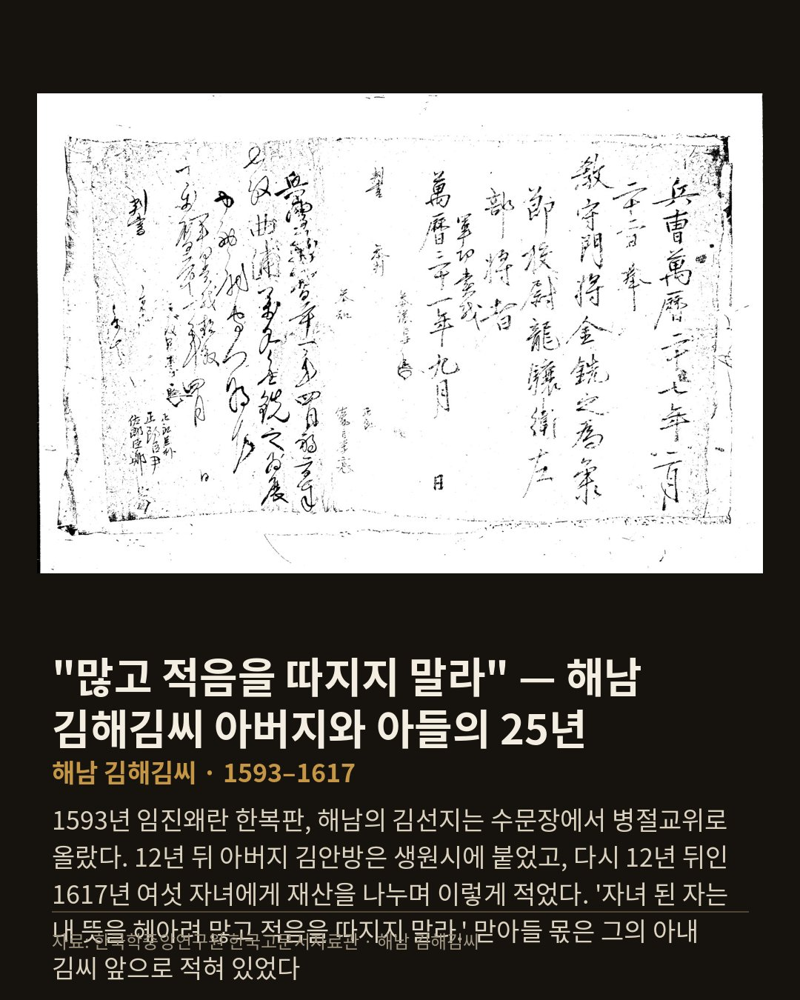
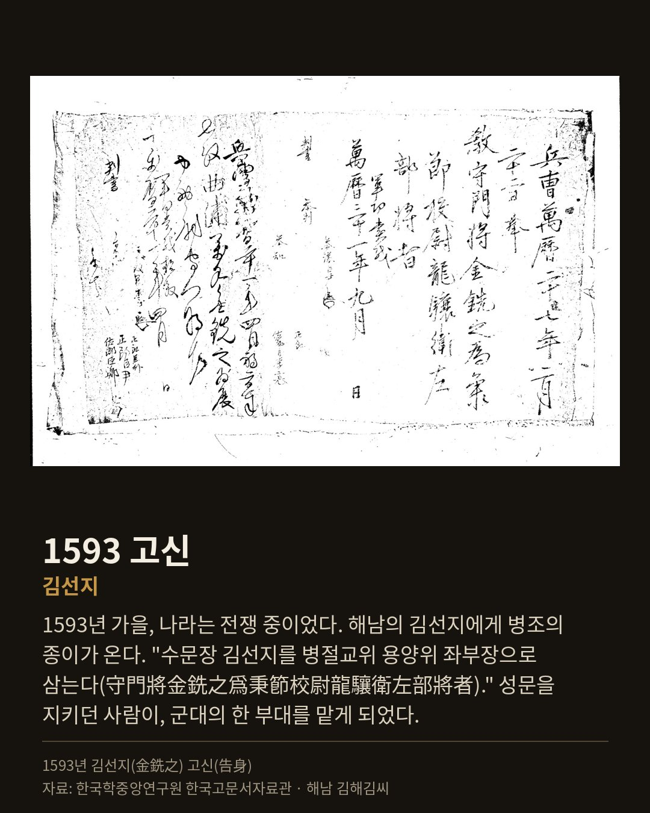
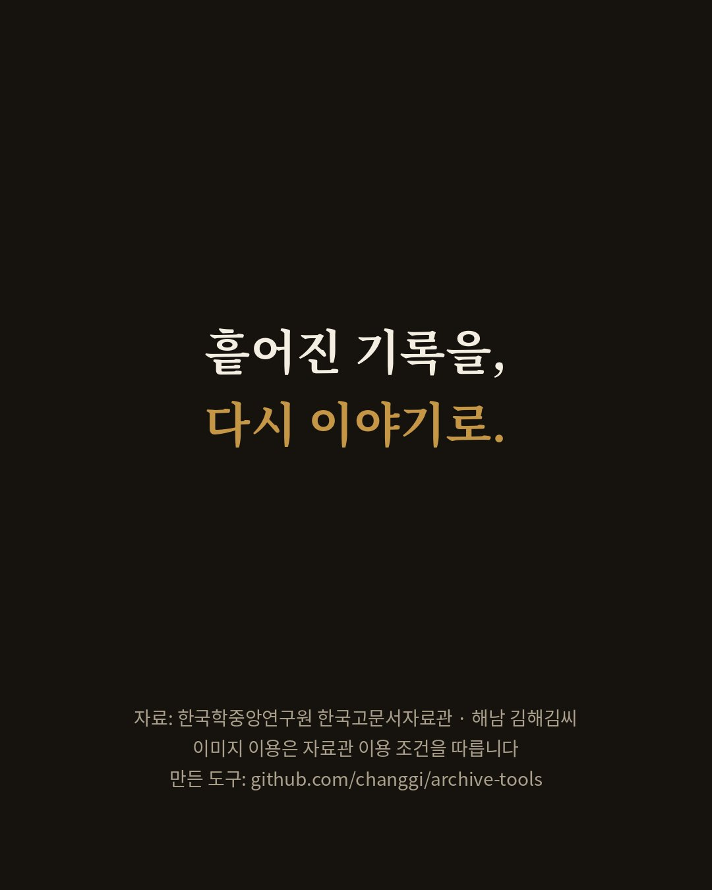

# EP.102 "많고 적음을 따지지 말라" — 해남 김해김씨 아버지와 아들의 25년

해남 김해김씨 (문중) · 1593년 임진왜란 한복판, 해남의 김선지는 수문장에서 병절교위로 올랐다. 12년 뒤 아버지 김안방은 생원시에 붙었고, 다시 12년 뒤인 1617년 여섯 자녀에게 재산을 나누며 이렇게 적었다. '자녀 된 자는 내 뜻을 헤아려 많고 적음을 따지지 말라.' 맏아들 몫은 그의 아내 김씨 앞으로 적혀 있었다

- 🌐 [전시 웹페이지](https://changgi.github.io/archive-tools/examples/haenam-kim/exhibit.html) (한자 위 한글 독음 · 원문 해석) · [수업 활동지](https://changgi.github.io/archive-tools/examples/haenam-kim/handout.html)
- 🎬 영상: [릴스 9:16](https://changgi.github.io/archive-tools/examples/media/ep102-haenam-kim_reel.mp4) · [가로 16:9](https://changgi.github.io/archive-tools/examples/media/ep102-haenam-kim_wide.mp4) · 홍보 글: [`promo.md`](promo.md)
- 카드뉴스: [`cards/`](cards/) · SNS 글: [`sns.txt`](sns.txt) · 판독·해석 표: [`selection.csv`](selection.csv)

<!-- DELIVERY -->
## 전달 에디팅 — 이 기록을 이렇게 전합니다

- **핵심 정서** — 먹먹함
- **한 문장** — 재산 문서에도 마음이 적힌다 — '많고 적음을 따지지 말라'는 당부와, 이미 세상을 떠난 맏아들의 몫.
- **열기** — 아버지는 재산을 나누며, 자식들에게 이 한 줄을 남겼습니다.
- **펼치기** — 김선지 고신 → 김안방 생원 백패 → 김안방 허여명문 (1593–1617년) — 전쟁 중의 임명장 → 늦은 합격증 → 분재 문서의 당부, 그리고 '선지의 처 김씨'라는 이름에서 멈추도록 구성했습니다.
- **절정** — "자녀 된 자는 모름지기 내 뜻을 헤아려, 많고 적음을 따지지 말라(凡爲子女須體吾意 毋較多少)" — 화면·공간에서 이 한 줄만 크게, 소리를 줄여 집중
- **여운** — 부모님이 남긴 한 줄의 당부가 있다면, 무엇인가요? — 질문으로 끝내고 답은 보는 사람에게
- **감각과 물질** — 누런 분재 문서의 '一' 자 줄과 빈자리, 여섯 자녀의 이름 · 어보·관인 탁본 스탬프를 찍어 보는 체험 · 흰 종이 한 장에 조명 하나 · 값(무명·냥·원)을 오늘의 물건으로 바꿔 옆에 놓기, 수결 따라 그리기
- **통로와 매개** — 온라인: 릴스(열기) → 카드뉴스(펼치기) → 전시 웹페이지(절정·원문) → 비하인드 카드(여운) / 오프라인: 원본 크기 복제·낭독·참여 벽 / 남기기: 활동지·질문 카드
- **여운 장치** — 우리 집에 전해 오는 한 줄의 당부 적어 보기
- **전달 에디팅 전** — 3건의 문서를 1593–1617년 연대순으로 놓고 문서명 · 유형 · 해설을 붙인다 — 정확하지만, 지나가면 잊힌다.
- **전달 에디팅 후** — 핵심 정서는 「먹먹함」. 「아버지는 재산을 나누며, 자식들에게 이 한 줄을 남겼습니다.」로 열고, 문서를 대비와 순서로 펼친 뒤, "자녀 된 자는 모름지기 내 뜻을 헤아려, 많고 적음을 따지지 말라(凡爲子女須體吾意 毋較多少)"에서 멈춘다. 누런 분재 문서의 '一' 자 줄과 빈자리, 여섯 자녀의 이름. 마지막엔 「우리 집에 전해 오는 한 줄의 당부 적어 보기」로 보는 사람이 자기 이야기를 남기고 떠나게 한다.

전문: [`delivery.md`](delivery.md)
<!-- /DELIVERY -->

<!-- CURATOR -->
## 비하인드 — 큐레이터 노트

- **왜 이 문서들인가** — 아들의 무관 고신(1593), 아버지의 생원 백패(1605), 아버지의 분재 문서(1617)가 12년 간격으로 이어져, 한 집안의 25년이 그대로 보였습니다.
- **전하고 싶은 것** — 재산 문서에도 마음이 적힌다 — '많고 적음을 따지지 말라'는 당부와, 이미 세상을 떠난 맏아들의 몫.
- **이렇게 보이길 바랐다** — 전쟁 중의 임명장 → 늦은 합격증 → 분재 문서의 당부, 그리고 '선지의 처 김씨'라는 이름에서 멈추도록 구성했습니다.
- **이렇게 써 주세요** — 분재기(상속 문서) 읽기, 임진왜란기 무관 임명, 조선의 상속 관행을 다루는 수업에 쓰세요.
- **만들며 있었던 일** — 허여명문 둘째 면과 고신 왼쪽의 흘림 문서는 판독하지 않았거나 불확실합니다. 김선지가 1617년 이전에 세상을 떠났다는 것은 문서의 표기에서 나온 추정입니다.
- **남겨 둔 질문** — 부모님이 남긴 한 줄의 당부가 있다면, 무엇인가요?
- **제작 기록** — 문서 3건 · 1593–1617년 · 원본 사진 4면(문서 전체) · 원문 판독 3건 · 번역 3건 · 못 읽은 글자 □ 0 · 불확실 (?) 2

전문: [`curator.md`](curator.md) · 비하인드 카드: [`behind/`](behind/) · 채널별 홍보안: [`channels.md`](channels.md)
<!-- /CURATOR -->

## 이야기 — 사료가 말하는 대로

아버지는 재산을 나누며, 자식들에게 이 한 줄을 남겼습니다.

> **1593 고신** — 1593년 가을, 나라는 전쟁 중이었다. 해남의 김선지에게 병조의 종이가 온다. "수문장 김선지를 병절교위 용양위 좌부장으로 삼는다(守門將金銑之爲秉節校尉龍驤衛左部將者)." 성문을 지키던 사람이, 군대의 한 부대를 맡게 되었다.
> **1605 백패** — 12년 뒤, 이번에는 아버지 차례였다. "유학 김안방이 생원시 3등 제67인으로 합격하였다(幼學金安邦生員三等第六十七人入格者)." 전쟁이 지나간 뒤, 아들보다 늦게 받은 흰 종이 한 장.
> **1617 허여명문** — 다시 12년 뒤인 1617년, 늙은 아버지는 여섯 자녀에게 재산을 나눈다. 그리고 첫머리에 이렇게 적는다. "자녀 된 자는 모름지기 내 뜻을 헤아려, 많고 적음을 따지지 말라(凡爲子女須體吾意 毋較多少)." 맏아들의 몫은 '선지의 처 김씨' 앞으로 적혀 있었다. 전쟁터에 나갔던 아들은, 그 자리에 없었다.

| 표지 | 1번 카드 | 마무리 |
|---|---|---|
|  |  |  |

## 선별 문서 (3점)

| # | 연도 | 유형 | 문서명 | 원본 |
|---|---|---|---|---|
| 1 | 1593 | 고신 | 1593년 김선지(金銑之) 고신(告身) | [원본 보기](https://archive.aks.ac.kr/viewer/viewer.do#imgnode.do?itemId=book&gubun=booktree&depth=6&upPath=01%5E0148%5EL014813%5EL014813F02%5EL014813F0201&dataId=G002%2BAKS%2BKSM-XA.1593.1111-20101008.B026a_039_00001_XXX&itemType=) |
| 2 | 1605 | 백패 | 1605년 김안방(金安邦) 생원 백패(生員白牌) | [원본 보기](https://archive.aks.ac.kr/viewer/viewer.do#imgnode.do?itemId=book&gubun=booktree&depth=6&upPath=01%5E0148%5EL014813%5EL014813F02%5EL014813F0201&dataId=G002%2BAKS%2BKSM-XA.1605.1111-20101008.B026a_039_00041_XXX&itemType=) |
| 3 | 1617 | 허여명문 | 1617년 김안방(金安邦) 허여명문(許與明文) | [원본 보기](https://archive.aks.ac.kr/viewer/viewer.do#imgnode.do?itemId=book&gubun=booktree&depth=6&upPath=01%5E0148%5EL014813%5EL014813F02%5EL014813F0205&dataId=G002%2BAKS%2BKSM-XE.1617.0000-20101008.B026a_039_00137_XXX&itemType=) |

## 원문 판독과 해석

### 1. 1593년 김선지(金銑之) 고신(告身)

**원문 판독**

```
兵曹萬曆二十一年(?)…月
二十二日奉
敎守門將金銑之爲秉
節校尉龍驤衛左
部將者
軍功書啓(?)
萬曆二十一年九月　日
(왼쪽에 같은 종이로 이어 쓴 병조의 흘림 문서 — 金銑之 … 판독 불확실)
判書 參判 參知 參議 正郞 佐郞 (서명)
```

**원문 해석** 병조가 만력 21년 ○월 22일 임금의 명을 받들어, 수문장 김선지를 병절교위 용양위 좌부장으로 삼는다. 군공을 아뢴 데 따름(?). 만력 21년(1593) 9월 일. (왼쪽: 같은 해 병조의 또 다른 명령이 흘림으로 이어짐) 판서 · 참판 · 참지 · 참의 · 정랑 · 좌랑.

**해제** 1593년(선조 26, 萬曆 21) 9월, 병조가 임금의 명을 받들어 수문장(守門將) 김선지(金銑之)를 병절교위(秉節校尉, 종6품 무관 품계) 용양위 좌부장(龍驤衛左部將)으로 임명한 고신입니다. 임진왜란이 일어난 이듬해로, 이 무렵에는 전쟁의 공(군공)에 따라 품계와 군직을 내리는 일이 많았습니다. '軍功書啓'로 보이는 작은 글씨와 왼쪽에 이어 쓴 흘림 문서는 판독이 불확실합니다. 1617년 아버지 김안방의 허여명문에 '맏아들 선지'로 나오는 인물입니다.

### 2. 1605년 김안방(金安邦) 생원 백패(生員白牌)

**원문 판독**

```
敎旨
幼學金安邦生員三等第六十
七人入格者
萬曆三十三年二月　日 (도장)
```

**원문 해석** 교지. 유학 김안방이 생원시 3등 제67인으로 합격하였다. 만력 33년(1605) 2월 일.

**해제** 1605년(선조 38, 萬曆 33) 2월, 유학(幼學, 벼슬하지 않은 선비) 김안방(金安邦)이 생원시에 3등 제67인으로 합격했음을 증명하는 백패(白牌)입니다. 생원 · 진사시(소과)의 합격증은 흰 종이에 써서 백패라 하고, 문 · 무과(대과)의 합격증은 붉은 종이의 홍패입니다. 12년 전 맏아들 김선지가 이미 무관 고신을 받았으니, 아버지는 아들보다 늦게 시험에 붙은 셈입니다.

### 3. 1617년 김안방(金安邦) 허여명문(許與明文)

**원문 판독**

```
萬曆肆拾伍年丁巳伍月初五日陸子女等處許與
(작은 글씨) 以代筆某奴婢十六 … 衆子
右許與事 … 寸土者 書成文 自愧 … 甚
苟或不顧廉恥之人 不保不出於其間 則斯文不可無作 … 於小人人事之際 僅記若干
分之如左 凡爲子女須體吾意 毋較多少 恐及泉裡 不勝幸甚
一 長子銑之妻金氏衿 邑內基田 … 落只 …
… (가운데 줄: 先人遺敎 · 承重 · 家世甚貧 등)
一 仲子錬之衿 …
一 末子鋥之衿 …
(이하 노비 이름 · 나이 · 전답 목록, 둘째 면으로 이어짐)
```

**원문 해석** 만력 45년 정사(1617) 5월 초5일, 여섯 자녀에게 나누어 주는 문서. … 한 치의 땅까지 문서로 만드는 것이 스스로 부끄럽지만, 혹시라도 염치를 돌아보지 않는 사람이 그사이에 나오지 않으리라 장담할 수 없으니 이 글을 짓지 않을 수 없다. … 조금이나마 적어 아래와 같이 나눈다. 무릇 자녀 된 자는 모름지기 내 뜻을 헤아려 많고 적음을 따지지 말라. 그러면 저승에 가서도 더없이 다행이겠다. 하나, 맏아들 선지의 처 김씨 몫: 읍내 집터 밭 … 하나, 둘째 아들 연지 몫 … 하나, 막내아들 정지 몫 … (이하 노비 · 전답 목록)

**해제** 1617년(광해군 9, 萬曆 45, 丁巳) 5월 5일, 김안방이 여섯 자녀에게 노비와 전답을 나누어 준 허여명문(許與明文)입니다. 부모가 살아 있을 때 재산을 미리 나누어 주는 문서로, 서문에 문서를 남기는 까닭과 당부를 적고 '一'로 자녀별 몫을 늘어놓습니다. '凡爲子女須體吾意 毋較多少'는 분재 문서에 자주 보이는 당부이지만, 집안 형편이 매우 가난했다(家世甚貧)는 구절과 함께 읽으면 무게가 다릅니다. 맏아들 몫이 '長子銑之妻金氏'로 적힌 것은 1593년 고신의 김선지가 이때 이미 세상을 떠났기 때문으로 보입니다(추정). 둘째 면은 판독하지 않았고, 흐린 글자와 작은 글씨는 판독이 불확실합니다.

판독·해석·이야기는 이미지에 근거한 초안이며(검토 전 "초안" 표시), 정확한 판독은 원문 확인이 필요합니다. □는 읽지 못한 글자, (?)는 불확실한 글자입니다.
이미지: 한국학중앙연구원 한국고문서자료관 소장·제공. "원본" 링크를 누르면 자료관 뷰어에서 그 문서가 열립니다. 재사용은 자료관에 문의하세요(소장처 동의 필요).
