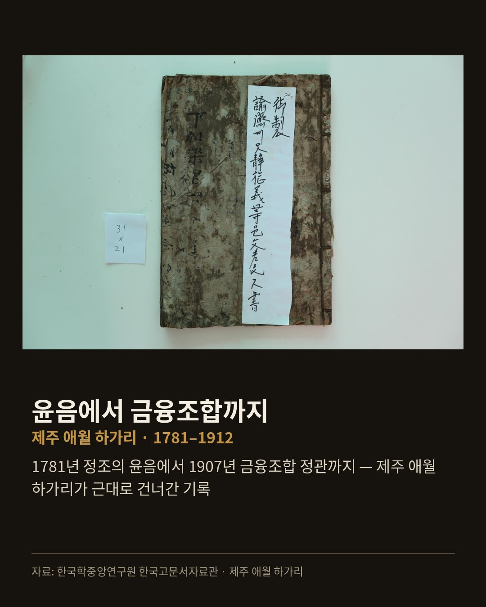
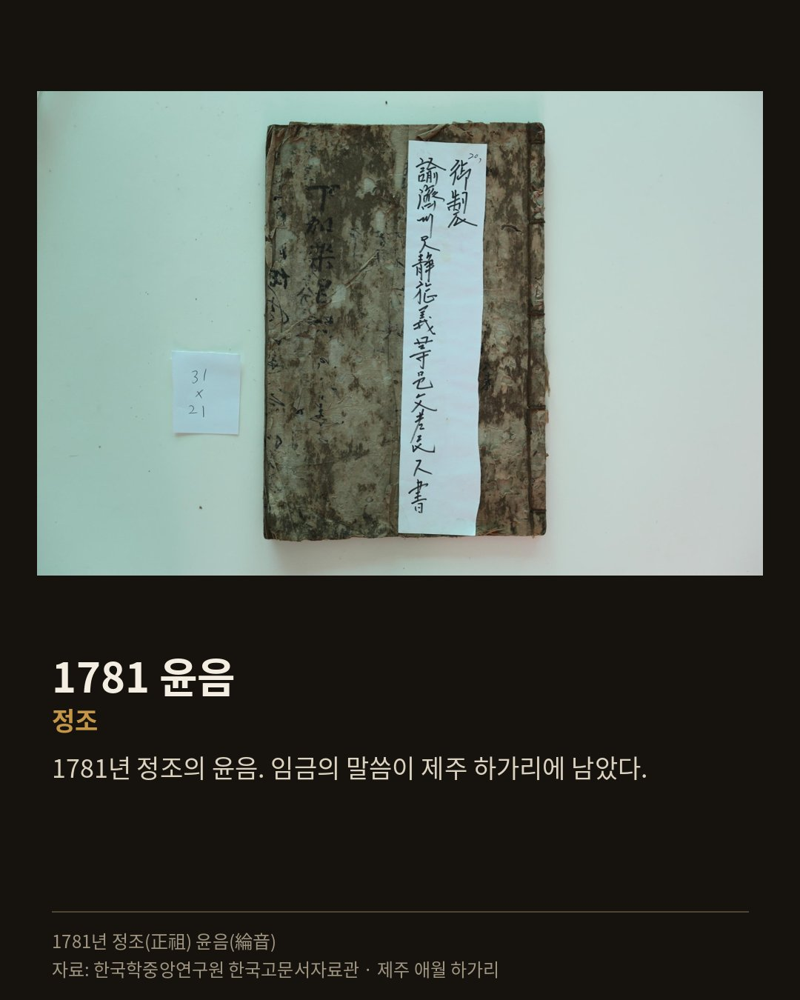
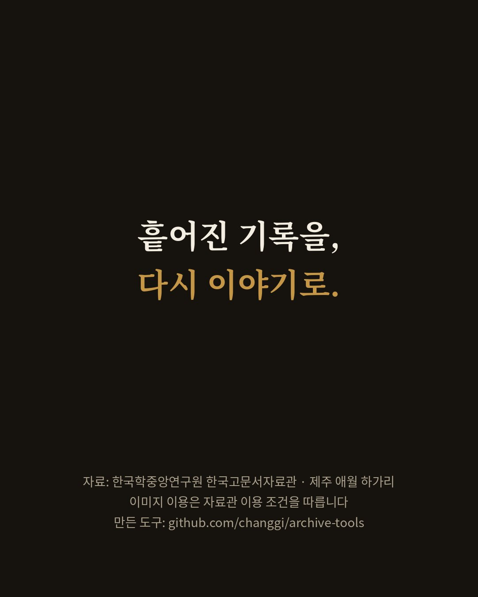

# EP.11 윤음에서 금융조합까지

제주 애월 하가리 (마을) · 1781년 정조의 윤음에서 1907년 금융조합 정관까지 — 제주 애월 하가리가 근대로 건너간 기록

- 🌐 [전시 웹페이지](https://changgi.github.io/archive-tools/examples/hagari/exhibit.html) · [수업 활동지](https://changgi.github.io/archive-tools/examples/hagari/handout.html)
- 🎬 영상: [릴스 9:16](https://changgi.github.io/archive-tools-next/media/ep11-hagari_reel.mp4) · [가로 16:9](https://changgi.github.io/archive-tools-next/media/ep11-hagari_wide.mp4) · 홍보 글: [`promo.md`](promo.md)
- 카드뉴스: [`cards/`](cards/) · SNS 글: [`sns.txt`](sns.txt) · 에디팅 결과: [`selection.csv`](selection.csv)

## 이야기 (영상 내레이션)

> 왕의 말씀에서 은행까지, 한 마을이 걸어온 길은?
> 1781년, 정조의 윤음이 이 마을에 남았습니다.
> 1839년엔 단계를 건너뛴 소송을 엄금한다는 절목이 내려오고,
> 1897년, 이웃한 두 마을은 스스로 의논해 규칙을 정합니다.
> 1906년, 마을 문서에 사립학교의 기금 장부가 등장하고,
> 1907년엔 금융조합의 정관까지 남았습니다.
> 임금의 말씀에서 학교와 금융조합까지, 한 마을이 근대로 건너간 길입니다.

| 표지 | 1번 카드 | 마무리 |
|---|---|---|
|  |  |  |

<!-- DELIVERY -->
## 전달 에디팅 — 이 기록을 이렇게 전합니다

- **핵심 정서** — 변화
- **한 문장** — 한 마을의 문서함에 조선에서 근대로 넘어가는 길이 담겨 있다는 것.
- **열기** — 왕의 말씀에서 금융조합까지, 한 마을은 어떤 길을 걸었을까요?
- **펼치기** — 정조 윤음 → 월소엄금절목 → 전장주 임백상 전여기 → 하가리 경민소 회통－1 → 상하가양리수의성절목 → 제주군사립의신학교비기본금액급연리총 → 제주지방금융조합정관 → 신우면 하가리 환곡분급성책 (1781–1912년) — 왕의 말씀 → 마을의 규칙 → 학교와 금융으로, 마을이 스스로 변해 가는 과정을 따라갔습니다.
- **절정** — 1906년 사립학교 기금 장부 — 마을이 스스로 미래를 준비하는 장면 — 이 장면에서 멈추고 크게
- **여운** — 마을이 세운 학교에서 공부한 아이들은 어떤 어른이 되었을까요? — 질문으로 끝내고 답은 보는 사람에게
- **감각과 물질** — 윤음 → 학교 기금 장부 → 금융조합 문서를 한 줄 시간 띠로 · 규약을 판에 새기고 관람객이 자기 규칙을 써 보는 벽 · 책장을 넘기는 소리, 확대 열람대
- **통로와 매개** — 온라인: 릴스(열기) → 카드뉴스(펼치기) → 전시 웹페이지(절정·원문) → 비하인드 카드(여운) / 오프라인: 원본 크기 복제·낭독·참여 벽 / 남기기: 활동지·질문 카드
- **여운 장치** — "100년 뒤 우리 마을의 문서는?" 상상 카드
- **전달 에디팅 전** — 8건의 문서를 1781–1912년 연대순으로 놓고 문서명 · 유형 · 해설을 붙인다 — 정확하지만, 지나가면 잊힌다.
- **전달 에디팅 후** — 핵심 정서는 「변화」. 「왕의 말씀에서 금융조합까지, 한 마을은 어떤 길을 걸었을까요?」로 열고, 문서를 대비와 순서로 펼친 뒤, 1906년 사립학교 기금 장부에서 멈춘다. 윤음 → 학교 기금 장부 → 금융조합 문서를 한 줄 시간 띠로. 마지막엔 「"100년 뒤 우리 마을의 문서는?" 상상 카드」로 보는 사람이 자기 이야기를 남기고 떠나게 한다.

전문: [`delivery.md`](delivery.md)
<!-- /DELIVERY -->

<!-- CURATOR -->
## 비하인드 — 큐레이터 노트

- **왜 이 문서들인가** — 정조의 윤음에서 사립학교 기금 장부, 금융조합까지 한 마을의 130년이 이어져 있었습니다.
- **전하고 싶은 것** — 한 마을의 문서함에 조선에서 근대로 넘어가는 길이 담겨 있다는 것.
- **이렇게 보이길 바랐다** — 왕의 말씀 → 마을의 규칙 → 학교와 금융으로, 마을이 스스로 변해 가는 과정을 따라갔습니다.
- **이렇게 써 주세요** — 근대 전환기 지역사, 마을 교육사 수업에 쓰세요.
- **만들며 있었던 일** — 처음에는 문서명으로 캡션 초안만 만들었고, 뒤에 원문 전문 판독(v0.3.6)과 원문 해석(v0.4.0)을 더해 지금 모습이 되었습니다.
- **남겨 둔 질문** — 마을이 세운 학교에서 공부한 아이들은 어떤 어른이 되었을까요?
- **제작 기록** — 문서 8건 · 1781–1912년 · 원본 사진 73면(문서 전체) · 원문 판독 8건 · 번역 8건 · 못 읽은 글자 □ 0 · 불확실 (?) 1

전문: [`curator.md`](curator.md)
<!-- /CURATOR -->

## 선별 문서 (8점)

| # | 연도 | 유형 | 문서명 | 원본 |
|---|---|---|---|---|
| 1 | 1781 | 윤음 | 1781년 정조(正祖) 윤음(綸音) | [원본 보기](https://archive.aks.ac.kr/viewer/viewer.do#imgnode.do?itemId=book&gubun=booktree&depth=6&upPath=07%5E0747%5EL074701%5EL074701F02%5EL074701F0201&dataId=G002%2BAKS%2BKSM-XA.1781.5011-20201218.D108_00082&itemType=) |
| 2 | 1839 | 월소엄금절목 | 1839년 월소엄금절목(越訴嚴禁節目) | [원본 보기](https://archive.aks.ac.kr/viewer/viewer.do#imgnode.do?itemId=book&gubun=booktree&depth=6&upPath=07%5E0747%5EL074701%5EL074701F02%5EL074701F0203&dataId=G002%2BAKS%2BKSM-XC.1839.5011-20201218.D108_00087&itemType=) |
| 3 | 1889 | 전여기 | 1889년 전장주(傳掌主) 임백상(林栢祥) 전여기(傳與記) | [원본 보기](https://archive.aks.ac.kr/viewer/viewer.do#imgnode.do?itemId=book&gubun=booktree&depth=6&upPath=07%5E0747%5EL074701%5EL074701F02%5EL074701F0207&dataId=G002%2BAKS%2BKSM-XG.1889.5011-20201218.D108_00111&itemType=) |
| 4 | 1895 | 회통 | 1895년 하가리 경민소(下加里 警民所) 회통(回通)－1 | [원본 보기](https://archive.aks.ac.kr/viewer/viewer.do#imgnode.do?itemId=book&gubun=booktree&depth=6&upPath=07%5E0747%5EL074701%5EL074701F02%5EL074701F0203&dataId=G002%2BAKS%2BKSM-XC.1895.5011-20201218.D108_00098&itemType=) |
| 5 | 1897 | 상하가양리수의성절목 | 1897년 상하가양리수의성절목(上下加兩里收議成節目) | [원본 보기](https://archive.aks.ac.kr/viewer/viewer.do#imgnode.do?itemId=book&gubun=booktree&depth=6&upPath=07%5E0747%5EL074701%5EL074701F02%5EL074701F0203&dataId=G002%2BAKS%2BKSM-XC.1897.5011-20201218.D108_00109&itemType=) |
| 6 | 1906 | 학교 기금 장부 | 1906년 제주군사립의신학교비기본금액급연리총책(濟州郡私立義信學校費基本金額及年利摠冊) | [원본 보기](https://archive.aks.ac.kr/viewer/viewer.do#imgnode.do?itemId=book&gubun=booktree&depth=6&upPath=07%5E0747%5EL074701%5EL074701F02%5EL074701F0207&dataId=G002%2BAKS%2BKSM-XG.1906.5011-20201218.D108_00114&itemType=) |
| 7 | 1907 | 제주지방금융조합정관 | 1907년 제주지방금융조합정관(濟州地方金融組合定款) | [원본 보기](https://archive.aks.ac.kr/viewer/viewer.do#imgnode.do?itemId=book&gubun=booktree&depth=6&upPath=07%5E0747%5EL074701%5EL074701F02%5EL074701F0204&dataId=G002%2BAKS%2BKSM-XD.1907.5011-20201218.D108_00110&itemType=) |
| 8 | 1912 | 환곡분급성책 | 1912년 신우면 하가리(新右面 下加里) 환곡분급성책(還穀分給成冊) | [원본 보기](https://archive.aks.ac.kr/viewer/viewer.do#imgnode.do?itemId=book&gubun=booktree&depth=6&upPath=07%5E0747%5EL074701%5EL074701F02%5EL074701F0207&dataId=G002%2BAKS%2BKSM-XG.1912.5011-20201218.D108_00116&itemType=) |

이야기는 문서명과 이미지에서 보이는 것에 근거한 초안이며(검토 전 "초안" 표시), 판독·해석은 원문 확인이 필요합니다.
이미지: 한국학중앙연구원 한국고문서자료관 소장·제공. "원본" 링크를 누르면 자료관 뷰어에서 그 문서가 열립니다. 재사용은 자료관에 문의하세요(소장처 동의 필요).
