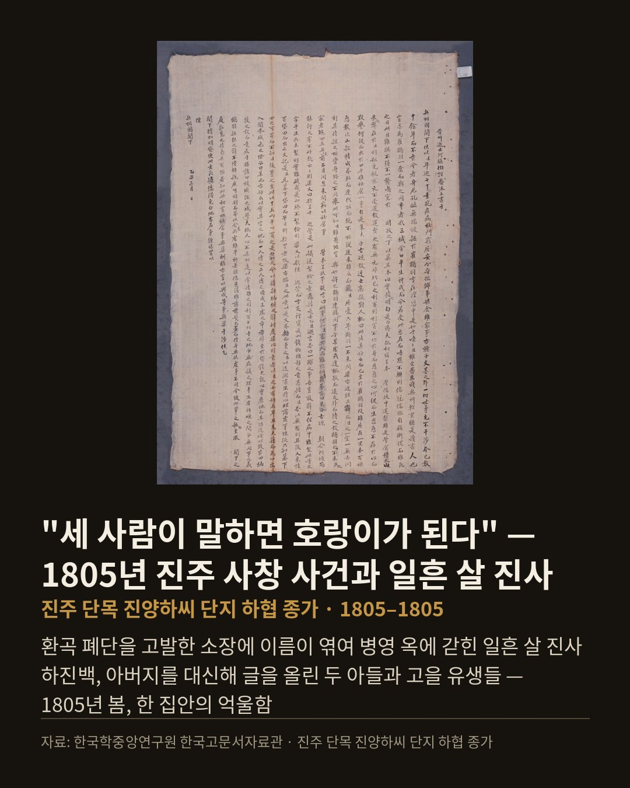
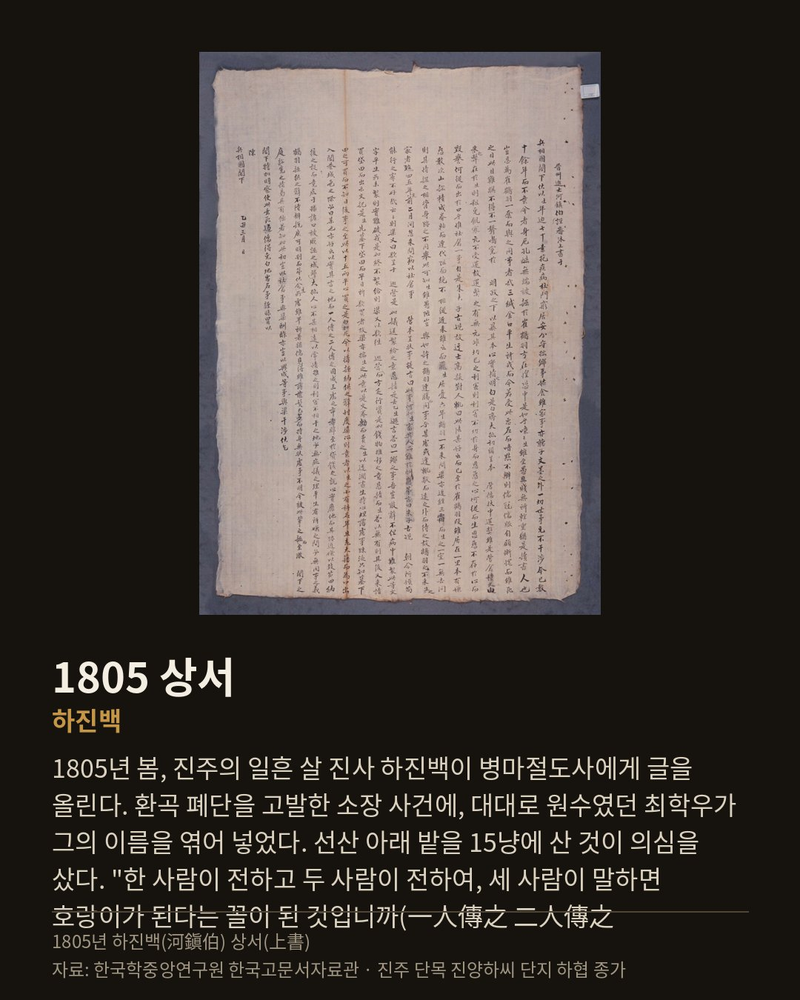
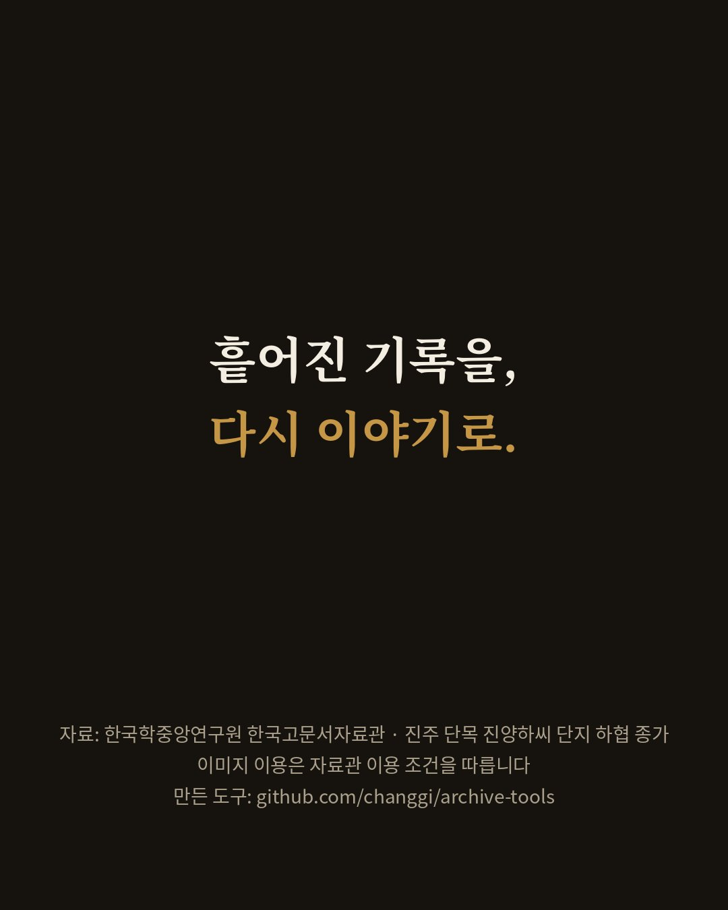

# EP.32 "세 사람이 말하면 호랑이가 된다" — 1805년 진주 사창 사건과 일흔 살 진사

진주 단목 진양하씨 단지 하협 종가 (문중) · 환곡 폐단을 고발한 소장에 이름이 엮여 병영 옥에 갇힌 일흔 살 진사 하진백, 아버지를 대신해 글을 올린 두 아들과 고을 유생들 — 1805년 봄, 한 집안의 억울함

- 🌐 [전시 웹페이지](https://changgi.github.io/archive-tools/examples/hahyeop/exhibit.html) (한자 위 한글 독음 · 원문 해석) · [수업 활동지](https://changgi.github.io/archive-tools/examples/hahyeop/handout.html)
- 🎬 영상: [릴스 9:16](https://changgi.github.io/archive-tools-next/media/ep32-hahyeop_reel.mp4) · [가로 16:9](https://changgi.github.io/archive-tools-next/media/ep32-hahyeop_wide.mp4) · 홍보 글: [`promo.md`](promo.md)
- 카드뉴스: [`cards/`](cards/) · SNS 글: [`sns.txt`](sns.txt) · 판독·해석 표: [`selection.csv`](selection.csv)


<!-- DELIVERY -->
## 전달 에디팅 — 이 기록을 이렇게 전합니다

- **핵심 정서** — 억울함
- **한 문장** — '세 사람이 말하면 호랑이가 된다' — 소문과 모함이 사람을 어떻게 가두는지.
- **열기** — 일흔 살 선비는 왜 옥에 갇혔을까요? 밭 한 뙈기 15냥이 문제였습니다.
- **펼치기** — 하진백 상서 → 하태범 상서 → 강일 등 상서 → 하제범 소지 (1805년) — 같은 해의 상서·소지 네 장을 이어 하나의 법정 드라마처럼 구성했습니다.
- **절정** — "한 사람이 전하고 두 사람이 전하여, 세 사람이 말하면 호랑이가 된다는 꼴이 된 것입니까(一人傳之 二人傳之 因成三虎之市者耶)" — 화면·공간에서 이 한 줄만 크게, 소리를 줄여 집중
- **여운** — 하진백의 억울함은 결국 풀렸을까요? — 질문으로 끝내고 답은 보는 사람에게
- **감각과 물질** — "세 사람이 말하면 호랑이가 된다"를 속삭임 소리가 커지는 음향으로 · 연명한 이름을 벽에 길게 나열하고 관아 마당처럼 서서 읽는 동선
- **통로와 매개** — 온라인: 릴스(열기) → 카드뉴스(펼치기) → 전시 웹페이지(절정·원문) → 비하인드 카드(여운) / 오프라인: 원본 크기 복제·낭독·참여 벽 / 남기기: 활동지·질문 카드
- **여운 장치** — 소문을 멈추는 말 한 마디 쓰기
- **전달 에디팅 전** — 4건의 문서를 1805년 연대순으로 놓고 문서명 · 유형 · 해설을 붙인다 — 정확하지만, 지나가면 잊힌다.
- **전달 에디팅 후** — 핵심 정서는 「억울함」. 「일흔 살 선비는 왜 옥에 갇혔을까요? 밭 한 뙈기 15냥이 문제였습니다.」로 열고, 문서를 대비와 순서로 펼친 뒤, "한 사람이 전하고 두 사람이 전하여, 세 사람이 말하면 호랑이가 된다는 꼴이 된 것입니까(一人傳之 二人傳之 因成三虎之市者耶)"에서 멈춘다. "세 사람이 말하면 호랑이가 된다"를 속삭임 소리가 커지는 음향으로. 마지막엔 「소문을 멈추는 말 한 마디 쓰기」로 보는 사람이 자기 이야기를 남기고 떠나게 한다.

전문: [`delivery.md`](delivery.md)
<!-- /DELIVERY -->

<!-- CURATOR -->
## 비하인드 — 큐레이터 노트

- **왜 이 문서들인가** — 일흔 살 진사가 원수의 모함으로 옥에 갇히고, 밭 한 뙈기 15냥이 의심을 산 1805년 소송 문서가 생생했습니다.
- **전하고 싶은 것** — '세 사람이 말하면 호랑이가 된다' — 소문과 모함이 사람을 어떻게 가두는지.
- **이렇게 보이길 바랐다** — 같은 해의 상서·소지 네 장을 이어 하나의 법정 드라마처럼 구성했습니다.
- **이렇게 써 주세요** — 조선의 소송과 민원, 가짜 뉴스와 명예 문제를 다루는 수업에 쓰세요.
- **만들며 있었던 일** — 영상 제작 중 여러 줄 제목 처리 오류가 나 고친 뒤 다시 만들었습니다.
- **남겨 둔 질문** — 하진백의 억울함은 결국 풀렸을까요?
- **제작 기록** — 문서 4건 · 1805년 · 원본 사진 4면(문서 전체) · 원문 판독 4건 · 번역 4건 · 못 읽은 글자 □ 3 · 불확실 (?) 3

전문: [`curator.md`](curator.md)
<!-- /CURATOR -->

## 이야기 — 사료가 말하는 대로

일흔 살 선비는 왜 옥에 갇혔을까요? 밭 한 뙈기 15냥이 문제였습니다.

> **1805 상서** — 1805년 봄, 진주의 일흔 살 진사 하진백이 병마절도사에게 글을 올린다. 환곡 폐단을 고발한 소장 사건에, 대대로 원수였던 최학우가 그의 이름을 엮어 넣었다. 선산 아래 밭을 15냥에 산 것이 의심을 샀다. "한 사람이 전하고 두 사람이 전하여, 세 사람이 말하면 호랑이가 된다는 꼴이 된 것입니까(一人傳之 二人傳之 因成三虎之市者耶)."
> **1805 상서** — 같은 봄, 아들 하태범도 붓을 든다. 아버지가 쓴 문장을 거의 그대로 옮기되, '나'를 '제 아버지'로 바꿨다. "제 아버지가 비록 늙고 궁하나 그래도 글 읽는 사람입니다(生之父雖老且窮 猶是讀書人)."
> **1805 상서** — 사건은 하진백 한 사람의 일이 아니었다. 같은 달, 진주 유생 수십 명이 이번에는 관찰사에게 연명 상서를 올린다. "설령 글에 눈에 거슬리는 데가 있더라도, 시골 선비의 말이 조금 지나쳤을 뿐입니다(此不過鄕曲迂儒語言薄過)."
> **1805 소지** — 한 달 뒤, 해명은 받아들여지지 않았다. 또 다른 아들 하제범이 소지를 올린다. 아버지는 칼을 쓴 채 한 달째 옥에 있고, 억울하게 죽은 큰아들의 첫 기일이 다가오고 있었다. "끊어져 가는 아버지의 목숨이 살아서 옥문을 나오게 해 주십시오(使小生父垂絶之命 生出獄門)."

| 표지 | 1번 카드 | 마무리 |
|---|---|---|
|  |  |  |

## 선별 문서 (4점)

| # | 연도 | 유형 | 문서명 | 원본 |
|---|---|---|---|---|
| 1 | 1805 | 상서 | 1805년 하진백(河鎭伯) 상서(上書) | [원본 보기](https://archive.aks.ac.kr/viewer/viewer.do#imgnode.do?itemId=book&gubun=booktree&depth=6&upPath=01%5E0150%5EL015007%5EL015007F02%5EL015007F0202&dataId=G002%2BAKS%2BKSM-XB.1805.4817-20101008.B039a_060_00031_XXX&itemType=) |
| 2 | 1805 | 상서 | 1805년 하태범(河泰範) 상서(上書) | [원본 보기](https://archive.aks.ac.kr/viewer/viewer.do#imgnode.do?itemId=book&gubun=booktree&depth=6&upPath=01%5E0150%5EL015007%5EL015007F02%5EL015007F0202&dataId=G002%2BAKS%2BKSM-XB.1805.4817-20101008.B039a_060_00032_XXX&itemType=) |
| 3 | 1805 | 상서 | 1805년 강일(姜馹) 등 상서(上書) | [원본 보기](https://archive.aks.ac.kr/viewer/viewer.do#imgnode.do?itemId=book&gubun=booktree&depth=6&upPath=01%5E0150%5EL015007%5EL015007F02%5EL015007F0202&dataId=G002%2BAKS%2BKSM-XB.1805.4817-20101008.B039a_060_00034_XXX&itemType=) |
| 4 | 1805 | 소지 | 1805년 하제범(河濟範) 소지(所志) | [원본 보기](https://archive.aks.ac.kr/viewer/viewer.do#imgnode.do?itemId=book&gubun=booktree&depth=6&upPath=01%5E0150%5EL015007%5EL015007F02%5EL015007F0202&dataId=G002%2BAKS%2BKSM-XB.1805.4817-20101008.B039a_060_00036_XXX&itemType=) |

## 원문 판독과 해석

### 1. 1805년 하진백(河鎭伯) 상서(上書)

**원문 판독**

```
晉州進士河鎭伯謹齋沐上書于
兵相國閤下 伏以生年迫七十 素抱疾病 杜門窮居 安分守拙 鄕事姑舍 雖家事亦聽子 文墨之外 一切世事 元不干涉 今已數
十餘年 而不意今者身厄孔酷 無端被誣於崔鶴羽 方在惶恐中是如乎 噫噫 生雖至愚且賤 無所輕重 猶是讀書人也
豈忍爲崔鶴羽一套 而與之同事者哉 三緘金口 平生所戒 而今若受此惡名 而噤默不辨 則儒冠儒服 自顧慚愧 而雖死
之日 此目難瞑 不得不一聲鳴冤於 明政之下 以暴其本心實情之明白是白齋 大抵初頭呈本 營儒狀中還弊 雖是營倉積久由
來之弊 在於生 則粗免飢寒 元不受還 故還弊之有無 元非切己之利害 則利害不切於身 而恩怨之心 何從而生 恩怨不存於心 而
毁譽何從而出於口乎 惟社倉一事 自是朱夫子古規 故迂士高談 對人輒曰 此法甚好云而已 至於崔鶴羽段 雖居在一里 本有嫌
怨 數次山訟 積成卷軸 而連代阻而絶不相從 近來雖云而罷 生居憂六年 鶴羽一不來問 渠亦近經三霜 而生之一室 一無去問
則其情誼之相背 身跡之不同 擧此可知 生雖愚陋 豈與如許之鶴羽 連腸而同事乎 某處或逢 輒敬而遠之 外而待之 故鶴羽之不來生之
家者殆四五年矣 前二月間 忽來問病 以社倉事 營本呈狀事 提言曰 此事何如 生審其人品 難於酬應 第言曰 朱子古規 朝令所領 苟
能行之 寧不好哉云云 則渠又曰 欲呈于 巡營 是如議送 製給之意 懇請是去乙 生遜言答曰 一鄕之事 吾豈敢辭 不但病中難製此等文
字 平生所未製 則實難破戒 是如終不製給 則渠又以欲往 巡營 而方乏行資 是如錢物推移之意 懇請 而生答以無有 則其後又來 請
買坐田 而出示文記 是生先墓下坐田 而平日所欲買者 故渠亦揣生之此意 以是文券勸而賣之 生以迂闊書生 持心坦蕩 慮事疎迂 只知墓下
田之可買 而不知日後事之至此 以十五兩平心買之是白加尼 今以搆誣納供之辭 忖度渠心 則意者以生之小有科名 年且老大 藉而爲口 出
入閭巷城邑之際 必曰某也亦好云 以實其言之地 而一人傳之 二人傳之 因成三虎之市者耶 至於貸錢之說 心實靡他 而其跡近嫌 以致茲田納
價之疑 而竟底于播諸口 被厥誣之域耶 大抵人心不甚相遠 以常情推之 則利害不相干之地 必無疵議之理 平生有所嫌之間 必無同事之義
鶴羽誣供之辭 不待辨說 庶可明別 而第伏念 生所處雖卑 所著猶儒 見得雖疎 齒髮已暮 而持身無狀 處事不明 今被此輩之誣 至徹 閤下之
庭 訟冤之情 曷其有極 若知如此 初豈以社倉事與渠酬酢 亦豈以興成(?)等事與渠干涉 伏乞
閤下特加明察 使此垂死迂儒 得免白地惡名事 謹昧冒以
陳
兵相國閤下
乙丑三月 日
```

**원문 해석** 진주 진사 하진백이 삼가 목욕재계하고 병마절도사 합하께 글을 올립니다. 엎드려 아뢰건대, 저는 나이가 일흔에 가깝고 본디 병을 안고 문을 닫은 채 궁벽하게 살며 분수를 지키고 졸렬함을 지켜 왔습니다. 고을 일은 말할 것도 없고 집안일조차 아들에게 맡기고, 글 읽고 쓰는 일 밖의 세상일에는 전혀 관여하지 않은 지 이미 수십 년입니다. 그런데 뜻밖에 지금 몸에 큰 화가 닥쳐, 까닭 없이 최학우에게 무고를 당해 두려움 속에 있습니다. 아아, 제가 비록 어리석고 천하여 보잘것없으나 그래도 글 읽는 사람인데, 어찌 차마 최학우와 한패가 되어 일을 함께 하겠습니까. 입을 세 번 봉하는 것은 평생의 경계였으나, 지금 이런 오명을 쓰고도 입을 다물고 해명하지 않는다면 선비의 갓과 옷을 입은 몸으로 부끄럽고, 죽는 날에도 눈을 감지 못할 것이기에, 밝은 정사 아래 한마디 억울함을 외쳐 본심과 실정이 명백함을 드러내고자 합니다.
처음 올린 병영 유생들의 소장 가운데 환곡 폐단은 병영 창고에 오래 쌓인 폐단이지만, 저는 겨우 굶주림과 추위를 면하는 처지라 처음부터 환곡을 받지 않았으니 환곡 폐단이 있고 없음이 제게 이해가 걸린 일이 아닙니다. 이해가 몸에 걸리지 않았는데 은혜와 원망의 마음이 어디서 생기며, 그런 마음이 없는데 칭찬과 헐뜯음이 어찌 입에서 나오겠습니까. 다만 사창(社倉)은 본래 주자의 옛 제도이므로, 세상 물정 모르는 선비의 고담으로 사람을 만나면 '이 법이 매우 좋다'고 말했을 뿐입니다.
최학우로 말하면, 한 마을에 살지만 본래 원한이 있어 여러 차례 산송(묘지 소송)으로 문서가 두루마리를 이룰 정도이고, 대를 이어 막혀 서로 왕래하지 않았습니다. 근래 화해했다고는 하나, 제가 6년 상을 치르는 동안 학우는 한 번도 문상 오지 않았고, 그도 근래 삼년상을 치렀지만 저희 집에서는 한 사람도 가지 않았습니다. 정의가 어긋나고 발길이 다른 것이 이로써 알 만합니다. 그러니 제가 어찌 그런 학우와 한 속이 되어 일을 함께 하겠습니까. 어디서 마주치면 공경하되 멀리하고 겉으로만 대했기에, 학우가 저희 집에 오지 않은 지 거의 4~5년이었습니다.
지난 2월쯤 갑자기 와서 병문안을 하고는, 사창 일로 병영에 소장을 낸 일을 꺼내며 '이 일이 어떻습니까' 하였습니다. 저는 그 사람됨을 살펴 상대하기 어렵다 여겨 다만 '주자의 옛 제도이고 조정의 명으로 맡긴 바이니 진실로 행할 수 있다면 어찌 좋지 않겠는가' 하였습니다. 그러자 그가 또 '순영(감영)에 올리려 하니 의송(議送)을 지어 달라' 간청하기에, 저는 '한 고을의 일을 내가 어찌 사양하겠는가마는, 병중이라 이런 글을 짓기 어려울 뿐 아니라 평생 지어 본 적이 없어 계율을 깨기 어렵다' 하고 끝내 지어 주지 않았습니다. 그러자 그가 또 순영에 가려는데 노자가 없다며 돈을 융통해 달라 간청하였고, 저는 없다고 답했습니다. 그 뒤 또 와서 밭을 사 달라며 문기를 내보였는데, 그것이 바로 저희 선산 아래 밭으로 평소 사고 싶던 것이었습니다. 그도 제 뜻을 짐작하여 그 문서로 팔기를 권했고, 저는 세상 물정 모르는 서생이라 마음을 터놓고 일을 허술하게 헤아려, 다만 선산 아래 밭을 살 수 있다는 것만 알고 훗날 일이 이렇게 될 줄은 모른 채 15냥에 공평하게 샀습니다.
이제 그가 꾸며 바친 진술을 헤아려 보건대, 제가 작은 과거 이름이 있고 나이도 많으니 이를 빌려 마을과 성안을 드나들며 '아무개도 좋다고 했다'고 말해 제 말을 사실로 만들려 한 것이고, 한 사람이 전하고 두 사람이 전하여 '세 사람이 말하면 저자에 호랑이가 있다'는 꼴이 된 것입니까. 돈을 빌려 달라던 일은 마음에 다른 뜻이 없었으나 자취가 혐의에 가까워 이 밭값에 대한 의심을 낳고, 마침내 입에서 입으로 퍼져 그 무고를 당하게 된 것입니까. 사람의 마음은 크게 다르지 않으니, 이해가 걸리지 않은 처지에 흠잡을 이유가 없고, 평생 혐의가 있는 사이에 일을 함께 할 리가 없습니다. 학우의 무고는 따지지 않아도 가려질 것이나, 엎드려 생각건대 제 처지가 비록 낮아도 입은 것은 선비의 옷이요, 견식이 비록 성글어도 나이가 이미 저물었는데, 몸가짐이 형편없고 일 처리가 밝지 못하여 이런 무리의 무고를 입어 합하의 뜰에까지 이르렀으니, 억울함을 호소하는 마음이 어찌 끝이 있겠습니까. 이럴 줄 알았다면 처음부터 어찌 사창 일로 그와 말을 섞었겠으며, 어찌 흥성(?) 등의 일로 그와 얽혔겠습니까. 엎드려 바라건대 합하께서 특별히 밝게 살피시어, 죽어 가는 이 세상 물정 모르는 선비가 터무니없는 오명을 벗게 해 주십시오. 삼가 외람되이 아룁니다. 병마절도사 합하. 을축년(1805) 3월 일.

**해제** 1805년(순조 5, 乙丑) 3월, 진주의 진사 하진백(河鎭伯)이 경상우병마절도사(兵相國, 진주 병영)에게 올린 상서입니다. 진주 병영 창고의 환곡 폐단과 사창(社倉) 설치를 두고 유생들이 소장을 낸 일로 조사가 벌어졌는데, 최학우(崔鶴羽)가 진술에서 하진백을 한패로 끌어들인 데 대한 해명입니다. 두 집안은 대를 이은 산송으로 왕래가 끊긴 사이였고, 최학우가 팔러 온 선산 아래 밭을 15냥에 산 일이 뇌물처럼 의심받았다고 설명합니다. 줄 끝을 맞춰 쓴 해서체로 전문을 판독했으며, 몇 글자는 불확실합니다.

### 2. 1805년 하태범(河泰範) 상서(上書)

**원문 판독**

```
晉州幼學河泰範謹齋沐上書于
兵相國閤下 伏以生之父年迫七十 素抱疾病 杜門窮居 安分守拙 鄕事姑舍 雖(…)
無端被誣於崔鶴羽是如乎 噫噫 生之父雖老且窮 猶是讀書人 豈忍爲崔(…)
實自難容 不得不一聲鳴冤於 明政之下 以暴其本心實情之明白是(…)
寒 元不受還 故還弊之有無 元非切己之利害 則利害不切於身 而恩怨(…)
下老儒所可干 所與知 而惟社倉一事 自是朱夫子古規 故迂士高談(…)
眷軸 連代沮而絶不相從 近來雖云而罷 生之父居憂 渠不來問 渠亦近經(…)
連腸而同事乎 鶴羽之不來生之家者 殆四五年矣 前二月間 生之父臥病 對(…)
朝令之所領 苟能行之 寧不好哉云云 則渠又曰 欲呈于 巡營 是如議 送製(…)
(이하 왼쪽 절반은 하진백 상서와 같은 사연을 아들의 말로 옮긴 것 — 판독 필요)
```

**원문 해석** 진주 유학 하태범이 삼가 목욕재계하고 병마절도사 합하께 글을 올립니다. 엎드려 아뢰건대, 제 아버지는 나이가 일흔에 가깝고 본디 병을 안고 문을 닫은 채 궁벽하게 살며 분수를 지켜, 고을 일은 말할 것도 없고 … 그런데 까닭 없이 최학우에게 무고를 당했습니다. 아아, 제 아버지가 비록 늙고 궁하나 그래도 글 읽는 사람인데 어찌 차마 최[학우와 한패가 되겠습니까]. … 실로 스스로 용납하기 어려워 밝은 정사 아래 한마디 억울함을 외쳐 본심과 실정이 명백함을 드러내고자 합니다. … [겨우 굶주림과] 추위를 면하는 처지라 처음부터 환곡을 받지 않았으니 환곡 폐단이 있고 없음이 이해가 걸린 일이 아닙니다. … 늙은 선비가 간여하고 알 일이 아니며, 다만 사창은 주자의 옛 제도이므로 세상 물정 모르는 선비의 고담으로 … 대를 이어 막혀 서로 왕래하지 않았고, 근래 화해했다 하나 아버지가 상중일 때 그는 문상 오지 않았고 … 어찌 한 속이 되어 일을 함께 하겠습니까. 학우가 저희 집에 오지 않은 지 거의 4~5년이었는데, 지난 2월쯤 아버지가 병으로 누워 계실 때 … '조정의 명으로 맡긴 바이니 진실로 행할 수 있다면 어찌 좋지 않겠는가' 하자, 그가 또 순영에 올릴 의송을 지어 달라고 … (이하 판독 필요)

**해제** 같은 1805년, 하진백의 아들 유학 하태범(河泰範)이 아버지를 대신해 병마절도사에게 올린 상서입니다. 문장과 사연이 아버지의 상서와 거의 같고, 주어만 '생(生, 저)'에서 '생지부(生之父, 제 아버지)'로 바뀌어 있습니다. 같은 초안을 바탕으로 아버지와 아들이 각각 글을 올린 것으로 보입니다. 오른쪽 절반을 판독했고, 왼쪽 절반은 판독이 필요합니다.

### 3. 1805년 강일(姜馹) 등 상서(上書)

**원문 판독**

```
晉州幼學 等謹齋沐百拜上書于
巡相國閤下 伏以生等以鄕儒被囚於兵營事 數日前有所齊顲 閤下必已洞燭
陳 伏願 閤下垂察焉 本邑餉穀痼弊 卽道內之尤甚 及此社倉領 令之後 民情(…)
議呈辭於本官及兵營 而懇請其放釋 時則 營門勘決關未來之前也 而兵營非但(…)
忽地挐出 着枷嚴囚 又以軍任差出之令 催督本官 則生等城主 以儒生之差以軍任 本邑(…)
雖使所呈文字 或有礙眼 此不過鄕曲迂儒語言薄過 有何足深責 而一至於此 以林下讀(…)
撰以事理 得非居乎 彼被繫二人 素以謹拙之士 平生所讀 卽朱書也 平日講明 卽道理也 今(…)
朝令是朱夫子古制 我
聖上明命 而又是 營門勘決未來之前 故未料事機之乖戾至此 而與衆隨參而已 則原其本(…)
書以狀頭 此則兵營棄去此原狀 故未及詳考而致此誤 書原狀內在何足多卞 彼二人之(…)
(…가운데 여러 줄 판독 필요…)
閤下巡宣之下 所仰恃者 惟 閤下而已也 伏乞 仰體
朝家愛民之意 俯察一邑無告之冤 特下 明令 垂濟一州事 謹冒昧以
陳
乙丑三月 日
姜馹 李命守 姜瞌 鄭東善 李命範 許(?)□ 許峒 鄭志衡 張錫柱 鄭衡殷 文斯廷 文亨紞 文弼純 成師爗
朴師道 成師憲 崔景彦 李守燦 鄭世益 李文新 鄭潤彬 鄭守成 李再斌 李國彬 許濟 李再煥 文師伯 成師顯 (외 여러 이름 — 판독 필요)
```

**원문 해석** 진주 유학 [강일] 등이 삼가 목욕재계하고 백 번 절하며 관찰사 합하께 글을 올립니다. 엎드려 아뢰건대, 저희는 고을 유생이 병영에 갇힌 일로 며칠 전 함께 호소하였으니 합하께서 이미 훤히 아실 것입니다. 엎드려 바라건대 살펴 주십시오. 이 고을 군량 곡식(餉穀)의 고질적 폐단은 도 안에서도 가장 심한데, 사창(社倉)을 맡기라는 영이 내려온 뒤 민정이 … 본관(진주목사)과 병영에 글을 올려 [갇힌 이들을] 풀어 달라고 간청하였는데, 그때는 감영의 판결 공문이 오기 전이었습니다. 그런데 병영에서는 … 갑자기 잡아내어 칼을 씌워 엄하게 가두고, 또 군역 직임에 차출하라는 영으로 본관을 독촉하니, 저희 사또께서는 유생을 군임에 차출하는 것으로 … 설령 올린 글에 눈에 거슬리는 데가 있더라도 이는 시골의 세상 물정 모르는 선비의 말이 조금 지나쳤을 뿐이니 어찌 깊이 꾸짖을 만하며, 이렇게까지 하십니까. … 저 갇힌 두 사람은 본래 삼가고 졸박한 선비로, 평생 읽은 것이 주자의 글이고 평소 밝힌 것이 도리입니다. … 조정의 명은 주자의 옛 제도이자 우리 성상의 밝은 명이고, 또 감영의 판결이 내려오기 전이었으므로 일이 이렇게 어그러질 줄 모르고 여럿을 따라 참여했을 뿐입니다. … (가운데 판독 필요) … 합하께서 순찰하며 펴시는 정사 아래 우러러 믿을 이는 오직 합하뿐입니다. 엎드려 바라건대 조정이 백성을 아끼는 뜻을 받들어, 한 고을의 하소연할 데 없는 억울함을 굽어살피시어 특별히 밝은 영을 내려 한 고을을 구해 주십시오. 삼가 외람되이 아룁니다. 을축년(1805) 3월 일. 강일, 이명수, 강개 … 등.

**해제** 1805년 3월 진주 유생 강일(姜馹) 등 수십 명이 경상도 관찰사(巡相國)에게 올린 연명 상서입니다. 사창 문제로 글을 올린 유생 두 사람이 병영에 칼을 쓴 채 갇히고, 병영이 그들을 군역 직임에 차출하라고 진주목사를 독촉하자, 감영의 판결이 내려오기도 전의 일이라며 석방을 호소했습니다. 왼쪽 아래에 연명한 유생들의 이름이 두 줄로 길게 이어집니다. 오른쪽 앞부분과 끝맺음·이름을 판독했고, 가운데 여러 줄은 판독이 필요합니다.

### 4. 1805년 하제범(河濟範) 소지(所志)

**원문 판독**

```
幼學河濟範
右謹言泣血冤痛情由段 小生之父以年老抱病之身 哭子□□(?) 久滯冷獄 百病交生 氣息奄奄是乎等以 小生席藁待罪凡十五日而
閤下憐其病勢沉重 特賜保放 小生旣被恩德 感泣無地是乎矣 小生之父精神尙存 不忍獨出是乎所 小生不敢負出獄門是白加尼 今則枷囚牢獄
凡一月而病勢漸劇 食飮難下 重以壯子冤死初祥 迫在今月十二日是乎尒 以小生之父 病極沉奄之中 心氣沸鬱 火氣交作 身不能著衣
粥不能下咽 方在朝夕難保之境 小生雖不肖無狀 爲子情地 痛泣罔措 玆敢大聲長呼於
伏鉞孝理之下 伏乞 洞燭小生父本情之無罪 病勢之危篤 特憐究祥迫近 火熱添病 更加仁恩 使小生父垂絶之命 生出獄門 以
爲救病於究祥之前 事積善 行下爲只爲
行下 向敎是事
兵相國 處分
乙丑四月 日
```

**원문 해석** 유학 하제범. 삼가 피눈물로 원통한 사정을 아룁니다. 제 아버지는 늙고 병든 몸으로 [아들을 잃고 곡하던 중] 오래 차가운 옥에 갇혀 온갖 병이 함께 생겨 숨이 끊어질 듯하옵기에, 저는 거적을 깔고 죄를 기다린 지 열닷새 만에 합하께서 그 병세가 위중함을 가엾게 여기시어 특별히 보석(保放)을 허락하셨습니다. 저는 그 은덕을 입어 감격의 눈물을 흘릴 곳을 몰랐으나, 아버지가 아직 정신이 있어 차마 혼자 나가지 못하시므로 저도 감히 [아버지를] 업고 옥문을 나서지 못하였습니다. 그런데 지금은 칼을 쓰고 옥에 갇힌 지 무릇 한 달이 되어 병세가 점점 심해져 음식을 넘기기 어렵고, 게다가 억울하게 죽은 장성한 아들의 첫 기일(초상)이 이달 12일로 다가왔습니다. 아버지는 병이 극히 위중한 가운데 마음이 끓어오르고 화기가 번갈아 일어 옷을 입지 못하고 죽도 넘기지 못하여, 아침저녁을 보전하기 어려운 지경입니다. 제가 비록 못나고 보잘것없으나 자식 된 처지로 통곡하며 어찌할 줄 몰라, 감히 큰 소리로 효로 다스리시는 [합하의] 부월 아래 길게 부르짖습니다. 엎드려 바라건대, 아버지의 본심에 죄가 없음과 병세가 위독함을 훤히 살피시고, 기일이 다가오고 열이 병을 더하는 것을 특별히 가엾이 여기시어 다시 어진 은혜를 베푸시어, 끊어져 가는 아버지의 목숨이 살아서 옥문을 나와 기일 전에 병을 고칠 수 있도록 처분해 주십시오. 병마절도사께서 처분하실 일. 을축년(1805) 4월 일.

**해제** 1805년 4월, 유학 하제범(河濟範)이 병마절도사에게 올린 소지입니다. 칼을 쓴 채 한 달째 옥에 갇혀 병이 위독한 아버지를 풀어 달라는 청원입니다. 같은 해 3월의 하진백·하태범 상서와 함께 전하고, 하태범과 같은 '範' 자 항렬이어서 하진백의 아들로 보이지만 문서 안에 아버지 이름은 없습니다. 한 해 전 '억울하게 죽은 장성한 아들(壯子冤死)'의 첫 기일이 다가온다는 구절이 있습니다. '是乎等以(이온들로)', '是白加尼(이삷더니)', '爲只爲(하기 위하여)' 같은 이두가 쓰였습니다.

판독·해석·이야기는 이미지에 근거한 초안이며(검토 전 "초안" 표시), 정확한 판독은 원문 확인이 필요합니다. □는 읽지 못한 글자, (?)는 불확실한 글자입니다.
이미지: 한국학중앙연구원 한국고문서자료관 소장·제공. "원본" 링크를 누르면 자료관 뷰어에서 그 문서가 열립니다. 재사용은 자료관에 문의하세요(소장처 동의 필요).
