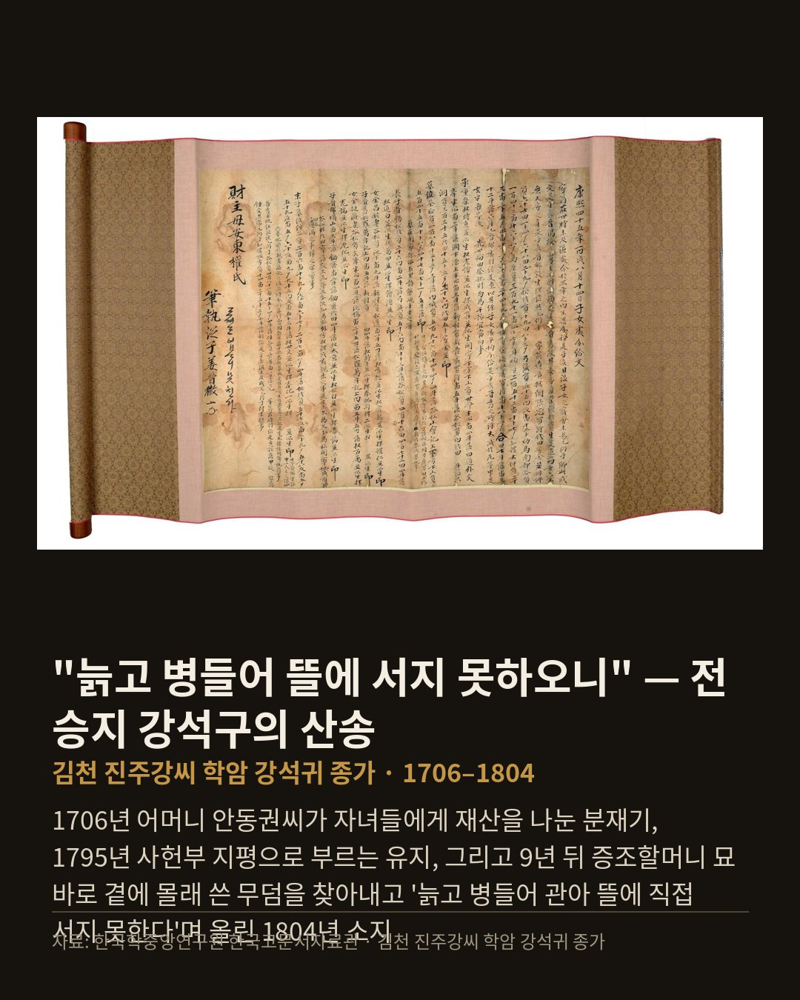
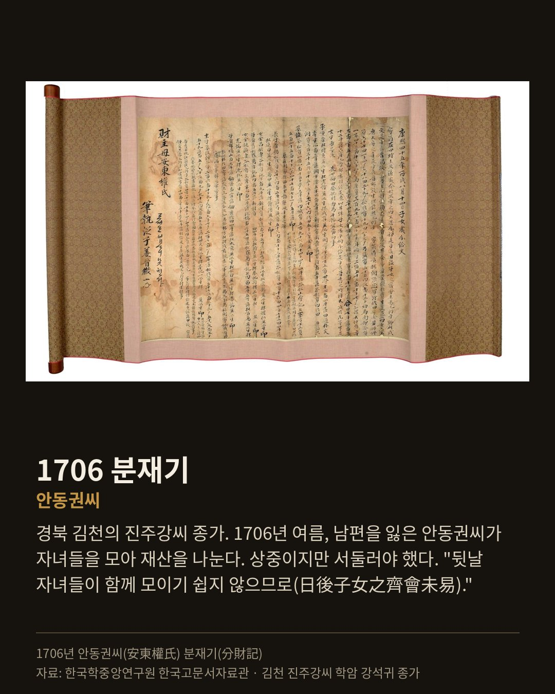
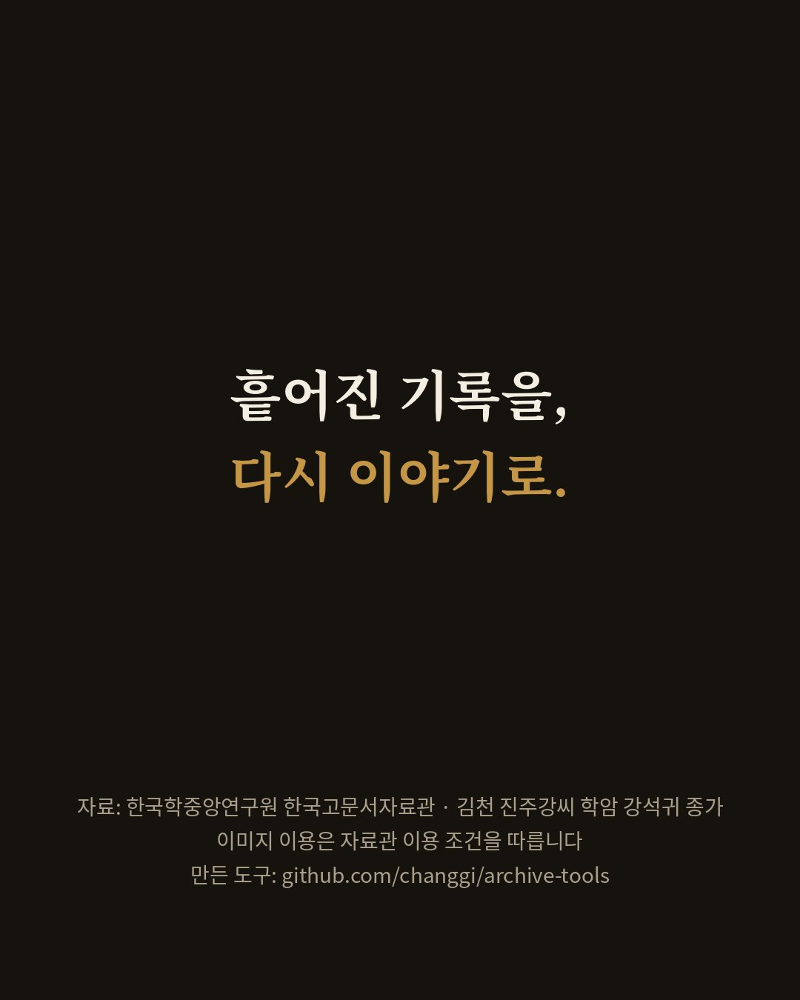

# EP.65 "늙고 병들어 뜰에 서지 못하오니" — 전 승지 강석구의 산송

김천 진주강씨 학암 강석귀 종가 (문중) · 1706년 어머니 안동권씨가 자녀들에게 재산을 나눈 분재기, 1795년 사헌부 지평으로 부르는 유지, 그리고 9년 뒤 증조할머니 묘 바로 곁에 몰래 쓴 무덤을 찾아내고 '늙고 병들어 관아 뜰에 직접 서지 못한다'며 올린 1804년 소지

- 🌐 [전시 웹페이지](https://changgi.github.io/archive-tools/examples/hakam/exhibit.html) (한자 위 한글 독음 · 원문 해석) · [수업 활동지](https://changgi.github.io/archive-tools/examples/hakam/handout.html)
- 🎬 영상: [릴스 9:16](https://changgi.github.io/archive-tools-next/media/ep65-hakam_reel.mp4) · [가로 16:9](https://changgi.github.io/archive-tools-next/media/ep65-hakam_wide.mp4) · 홍보 글: [`promo.md`](promo.md)
- 카드뉴스: [`cards/`](cards/) · SNS 글: [`sns.txt`](sns.txt) · 판독·해석 표: [`selection.csv`](selection.csv)


<!-- DELIVERY -->
## 전달 에디팅 — 이 기록을 이렇게 전합니다

- **핵심 정서** — 노년의 고집
- **한 문장** — 벼슬을 지낸 사람도 조상 무덤을 지키려면 관아에 호소해야 했다는 것.
- **열기** — 서울에서 승지를 지낸 노인이, 고향 사또에게 종이 한 장으로 호소했습니다.
- **펼치기** — 안동권씨 분재기 → 강석구 유지 → 강석구 등 14인 소지 (1706–1804년) — 어머니의 분재기 → 지평으로 부르는 유지 → 늙은 몸의 소지로, 한 집안의 백 년을 이었습니다.
- **절정** — "관아 뜰에 서서 자세히 아뢰고 싶지 않은 것이 아니나, 늙은 병이 추위에 더욱 심해져(非不欲面立庭細陳情原 而老病當寒添劇)" — 화면·공간에서 이 한 줄만 크게, 소리를 줄여 집중
- **여운** — 직접 뜰에 서지 못한 그를 대신해, 누가 관아에 갔을까요? — 질문으로 끝내고 답은 보는 사람에게
- **감각과 물질** — 관아 뜰에 놓인 빈 의자 — 서지 못한 사람 · 값(무명·냥·원)을 오늘의 물건으로 바꿔 옆에 놓기, 수결 따라 그리기 · 역마 방울·말발굽 소리와 함께 펼치는 두루마리 · 연명한 이름을 벽에 길게 나열하고 관아 마당처럼 서서 읽는 동선
- **통로와 매개** — 온라인: 릴스(열기) → 카드뉴스(펼치기) → 전시 웹페이지(절정·원문) → 비하인드 카드(여운) / 오프라인: 원본 크기 복제·낭독·참여 벽 / 남기기: 활동지·질문 카드
- **여운 장치** — "대신 가 준 사람" 기억
- **전달 에디팅 전** — 3건의 문서를 1706–1804년 연대순으로 놓고 문서명 · 유형 · 해설을 붙인다 — 정확하지만, 지나가면 잊힌다.
- **전달 에디팅 후** — 핵심 정서는 「노년의 고집」. 「서울에서 승지를 지낸 노인이, 고향 사또에게 종이 한 장으로 호소했습니다.」로 열고, 문서를 대비와 순서로 펼친 뒤, "관아 뜰에 서서 자세히 아뢰고 싶지 않은 것이 아니나, 늙은 병이 추위에 더욱 심해져(非不欲面立庭細陳情原 而老病當寒添劇)"에서 멈춘다. 관아 뜰에 놓인 빈 의자 — 서지 못한 사람. 마지막엔 「"대신 가 준 사람" 기억」로 보는 사람이 자기 이야기를 남기고 떠나게 한다.

전문: [`delivery.md`](delivery.md)
<!-- /DELIVERY -->

<!-- CURATOR -->
## 비하인드 — 큐레이터 노트

- **왜 이 문서들인가** — 전 승지가 '늙고 병들어 관아 뜰에 서지 못한다'며 올린 산송 소지가, 소송의 현실을 보여 주었습니다.
- **전하고 싶은 것** — 벼슬을 지낸 사람도 조상 무덤을 지키려면 관아에 호소해야 했다는 것.
- **이렇게 보이길 바랐다** — 어머니의 분재기 → 지평으로 부르는 유지 → 늙은 몸의 소지로, 한 집안의 백 년을 이었습니다.
- **이렇게 써 주세요** — 산송(묘지 소송) 문화, 노년과 공직을 다루는 자료로 쓰세요.
- **남겨 둔 질문** — 직접 뜰에 서지 못한 그를 대신해, 누가 관아에 갔을까요?
- **제작 기록** — 문서 3건 · 1706–1804년 · 원본 사진 6면(문서 전체) · 원문 판독 3건 · 번역 3건 · 못 읽은 글자 □ 1 · 불확실 (?) 5 · 해제에 "확인 필요"를 단 문서 1건

전문: [`curator.md`](curator.md)
<!-- /CURATOR -->

## 이야기 — 사료가 말하는 대로

서울에서 승지를 지낸 노인이, 고향 사또에게 종이 한 장으로 호소했습니다.

> **1706 분재기** — 경북 김천의 진주강씨 종가. 1706년 여름, 남편을 잃은 안동권씨가 자녀들을 모아 재산을 나눈다. 상중이지만 서둘러야 했다. "뒷날 자녀들이 함께 모이기 쉽지 않으므로(日後子女之齊會未易)."
> **1795 유지** — 89년 뒤, 이 집안의 강석구에게 서울에서 부름이 온다. "너를 사헌부 지평으로 삼으니, 서둘러 역마를 타고 올라오라." 그는 뒤에 승지까지 지냈다.
> **1804 소지** — 그리고 1804년 겨울, 늙은 전 승지가 사또에게 글을 쓴다. 증조할머니 묘 곁에 누군가 몰래 무덤을 썼다. 여러 달 찾아 헤매 범인을 잡았지만, 그는 관아에 갈 수가 없었다. "관아 뜰에 서서 자세히 아뢰고 싶지 않은 것이 아니나, 늙은 병이 추위에 더욱 심해져(非不欲面立庭細陳情原 而老病當寒添劇)." 그래서 종이 한 장으로 대신했다.

| 표지 | 1번 카드 | 마무리 |
|---|---|---|
|  |  |  |

## 선별 문서 (3점)

| # | 연도 | 유형 | 문서명 | 원본 |
|---|---|---|---|---|
| 1 | 1706 | 분재기 | 1706년 안동권씨(安東權氏) 분재기(分財記) | [원본 보기](https://archive.aks.ac.kr/viewer/viewer.do#imgnode.do?itemId=book&gubun=booktree&depth=6&upPath=01%5E0167%5EL016724%5EL016724F02%5EL016724F0205&dataId=G002%2BKHD%2BKSM-XE.1706.0000-20160628.C0801_002_00063_XXX&itemType=) |
| 2 | 1795 | 유지 | 1795년 강석구(姜碩龜) 유지(有旨) | [원본 보기](https://archive.aks.ac.kr/viewer/viewer.do#imgnode.do?itemId=book&gubun=booktree&depth=6&upPath=01%5E0167%5EL016724%5EL016724F02%5EL016724F0201&dataId=G002%2BKHD%2BKSM-XA.1795.0000-20160628.C0801_002_00028_XXX&itemType=) |
| 3 | 1804 | 소지 | 1804년 강석구(姜碩龜) 등 14인 소지(所志) | [원본 보기](https://archive.aks.ac.kr/viewer/viewer.do#imgnode.do?itemId=book&gubun=booktree&depth=6&upPath=01%5E0167%5EL016724%5EL016724F02%5EL016724F0202&dataId=G002%2BKHD%2BKSM-XB.1804.0000-20160628.C0801_002_00033_XXX&itemType=) |

## 원문 판독과 해석

### 1. 1706년 안동권씨(安東權氏) 분재기(分財記)

**원문 판독**

```
康熙四十五年丙戌八月十四日 子女處分給文
右文爲 家翁在世時 未及區處 今於三年之內 不忍分析是乎矣 日後子女之齊會未易乙仍于 卿與(?)成
文 (…) (이하 자녀별 노비·논밭 목록 — 長子 … / 女金昌鍇妻 … / 次子 … / 末子 … 각 줄 끝에 印)
(…가운데 여러 줄, 판독 필요…)
財主 母 安東權氏 (도장)
筆執 從子 姜晉徵 (수결)
```

**원문 해석** 강희 45년 병술(1706) 8월 14일, 자녀들에게 나눠 주는 문서. 이 글은, 남편이 살아 있을 때 미처 나누어 정하지 못하였는데, 이제 [상을 치르는] 삼 년 안에 나누는 것이 차마 못 할 일이지만, 뒷날 자녀들이 함께 모이기 쉽지 않으므로 … 문서를 만든다. (이하 맏아들·딸(김창개의 처)·둘째 아들·막내아들 등 몫의 노비와 논밭 목록) … 재주 어머니 안동권씨(도장). 필집 조카 강진징(수결).

**해제** 1706년(숙종 32) 8월, 남편을 잃은 안동권씨가 자녀들에게 노비와 논밭을 나눈 분재기(分財記)입니다. 남편이 생전에 나누지 못해, 탈상 전이지만 자녀들이 다시 모이기 어려우니 지금 나눈다고 사연을 적었습니다. 자녀별 몫 끝마다 '印'을 찍어 확인했고, 글은 조카(從子) 강진징이 받아 썼습니다. 작은 글씨의 재산 목록은 대부분 판독이 필요합니다.

### 2. 1795년 강석구(姜碩龜) 유지(有旨)

**원문 판독**

```
(겉) 司憲府持平姜碩龜 開拆
同副承旨李(押)
今以爾爲司憲府持平
爾其斯速乘馹上
來事 有
旨
乾隆六十年十二月二十一日 (도장)
```

**원문 해석** 사헌부 지평 강석구가 열어 볼 것. 동부승지 이(李)가 씀. 이제 너를 사헌부 지평으로 삼으니, 너는 서둘러 역마를 타고 올라오라는 유지. 건륭 60년(1795) 12월 21일.

**해제** 1795년(정조 19) 12월, 김천에 있던 강석구(姜碩龜)를 사헌부 지평에 임명하며 부른 유지입니다. 강석구는 뒤에 승지까지 지냈고, 1804년 소지에서는 자신을 '전 승지(前承旨)'라 썼습니다. 비단으로 두루마리 장황을 해 보관하고 있습니다.

### 3. 1804년 강석구(姜碩龜) 등 14인 소지(所志)

**원문 판독**

```
化民前承旨姜碩龜謹再拜上書于
城主閤下 伏以民之曾祖 贈□(?)敎公 妣 位淑夫人墳山 在於外面平田 而四山守護 殆過百年 千萬不意 不知何許漢 偸葬於靑龍要害至近之處 民等累月搜覓
始現捉則 乃山下居金東振爲名漢也 嗟噫痛矣 雖匠庶家墳山 龍虎主案四山內 勿許他人入葬 自有
先朝飭敎 則況以公卿之兆 視一鄕士夫通葬於至(?)… 何民習此 何世變也 民年迫桑楡 奄遭山變 非不欲面
立庭細陳情原 而老病當寒添劇 伏枕
泣(?)沫(?) 由起作 茲敢以一紙替顲於
按法之下 伏乞 親審摘奸後 塚主金東振捉致 法庭 先治其偸葬之罪 依 法典 卽刻掘移 以爲士夫家墳山保護之地 民無任祈懇之至
城主 處分
甲子十月 日 民 姜碩龜
姜履和 姜履埈 姜致儉 姜履載 姜復淳 姜達淳 姜哲淳 姜永淳 姜義淳 姜秉淳 姜溥淳 姜錫淳 姜周楨 等
(왼쪽 큰 흘림 — 관의 처분: 此極驚駭 … 同金東振 … 掘移 … 판독 필요) (관인 여럿)
```

**원문 해석** 교화를 받는 백성 전 승지 강석구가 삼가 두 번 절하고 사또께 글을 올립니다. 엎드려 아뢰건대, 저의 증조할아버지 … 와 증조할머니 숙부인의 묘가 외면 평전에 있어 사방 산을 지켜 온 지 거의 백 년이 되었습니다. 그런데 천만뜻밖에 어떤 놈인지 모를 자가 청룡(묘 왼쪽 산줄기)의 요해처 아주 가까운 곳에 몰래 장사 지냈기에, 저희가 여러 달 찾아 헤맨 끝에 비로소 잡고 보니 산 아래 사는 김동진이라는 자였습니다. 아아, 원통합니다. 비록 장인이나 서민의 묘라도 좌청룡·우백호·주산·안산 사방 산 안에는 남이 묻는 것을 허락하지 않는다는 선왕의 지엄한 가르침이 있는데, 하물며 공경의 묘에 … 이 무슨 백성의 버릇이며 이 무슨 세상의 변괴입니까. 저는 나이가 저물녘(桑楡)에 이르러 갑자기 묘의 변을 당했으니, 관아 뜰에 직접 서서 사정을 자세히 아뢰고 싶지 않은 것이 아니나, 늙은 병이 추위를 만나 더욱 심해져 베개에 엎드려 … 일어날 수 없어, 감히 종이 한 장으로 대신 호소합니다. 엎드려 바라건대 직접 살펴 조사하신 뒤 무덤 주인 김동진을 법정에 잡아들여 먼저 몰래 장사 지낸 죄를 다스리고, 법전에 따라 즉시 파 옮기게 하여 사대부 집안 묘를 보호하게 해 주십시오. 간절히 비는 마음을 이기지 못합니다. 사또께서 처분하실 일. 갑자년(1804) 10월 일. 백성 강석구, 강이화 … 강주정 등.

**해제** 1804년(순조 4, 甲子) 10월, 전 승지 강석구가 집안사람 13명과 함께 김천 군수에게 올린 산송(山訟) 소지입니다. 증조부모 묘의 청룡 쪽 가까운 곳에 산 아래 사는 김동진이 몰래 장사 지낸(偸葬) 것을 여러 달 만에 찾아내, 파 옮기게 해 달라고 청했습니다. '늙고 병들어 추위에 더 심해져 직접 뜰에 서지 못한다'는 대목에 전직 고관의 처지가 보입니다. 왼쪽의 큰 흘림은 관의 처분으로 '此極驚駭(이는 지극히 놀랍다)'로 시작하는 것으로 보입니다. 해서로 써서 본문을 거의 판독했습니다.

판독·해석·이야기는 이미지에 근거한 초안이며(검토 전 "초안" 표시), 정확한 판독은 원문 확인이 필요합니다. □는 읽지 못한 글자, (?)는 불확실한 글자입니다.
이미지: 한국학중앙연구원 한국고문서자료관 소장·제공. "원본" 링크를 누르면 자료관 뷰어에서 그 문서가 열립니다. 재사용은 자료관에 문의하세요(소장처 동의 필요).
