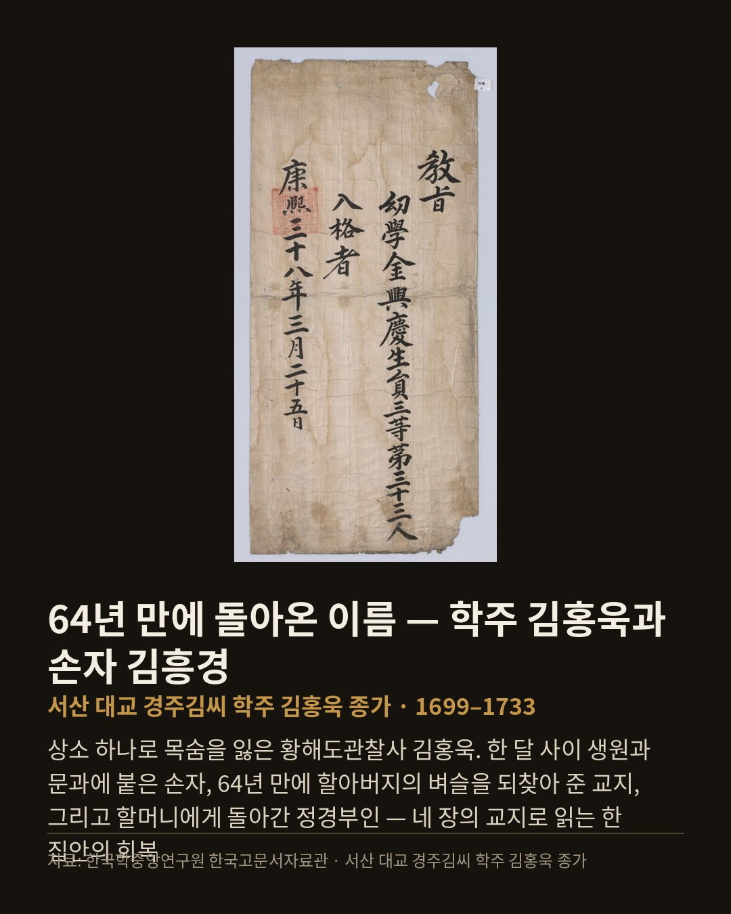
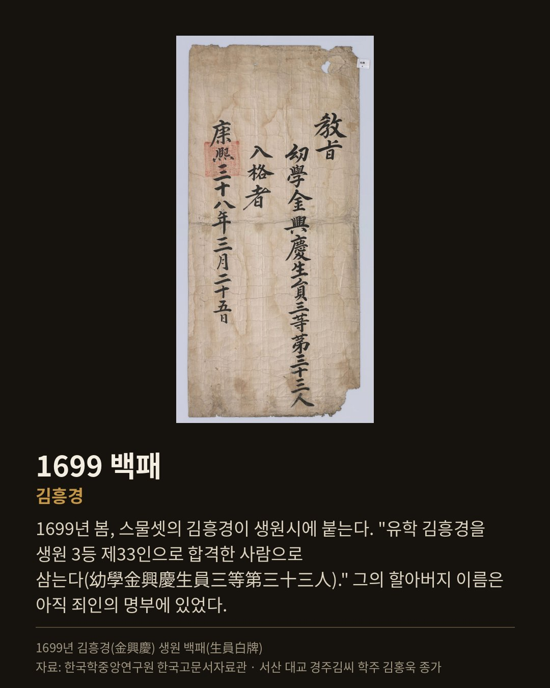
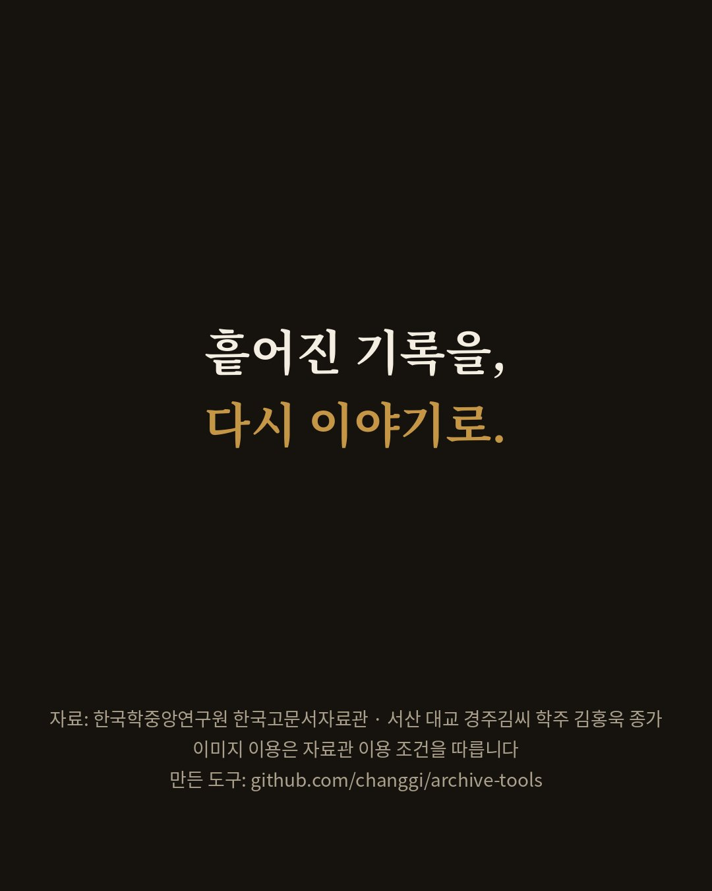

# EP.37 64년 만에 돌아온 이름 — 학주 김홍욱과 손자 김흥경

서산 대교 경주김씨 학주 김홍욱 종가 (문중) · 상소 하나로 목숨을 잃은 황해도관찰사 김홍욱. 한 달 사이 생원과 문과에 붙은 손자, 64년 만에 할아버지의 벼슬을 되찾아 준 교지, 그리고 할머니에게 돌아간 정경부인 — 네 장의 교지로 읽는 한 집안의 회복

- 🌐 [전시 웹페이지](https://changgi.github.io/archive-tools/examples/hakju/exhibit.html) (한자 위 한글 독음 · 원문 해석) · [수업 활동지](https://changgi.github.io/archive-tools/examples/hakju/handout.html)
- 🎬 영상: [릴스 9:16](https://changgi.github.io/archive-tools/examples/media/ep37-hakju_reel.mp4) · [가로 16:9](https://changgi.github.io/archive-tools/examples/media/ep37-hakju_wide.mp4) · 홍보 글: [`promo.md`](promo.md)
- 카드뉴스: [`cards/`](cards/) · SNS 글: [`sns.txt`](sns.txt) · 판독·해석 표: [`selection.csv`](selection.csv)


<!-- CURATOR -->
## 비하인드 — 큐레이터 노트

- **왜 이 문서들인가** — 상소로 목숨을 잃은 할아버지의 이름이 64년 만에 돌아온 교지와, 한 달 사이 '유학'에서 '생원'이 된 손자의 문서가 함께 있었습니다.
- **전하고 싶은 것** — 억울한 죽음도 시간이 지나 기록으로 회복될 수 있다는 것.
- **이렇게 보이길 바랐다** — 손자의 두 장(한 달 차이)으로 시작해, 할아버지의 복권으로 시간을 거슬러 올라갔습니다.
- **이렇게 써 주세요** — 언론과 직언, 복권의 역사를 다루는 수업에 쓰세요.
- **만들며 있었던 일** — 가로 영상이 중간에 끊긴 채 만들어져 지우고 다시 만들었습니다.
- **남겨 둔 질문** — 64년 동안 이 집안은 할아버지를 어떻게 기억했을까요?
- **제작 기록** — 문서 4건 · 1699–1733년 · 원본 사진 6면(문서 전체) · 원문 판독 4건 · 번역 4건 · 해제에 "확인 필요"를 단 문서 1건

전문: [`curator.md`](curator.md)
<!-- /CURATOR -->

## 이야기 — 사료가 말하는 대로

상소 하나로 목숨을 잃은 관찰사. 그 이름이 돌아오는 데 64년이 걸렸습니다.

> **1699 백패** — 1699년 봄, 스물셋의 김흥경이 생원시에 붙는다. "유학 김흥경을 생원 3등 제33인으로 합격한 사람으로 삼는다(幼學金興慶生員三等第三十三人)." 그의 할아버지 이름은 아직 죄인의 명부에 있었다.
> **1699 홍패** — 한 달 뒤, 같은 이름이 붉은 종이에 다시 적힌다. 이번에는 이름 앞의 두 글자가 바뀌었다. "생원 김흥경을 문과 병과 제11인으로 급제한 사람으로 삼는다(生員金興慶文科丙科第十一人)."
> **1718 증직교지** — 1718년, 나라는 64년 전 죽은 사람에게 교지를 내린다. 첫 줄에 그의 마지막 관직이 그대로 적혀 있다. "황해도관찰사 김홍욱에게 이조판서를 추증한다(金弘郁贈資憲大夫吏曹判書)." 상소 하나로 목숨을 잃었던 그 관찰사였다.
> **1733 추증교지** — 그리고 1733년, 손자는 우의정이 되었다. 그 덕에 할머니에게도 교지가 내려온다. 왼쪽 작은 글씨가 이유를 말한다. "우의정 김흥경의 할머니이므로 법전에 따라 추증한다(金興慶祖妣依法典追贈)." 할아버지가 잃었던 이름을, 손자가 집안에 되찾아 왔다.

| 표지 | 1번 카드 | 마무리 |
|---|---|---|
|  |  |  |

## 선별 문서 (4점)

| # | 연도 | 유형 | 문서명 | 원본 |
|---|---|---|---|---|
| 1 | 1699 | 백패 | 1699년 김흥경(金興慶) 생원 백패(生員白牌) | [원본 보기](https://archive.aks.ac.kr/viewer/viewer.do#imgnode.do?itemId=book&gubun=booktree&depth=6&upPath=01%5E0144%5EL014432%5EL014432F02%5EL014432F0201&dataId=G002%2BAKS%2BKSM-XA.1699.1111-20101008.B060b_086_00060_XXX&itemType=) |
| 2 | 1699 | 홍패 | 1699년 김흥경(金興慶) 문과 홍패(文科紅牌) | [원본 보기](https://archive.aks.ac.kr/viewer/viewer.do#imgnode.do?itemId=book&gubun=booktree&depth=6&upPath=01%5E0144%5EL014432%5EL014432F02%5EL014432F0201&dataId=G002%2BAKS%2BKSM-XA.1699.1111-20101008.B060b_086_00063_XXX&itemType=) |
| 3 | 1718 | 증직교지 | 1718년 김홍욱(金弘郁) 증직교지(贈職敎旨) | [원본 보기](https://archive.aks.ac.kr/viewer/viewer.do#imgnode.do?itemId=book&gubun=booktree&depth=6&upPath=01%5E0144%5EL014432%5EL014432F02%5EL014432F0201&dataId=G002%2BAKS%2BKSM-XA.1718.1111-20101008.B060b_086_00103_XXX&itemType=) |
| 4 | 1733 | 추증교지 | 1733년 정부인(貞夫人) 이씨(李氏) 추증교지(追贈敎旨) | [원본 보기](https://archive.aks.ac.kr/viewer/viewer.do#imgnode.do?itemId=book&gubun=booktree&depth=6&upPath=01%5E0144%5EL014432%5EL014432F02%5EL014432F0201&dataId=G002%2BAKS%2BKSM-XA.1733.1111-20101008.B060b_086_00104_XXX&itemType=) |

## 원문 판독과 해석

### 1. 1699년 김흥경(金興慶) 생원 백패(生員白牌)

**원문 판독**

```
敎旨
幼學金興慶生員三等第三十三人
入格者
康熙三十八年三月二十五日 (도장)
```

**원문 해석** 교지. 유학 김흥경을 생원시 3등 제33인으로 합격한 사람으로 삼는다. 강희 38년(1699) 3월 25일.

**해제** 1699년(숙종 25) 3월, 김홍욱의 손자 김흥경(金興慶, 1677~1750)이 생원시에 합격하고 받은 백패(白牌)입니다. 흰 종이에 쓰는 소과(생원·진사) 합격 증서입니다.

### 2. 1699년 김흥경(金興慶) 문과 홍패(文科紅牌)

**원문 판독**

```
敎旨
生員金興慶文科丙科第
十一人及第出身者
康熙三十八年四月二十一日 (도장)
```

**원문 해석** 교지. 생원 김흥경을 문과 병과 제11인으로 급제하여 출신한 사람으로 삼는다. 강희 38년(1699) 4월 21일.

**해제** 같은 1699년 4월, 김흥경이 문과에 급제하고 받은 홍패입니다. 한 달 전 백패에서는 '幼學(유학)'이던 신분이 여기서는 '生員(생원)'으로 바뀌어 있어, 두 문서를 나란히 놓으면 한 달 사이의 변화가 보입니다. 김흥경은 뒤에 영의정까지 올랐습니다.

### 3. 1718년 김홍욱(金弘郁) 증직교지(贈職敎旨)

**원문 판독**

```
敎旨
通政大夫守黃海道觀察使
兼兵馬水軍節度使巡察使
金弘郁贈資憲大夫吏曹判
書兼知經筵義禁府事弘文
館大提學藝文館大提學知
春秋館成均館事五衛都摠
府都摠管世子左賓客者
康熙五十七年四月二十一日 (도장)
贈職事承
傳
```

**원문 해석** 교지. 통정대부 수 황해도관찰사 겸 병마수군절도사 순찰사 김홍욱에게 자헌대부 이조판서 겸 지경연·의금부사, 홍문관 대제학, 예문관 대제학, 지춘추관·성균관사, 오위도총부 도총관, 세자좌빈객을 추증한다. 강희 57년(1718) 4월 21일. 증직하는 일은 [임금의] 명을 받들어 전함(承傳).

**해제** 1718년(숙종 44) 4월, 김홍욱(金弘郁, 1602~1654)에게 이조판서 등을 추증한 증직교지입니다. 김홍욱은 황해도관찰사로 있던 1654년, 억울하게 죽은 소현세자빈 강씨(강빈)의 신원을 청하는 상소를 올렸다가 효종의 노여움을 사 장살된 것으로 알려져 있습니다(문서 밖 사실 — 확인 필요). 교지에 적힌 그의 본직이 바로 그 마지막 관직 '황해도관찰사'입니다. 64년 만에 벼슬이 회복되고 높여진 것으로, 왼쪽 '贈職事承傳'은 임금의 특명(승전)으로 증직했다는 뜻입니다.

### 4. 1733년 정부인(貞夫人) 이씨(李氏) 추증교지(追贈敎旨)

**원문 판독**

```
敎旨
贈貞夫人
李氏贈貞
敬夫人者
雍正十一年正月二十三日 (도장)
(왼쪽 작은 글씨) 大匡輔國崇祿大夫議政府右議[政兼領經筵]
事監春秋館事金興慶祖妣依法典追
贈
```

**원문 해석** 교지. 정부인으로 추증된 이씨를 정경부인으로 추증한다. 옹정 11년(1733) 1월 23일. (근거) 대광보국숭록대부 의정부 우의정 겸 영경연·감춘추관사 김흥경의 할머니이므로 법전에 따라 추증함.

**해제** 1733년(영조 9) 1월, 김홍욱의 부인 이씨를 정경부인(정1품 부인)으로 추증한 교지입니다. 왼쪽 작은 글씨에 근거가 적혀 있는데, 손자 김흥경이 우의정에 오르자 법전에 따라 조부모에게 벼슬을 높여 주는 제도로 할머니가 추증된 것입니다. 34년 전 생원 백패를 받던 손자가 정승이 되어, 할머니의 이름을 높인 셈입니다.

판독·해석·이야기는 이미지에 근거한 초안이며(검토 전 "초안" 표시), 정확한 판독은 원문 확인이 필요합니다. □는 읽지 못한 글자, (?)는 불확실한 글자입니다.
이미지: 한국학중앙연구원 한국고문서자료관 소장·제공. "원본" 링크를 누르면 자료관 뷰어에서 그 문서가 열립니다. 재사용은 자료관에 문의하세요(소장처 동의 필요).
