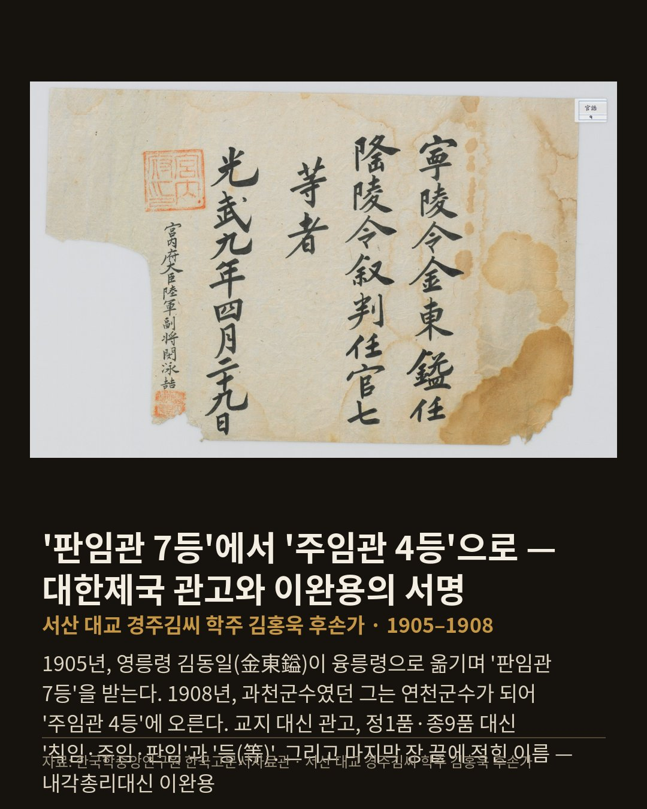
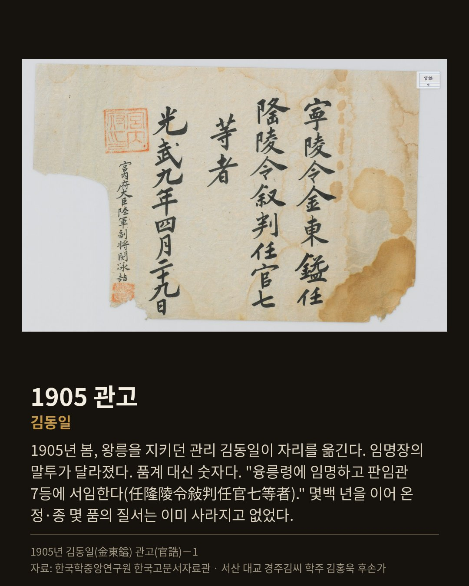
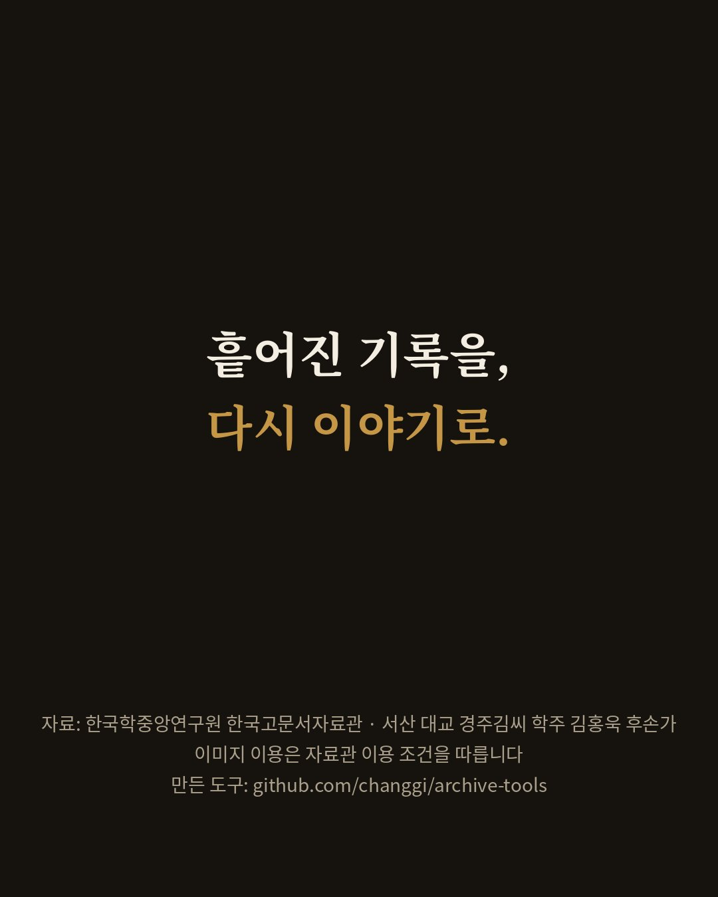

# EP.93 '판임관 7등'에서 '주임관 4등'으로 — 대한제국 관고와 이완용의 서명

서산 대교 경주김씨 학주 김홍욱 후손가 (문중) · 1905년, 영릉령 김동일(金東鎰)이 융릉령으로 옮기며 '판임관 7등'을 받는다. 1908년, 과천군수였던 그는 연천군수가 되어 '주임관 4등'에 오른다. 교지 대신 관고, 정1품·종9품 대신 '칙임·주임·판임'과 '등(等)'. 그리고 마지막 장 끝에 적힌 이름 — 내각총리대신 이완용

- 🌐 [전시 웹페이지](https://changgi.github.io/archive-tools/examples/hakju2/exhibit.html) (한자 위 한글 독음 · 원문 해석) · [수업 활동지](https://changgi.github.io/archive-tools/examples/hakju2/handout.html)
- 🎬 영상: [릴스 9:16](https://changgi.github.io/archive-tools/examples/media/ep93-hakju2_reel.mp4) · [가로 16:9](https://changgi.github.io/archive-tools/examples/media/ep93-hakju2_wide.mp4) · 홍보 글: [`promo.md`](promo.md)
- 카드뉴스: [`cards/`](cards/) · SNS 글: [`sns.txt`](sns.txt) · 판독·해석 표: [`selection.csv`](selection.csv)


<!-- DELIVERY -->
## 전달 에디팅 — 이 기록을 이렇게 전합니다

- **핵심 정서** — 무너짐
- **한 문장** — 나라가 사라지기 직전, 제도는 근대화되었지만 주권은 무너지고 있었다는 것.
- **열기** — 이 임명장 끝에 적힌 이름은 이완용이었습니다.
- **펼치기** — 김동일 관고－1 → 김동일 관고 (1905–1908년) — 품계 대신 숫자로 바뀐 직급을 먼저 보여 주고, 마지막 서명자의 이름으로 무게를 실었습니다.
- **절정** — "내각총리대신 이완용(內閣總理大臣李完用)" — 화면·공간에서 이 한 줄만 크게, 소리를 줄여 집중
- **여운** — 이 임명장을 받은 군수는 서명자의 이름을 보고 어떤 생각을 했을까요? — 질문으로 끝내고 답은 보는 사람에게
- **감각과 물질** — 근대식 관고의 숫자 직급, 마지막 서명 "이완용" 앞에서 조명이 꺼짐 · 어보·관인 탁본 스탬프를 찍어 보는 체험
- **통로와 매개** — 온라인: 릴스(열기) → 카드뉴스(펼치기) → 전시 웹페이지(절정·원문) → 비하인드 카드(여운) / 오프라인: 원본 크기 복제·낭독·참여 벽 / 남기기: 활동지·질문 카드
- **여운 장치** — "2년 뒤 나라가 사라진다면" 질문
- **전달 에디팅 전** — 2건의 문서를 1905–1908년 연대순으로 놓고 문서명 · 유형 · 해설을 붙인다 — 정확하지만, 지나가면 잊힌다.
- **전달 에디팅 후** — 핵심 정서는 「무너짐」. 「이 임명장 끝에 적힌 이름은 이완용이었습니다.」로 열고, 문서를 대비와 순서로 펼친 뒤, "내각총리대신 이완용(內閣總理大臣李完用)"에서 멈춘다. 근대식 관고의 숫자 직급, 마지막 서명 "이완용" 앞에서 조명이 꺼짐. 마지막엔 「"2년 뒤 나라가 사라진다면" 질문」로 보는 사람이 자기 이야기를 남기고 떠나게 한다.

전문: [`delivery.md`](delivery.md)
<!-- /DELIVERY -->

<!-- CURATOR -->
## 비하인드 — 큐레이터 노트

- **왜 이 문서들인가** — 판임관 7등·주임관 4등 같은 대한제국의 새 관료 체계와, 임명장 끝의 '내각총리대신 이완용'이 함께 보였습니다.
- **전하고 싶은 것** — 나라가 사라지기 직전, 제도는 근대화되었지만 주권은 무너지고 있었다는 것.
- **이렇게 보이길 바랐다** — 품계 대신 숫자로 바뀐 직급을 먼저 보여 주고, 마지막 서명자의 이름으로 무게를 실었습니다.
- **이렇게 써 주세요** — 갑오개혁 이후 관제 변화, 국권 상실 과정을 다루는 수업에 쓰세요.
- **만들며 있었던 일** — 1905년 궁내부대신 이름 끝 글자와 1908년 연호 부분은 판독·보충이 필요합니다.
- **남겨 둔 질문** — 이 임명장을 받은 군수는 서명자의 이름을 보고 어떤 생각을 했을까요?
- **제작 기록** — 문서 2건 · 1905–1908년 · 원본 사진 2면(문서 전체) · 원문 판독 2건 · 번역 2건 · 해제에 "확인 필요"를 단 문서 1건

전문: [`curator.md`](curator.md)
<!-- /CURATOR -->

## 이야기 — 사료가 말하는 대로

이 임명장 끝에 적힌 이름은 이완용이었습니다.

> **1905 관고** — 1905년 봄, 왕릉을 지키던 관리 김동일이 자리를 옮긴다. 임명장의 말투가 달라졌다. 품계 대신 숫자다. "융릉령에 임명하고 판임관 7등에 서임한다(任隆陵令敍判任官七等者)." 몇백 년을 이어 온 정·종 몇 품의 질서는 이미 사라지고 없었다.
> **1908 관고** — 세 해 뒤, 그는 연천군수가 된다. 등급은 올랐다. "연천군수에 임명하고 주임관 4등에 서임한다(任漣川郡守敍奏任官四等)." 그런데 문서 끝에 적힌 이름이 무겁다. "내각총리대신 이완용(內閣總理大臣李完用)." 이 임명장으로부터 2년이 채 안 되어, 나라는 사라진다.

| 표지 | 1번 카드 | 마무리 |
|---|---|---|
|  |  |  |

## 선별 문서 (2점)

| # | 연도 | 유형 | 문서명 | 원본 |
|---|---|---|---|---|
| 1 | 1905 | 관고 | 1905년 김동일(金東鎰) 관고(官誥)－1 | [원본 보기](https://archive.aks.ac.kr/viewer/viewer.do#imgnode.do?itemId=book&gubun=booktree&depth=6&upPath=01%5E0144%5EL014433%5EL014433F02%5EL014433F0201&dataId=G002%2BAKS%2BKSM-XA.1905.1111-20101008.B060c_086_00670_XXX&itemType=) |
| 2 | 1908 | 관고 | 1908년 김동일(金東鎰) 관고(官誥) | [원본 보기](https://archive.aks.ac.kr/viewer/viewer.do#imgnode.do?itemId=book&gubun=booktree&depth=6&upPath=01%5E0144%5EL014433%5EL014433F02%5EL014433F0201&dataId=G002%2BAKS%2BKSM-XA.1908.1111-20101008.B060c_086_00674_XXX&itemType=) |

## 원문 판독과 해석

### 1. 1905년 김동일(金東鎰) 관고(官誥)－1

**원문 판독**

```
寧陵令金東鎰任
隆陵令敍判任官七
等者
光武九年四月二十九日
(궁내부 인)
宮內府大臣陸軍副將閔泳喆 誥 [인]
```

**원문 해석** 영릉령 김동일을 융릉령에 임명하고 판임관 7등에 서임한다. 광무 9년(1905) 4월 29일. 궁내부대신 육군부장 민영철 관고. [궁내부 인]

**해제** 1894년 갑오개혁 이후 관료제는 품계(정1품~종9품) 대신 칙임관·주임관·판임관의 등급과 그 안의 '등(等)'으로 바뀌었고, 임명장도 '관고(官誥)'라 불렀습니다. 이 문서는 왕릉 관리 책임자인 능령(陵令)을 영릉(효종릉)에서 융릉(사도세자·혜경궁 능)으로 옮기며 판임관 7등에 서임한 것으로, 왕실 업무를 관장한 궁내부(宮內府) 대신 명의로 발급되었습니다. 궁내부대신의 이름 끝 글자는 판독이 불확실하여 확인이 필요합니다.

### 2. 1908년 김동일(金東鎰) 관고(官誥)

**원문 판독**

```
果川郡守金東鎰
任漣川郡守敍奏任官四等
[隆熙]二年十二月二十一日
(칙명지보 1과)
太子少師大勳內閣總理大臣李完用 宣
```

**원문 해석** 과천군수 김동일을 연천군수에 임명하고 주임관 4등에 서임한다. [융희] 2년(1908) 12월 21일. 태자소사 대훈 내각총리대신 이완용 선(宣, 반포).

**해제** 1908년(융희 2) 과천군수 김동일을 연천군수에 임명하고 주임관 4등에 서임한 관고입니다. 군수는 주임관(奏任官)으로, 총리대신이 상주하여 황제가 임명하는 관직이었습니다. 끝에 '태자소사 대훈 내각총리대신 이완용'이 반포자로 적혀 있습니다. 1907년 고종 강제 퇴위와 정미7조약 이후 통감부의 통제 아래 이완용 내각이 인사를 장악하던 때로, 대한제국의 마지막 관료제 모습을 보여 줍니다. 연호 부분이 떨어져 나가 '隆熙'는 연대와 서식으로 보충했습니다.

판독·해석·이야기는 이미지에 근거한 초안이며(검토 전 "초안" 표시), 정확한 판독은 원문 확인이 필요합니다. □는 읽지 못한 글자, (?)는 불확실한 글자입니다.
이미지: 한국학중앙연구원 한국고문서자료관 소장·제공. "원본" 링크를 누르면 자료관 뷰어에서 그 문서가 열립니다. 재사용은 자료관에 문의하세요(소장처 동의 필요).
