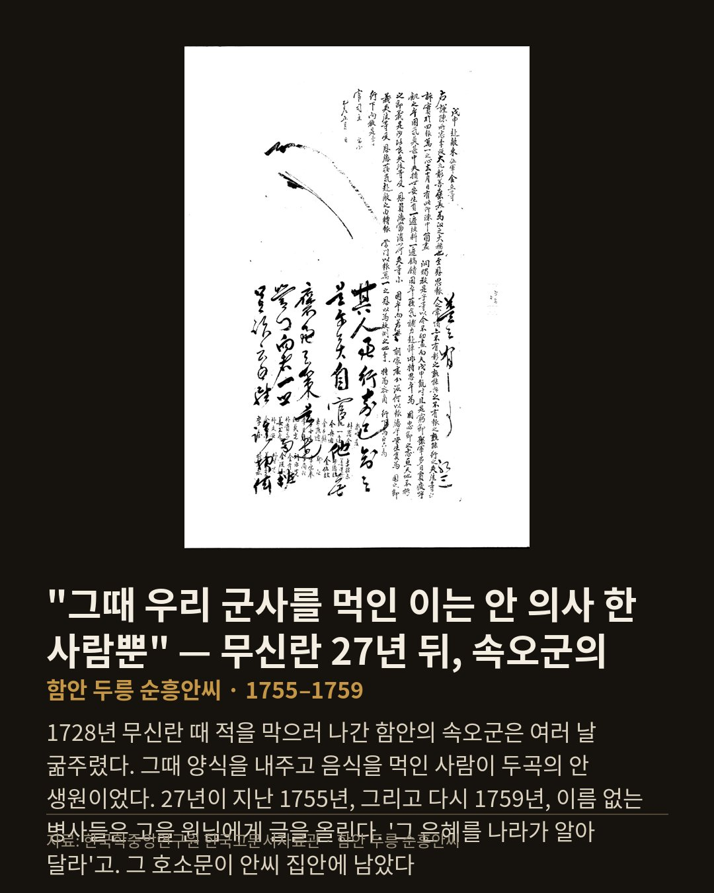
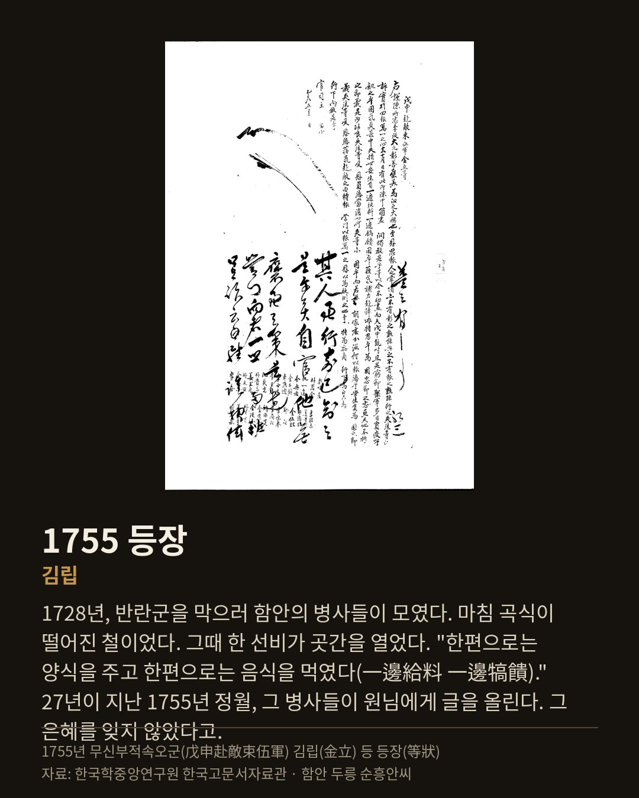
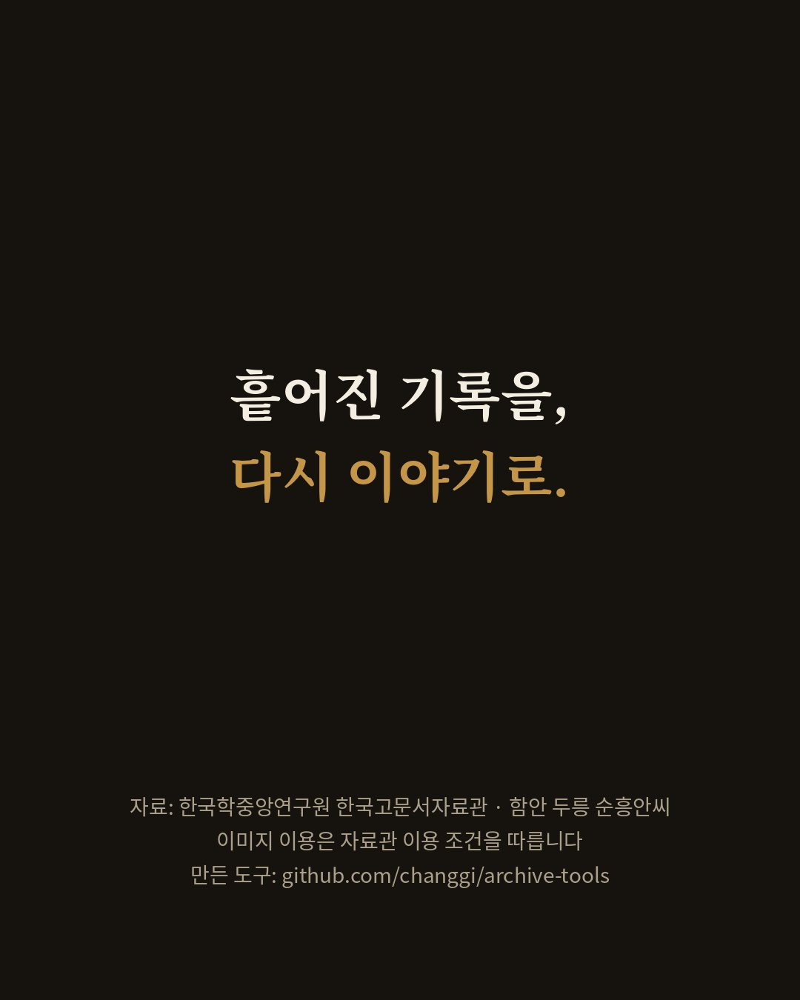

# EP.103 "그때 우리 군사를 먹인 이는 안 의사 한 사람뿐" — 무신란 27년 뒤, 속오군의 호소

함안 두릉 순흥안씨 (문중) · 1728년 무신란 때 적을 막으러 나간 함안의 속오군은 여러 날 굶주렸다. 그때 양식을 내주고 음식을 먹인 사람이 두곡의 안 생원이었다. 27년이 지난 1755년, 그리고 다시 1759년, 이름 없는 병사들은 고을 원님에게 글을 올린다. '그 은혜를 나라가 알아 달라'고. 그 호소문이 안씨 집안에 남았다

- 🌐 [전시 웹페이지](https://changgi.github.io/archive-tools/examples/hamahn-ahn/exhibit.html) (한자 위 한글 독음 · 원문 해석) · [수업 활동지](https://changgi.github.io/archive-tools/examples/hamahn-ahn/handout.html)
- 🎬 영상: [릴스 9:16](https://changgi.github.io/archive-tools-next/media/ep103-hamahn-ahn_reel.mp4) · [가로 16:9](https://changgi.github.io/archive-tools-next/media/ep103-hamahn-ahn_wide.mp4) · 홍보 글: [`promo.md`](promo.md)
- 카드뉴스: [`cards/`](cards/) · SNS 글: [`sns.txt`](sns.txt) · 판독·해석 표: [`selection.csv`](selection.csv)

<!-- DELIVERY -->
## 전달 에디팅 — 이 기록을 이렇게 전합니다

- **핵심 정서** — 고마움
- **한 문장** — 고마움은 오래간다 — 굶주린 날 밥을 준 사람을, 병사들은 30년 가까이 잊지 않았다.
- **열기** — 굶주린 병사들은, 밥을 준 사람을 30년 동안 잊지 않았습니다.
- **펼치기** — 무신부적속오군 김립 등 등장 → 속오군 김천세, 박여달, 이필 등 (1755–1759년) — 1728년의 굶주림 → 1755년 첫 호소의 '一邊給料 一邊犒饋' → 1759년 '안 의사 한 사람뿐'으로, 같은 은혜를 다른 병사들이 다시 말하는 순서로 구성했습니다.
- **절정** — "그때 나라를 위해 우리 군사를 먹인 이는 두곡의 안 의사 한 사람뿐이었습니다(伊時爲國家餉我軍者 杜谷安義士一人而已)" — 화면·공간에서 이 한 줄만 크게, 소리를 줄여 집중
- **여운** — 안 의사는 끝내 나라의 포상을 받았을까요? — 질문으로 끝내고 답은 보는 사람에게
- **감각과 물질** — 굶주린 병사들의 줄과 곳간을 여는 손, 열두 장의 청원서 · 연명한 이름을 벽에 길게 나열하고 관아 마당처럼 서서 읽는 동선
- **통로와 매개** — 온라인: 릴스(열기) → 카드뉴스(펼치기) → 전시 웹페이지(절정·원문) → 비하인드 카드(여운) / 오프라인: 원본 크기 복제·낭독·참여 벽 / 남기기: 활동지·질문 카드
- **여운 장치** — 잊지 못한 한 끼의 고마움을 적어 보기
- **전달 에디팅 전** — 2건의 문서를 1755–1759년 연대순으로 놓고 문서명 · 유형 · 해설을 붙인다 — 정확하지만, 지나가면 잊힌다.
- **전달 에디팅 후** — 핵심 정서는 「고마움」. 「굶주린 병사들은, 밥을 준 사람을 30년 동안 잊지 않았습니다.」로 열고, 문서를 대비와 순서로 펼친 뒤, "그때 나라를 위해 우리 군사를 먹인 이는 두곡의 안 의사 한 사람뿐이었습니다(伊時爲國家餉我軍者 杜谷安義士一人而已)"에서 멈춘다. 굶주린 병사들의 줄과 곳간을 여는 손, 열두 장의 청원서. 마지막엔 「잊지 못한 한 끼의 고마움을 적어 보기」로 보는 사람이 자기 이야기를 남기고 떠나게 한다.

전문: [`delivery.md`](delivery.md)
<!-- /DELIVERY -->

<!-- CURATOR -->
## 비하인드 — 큐레이터 노트

- **왜 이 문서들인가** — 양반 집안의 문서함에, 이름 없는 병사들이 쓴 청원서가 열두 장이나 들어 있었습니다. 받은 사람이 아니라 준 사람의 집에 남은 감사의 기록이었습니다.
- **전하고 싶은 것** — 고마움은 오래간다 — 굶주린 날 밥을 준 사람을, 병사들은 30년 가까이 잊지 않았다.
- **이렇게 보이길 바랐다** — 1728년의 굶주림 → 1755년 첫 호소의 '一邊給料 一邊犒饋' → 1759년 '안 의사 한 사람뿐'으로, 같은 은혜를 다른 병사들이 다시 말하는 순서로 구성했습니다.
- **이렇게 써 주세요** — 무신란(이인좌의 난), 조선 후기 지방군(속오군), 청원 문서(등장 · 소지 · 제사)를 다루는 수업에 쓰세요.
- **만들며 있었던 일** — 두 문서의 아래쪽 큰 흘림(원님의 처분)과 군사들의 이름 일부는 판독이 불확실합니다. 안 생원(안 의사)이 집안의 누구인지는 이 두 장만으로는 확인하지 못했습니다.
- **남겨 둔 질문** — 안 의사는 끝내 나라의 포상을 받았을까요?
- **제작 기록** — 문서 2건 · 1755–1759년 · 원본 사진 2면(문서 전체) · 원문 판독 2건 · 번역 2건 · 못 읽은 글자 □ 0 · 불확실 (?) 16

전문: [`curator.md`](curator.md) · 비하인드 카드: [`behind/`](behind/) · 채널별 홍보안: [`channels.md`](channels.md)
<!-- /CURATOR -->

## 이야기 — 사료가 말하는 대로

굶주린 병사들은, 밥을 준 사람을 30년 동안 잊지 않았습니다.

> **1755 등장** — 1728년, 반란군을 막으러 함안의 병사들이 모였다. 마침 곡식이 떨어진 철이었다. 그때 한 선비가 곳간을 열었다. "한편으로는 양식을 주고 한편으로는 음식을 먹였다(一邊給料 一邊犒饋)." 27년이 지난 1755년 정월, 그 병사들이 원님에게 글을 올린다. 그 은혜를 잊지 않았다고.
> **1759 등장** — 4년 뒤에도 호소는 그치지 않았다. 이번에는 다른 병사들이 이름을 올렸다. "그때 나라를 위해 우리 군사를 먹인 이는 두곡의 안 의사 한 사람뿐이었습니다(伊時爲國家餉我軍者 杜谷安義士一人而已)." 30년이 지나도, 배고팠던 날은 잊히지 않았다.

| 표지 | 1번 카드 | 마무리 |
|---|---|---|
|  |  |  |

## 선별 문서 (2점)

| # | 연도 | 유형 | 문서명 | 원본 |
|---|---|---|---|---|
| 1 | 1755 | 등장 | 1755년 무신부적속오군(戊申赴敵束伍軍) 김립(金立) 등 등장(等狀) | [원본 보기](https://archive.aks.ac.kr/viewer/viewer.do#imgnode.do?itemId=book&gubun=booktree&depth=6&upPath=01%5E0150%5EL015002%5EL015002F02%5EL015002F0202&dataId=G002%2BAKS%2BKSM-XB.1755.4873-20101008.B056a_081_00049_XXX&itemType=) |
| 2 | 1759 | 등장 | 1759년 속오군(束伍軍) 김천세(金千世), 박여달(朴汝達), 이필(李怭) 등 등장(等狀) | [원본 보기](https://archive.aks.ac.kr/viewer/viewer.do#imgnode.do?itemId=book&gubun=booktree&depth=6&upPath=01%5E0150%5EL015002%5EL015002F02%5EL015002F0202&dataId=G002%2BAKS%2BKSM-XB.1759.4873-20101008.B056a_081_00058_XXX&itemType=) |

## 원문 판독과 해석

### 1. 1755년 무신부적속오군(戊申赴敵束伍軍) 김립(金立) 등 등장(等狀)

**원문 판독**

```
戊申赴敵束伍軍金立等
右謹陳所志事段 大凡彰善褒義 爲政之大務也 至(?)恩思報 人之常情 上不有彰之 孰能與之 不有報之 孰能行之矣 徒等(?)…
… 萬一之心 去十月日 有此所陳 … 向(?)夫戊申亂時 且是窮節(?) 聚軍多日 貧疲呼
飢之中 困乏莫甚 中典(?)指出安生員 一邊給料 一邊犒饋 困乏蘇甦(?) 補力赴陣 非特恩爲 國忠節之志 亘天地不朽
之節義 … 朝家褒(?)以從 何以報德乎 安生員爲 國之節
義矣 … 赴敵之由 轉報 營門 以報萬一之恩 以爲激(?)勵之地事 特爲參商(?) 行下爲只爲
行下向敎是事
官司主　處分
乙亥正月　日
(아래 큰 흘림: 원님의 처분(제사) — 其人所行 … 판독 불확실)
(이름: 李謹 · 朴文安 · 朴貴金(?) · 姜玉丁(?) · 金手鶴(?) · 車仍迪(?) · 全興迪(?) 등)
```

**원문 해석** 무신년(1728)에 적을 향해 나갔던 속오군 김립 등. 삼가 아뢰는 일: 무릇 착한 일을 드러내고 의로운 일을 기리는 것은 정치의 큰 일이며, 은혜를 입으면 갚으려 하는 것은 사람의 떳떳한 마음입니다. 위에서 드러내 주지 않으면 누가 하겠으며, 갚지 않으면 누가 행하겠습니까. … 지난 무신년 난리 때는 마침 궁한 철이라 군사를 여러 날 모아 두니, 가난하고 지쳐 굶주림을 호소하는 가운데 곤궁함이 더할 수 없었습니다. 그때 안 생원이 한편으로는 양식을 내주고 한편으로는 음식을 먹여, 기운을 되찾아 힘을 보태 싸움터로 나갈 수 있었습니다. 이는 나라를 위한 충절의 뜻이요 천지와 함께 썩지 않을 절의입니다. … 적을 향해 나간 사연을 감영에 보고하여 만분의 일이라도 은혜를 갚고, 사람들을 격려하는 바탕이 되게 해 주십시오. 원님께서 처분해 주십시오. 을해년(1755) 정월 일.

**해제** 1755년(영조 31, 乙亥) 정월, 1728년(영조 4, 戊申) 무신란(이인좌의 난) 때 적을 막으러 나갔던 함안의 속오군(束伍軍, 양인 · 노비로 꾸린 지방 군대) 김립 등 여러 사람이 고을 원님에게 올린 등장(等狀, 여럿이 함께 올린 청원서)입니다. 난리 때 굶주린 군사들에게 양식과 음식을 대 준 '안 생원'의 공을 감영에 보고해 포상해 달라는 내용으로, 그래서 이 문서가 순흥안씨 집안에 전합니다. 아래 큰 흘림 글씨는 원님의 처분(제사)이고, 맨 아래 작은 글씨는 함께 이름을 올린 군사들입니다. 흘림과 작은 글씨 일부는 판독이 불확실합니다.

### 2. 1759년 속오군(束伍軍) 김천세(金千世), 박여달(朴汝達), 이필(李怭) 등 등장(等狀)

**원문 판독**

```
束伍軍金千世朴汝達李怭等
右謹陳所志情由 … 往者戊申之變 爲臣民所共憤 而伊時爲 國家餉我軍者 杜谷安義士一人而已 則其忠義美跡 至于今烈烈彌光 …
令監主按(?)節之時 … 上下之公論 … 營門 …
令監主激忠成人之德 益復高於安義士 爲 國 … 恩則 …
天門則此莫非 令監主忠義擡排(?)之恩 …
令監主獎勸忠孝之下 更爲馳報于新 使道 …
行下　向敎是事
令監主　處分
己卯正月　日
(왼쪽 큰 흘림: 원님의 처분 — 彰 … 판독 불확실)
```

**원문 해석** 속오군 김천세 · 박여달 · 이필 등. 삼가 아뢰는 사정: … 지난 무신년의 변란은 신하와 백성이 함께 분노한 일이었는데, 그때 나라를 위해 우리 군사를 먹인 이는 두곡의 안 의사 한 사람뿐이었습니다. 그 충의의 아름다운 자취가 지금까지도 빛나고 있습니다. … 원님께서 충성을 북돋우고 사람의 덕을 이루어 주시니, 안 의사의 일이 더욱 높아질 것입니다. … 충효를 장려하시는 가운데, 새로 오신 감사께도 다시 급히 보고해 주십시오. 원님께서 처분해 주십시오. 기묘년(1759) 정월 일.

**해제** 1759년(영조 35, 己卯) 정월, 속오군 김천세 · 박여달 · 이필 등이 다시 올린 등장입니다. 1755년 김립 등의 등장에 이어, 1754년부터 1759년까지 여러 차례 같은 호소가 이어졌습니다(이 집안 문서에 속오군 등장 · 의송이 12건 전함). '伊時爲國家餉我軍者 杜谷安義士一人而已'라 하여, 1755년의 '안 생원'을 이제 '두곡(杜谷)의 안 의사(義士)'라 부릅니다. 새로 부임한 감사에게 다시 보고해 달라는 대목에서, 포상을 받기까지 수령과 감사가 바뀌는 동안 호소가 거듭되었음을 알 수 있습니다. 흘림인 처분(제사)과 일부 글자는 판독이 불확실합니다.

판독·해석·이야기는 이미지에 근거한 초안이며(검토 전 "초안" 표시), 정확한 판독은 원문 확인이 필요합니다. □는 읽지 못한 글자, (?)는 불확실한 글자입니다.
이미지: 한국학중앙연구원 한국고문서자료관 소장·제공. "원본" 링크를 누르면 자료관 뷰어에서 그 문서가 열립니다. 재사용은 자료관에 문의하세요(소장처 동의 필요).
