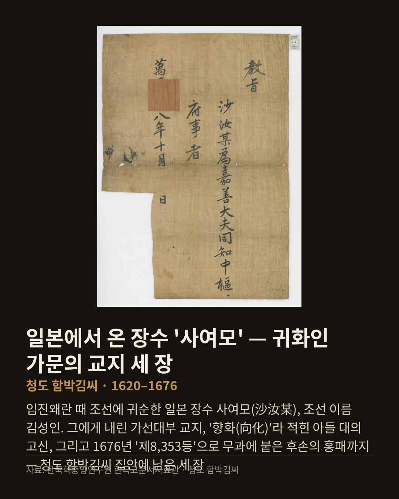
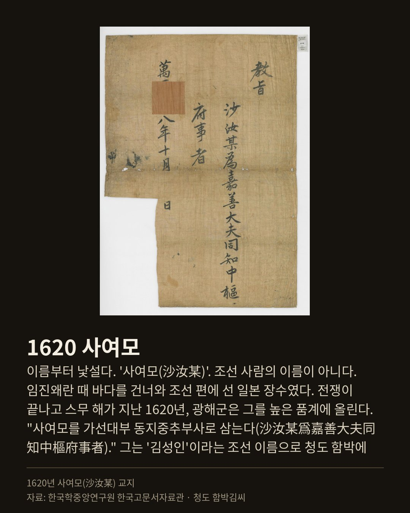
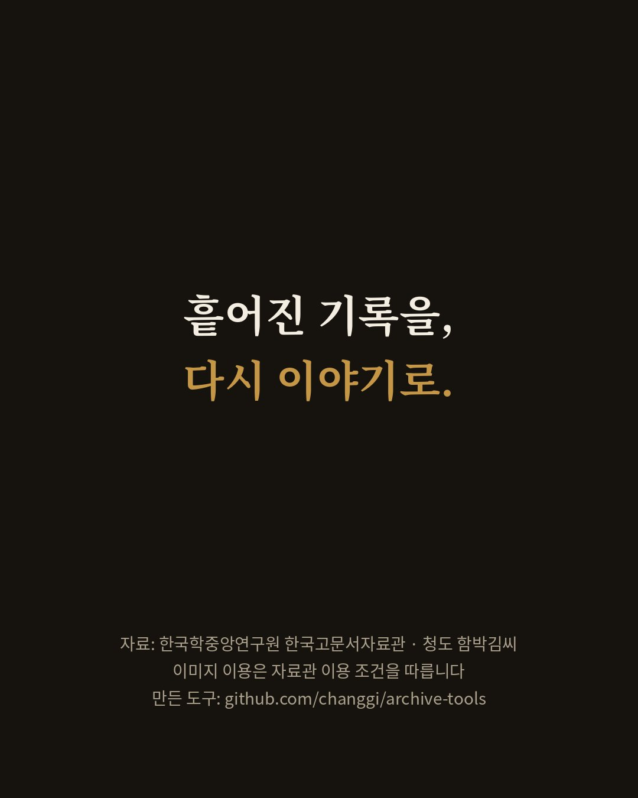

# EP.73 일본에서 온 장수 '사여모' — 귀화인 가문의 교지 세 장

청도 함박김씨 (문중) · 임진왜란 때 조선에 귀순한 일본 장수 사여모(沙汝某), 조선 이름 김성인. 그에게 내린 가선대부 교지, '향화(向化)'라 적힌 아들 대의 고신, 그리고 1676년 '제8,353등'으로 무과에 붙은 후손의 홍패까지 — 청도 함박김씨 집안에 남은 세 장

- 🌐 [전시 웹페이지](https://changgi.github.io/archive-tools/examples/hambak-kim/exhibit.html) (한자 위 한글 독음 · 원문 해석) · [수업 활동지](https://changgi.github.io/archive-tools/examples/hambak-kim/handout.html)
- 🎬 영상: [릴스 9:16](https://changgi.github.io/archive-tools/examples/media/ep73-hambak-kim_reel.mp4) · [가로 16:9](https://changgi.github.io/archive-tools/examples/media/ep73-hambak-kim_wide.mp4) · 홍보 글: [`promo.md`](promo.md)
- 카드뉴스: [`cards/`](cards/) · SNS 글: [`sns.txt`](sns.txt) · 판독·해석 표: [`selection.csv`](selection.csv)


<!-- DELIVERY -->
## 전달 에디팅 — 이 기록을 이렇게 전합니다

- **핵심 정서** — 경계를 넘음
- **한 문장** — 조선은 귀화인의 출신을 지우지 않고 적어 두었고, 그 후손은 조선 사람으로 살아갔다는 것.
- **열기** — 이 사람의 이름은 '사여모'. 조선 사람이 아니었습니다.
- **펼치기** — 사여모 교지 → 김계수 교지 → 김흥발 무과 홍패 (1620–1676년) — 낯선 이름 '사여모' → '향화'라는 한 단어 → 만 명 넘게 뽑힌 무과의 합격증으로 3대를 이었습니다.
- **절정** — "향화 김계수(向化金戒守)" — 화면·공간에서 이 한 줄만 크게, 소리를 줄여 집중
- **여운** — 고향을 떠나 이 땅에 남은 사람에게 '향화'라는 이름은 어떻게 들렸을까요? — 질문으로 끝내고 답은 보는 사람에게
- **감각과 물질** — 바다 소리에서 시작해 "향화" 한 글자만 크게, 무과 8,353등 숫자를 바닥에 · 붉은 종이를 실물 크기로 복제해 벽에 거는 연출
- **통로와 매개** — 온라인: 릴스(열기) → 카드뉴스(펼치기) → 전시 웹페이지(절정·원문) → 비하인드 카드(여운) / 오프라인: 원본 크기 복제·낭독·참여 벽 / 남기기: 활동지·질문 카드
- **여운 장치** — "내가 떠나온 곳, 뿌리내린 곳" 지도
- **전달 에디팅 전** — 3건의 문서를 1620–1676년 연대순으로 놓고 문서명 · 유형 · 해설을 붙인다 — 정확하지만, 지나가면 잊힌다.
- **전달 에디팅 후** — 핵심 정서는 「경계를 넘음」. 「이 사람의 이름은 '사여모'. 조선 사람이 아니었습니다.」로 열고, 문서를 대비와 순서로 펼친 뒤, "향화 김계수(向化金戒守)"에서 멈춘다. 바다 소리에서 시작해 "향화" 한 글자만 크게, 무과 8,353등 숫자를 바닥에. 마지막엔 「"내가 떠나온 곳, 뿌리내린 곳" 지도」로 보는 사람이 자기 이야기를 남기고 떠나게 한다.

전문: [`delivery.md`](delivery.md)
<!-- /DELIVERY -->

<!-- CURATOR -->
## 비하인드 — 큐레이터 노트

- **왜 이 문서들인가** — 임진왜란 때 귀순한 일본 장수 사여모(김성인) 집안의 문서에 '향화(向化)'라는 말이 실제로 적혀 있었습니다.
- **전하고 싶은 것** — 조선은 귀화인의 출신을 지우지 않고 적어 두었고, 그 후손은 조선 사람으로 살아갔다는 것.
- **이렇게 보이길 바랐다** — 낯선 이름 '사여모' → '향화'라는 한 단어 → 만 명 넘게 뽑힌 무과의 합격증으로 3대를 이었습니다.
- **이렇게 써 주세요** — 이주와 다문화의 역사, 임진왜란의 다른 얼굴을 다루는 수업과 전시에 쓰세요.
- **만들며 있었던 일** — 1620년 교지의 연호 일부는 덧댄 종이에 가려 문맥으로 보충했습니다. '만과' 합격 인원은 연구마다 달라 확인이 필요합니다.
- **남겨 둔 질문** — 고향을 떠나 이 땅에 남은 사람에게 '향화'라는 이름은 어떻게 들렸을까요?
- **제작 기록** — 문서 3건 · 1620–1676년 · 원본 사진 7면(문서 전체) · 원문 판독 3건 · 번역 3건 · 해제에 "확인 필요"를 단 문서 1건

전문: [`curator.md`](curator.md)
<!-- /CURATOR -->

## 이야기 — 사료가 말하는 대로

이 사람의 이름은 '사여모'. 조선 사람이 아니었습니다.

> **1620 사여모** — 이름부터 낯설다. '사여모(沙汝某)'. 조선 사람의 이름이 아니다. 임진왜란 때 바다를 건너와 조선 편에 선 일본 장수였다. 전쟁이 끝나고 스무 해가 지난 1620년, 광해군은 그를 높은 품계에 올린다. "사여모를 가선대부 동지중추부사로 삼는다(沙汝某爲嘉善大夫同知中樞府事者)." 그는 '김성인'이라는 조선 이름으로 청도 함박에 뿌리를 내렸다.
> **1621 김계수** — 이듬해 같은 집안에 또 한 장의 임명장이 온다. 병조는 김계수를 훈련원의 무관으로 삼았다. 그런데 문서 한쪽에 작은 글씨가 있다. "향화 김계수(向化金戒守)". 향화, 조선의 교화를 따라 귀화해 온 사람이라는 뜻이다. 나라는 그의 출신을 지우지 않고 적어 두었다.
> **1676 홍패** — 그리고 반세기 뒤, 손자 대의 김흥발이 무과에 합격한다. 등수를 보면 눈을 의심하게 된다. "무과 병과 제8,353인으로 급제 출신(武科丙科第八千三百五十三人及第出身者)." 1676년, 북벌을 꿈꾸던 조정이 군사를 만 명 넘게 뽑은 '만과'였다. 바다 건너온 장수의 후손은 그렇게 조선의 무관 명단에 이름을 올렸다.

| 표지 | 1번 카드 | 마무리 |
|---|---|---|
|  |  |  |

## 선별 문서 (3점)

| # | 연도 | 유형 | 문서명 | 원본 |
|---|---|---|---|---|
| 1 | 1620 | 사여모 | 1620년 사여모(沙汝某) 교지 | [원본 보기](https://archive.aks.ac.kr/viewer/viewer.do#imgnode.do?itemId=book&gubun=booktree&depth=6&upPath=01%5E0167%5EL016774%5EL016774F02%5EL016774F0201&dataId=G002%2BAKS%2BKSM-XA.1620.4782-20240213.F16702-01-W000002&itemType=) |
| 2 | 1621 | 김계수 | 1621년 김계수(金戒守) 교지 | [원본 보기](https://archive.aks.ac.kr/viewer/viewer.do#imgnode.do?itemId=book&gubun=booktree&depth=6&upPath=01%5E0167%5EL016774%5EL016774F02%5EL016774F0201&dataId=G002%2BAKS%2BKSM-XA.1621.4782-20240213.F16702-01-W000003&itemType=) |
| 3 | 1676 | 홍패 | 1676년 김흥발(金興發) 무과 홍패(武科紅牌) | [원본 보기](https://archive.aks.ac.kr/viewer/viewer.do#imgnode.do?itemId=book&gubun=booktree&depth=6&upPath=01%5E0167%5EL016774%5EL016774F02%5EL016774F0201&dataId=G002%2BAKS%2BKSM-XA.1676.4782-20240213.F16702-01-W000001&itemType=) |

## 원문 판독과 해석

### 1. 1620년 사여모(沙汝某) 교지

**원문 판독**

```
敎旨
沙汝某爲嘉善大夫同知中樞
府事者
萬曆[四十]八年十月
日
(연호 아래 어보(御寶) 자리에 후대에 덧댄 종이가 붙어 있음)
```

**원문 해석** 교지. 사여모를 가선대부 동지중추부사로 삼는다. 만력 48년(1620) 10월 일.

**해제** 임진왜란 때 조선에 귀순한 일본 장수 사여모(沙汝某, 조선 이름 김성인 金誠仁)에게 종2품 가선대부 동지중추부사를 내린 교지입니다. 이름 '沙汝某'는 일본식 이름을 한자로 옮긴 것으로 보이며, 같은 문서군에 '김성인 교지'가 함께 전합니다. 청도 함박김씨는 그를 시조로 삼는 가문으로 알려져 있습니다. 동지중추부사는 실무가 없는 중추부의 명예직이어서, 공을 세운 귀화인에게 품계로 예우한 것입니다. 연호 '四十' 부분은 덧댄 종이에 가려 문맥으로 보충했습니다.

### 2. 1621년 김계수(金戒守) 교지

**원문 판독**

```
兵曹天[啓元]年五
月初六日
奉
敎 判官金戒守爲
顯信校尉守訓
鍊院僉正者
天啓元年五月　日
(좌측 소자) 向化金戒守
判書　參判 臣 … 參議 …
(병조 관인 1과)
```

**원문 해석** 병조에서 천계 원년(1621) 5월 초6일 왕명을 받들어, 판관 김계수를 현신교위 수훈련원첨정으로 삼는다. 천계 원년 5월 일. (옆에 작게) 향화인 김계수. 판서·참판·참의 [서명].

**해제** 1621년(광해군 13) 병조가 왕명을 받들어 김계수(金戒守)를 종4품 무관 현신교위 수훈련원첨정에 임명한 고신(사령장)입니다. 왼쪽에 작은 글씨로 '향화(向化) 김계수'라고 적혀 있는데, '향화'는 조선에 귀화한 외국인을 부르던 말입니다. 함박김씨 집안의 귀화인 출신을 문서 자체가 증언하는 셈입니다. 종이 위·오른쪽이 크게 떨어져 나갔으나 핵심 글자는 남아 있습니다.

### 3. 1676년 김흥발(金興發) 무과 홍패(武科紅牌)

**원문 판독**

```
敎旨
別隊金興發武科丙科第八千
三百五十三人及第出身者
康熙十五年三月二十一日
(좌측 아래 소자 '家傳'?)
```

**원문 해석** 교지. 별대 김흥발을 무과 병과 제8,353인으로 급제 출신시킨다. 강희 15년(1676) 3월 21일.

**해제** 1676년(숙종 2) 무과에 급제한 별대(別隊) 소속 군사 김흥발(金興發)의 홍패(합격증)입니다. 등수가 '병과 제8,353인'인데, 이 해 정시(庭試) 무과는 북벌을 준비하며 군사를 대거 뽑은 이른바 '만과(萬科)'로, 1만 7천여 명이 합격했다고 알려져 있습니다. 귀화인 가문의 후손이 반세기 뒤 조선의 무과 급제자가 되었음을 보여 줍니다. 합격 인원 수치는 연구에 따라 차이가 있어 확인이 필요합니다.

판독·해석·이야기는 이미지에 근거한 초안이며(검토 전 "초안" 표시), 정확한 판독은 원문 확인이 필요합니다. □는 읽지 못한 글자, (?)는 불확실한 글자입니다.
이미지: 한국학중앙연구원 한국고문서자료관 소장·제공. "원본" 링크를 누르면 자료관 뷰어에서 그 문서가 열립니다. 재사용은 자료관에 문의하세요(소장처 동의 필요).
